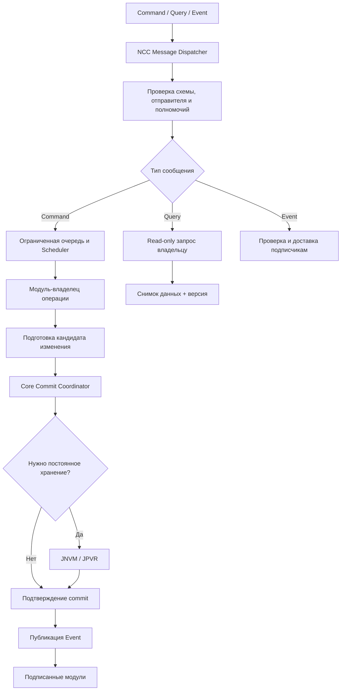

# JARVIS ANS-100 Alpha — архитектура и журнал решений

**Статус документа:** рабочая спецификация и журнал согласованных проектных решений  
**Дата последнего обновления:** 7 ноября 2026 года  
**Репозиторий:** `maksrugu123-sys/jarvis-ans100-alpha` (Private)  
**Основная ветка:** `main`

> Этот документ фиксирует идеи и решения, обсуждённые до начала реализации. Он не означает, что описанные механизмы уже написаны, собраны или проверены. Все показатели производительности и объёмы памяти должны быть измерены экспериментально.

---

## 1. Назначение проекта

**JARVIS ANS-100 Alpha** (Adaptive Neural System) — исследовательский проект компактной адаптивной нейросистемы.

Исходная цель — начать с одного небольшого искусственного нейрона, исследовать его состояние, связи, обучение и потребление памяти, а затем постепенно проверить масштабирование до 10, 100, 1 000 и большего числа нейронов.

Основные намерения:

- локальная работа без обязательного подключения к интернету;
- небольшие и экономно хранящиеся нейроны;
- адаптивное изменение синаптических связей;
- обучение на опыте, обратной связи и обнаруженных закономерностях;
- гибридная память нейронов и всей сети;
- собственная система виртуальной памяти для работы с объёмом данных, превышающим доступную физическую RAM;
- измеряемая, поэтапная разработка без преждевременных обещаний о производительности.

**Начальный бюджет RAM и бюджет проекта пока не определены.** Не считать ранее обсуждавшиеся значения окончательными ограничениями.

## 2. Принципы разработки

1. Сначала исследовать и проектировать, затем программировать.
2. Начинать с одного нейрона и измерений, а не сразу создавать большую сеть.
3. Разделять логическую доступность нейрона и его фактическую вычислительную активность.
4. Не считать накопитель эквивалентом физической RAM: CPU должен получить необходимые данные в RAM, чтобы выполнять вычисления.
5. Не удалять важные воспоминания и обученные связи только из-за длительного отсутствия обращений.
6. Не считать гипотезы о скорости, размере и масштабировании доказанными до тестов.
7. Сохранять решения и открытые вопросы в этом документе по мере развития проекта.

## 3. Искусственный нейрон

### 3.1. Предварительная модель

В качестве кандидата для первого эксперимента рассматривалась модель **Leaky Integrate-and-Fire (LIF)**:

- получает входящие сигналы;
- накапливает мембранный потенциал;
- постепенно уменьшает потенциал за счёт утечки;
- при достижении порога выдаёт импульс;
- после импульса может проходить период восстановления.

Это пока кандидат для сравнения, а не окончательно утверждённая модель.

Планируемые параметры для исследования:

- мембранный потенциал;
- порог активации;
- коэффициент утечки;
- период восстановления;
- счётчик импульсов;
- адаптивный порог.

Нужно сравнить LIF с более простым пороговым нейроном по сложности, скорости, памяти и качеству поведения.

### 3.2. Обучение и изменение связей

Рассматриваемые механизмы:

- **STDP** — изменение силы связи с учётом временного соотношения импульсов;
- **Reward-Modulated STDP** — дополнительная коррекция с учётом сигнала обратной связи;
- укрепление и ослабление связей;
- создание и удаление связей;
- нормализация и ограничения весов для устойчивости;
- разреженные связи: не каждый нейрон обязан быть связан со всеми остальными.

Совместная активация сама по себе не гарантирует полезность связи. Нужны критерии обратной связи, проверки устойчивых закономерностей и защиты от случайного шума.

### 3.3. Predictability Feedback

Обсуждалась идея обратной связи, вдохновлённая экспериментами с нейронными культурами и Pong:

- успешное действие может сопровождаться предсказуемой обратной связью;
- ошибка может сопровождаться менее предсказуемой обратной связью;
- сеть может учиться находить действия и закономерности, которые улучшают результат.

Для искусственной системы это будет собственный вычислительный механизм обратной связи, а не точная копия биологического эксперимента. Нельзя трактовать такой механизм как доказательство сознания или буквального переживания эмоций.

### 3.4. Predictive Surprise — обнаружение неожиданностей

Пользователь согласился включить в концепцию механизм удивления/неожиданности:

1. нейрон формирует прогноз;
2. получает фактический результат;
3. оценивает ошибку прогноза;
4. при существенном расхождении временно повышает внимание к сигналу;
5. проверяет, является ли событие шумом или частью устойчивой новой закономерности;
6. при подтверждении адаптирует соответствующие связи.

Для числового прогноза возможна базовая оценка ошибки:

**E = |фактическое значение − ожидаемое значение|**

Для вероятностных прогнозов потребуется подходящая вероятностная метрика. Повторяющиеся знакомые события могут со временем снижать реакцию (habituation).

Не следует автоматически усиливать все связи после каждого неожиданного события. Единичный шум нужно отличать от устойчивого изменения.

Предлагаемые внутренние показатели: Prediction, Surprise, Familiarity, Attention и Adaptation. Это инженерные переменные, а не утверждение о субъективных переживаниях.

### 3.5. Предварительные компоненты нейрона

В качестве схемы для дальнейшего проектирования обсуждались:

1. входной модуль;
2. синаптический модуль;
3. ядро нейрона;
4. механизм неожиданности;
5. механизм предсказания;
6. обучение и локальная память;
7. выходной модуль.

Окончательный состав, интерфейсы и формат состояния ещё предстоит определить.

### 3.6. Согласованные решения по архитектуре первого нейрона (7 ноября 2026)

Пользователь выбрал вариант C в десяти последовательных архитектурных вопросах. Эти решения фиксируют направление проектирования, но ещё не являются реализованным или экспериментально проверенным кодом.

| № | Область | Согласованное решение |
|---|---|---|
| 1 | Общая архитектура | Собственный гибридный нейрон с отдельными входным, синаптическим, вычислительным, адаптивным, обучающим/памятным и выходным компонентами |
| 2 | Адаптация чувствительности | Полная адаптация с учётом активности, неожиданности, опыта, полезности сигналов и обратной связи |
| 3 | Активация | Динамический порог, учитывающий потенциал, неожиданность, опыт, активность и обратную связь |
| 4 | Выходной сигнал | Адаптивный импульс: сила, длительность и частота зависят от состояния нейрона и ситуации |
| 5 | Усталость и восстановление | Адаптивное утомление при нагрузке и восстановление во время отдыха; необходимы ограничения, чтобы нейрон не истощался полностью |
| 6 | Забывание | Адаптивное забывание с учётом возраста, частоты использования, полезности и важности; защита значимых воспоминаний и обученных связей |
| 7 | Обучение | Гибридное обучение: STDP, Reward-Modulated STDP, ошибка прогноза, обратная связь и адаптация связей |
| 8 | Связи с другими нейронами | Адаптивное создание, укрепление, ослабление и удаление связей с ограничениями для предотвращения хаоса и чрезмерного роста |
| 9 | Обработка входящих сигналов | Адаптивная обработка: приоритет важных и срочных сигналов, очередь для ожидающих сигналов и параллельная обработка независимых операций при наличии ресурсов |
| 10 | Самоконтроль и саморегуляция | Полная адаптивная саморегуляция: мониторинг состояния и ресурсов, обнаружение нестабильности, регулировка нагрузки, контроль памяти и связей, безопасный режим и адаптивная частота проверок |

Все десять предварительных архитектурных решений согласованы. Это не означает, что нейрон готов на 100%: число отражает только количество выбранных направлений, а не процент реализации. Следующие этапы — согласование внутреннего состояния, проверка совместимости компонентов, определение алгоритмов и параметров, а затем реализация и измерение прототипа одного нейрона.

### 3.7. JARVIS Neural Core State — единое внутреннее состояние

**Neural Core State** — согласованный набор текущих параметров, через который компоненты нейрона обмениваются сведениями о его состоянии. Выбрана **C — гибридная структура**:

- компактное основное состояние и параметры, нужные для текущих вычислений, находятся в RAM;
- объёмные данные воспоминаний и подробные записи синаптических связей хранятся в отдельных структурах;
- основное состояние содержит необходимые сводки, идентификаторы/ссылки и метаданные для доступа к этим структурам;
- JNVM/JPVR управляет постоянным хранением и загрузкой нужных данных; наличие логической ссылки не означает, что данные уже находятся в RAM.

Предварительно состояние разделено на семь логических групп:

1. **Физиологическое состояние:** Neural Potential, Activity Level, Fatigue, Recovery.
2. **Когнитивное и предсказательное состояние:** Prediction, Surprise, Attention, Familiarity.
3. **Адаптивное состояние:** Sensitivity, Activation Threshold, Adaptation Rate.
4. **Состояние связей:** Connection Count, сводная Connection Strength, Plasticity, Structural Stability. Подробные записи отдельных связей находятся во внешнем хранилище связей.
5. **Состояние памяти:** показатели кратковременной и долговременной памяти, Memory Importance, Memory Integrity и ссылки на записи. Сами объёмные воспоминания не встраиваются целиком в основной объект.
6. **Самоконтроль:** Stability, Resource Usage, Error State, Recovery Mode.
7. **Временное состояние:** Last Activation, Last Learning, Last Recovery, Update Counter и необходимые временные метки.

Это логические группы для дальнейшего проектирования, а не утверждённый список полей структуры или окончательные типы данных. В частности, ещё предстоит определить единицы измерения, диапазоны, типы чисел и правила синхронизации.

### 3.8. Адаптивное обновление Neural Core State

Выбран вариант **C — адаптивное обновление**:

- после критического события нужные параметры обновляются немедленно;
- после обычного сигнала обновляются прежде всего затронутые параметры, а не всё состояние без необходимости;
- при высокой нагрузке некритические обновления могут объединяться или откладываться;
- во время низкой активности выполняются отложенное обслуживание и плановые проверки;
- при ошибке или подозрении на повреждение запускается внеочередная проверка затронутых данных.

Экономия ресурсов не должна задерживать критическое обновление, обработку срочного сигнала или фиксацию данных, необходимых для безопасного восстановления. Конкретные триггеры, интервалы, приоритеты и пределы объединения обновлений пока не определены.

### 3.9. Адаптивная точность числовых параметров

Выбран вариант **C — адаптивная точность хранения**:

- для критичных параметров применяется представление с точностью, достаточной для устойчивых вычислений;
- для обычных параметров используется стандартная точность;
- для второстепенных или допускающих приближение данных может применяться более компактное представление;
- во время обучения точность может повышаться, если это необходимо для сохранения значимых малых изменений;
- преобразование между форматами должно контролироваться по ошибке округления и влиянию на поведение нейрона.

Пока не выбраны конкретные числовые типы, разрядность, пороги переключения точности и допустимая погрешность. Нельзя автоматически снижать точность защищённых или чувствительных параметров без проверки последствий.

### 3.10. Предварительная схема взаимодействия компонентов

Для уменьшения конфликтов между компонентами предлагается разделить работу на три координируемых контура:

- **Быстрый нейронный цикл:** получение и приоритизация сигнала, прогноз, оценка неожиданности, вычисление активации и формирование выходного сигнала. Обновляются только необходимые для этого цикла параметры.
- **Медленный адаптационный цикл:** изменение чувствительности и порога, усталость и восстановление, обучение, забывание, обслуживание памяти и перестройка связей.
- **Контур саморегуляции:** контролирует стабильность, нагрузку, ошибки, целостность и безопасные границы; выбирает частоту проверок и при необходимости ограничивает работу других контуров.

Это предварительная архитектурная схема. Точный порядок операций, синхронизация и разрешение конфликтов ещё требуют проектирования и тестирования.

Основные риски, которые необходимо проверить экспериментально:

- самоподдерживающееся усиление активности — нужны ограничители и устойчивые правила восстановления;
- обучение на единичном шумовом событии — неожиданность сама по себе не должна немедленно усиливать все связи;
- конфликт обучения и забывания — важные воспоминания и связи должны быть защищены, а изменения согласованы;
- чрезмерные расходы на самоконтроль — мониторинг должен иметь собственные ресурсные пределы;
- длительное ожидание сигналов низкого приоритета — требуется проверить защиту очереди от голодания.

Пока это список рисков и проектных мер, а не доказательство отсутствия проблем.

### 3.11. Дополнительные согласованные решения Neural Core State (7 ноября 2026)

Продолжение десяти решений по внутреннему состоянию. Для всех пунктов выбран вариант C — гибридный или адаптивный подход:

| № | Область | Согласованное решение |
|---|---|---|
| 4 | Восстановление повреждённого состояния | Гибридное восстановление: обнаружить повреждение проверкой целостности; по возможности восстановить только повреждённую часть из журнала и резервных копий; если локальное восстановление невозможно — вернуться к последнему целостному состоянию; перед продолжением проверить нейрон. Контрольная сумма обнаруживает повреждение, но сама его не исправляет. |
| 5 | Проверка согласованности | Адаптивные проверки после критических изменений, подозрительных событий и периодически во время обслуживания; при обнаружении ошибок частота проверок повышается. |
| 6 | История изменений | Гибридная история: актуальное состояние, журнал важных изменений и периодические контрольные снимки; устаревшие записи можно объединять или очищать безопасным способом. |
| 7 | Одновременные изменения | Критические изменения обрабатываются последовательно; независимые операции могут выполняться параллельно; перед сохранением проверяется согласованность; конфликты разрешает контроллер; незавершённые изменения не считаются подтверждённым состоянием. |
| 8 | Приоритеты компонентов | Адаптивные приоритеты: целостность и восстановление становятся высшими при ошибках; далее учитываются важные и срочные сигналы; обучение и обслуживание планируются с учётом нагрузки; низкоприоритетные задачи не должны голодать бесконечно. |
| 9 | Нехватка RAM | Адаптивно определять необходимые данные; критические данные сохранять в RAM; подходящие неактивные данные выгружать в JPVR; при необходимости использовать сжатие; при сохраняющемся дефиците ограничивать новые задачи. RAM освобождать только после подтверждённой записи. |
| 10 | Автономность и перезапуск | При запуске загрузить последнее целостное состояние, проверить согласованность, восстановить подтверждённые изменения из журнала, сначала загрузить необходимые компоненты, остальные — по запросу; при серьёзной ошибке перейти в безопасный режим. |

### 3.12. JARVIS Neural Core State Engine

**Neural Core State Engine** — управляющая подсистема, координирующая жизненный цикл внутреннего состояния и работу специализированных модулей. Выбрана гибридная архитектура: центральный контроллер координирует систему, а специализированные модули отвечают за свои области.

Согласованные решения по Engine (7 ноября 2026):

| № | Область | Согласованное решение |
|---|---|---|
| 1 | Архитектура Engine | C — гибрид: центральный контроллер координирует работу, специализированные модули управляют своими компонентами. |
| 2 | Взаимодействие модулей | C — обмен через центральный контроллер с ограниченными прямыми связями там, где они явно разрешены архитектурой. |
| 3 | Обработка ошибок | C — изолировать сбойный модуль и пытаться восстановить его, не останавливая всю систему без необходимости. |
| 4 | Запуск модулей | C — адаптивно запускать модули по необходимости и приоритету, а не безусловно активировать всё сразу. |
| 5 | Контроль ресурсов | C — адаптивно управлять лимитами и бюджетами RAM, CPU и накопителя. |
| 6 | Обновление Engine | C — адаптивно обновлять компоненты по необходимости, предварительно проверяя совместимость. |
| 7 | Защита Engine | C — адаптивная защита с усилением проверок при подозрительных событиях. |
| 8 | Масштабирование | C — адаптивно добавлять или активировать модули с учётом доступных ресурсов и текущей нагрузки. |
| 9 | Журналирование | C — адаптивный журнал: важные события записывать подробно, обычные — кратко. |

Решение №10 по автономности Engine — **C, согласовано**: Engine самостоятельно управляет обычными задачами, а критические решения остаются под контролем центральной системы. Граница полномочий, перечень критических операций, правила эскалации и безопасное поведение при недоступности центрального контроллера ещё должны быть формализованы и протестированы.

Эти решения описывают проектируемое поведение. Они не означают, что Engine уже реализован, что модули действительно изолируются или восстанавливаются, либо что система проверена под нагрузкой. Перед реализацией потребуется определить интерфейсы модулей, модель ошибок, права контроллера, тайм-ауты, правила отката и тесты отказоустойчивости.

### 3.13. JARVIS Neural Core Controller — предварительная архитектура

**Статус:** архитектурное предложение, выбранное главным архитекторским решением 7 ноября 2026 года. Это спецификация для дальнейшего обсуждения и прототипирования, а не реализованный компонент.

#### 3.13.1. Назначение и границы

**Neural Core Controller (NCC)** — главный координатор внутри Neural Core State Engine. Он принимает команды и события, проверяет полномочия, распределяет задачи между специализированными модулями, контролирует ресурсы и подтверждает изменения общего состояния.

NCC не должен самостоятельно выполнять работу всех модулей:
- не рассчитывает синаптические веса вместо Learning Manager;
- не реализует алгоритм нейрона вместо Neural Computation;
- не управляет физическими страницами JPVR вместо JNVM/JPVR;
- не отменяет проверки целостности ради скорости;
- не получает права на критические операции только потому, что является главным координатором Engine.

Нужно различать NCC и центральную систему JARVIS, упомянутую в решении об автономности Engine. NCC действует в пределах делегированных полномочий. Центральная система задаёт политику и подтверждает операции, для которых требуется более высокий уровень разрешения. Точный интерфейс между ними остаётся открытым.

#### 3.13.2. Выбранная базовая архитектура

Для первой реализации выбирается **модульный монолит с циклом обработки событий и единственным координатором подтверждения изменений общего состояния (single-writer commit)**.

Причины выбора:
- на первом этапе исследуется один нейрон, поэтому микросервисы и распределённые процессы добавили бы ненужную сложность;
- модули можно разрабатывать и тестировать раздельно, сохраняя единый процесс и чёткие интерфейсы;
- один координатор подтверждения упрощает обнаружение конфликтов и контроль согласованности;
- независимые вычисления можно будет распараллелить позже, не разрешая нескольким задачам одновременно бесконтрольно менять общее состояние.

Термин «детерминированный цикл» здесь означает контролируемый порядок принятия и подтверждения событий. Он сам по себе не гарантирует полностью детерминированные результаты всех вычислений: это зависит также от алгоритмов, потоков, числовых операций и оборудования.

#### 3.13.3. Компоненты NCC

| Компонент | Обязанность |
|---|---|
| Command Validator | Проверка формата, обязательных полей, версии и допустимости команды |
| Permission & Safety Gate | Проверка полномочий, класса риска и ограничений операции |
| Bounded Priority Queue | Очередь ограниченного размера с приоритетами и обратным давлением при перегрузке |
| Core Dispatcher | Выбор следующего допустимого задания и передача его нужному модулю |
| Module Registry | Реестр модулей, интерфейсов, версий и текущих состояний |
| Lifecycle Manager | Контролируемый запуск, остановка, изоляция и перезапуск модулей |
| Resource Manager | Учёт и жёсткое ограничение бюджетов RAM, CPU, очередей и операций хранения |
| Recovery Manager | Координация восстановления и проверок перед возвращением модуля в работу |
| Journal & Telemetry | Запись важных переходов, ошибок, результатов и измерений производительности |

Специализированные модули — обработка сигналов, вычисление нейрона, обучение, управление Neural Core State и адаптер JNVM/JPVR — предоставляют NCC типизированные интерфейсы. В первой версии все команды, запросы и события проходят через внутренний диспетчер NCC; прямые вызовы между модулями и общий изменяемый доступ к их внутренним данным запрещены. Возможность узких прямых read-only интерфейсов можно рассматривать только позднее, если измерения покажут необходимость и зависимость будет явно описана.

#### 3.13.4. Путь обработки команды

1. NCC принимает команду или внутреннее событие и присваивает ему идентификатор.
2. Command Validator проверяет формат, версию схемы и обязательные данные.
3. Permission & Safety Gate определяет, разрешена ли операция текущему уровню Engine.
4. Допустимая задача помещается в ограниченную очередь. При заполнении очереди применяется backpressure: новые обычные задачи задерживаются или отклоняются с явным результатом, а не накапливаются бесконечно.
5. Core Dispatcher выбирает задачу по политике приоритетов и доступности ресурсов.
6. Задача передаётся специализированному модулю с ограниченным контекстом и сроком выполнения.
7. Результат проверяется; изменения общего состояния готовятся как отдельная транзакция.
8. Единственный координатор подтверждения проверяет конфликты и согласованность, затем разрешает зафиксировать изменение.
9. Если операция требует постоянного хранения, она считается сохранённой только после подтверждения соответствующего слоя JPVR. RAM нельзя освобождать до такого подтверждения.
10. NCC фиксирует итог: выполнено, отклонено, ожидает разрешения или завершилось ошибкой.

Повторная доставка события не должна приводить к повторному применению уже подтверждённого изменения. Для этого потребуются идентификаторы операций и правила идемпотентности.

#### 3.13.5. Очередь и приоритеты

Выбирается фиксированная иерархия классов безопасности с ограниченной адаптацией порядка внутри классов:

| Класс | Назначение |
|---|---|
| P0 | Предотвращение повреждения данных, проверка целостности и критическое восстановление |
| P1 | Разрешённые критические изменения состояния |
| P2 | Важные и срочные нейронные сигналы |
| P3 | Обучение и обычное изменение связей |
| P4 | Фоновая оптимизация и обслуживание |

Внутри класса допускаются сроки выполнения, доступность ресурсов и механизм Aging — повышение приоритета слишком долго ожидающей задачи. Aging не может позволить обычной задаче обойти обязательную операцию безопасности или восстановления.

Такой вариант выбран намеренно вместо полностью самоизменяющейся системы приоритетов: порядок защиты данных должен оставаться предсказуемым. Адаптация используется там, где она не нарушает эту гарантию.

Размер очередей, квоты на каждый класс, сроки и политика переполнения пока не определены и должны быть измерены на прототипе.

#### 3.13.6. Полномочия и автономность

NCC и Engine могут без отдельного запроса выполнять только заранее разрешённые обратимые операции в пределах ресурсных лимитов, например:
- планировать и запускать штатные задачи;
- обрабатывать очередь сигналов;
- выполнять обычное обслуживание;
- изолировать неисправный некритический модуль;
- перезапускать модуль после проверки его состояния;
- сохранять данные штатным способом.

Операции, для которых требуется разрешение центральной системы JARVIS:
- удаление защищённых воспоминаний или критически важных обученных данных;
- необратимое изменение общей структуры памяти;
- изменение глобальных правил безопасности и полномочий;
- превышение утверждённых ресурсных лимитов;
- восстановление, которое требует выбора между конфликтующими версиями критических данных.

Правило по умолчанию — **запрет при отсутствии разрешения**. Если центральная система недоступна, NCC продолжает только заранее разрешённые безопасные задачи, не выполняет ожидающие критические операции и сообщает о необходимости эскалации. Конкретная матрица полномочий должна быть утверждена отдельно.

#### 3.13.7. Состояния контроллера

Используется конечный автомат:

| Состояние | Значение |
|---|---|
| BOOTING | Загрузка реестра модулей, проверка конфигурации и последнего целостного состояния |
| READY | Штатная работа в рамках разрешённых задач |
| DEGRADED | Ограниченная работа: один или несколько модулей недоступны либо ресурсы ограничены |
| RECOVERING | Изолированное восстановление модуля или состояния с последующей проверкой |
| SAFE_STOP | Запрет новых изменяющих операций, когда безопасность или целостность подтвердить нельзя |

Переход в READY разрешён только после успешных стартовых проверок. После RECOVERING модуль возвращается в работу лишь после теста интерфейса и проверки целостности. При неустранимом повреждении критических данных, нарушении границ полномочий или невозможности безопасно продолжить работу выбирается SAFE_STOP. Выход из SAFE_STOP требует отдельной доверенной процедуры восстановления; автоматический бесконечный перезапуск запрещён.

#### 3.13.8. Ошибки и отказоустойчивость

Для задач и модулей предусматриваются:
- ограниченные тайм-ауты и число повторов;
- изоляция сбойного модуля;
- контроль повторной доставки и идемпотентности;
- явные состояния задания: queued, running, prepared, committed, failed или rejected;
- запрет считать подготовленное, но не подтверждённое изменение завершённым;
- журналирование причин отказа и восстановления;
- ограничение каскадных перезапусков и повторных попыток.

Ошибка обычного модуля не должна автоматически останавливать весь Engine. Но при сомнении в целостности общего состояния система должна предпочесть безопасную остановку продолжению работы с потенциально повреждёнными данными.

#### 3.13.9. Масштабирование

Первая версия работает в одном процессе. Изменения общего состояния подтверждаются последовательно. Независимые вычисления могут выполняться параллельно только если они не меняют общее состояние напрямую и возвращают результат через интерфейс NCC.

Переход к пулу рабочих потоков, процессам или распределённым компонентам допускается только после измерений. До такого перехода нужно доказать, что параллелизм действительно улучшает задержку или пропускную способность и не нарушает согласованность.

#### 3.13.10. Проверки для будущего прототипа

Минимальный набор тестов NCC:
1. Некорректная или неизвестная команда отклоняется до выполнения.
2. Запрещённая операция не проходит Permission & Safety Gate.
3. Переполнение очереди не приводит к неограниченному росту RAM.
4. Долгождущие задачи не остаются без обслуживания, но не обходят P0/P1.
5. Дублированное событие не применяет подтверждённое изменение повторно.
6. Два конфликтующих изменения общего состояния не фиксируются одновременно.
7. Сбой одного обычного модуля не повреждает состояние остальных.
8. NCC не освобождает данные из RAM до подтверждения сохранения JPVR.
9. При недоступности центральной системы критическая операция остаётся заблокированной.
10. При повреждении критического состояния NCC переходит в SAFE_STOP, а не продолжает работу на непроверенных данных.

**Итог выбора:** модульный монолит, ограниченная очередь, фиксированные классы безопасности, единственный координатор подтверждения общего состояния и строгая проверка полномочий. Адаптивность применяется к расписанию и ресурсам только внутри этих защитных границ. Это базовая архитектура для первого прототипа, а не утверждение о готовой реализации.

### 3.14. Протокол взаимодействия модулей Neural Core Engine

**Статус:** базовая модель взаимодействия выбрана 7 ноября 2026 года. Она относится к проектированию; интерфейсы и реализация ещё не созданы.

#### 3.14.1. Основной принцип

Для первой версии выбирается внутренний протокол **Command–Query–Event (CQE)**:

- **Command** — просьба выполнить действие, которое может изменить состояние.
- **Query** — запрос данных без изменения состояния.
- **Event** — сообщение о факте, который уже произошёл, например о подтверждённом изменении состояния или отказе модуля.

Все три типа проходят через **NCC Message Dispatcher** внутри одного процесса. Отдельный сетевой сервер, внешний брокер сообщений и межпроцессное взаимодействие на первом этапе не нужны.

Причины выбора:
- единая точка проверки полномочий, формата, приоритета и лимитов;
- отсутствие неконтролируемых прямых зависимостей между модулями;
- возможность тестировать каждый модуль отдельно через его контракт;
- меньше накладных расходов и меньше инфраструктуры для эксперимента с одним нейроном;
- возможность позднее заменить внутренний транспорт, не меняя смысл команд, запросов и событий.

Общая схема прохождения сообщений:

Схема не означает, что каждый Command обязательно записывается на накопитель: JPVR участвует только тогда, когда операция требует постоянного сохранения.

#### 3.14.2. Три типа сообщений

| Тип | Для чего используется | Правило |
|---|---|---|
| Command | Запустить вычисление, изменить состояние, сохранить данные, восстановить модуль | Всегда проверяет полномочия; имеет идентификатор операции и определённый результат |
| Query | Получить состояние нейрона, статус модуля, сведения о ресурсах или версии данных | Не меняет состояние; возвращает ограниченный read-only результат или снимок |
| Event | Сообщить, что сигнал принят, состояние подтверждено, модуль отказал или восстановлен | Описывает уже случившийся факт; не является скрытой командой на изменение |

Успешное принятие команды в очередь **не означает**, что действие завершено. Ответы должны различать как минимум:
- `ACCEPTED` — команда проверена и принята в обработку;
- `COMPLETED` — действие выполнено и, если требовалось, изменение подтверждено;
- `REJECTED` — команда запрещена или некорректна;
- `DEFERRED` — выполнение отложено из-за ресурсов, зависимости или необходимости разрешения;
- `FAILED` — выполнение началось, но завершилось ошибкой.

Повторный запрос статуса должен позволять выяснить итог команды по её идентификатору, не запуская её заново.

#### 3.14.3. Конверт сообщения

Все сообщения используют общую оболочку. Полезная нагрузка зависит от типа сообщения и его схемы.

| Поле | Назначение |
|---|---|
| message_id | Уникальный идентификатор сообщения |
| correlation_id | Идентификатор исходной операции для связывания запроса и ответа |
| causation_id | Идентификатор сообщения, которое вызвало текущее |
| schema_version | Версия контракта и формата данных |
| source | Идентификатор отправляющего модуля |
| target | Получатель или разрешённая способность/операция |
| message_type | COMMAND, QUERY или EVENT |
| priority | Класс приоритета в рамках политики NCC |
| deadline | Срок, после которого результат уже не нужен или должен быть пересмотрен |
| idempotency_key | Ключ для безопасной обработки повторов команды |
| expected_state_version | Ожидаемая версия состояния, если операция зависит от конкретной версии |
| payload | Типизированные данные сообщения с ограничением размера |

Не каждое поле обязательно для каждого сообщения. Например, Query обычно не требует idempotency_key, а Event не обязан содержать expected_state_version. Временные метки, счётчики и идентификаторы не должны заменять проверку фактической версии состояния.

Сообщения должны иметь лимит размера. Большие воспоминания, модели или блоки памяти не копируются в очередь целиком: передаётся проверяемая ссылка/дескриптор на данные в управляемом хранилище, а владелец данных проверяет право доступа и доступность объекта.

#### 3.14.4. Владение данными и запрет общего изменяемого доступа

Для каждого домена состояния назначается один модуль-владелец. Только он может менять принадлежащие ему данные через утверждённый путь фиксации.

Примеры границ владения:
- Neural State Manager — актуальное состояние нейрона и его версия;
- Learning Manager — состояние процесса обучения и предложенные изменения связей;
- Signal Processing — очередь и метаданные необработанных входящих сигналов;
- Module Lifecycle Manager — состояния и жизненный цикл модулей;
- JNVM/JPVR Adapter — запросы к слою постоянного хранения и результаты операций хранения.

Это предварительное распределение обязанностей: точные поля и границы доменов должны быть согласованы до реализации.

Запрещается:
- напрямую изменять внутренние структуры другого модуля;
- хранить несогласованные копии одного и того же изменяемого значения в нескольких модулях;
- передавать наружу изменяемые указатели или ссылки на внутреннюю память владельца;
- считать локальную копию данных актуальной без проверки её версии.

Query возвращает read-only снимок или ограниченный результат с номером версии. Изменение выполняется только через Command к владельцу данных.

#### 3.14.5. Последовательность изменения состояния

В первой версии выбирается **один владелец данных на одну транзакцию изменения**. Междоменные атомарные транзакции пока не вводятся: они усложнили бы восстановление до того, как доказана необходимость.

Последовательность:
1. NCC проверяет схему, полномочия, лимиты и idempotency_key.
2. NCC маршрутизирует Command модулю-владельцу.
3. Владелец проверяет expected_state_version и готовит кандидат изменения, не выдавая его за подтверждённое состояние.
4. Core Commit Coordinator проверяет право операции, конфликт версии и ограничения целостности.
5. Если изменение требует постоянного хранения, запись/журналирование проходит через JNVM/JPVR; до подтверждения хранения RAM не освобождается.
6. После успешной проверки владелец подтверждает новую версию состояния через единственный путь commit.
7. Только после подтверждения публикуется соответствующий Event и возвращается результат COMPLETED.

Если проверка или запись не прошла до commit, кандидат изменения отбрасывается, а прежнее подтверждённое состояние сохраняется. Если ошибка произошла в процессе восстановления после прерванного commit, NCC сверяется с журналом и последним целостным состоянием; он не должен угадывать, завершилась ли операция.

Операция, которая затрагивает несколько доменов, в первой версии выполняется как явно описанная последовательность отдельных команд с контрольными точками. Она не должна называться атомарной транзакцией. Поддержку много-доменных транзакций можно добавить только после отдельного проектирования журнала, порядка фиксации и аварийного отката.

#### 3.14.6. Очереди, порядок и перегрузка

NCC использует ограниченные внутренние очереди. Порядок обработки:
- приоритет сначала определяется классами P0–P4 из раздела 3.13.5;
- внутри одного класса действует FIFO;
- Aging может повысить ожидающую задачу внутри разрешённых границ;
- для модулей применяются квоты, чтобы один источник не занял всю очередь;
- зарезервированная ёмкость для критических задач не может использоваться обычными фоновыми задачами.

При достижении порога перегрузки NCC:
1. прекращает принимать необязательные фоновые задачи;
2. возвращает явный DEFERRED или REJECTED/RESOURCE_EXHAUSTED для новых команд;
3. просит источники снизить темп подачи сигналов;
4. сохраняет возможность безопасной обработки P0/P1 в рамках зарезервированных лимитов.

Очередь никогда не растёт без ограничения. Если безопасно принять критическое сообщение уже невозможно, NCC блокирует новые изменяющие операции и переходит в DEGRADED или SAFE_STOP в зависимости от риска. Критические события нельзя молча удалять ради освобождения места.

#### 3.14.7. Повторы, порядок доставки и подтверждения

Протокол **не обещает exactly-once delivery**. После тайм-аута или восстановления одно сообщение может быть доставлено повторно. Поэтому:
- каждая изменяющая команда имеет operation_id/idempotency_key;
- владелец хранит результат уже обработанной операции в пределах определённой политики хранения;
- повтор с тем же ключом возвращает прежний результат, а не применяет изменение повторно;
- конфликт expected_state_version возвращается как VERSION_CONFLICT и требует перечитать состояние;
- событие об успешном изменении публикуется только после commit;
- Event содержит event_id и, если относится к состоянию, state_version; получатель игнорирует устаревшие версии и не предполагает глобальный порядок между независимыми темами;
- доставка Event может повторяться; подписчики обрабатывают повторы идемпотентно;
- важные события, нужные для восстановления после перезапуска, записываются в журнал/outbox вместе с записью о commit или в рамках согласованной последовательности восстановления;
- временные телеметрические события могут быть потеряны при аварийном завершении, если они не влияют на состояние.

Тайм-аут означает, что отправитель не получил результат вовремя, но не доказывает, что операция не была выполнена. Сначала нужно проверить статус по operation_id. Повторять команду с новым ключом вслепую запрещено.

#### 3.14.8. Ошибки и коды результата

Для контрактов вводятся ограниченные машинно-читаемые коды:
- INVALID_MESSAGE — некорректный формат или поля;
- UNSUPPORTED_SCHEMA — несовместимая версия контракта;
- UNAUTHORIZED — нет требуемых полномочий;
- MODULE_UNAVAILABLE — получатель не готов принимать работу;
- VERSION_CONFLICT — изменилось состояние, на версии которого основывалась команда;
- DEADLINE_EXCEEDED — истёк срок выполнения;
- LATE_SIGNAL — временная метка сигнала старше уже подтверждённого модельного времени;
- RESOURCE_EXHAUSTED — достигнут безопасный лимит очереди или ресурсов;
- CANCELLED — задача отменена до commit;
- INTEGRITY_FAILURE — проверка целостности не пройдена;
- INTERNAL_FAILURE — непредвиденная внутренняя ошибка.

Ошибки должны содержать безопасное описание и correlation_id, но не раскрывать секреты, внутренние адреса памяти, приватные данные или чувствительное содержимое воспоминаний в обычном журнале.

#### 3.14.9. Реестр модулей и зависимости

Перед получением задач модуль регистрируется в Module Registry и сообщает:
- уникальный module_id;
- версию реализации и поддерживаемые версии схем;
- список принимаемых Commands и Queries;
- список публикуемых Events и список Event-тем, на которые модуль подписан;
- зависимости от других модулей;
- допустимый бюджет ресурсов;
- текущий статус жизненного цикла.

NCC принимает сообщения только от зарегистрированных модулей и только к объявленным операциям. Неизвестная команда или неподдерживаемая версия схемы отклоняется.

Граф обязательных зависимостей при запуске должен быть ациклическим. NCC проверяет порядок старта. Если для работы модуля недоступна обязательная зависимость, модуль не переходит в READY.

#### 3.14.10. Защита от взаимных блокировок

Модуль не должен синхронно ждать завершения цепочки, которая прямо или косвенно требует ответа от него самого. В первой версии:
- модули отправляют Command/Query через NCC и получают результат по correlation_id;
- длительные задачи возвращают ACCEPTED, а затем отдельный итог;
- ожидание ограничивается deadline и отменой;
- NCC выявляет циклические зависимости модулей на стадии регистрации;
- никакой модуль не удерживает блокировку своего состояния, ожидая выполнения чужой команды.

Это предотвращает типичные циклы вида A ждёт B, B ждёт A. Для изменения общего состояния всё равно применяется отдельная проверка версии и последовательная фиксация.

#### 3.14.11. Журналирование и наблюдаемость

Для диагностики записываются:
- message_id, correlation_id и operation_id;
- отправитель, получатель и тип операции;
- класс приоритета и время ожидания;
- версии контракта и состояния;
- итоговый код результата;
- длительность выполнения и причина отказа;
- факт commit и подтверждения постоянного хранения, если они требовались.

По умолчанию журнал содержит метаданные, а не полную полезную нагрузку. Содержимое воспоминаний и другие потенциально чувствительные данные не копируются в телеметрию без отдельной необходимости и политики защиты.

#### 3.14.12. Масштабирование транспорта

Первая реализация использует типизированные интерфейсы, внутренние ограниченные очереди и диспетчер событий в одном процессе.

Не используются на старте:
- сетевые RPC;
- внешний брокер сообщений;
- отдельные процессы для каждого модуля;
- распределённая фиксация транзакций;
- произвольный прямой обмен изменяемыми объектами.

При необходимости будущего разделения на процессы сохраняются типы сообщений и контракты; меняется только транспорт. Такое расширение допускается после измерений, а не заранее.

#### 3.14.13. Проверки для будущей реализации

1. Command с неизвестным типом, неверной схемой или незарегистрированным получателем отклоняется.
2. Query не изменяет данные и возвращает версию read-only снимка.
3. Модуль не может изменить данные другого владельца напрямую.
4. Дублированная команда с прежним idempotency_key не применяет изменение повторно.
5. Команда с устаревшим expected_state_version получает VERSION_CONFLICT.
6. Событие об успешном изменении не публикуется до подтверждённого commit.
7. Тайм-аут не приводит к слепому повторному выполнению операции.
8. Переполнение очереди не вызывает неограниченный рост RAM и не уничтожает критические задачи молча.
9. Циклическая зависимость модулей выявляется до перехода в READY.
10. Модуль не блокирует собственные ресурсы, ожидая чужую команду.
11. После сбоя результат операции можно восстановить по operation_id и журналу.
12. Повреждение или несовместимость контракта приводит к явной ошибке, а не к частичной интерпретации сообщения.

**Итог выбора:** CQE-протокол внутри одного процесса, единственный диспетчер NCC, типизированные контракты, один владелец на домен данных, ограниченные очереди, идентификаторы операций и commit до публикации события. Это намеренно более простая модель, чем распределённая шина сообщений, и она соответствует текущему масштабу исследования.

### 3.15. Нормативный профиль CQE v1: контракты, лимиты, полномочия и восстановление

**Статус:** базовый профиль для первого прототипа выбран 7 ноября 2026 года. Он уточняет разделы 3.13–3.14 и не означает, что NCC, CQE, журнал JPVR или центральная система полномочий уже реализованы. Все численные лимиты ниже — стартовые конфигурационные значения для эксперимента с одним нейроном, а не измеренные оптимумы для конкретного устройства.

#### 3.15.1. Версия и общие правила контракта

Для первого прототипа фиксируется **CQE protocol version 1**. Версия протокола описывает общие правила конверта и доставки; отдельная пара «schema_id + schema_version» описывает конкретную полезную нагрузку команды, запроса, ответа или события.

Обязательные правила:

1. NCC принимает только зарегистрированные типы сообщений и объявленные операции.
2. Отправитель идентифицируется по записи Module Registry, а не по произвольной строке, присланной внутри payload.
3. Приоритет назначается NCC по реестру операций. Поле priority от отправителя — только подсказка и не может повысить полномочия или обойти P0–P4.
4. Неизвестные обязательные поля, несовместимая версия схемы, повторяющиеся поля, выход за размерный лимит или неверный тип данных приводят к явному отказу. Неизвестные необязательные поля можно игнорировать только если это прямо разрешено конкретной версией схемы.
5. Идентификаторы и версии сравниваются как значения, а не как текстовые строки.
6. Время ожидания внутри процесса измеряется монотонными часами. Календарные отметки могут использоваться для журнала, но не для измерения дедлайна.
7. Ни один модуль не получает общий изменяемый доступ к памяти другого модуля.

#### 3.15.2. Контракт конверта сообщения

Каждое CQE-сообщение использует следующий логический конверт:

| Поле | Обязательность | Правило |
|---|---|---|
| protocol_version | Обязательно | Версия CQE; для первой реализации — 1 |
| message_id | Обязательно | Уникальный 128-битный идентификатор конкретного сообщения/доставки |
| event_id | Для EVENT | Стабильный идентификатор логического события, сохраняющийся при повторной доставке |
| commit_id | Для Event о подтверждённом изменении | Идентификатор commit, который породил событие |
| message_type | Обязательно | COMMAND, QUERY или EVENT |
| schema_id | Обязательно | Стабильное имя конкретной схемы |
| schema_version | Обязательно | Положительное целое число версии схемы |
| source_module_id | Обязательно | Идентификатор зарегистрированного отправителя |
| target_module_id / operation_id | По типу | Получатель или зарегистрированная операция/тема |
| correlation_id | Условно | Связывает ответ и дочерние сообщения с исходным запросом |
| causation_id | Условно | Ссылается на message_id сообщения-причины |
| operation_id | Для изменяющей Command | Стабильный идентификатор логической операции |
| idempotency_key | Для изменяющей Command | Ключ повторной безопасной доставки; повтор с тем же ключом не создаёт новое изменение |
| expected_state_version | Когда требуется | Версия состояния, на которой основано предложение изменения |
| deadline_budget_ms | Для выполняемых задач | Остаточный бюджет времени; NCC преобразует его в локальный монотонный дедлайн |
| requested_priority | Необязательно | Только подсказка; окончательный класс P0–P4 определяет NCC |
| capability_id | Для защищённых операций | Ссылка на выданное разрешение; наличие поля само по себе не доказывает полномочия |
| payload | По схеме | Типизированная полезная нагрузка или проверяемый дескриптор данных |

Для QUERY correlation_id обязателен, operation_id и idempotency_key не используются. Для EVENT обязателен event_id; если событие относится к изменённому состоянию, оно содержит commit_id и state_version. Событие без привязки к состоянию может не иметь state_version.

Данные большой величины не помещаются непосредственно в конверт. Используется ограниченный descriptor, содержащий object_id, область/тип данных, ожидаемый размер, версию и контрольную сумму или иной механизм проверки целостности. Владелец хранилища повторно проверяет разрешение на доступ и фактический объект при чтении. Обычные указатели на память и незащищённые пути файлов в CQE не передаются.

**Начальные ограничения v1:**

| Ограничение | Стартовое значение |
|---|---:|
| Полный размер одного конверта с inline payload | 8 KiB |
| Inline payload | 4 KiB |
| Descriptor ссылки на внешние данные | 1 KiB |
| Количество ссылок на внешние данные в одном сообщении | 16 |
| Размер результата QUERY с inline данными | 16 KiB |
| Необработанные принятые сообщения во всех очередях NCC | 256 |
| Одновременно активные изменяющие транзакции общего состояния | 1 |
| Одновременно исполняемые задачи в базовом профиле | 1 |

Если результат или вход больше допустимого размера, модуль должен вернуть ссылку на данные или разделить работу на ограниченные части. Молчаливое усечение payload запрещено. Параллельное исполнение вычислений не включается в стартовый профиль: его можно добавить после базовых измерений, сохранив единственный координатор commit.

#### 3.15.3. Начальная конфигурация ограниченных очередей

Общая ёмкость очередей NCC в первом профиле — **256 сообщений**. Классы имеют отдельные жёсткие квоты, которые нельзя занимать фоновыми задачами:

| Класс | Назначение | Максимум сообщений |
|---|---|---:|
| P0 | Целостность, аварийное восстановление, безопасная остановка | 16 |
| P1 | Разрешённые критические изменения состояния | 16 |
| P2 | Важные и срочные входящие сигналы | 64 |
| P3 | Обучение и обычные изменения связей | 96 |
| P4 | Обслуживание и фоновая оптимизация | 64 |
| **Всего** |  | **256** |

Дополнительные правила:

- одна очередь не может превысить свою квоту или общую ёмкость;
- стартовый предел для одного источника — 32 принятых сообщения одновременно; для P0/P1 NCC может использовать отдельную системную квоту, но не разрешает обычному модулю занять её;
- FIFO применяется внутри одного класса; Aging может менять порядок только в разрешённых границах и не переносит задачу через классы безопасности;
- Query учитывается в общей ёмкости, чтобы поток запросов также не мог бесконтрольно расходовать RAM;
- после ответа ACCEPTED сообщение принадлежит NCC и остаётся учитываемым до терминального результата; отправитель не должен создавать копию операции с новым idempotency_key;
- REJECTED/RESOURCE_EXHAUSTED означает, что NCC не принял сообщение: источник сохраняет его или снижает скорость отправки;
- DEFERRED означает, что операция не получила место/ресурс и не была обещана к выполнению; для повторной подачи сохраняется исходный operation_id и idempotency_key;
- уже принятые сообщения не удаляются молча ради освобождения слотов;
- телеметрию допустимо объединять или пропускать только если она явно помечена как необязательная и не влияет на состояние;
- при заполнении P0 очередь не вытесняет критические сообщения: новые изменяющие операции блокируются, NCC переходит как минимум в DEGRADED, а при невозможности сохранить целостность — в SAFE_STOP;
- если P1 заполнен, новые P1 операции получают явный DEFERRED/RESOURCE_EXHAUSTED; они не могут занять слоты P0;
- превышение квот P2–P4 приводит к backpressure, DEFERRED или REJECTED в зависимости от того, было ли сообщение уже принято.

Отдельный durable outbox также ограничен: стартовый предел — 256 ожидающих событий или 1 MiB метаданных/inline payload, в зависимости от того, что наступит раньше. В нём резервируются 16 записей для событий P0/P1. Если outbox достиг лимита, операция, требующая обязательной публикации durable Event, не может пройти commit до освобождения ёмкости. Критическое событие не удаляется для освобождения места. Для временной телеметрии без влияния на состояние допускается отдельный ограниченный best-effort канал.

Эти лимиты — защита от неограниченного роста памяти, а не обещание заданной пропускной способности. После измерений одного нейрона значения должны быть пересмотрены.

#### 3.15.4. Дедлайны, отмена и повторы

Все дедлайны рассчитываются от момента приёма сообщения по монотонным часам. Начальные значения для прототипа:

| Вид операции | Бюджет по умолчанию |
|---|---:|
| QUERY | 1 000 ms |
| Короткая локальная Command | 5 000 ms |
| Операция чтения/записи JPVR | 30 000 ms |
| Восстановление/проверка целостности | 60 000 ms |

Операция может иметь собственный бюджет только в пределах верхнего лимита, разрешённого NCC. Увеличить лимит или продолжить критическую операцию после истечения срока может только заранее разрешённая политика/полномочие. Значения не являются измеренными SLA и подлежат настройке по результатам тестов на целевом устройстве.

Правила отмены и тайм-аута:

1. До стадии PREPARED/COMMIT задача может быть отменена; её кандидат изменения отбрасывается и не становится состоянием нейрона.
2. После начала COMMIT отмена не означает откат. NCC обязан выяснить по журналу, был ли commit подтверждён.
3. Тайм-аут после отправки запроса не доказывает, что операция не была выполнена. Сначала запрашивается статус по operation_id.
4. Если commit нельзя однозначно подтвердить или опровергнуть, результат помечается COMMIT_UNKNOWN; запрещено повторять изменение с новым ключом.
5. Автоматические повторы Command на уровне диспетчера по умолчанию выключены. Ограниченные повторы отдельных идемпотентных I/O операций могут выполняться внутри владельца хранилища, но не должны обходить operation_id и лимит дедлайна.
6. Повторная подача той же логической команды использует прежний idempotency_key и возвращает сохранённый результат/текущее состояние операции.
7. После подтверждённого commit задача не отменяется; дальнейшее ожидание относится к доставке события, а не к выполнению изменения.

Статусы операции разделяются на состояние выполнения и состояние доставки события. Принятая команда может пройти QUEUED → RUNNING → PREPARED → COMMITTED → COMPLETED. Ответ ACCEPTED — отдельное подтверждение приёма в ограниченную очередь, а не конечный результат. После ACCEPTED операция остаётся под ответственностью NCC до терминального результата. Внутреннее ожидание зависимости/ресурса отражается состоянием очереди и не превращается в повторный DEFERRED. DEFERRED используется до ACCEPTED, когда NCC не взял операцию на исполнение; источник сохраняет её и повторяет с прежним idempotency_key. Допустимые терминальные/особые статусы: REJECTED, FAILED, CANCELLED и COMMIT_UNKNOWN. COMPLETED означает, что состояние подтверждено согласно требуемому уровню сохранения; это не означает, что каждый подписчик уже подтвердил обработку связанного Event.

#### 3.15.5. Матрица полномочий и capabilities

**Permission & Safety Gate** использует deny-by-default. Права назначаются конкретному зарегистрированному модулю, операции, области данных и лимиту ресурсов. Приоритет P0 не является разрешением: даже критическая команда проходит проверку полномочий.

| Операция | Кто может запросить | Условия |
|---|---|---|
| Приём входящего сигнала | Signal Processing / зарегистрированный входной адаптер | Только объявленный формат сигнала, P2 и лимиты очереди |
| Вычисление нейрона | Neural Computation через NCC | Вычисляет кандидат результата; не выполняет commit напрямую |
| Предложение изменения связей | Learning Manager | P3 по умолчанию; проверка версии, ограничений веса и защищённых связей |
| Изменение принадлежащего домена состояния | Модуль-владелец домена | Только через подготовку кандидата и Core Commit Coordinator |
| Сохранение/чтение JPVR | JNVM/JPVR Adapter | Только разрешённый контейнер, область, объект и I/O бюджет |
| Запуск/остановка/изоляция модуля | Lifecycle Manager через NCC | Только allowlist; запрещено отключать NCC или последний обязательный механизм безопасности без специального разрешения |
| Восстановление последней проверенной версии | Recovery Manager | Только при успешной проверке целостности и отсутствии неразрешённого конфликта версий |
| Очистка обычных временных данных | Владелец данных / штатный менеджер хранения | Только если данные объявлены удаляемыми и не защищены |
| Удаление защищённых воспоминаний/обученных данных | Центральная система JARVIS | Явное разрешение на конкретный объект/область и журналируемая причина |
| Выбор между конфликтующими валидными версиями критических данных | Центральная система JARVIS | Явное решение; Recovery Manager не выбирает произвольно |
| Изменение глобальной политики безопасности/полномочий | Центральная система JARVIS | Версионированное изменение с аудитом |
| Повышение глобальных лимитов RAM/CPU/storage | Центральная система JARVIS | NCC не может повысить собственный бюджет |
| Необратимая перестройка общей структуры памяти/контейнера | Центральная система JARVIS | Явное разрешение и проверяемая процедура восстановления |

Разрешение представляется capability с полями:

- capability_id;
- subject_module_id;
- разрешённые имена операций/типы команд (не уникальные идентификаторы отдельных запусков);
- область действия (нейрон, домен, объект или диапазон объектов);
- максимальный разрешённый приоритет;
- ресурсные пределы;
- policy_version/authority_epoch;
- срок действия или условие отзыва.

NCC проверяет capability при приёме команды и повторно перед commit для операций, меняющих состояние. Модуль не может самостоятельно выпустить capability, повысить свой приоритет, расширить scope или изменить ресурсный предел. Capability должен быть связан с идентичностью отправителя из Module Registry, а не только с присланным идентификатором.

Если центральная система недоступна, разрешены только заранее делегированные обратимые операции. Критические, необратимые или не покрытые действующей capability операции получают DEFERRED/UNAUTHORIZED и не выполняются. Для первой реализации формат реального межсистемного канала выдачи capabilities остаётся отдельным интерфейсом; здесь определены правила проверки, а не транспорт или реализация центральной системы.

#### 3.15.6. Commit и публикация Event: durable outbox

Для изменения, которое должно пережить перезапуск, выбирается схема **commit record + outbox в одной логической транзакции JPVR**. Это устраняет окно, в котором состояние уже сохранено, а намерение опубликовать Event потеряно.

Логическая запись commit содержит:

- commit_id и operation_id;
- владельца домена;
- expected_state_version и новую state_version;
- ссылки/описание подтверждаемых изменений состояния;
- event_id и компактные данные каждого обязательного Event, который должен быть опубликован после commit;
- контроль длины и целостности записи;
- признак завершённого commit, распознаваемый при восстановлении.

Порядок:

1. Владелец проверяет expected_state_version и готовит кандидат изменения.
2. До записи новых страниц владелец резервирует нужное место в ограниченном outbox; если места нет, commit откладывается без изменения подтверждённого состояния.
3. Новые страницы/объекты состояния записываются в JPVR и проходят проверку целостности.
4. JPVR формирует commit record, включающий изменение версии и записи outbox для обязательных событий.
5. Commit считается durable только после того, как слой хранения подтвердил завершённую запись и требуемую операцию flush/sync.
6. После подтверждения commit новая версия становится видимой в RAM.
7. NCC доставляет Event подписчикам из outbox.
8. Подписчик возвращает подтверждение после того, как сохранил результат обработки события в собственном состоянии или durable inbox.
9. Outbox и записи дедупликации очищаются/компактизируются только после подтверждения всех обязательных подписчиков и фиксации безопасной контрольной точки.

Для первой версии используется один владелец данных на транзакцию; много-доменные атомарные транзакции не вводятся. Если операция меняет несколько доменов, это последовательность отдельных commit с явно описанными промежуточными состояниями.

**Важное различие:** commit состояния и доставка события — разные этапы. После подтверждённого commit изменение не откатывается только потому, что один подписчик временно недоступен. Event остаётся в outbox и повторяется по политике доставки.

#### 3.15.7. Восстановление после сбоя между commit и Event

| Момент сбоя | Действие при восстановлении |
|---|---|
| До полной записи commit record | Неподтверждённый кандидат не применяется; неполный хвост журнала игнорируется после проверки framing/checksum |
| После записи страниц, но до commit record | Старое состояние остаётся подтверждённым; новые страницы считаются неподтверждёнными и могут быть очищены позднее |
| После durable commit, но до обновления RAM | Журнал повторно проигрывается; подтверждённая версия состояния восстанавливается |
| После durable commit, но до публикации Event | Outbox обнаруживает ожидающее событие и публикует его после восстановления |
| После публикации Event, но до подтверждения подписчика | Event может быть доставлен повторно; подписчик распознаёт event_id и не применяет эффект второй раз |
| После подтверждения подписчика, но до компактизации outbox | Повторная доставка безопасна благодаря durable inbox/курсорной записи подписчика; затем outbox можно компактизировать |
| Повреждение commit record или невозможность определить целостный префикс | Новые изменяющие операции блокируются; Recovery Manager проверяет checkpoint/журнал, при неустранимой неопределённости используется SAFE_STOP |

Файл/журнал должен использовать записи с длиной, версией формата и контрольной суммой; незавершённая или повреждённая последняя запись не считается commit. Нельзя полагаться на предположение, что произвольная запись файла атомарна при потере питания.

**Гарантия доставки:** для durable outbox используется at-least-once delivery, а не exactly-once. Повтор возможен, если получатель обработал событие, но система завершилась до сохранения подтверждения. Поэтому подписчик хранит event_id или непрерывный cursor вместе с результатом обработки в одной логической транзакции своего домена. Глобального порядка между независимыми темами нет; порядок по одному агрегату/домену определяется state_version.

Для volatile-изменения, которое по определению не требуется сохранять после перезапуска, допускается только in-memory outbox. Такое событие не является гарантированным после аварийного завершения и не может использоваться как доказательство долговременной фиксации состояния.

Надёжность flush/sync, framing и восстановления зависит от конкретной файловой системы, Android API и накопителя. Её необходимо подтвердить отдельным экспериментом с принудительным завершением процесса и проверкой состояния; архитектурное описание само по себе такой гарантии не доказывает.

#### 3.15.8. Начальные проверки CQE v1

К уже перечисленным проверкам раздела 3.14.13 добавляются:

1. Конверт выше 8 KiB, inline payload выше 4 KiB или QUERY-result выше 16 KiB отклоняется до обработки.
2. Отправитель не может назначить себе P0/P1 или повысить приоритет через поле сообщения.
3. Очередь каждого класса и общий лимит 256 не превышаются даже при параллельном поступлении.
4. Один источник не может занять более 32 обычных слотов; системные резервы остаются доступными только разрешённым компонентам.
5. Команда с отозванной/истёкшей capability не проходит повторную проверку перед commit.
6. Истечение дедлайна до commit приводит к отмене кандидата; истечение после commit не отменяет подтверждённое изменение.
7. Неопределённый результат после прерывания commit переводится в COMMIT_UNKNOWN и сверяется с журналом, а не повторяется с новым ключом.
8. Durable commit и обязательный outbox восстанавливаются вместе после сбоя в любой точке между записью, commit и публикацией Event.
9. Повторная доставка одного event_id не применяет эффект подписчика повторно.
10. Outbox не очищается до подтверждения обязательных подписчиков и безопасной контрольной точки.
11. При заполнении outbox критический Event не теряется; новые commit, которым требуется outbox-слот, получают backpressure.
12. Если центральная система полномочий недоступна, неразрешённые критические операции остаются заблокированными.

**Результат архитектурного выбора:** CQE v1 получил конкретный стартовый контракт, размерные ограничения, исходные квоты очередей, временные бюджеты, модель capabilities и сценарии восстановления commit-to-Event. Это закрывает проектную неопределённость на уровне первого прототипа; окончательные численные настройки, совместимость с реальным Android-хранилищем и все свойства восстановления ещё должны быть проверены экспериментально.

### 3.16. Выбор вычислительной модели первого нейрона: Adaptive LIF-DT

**Статус:** для первого прототипа выбрана модель Adaptive Leaky Integrate-and-Fire с динамическим порогом (Adaptive LIF-DT). Это компактная вычислительная модель, а не утверждение о точном воспроизведении биологического нейрона. Численные параметры и поведение на целевом устройстве ещё не измерены.

#### 3.16.1. Сравнение кандидатов

| Модель | Что делает | Преимущество | Оценка для JARVIS |
|---|---|---|---|
| Простой пороговый нейрон | Считает взвешенную сумму текущего входа и сравнивает её с порогом | Минимум состояния и вычислений | Не хранит временную динамику между сигналами; недостаточен как единственная модель |
| Integrate-and-Fire без утечки | Добавляет входные воздействия к потенциалу; при пороге выдаёт импульс и сбрасывается | Очень простой событийный механизм | Влияние старых сигналов может накапливаться слишком долго |
| Классический LIF | Накапливает вход, постепенно уменьшает потенциал, выдаёт импульс при пороге и сбрасывается | Простая временная динамика с небольшим количеством параметров | Подходит как база, но имеет фиксированный порог и не отражает выбранную адаптацию |
| **Adaptive LIF-DT** | LIF плюс состояние адаптации, которое временно повышает порог после импульсов | Сохраняет компактность LIF и учитывает недавнюю активность | **Выбран для первого прототипа:** соответствует динамическому порогу, усталости и восстановлению |
| Adaptive Exponential IF / Izhikevich | Добавляет более сложную нелинейную динамику и дополнительные состояния | Может воспроизводить больше типов спайковой активности | Для первого нейрона преждевременно усложняет модель; рассматривать при доказанной необходимости |

Простой пороговый нейрон остаётся контрольной базовой моделью для сравнения памяти, задержки и поведения. Классический LIF остаётся контрольной версией без адаптации порога. Основная проектируемая модель — Adaptive LIF-DT.

#### 3.16.2. Принцип модели

Нейрон хранит мембранный потенциал u и отдельное состояние адаптации/утомления a.

Между входящими событиями потенциал постепенно возвращается к потенциалу покоя, а адаптация постепенно уменьшается. При новом сигнале потенциал изменяется с учётом веса соответствующей синаптической связи. После выходного импульса состояние адаптации возрастает, поэтому следующий импульс требует более сильного или более продолжительного входа.

Таким образом, короткая динамическая память задаётся потенциалом u, а более медленная память недавней активности — состоянием a. Долговременные воспоминания и обученные связи не хранятся в этих двух переменных: они остаются в Neural Core State, Learning Manager и гибридной памяти JNVM/JPVR.

#### 3.16.3. Состояние и нормализация

| Переменная | Смысл | Ограничение |
|---|---|---|
| u | Мембранный потенциал | Ограниченный числовой диапазон |
| u_rest | Потенциал покоя | Нормализованная опорная величина |
| u_reset | Потенциал после импульса | Начально равен u_rest |
| theta_0 | Базовый порог | Выше потенциала покоя |
| a | Адаптация/утомление | От 0 до a_max |
| tau_m | Временной масштаб утечки потенциала | Строго положительный |
| tau_a | Временной масштаб восстановления адаптации | Строго положительный |
| k_a | Влияние адаптации на порог | Неотрицательный ограниченный коэффициент |
| T_ref | Минимальный период запрета нового выходного импульса | Неотрицательный временной интервал |
| Attention | Коэффициент текущего внимания из контура предсказания | От 0 до 1 |
| last_update_time | Момент последнего обновления динамики | Монотонное модельное время |
| refractory_until | Момент окончания рефрактерного периода | Монотонное модельное время |

Для первой математической проверки используется безразмерная нормализация: u_rest = 0, u_reset = 0, theta_0 = 1. Это удобная шкала для эксперимента, а не физические вольты и не окончательные значения. Пределы потенциала, коэффициенты, временные масштабы и числовая точность остаются параметрами исследования.

Эффективный синаптический вес в уравнениях имеет знак: положительный соответствует возбуждающему воздействию, отрицательный — тормозящему. В записи Synapse v1 знак хранится отдельно как неизменяемая полярность, а величина веса — как неотрицательное weight_magnitude; эффективный вес вычисляется как polarity_sign × weight_magnitude. Обычная пластичность не может менять полярность. Числовые пределы задаются параметрическим набором синапса. Входная сила проверяется и нормализуется до попадания в ядро нейрона.

#### 3.16.4. Математическое обновление между событиями

Первая версия использует **событийное обновление с аналитическим затуханием**, а не обязательный глобальный такт для каждого нейрона. При поступлении сигнала или запросе снимка состояния вычисляется интервал Delta t с момента последнего обновления.

Потенциал между событиями:

\[
u(t+\Delta t)=u_{\mathrm{rest}}+
\left(u(t)-u_{\mathrm{rest}}\right)e^{-\Delta t/\tau_m}
\]

Состояние адаптации:

\[
a(t+\Delta t)=a(t)e^{-\Delta t/\tau_a}
\]

Это позволяет не опрашивать неактивный нейрон каждую миллисекунду только ради уменьшения потенциала: затухание вычисляется при следующем событии или чтении состояния. Реализация обязана использовать монотонное время и не допускать отрицательного Delta t.

Для первой версии входные синаптические воздействия моделируются как ограниченные импульсные приращения потенциала. Отдельная динамика экспоненциального синаптического тока не включается в базовую модель: она добавила бы дополнительное состояние и стоимость обновления. Если эксперименты покажут, что форма и длительность постсинаптического тока важны, этот вариант можно исследовать отдельно.

#### 3.16.5. Обработка входного сигнала и активация

Для каждого сигнала применяется следующий порядок:

1. **Проверка и упорядочивание.** Signal Processing проверяет формат, диапазон, источник и временную последовательность. Сигналы поступают в неубывающем порядке модельного времени. Опоздавший сигнал получает явный результат LATE_SIGNAL или обрабатывается до передачи ядру; он не вставляется задним числом в уже подтверждённую историю.
2. **Обновление динамики.** Neural Computation вычисляет Delta t и обновляет u и a по формулам затухания.
3. **Получение синаптического воздействия.** Для сигнала используется актуальный вес синапса из версии, предоставленной его владельцем. Большие структуры не копируются в очередь CQE.
4. **Регулировка чувствительности.** Применяется ограниченный коэффициент внимания:

   \[
   g(A)=\operatorname{clip}\left(g_0(1+k_g A),g_{\min},g_{\max}\right)
   \]

   Внимание не может сделать усиление бесконечным или обойти ограничения безопасности.
5. **Интеграция.** Для одного сигнала:

   \[
   u \leftarrow \operatorname{clip}\left(u+g(A)w_i x_i,u_{\min},u_{\max}\right)
   \]

   Здесь w_i — подписанный вес синапса, а x_i — нормализованная сила входного сигнала. Сигналы с одинаковой временной меткой могут быть сгруппированы и просуммированы до проверки порога.
6. **Динамический порог.** Рассчитывается:

   \[
   \theta_{\mathrm{eff}}=
   \operatorname{clip}\left(\theta_0+k_a a,\theta_{\min},\theta_{\max}\right)
   \]

   Сюрприз не вызывает импульс напрямую и не обнуляет порог. Он может повлиять на ограниченное внимание после проверки предсказания.
7. **Рефрактерное состояние.** Пока model_time меньше refractory_until, новый выходной импульс запрещён. Входные воздействия при этом не исчезают: они продолжают менять ограниченный потенциал. Neural Scheduler планирует событие окончания рефрактерного периода, после которого порог проверяется снова.
8. **Выходной импульс.** Если рефрактерный период завершён и u не меньше theta_eff, нейрон генерирует один выходной импульс, сохраняет время события, сбрасывает u в u_reset, увеличивает a на величину адаптации после импульса и задаёт следующий refractory_until.
9. **Подтверждение состояния.** Изменённое состояние становится видимым только после штатного пути Neural Core State / Core Commit Coordinator. Событие neuron.spike.generated публикуется после подтверждения соответствующего изменения по правилам CQE.

Если несколько сигналов пришли с одной модельной временной меткой, они обрабатываются как один временной пакет с детерминированным порядком суммирования. Для пластичности равновременные pre/post-события не получают искусственного временного приоритета: следы читаются из снимка до пакета и обновляются после расчёта всего пакета (подробно — раздел 3.18.6).

#### 3.16.6. Усталость, восстановление и частота импульсов

После каждого выходного импульса адаптация увеличивается:

\[
a \leftarrow \min(a_{\max},a+\Delta a_{\mathrm{spike}})
\]

Затем она постепенно уменьшается по формуле из 3.16.4. Эффективный порог растёт вместе с a, поэтому при длительной непрерывной стимуляции нейрон может выдавать импульсы реже. Во время отдыха адаптация снижается, и чувствительность постепенно восстанавливается.

Обязательные ограничения:

- a не выходит за [0, a_max];
- порог не превышает theta_max;
- потенциал ограничен численно безопасным диапазоном;
- T_ref задаёт верхний предел частоты импульсов;
- восстановление не удаляет воспоминания, обученные связи или важные данные.

Частота выхода не задаётся отдельным генератором импульсов: она является результатом временного распределения входов, потенциала, адаптивного порога и рефрактерного периода. Это исключает второй независимый механизм, который мог бы противоречить вычислению нейрона.

#### 3.16.7. Предсказание, неожиданность и обучение

Predictive Surprise остаётся отдельным логическим контуром, а не заменой мембранного вычисления.

- Prediction Manager предоставляет прогноз для ожидаемого сигнала или результата.
- После получения фактического события оценивается ошибка прогноза и обновляются Surprise/Familiarity.
- Контур проверки отличает единичный шум от повторяющейся закономерности.
- Временное Attention может повысить чувствительность в пределах g_min и g_max.
- Изменение Attention после обработки текущего сигнала применяется к следующим сигналам, чтобы не менять задним числом уже рассчитанный результат.
- Неожиданность сама по себе не усиливает все синапсы и не гарантирует выходной импульс.

Learning Manager получает временные метки входных и выходных импульсов и предлагает обновления по STDP. Reward-Modulated STDP дополнительно использует отдельный сигнал полезности/обратной связи. Вес не изменяется посреди текущего вычисления: предложение обучения проходит проверку версии, ограничений веса и commit через NCC; подтверждённое изменение применяется к последующим сигналам.

Точные формулы STDP/R-STDP, окно временной зависимости, коэффициенты обучения, нормализация и правила структурной пластичности остаются отдельным открытым этапом. Это предотвращает смешивание вычисления текущего импульса и изменения правил, по которым рассчитываются будущие импульсы.

#### 3.16.8. Адаптивный выходной импульс

Внутреннее событие выхода содержит как минимум идентификатор нейрона, порядковый номер импульса, модельную временную метку, версию состояния и базовую силу.

Согласованная ранее адаптивность выхода уточняется так:

- **частота** определяется интервалами между импульсами, адаптивным порогом и T_ref, а не независимым таймером генерации;
- **сила** может ограниченно зависеть от превышения порога и Attention;
- **длительность** может ограниченно зависеть от состояния внимания и выходной политики.

Здесь overshoot определяется до сброса потенциала: overshoot = max(0, u_before_reset − theta_eff). Это только превышение порога в текущем вычислении, а не дополнительный сигнал неожиданности.

Концептуально:

\[
s_{\mathrm{out}}=\operatorname{clip}(s_0+k_o\,\mathrm{overshoot}+k_s A,s_{\min},s_{\max})
\]

\[
d_{\mathrm{out}}=\operatorname{clip}(d_0+k_d A,d_{\min},d_{\max})
\]

На первом контрольном прогоне следует сначала использовать базовые фиксированные силу и длительность, чтобы отдельно проверить динамику ALIF-DT. Затем адаптивная форма выходного импульса включается как отдельный этап и сравнивается по влиянию на сеть. Это не отменяет выбранную адаптивную архитектуру, а позволяет измерить её части без смешивания причин ошибок.

#### 3.16.9. Границы модели и условия пересмотра

Adaptive LIF-DT не моделирует точную форму потенциала действия, ионные каналы, дендритную геометрию, все типы возбуждения, вспышечные режимы и постингибиторный отскок. Это компактная точечная модель для проверки обучения, временной интеграции, адаптации и хранения состояния.

Переходить к AdEx, Izhikevich или другой более сложной модели следует только если конкретный эксперимент покажет, что важное целевое поведение невозможно получить с ALIF-DT при приемлемой сложности. Более сложная модель не считается автоматически лучше для JARVIS.

#### 3.16.10. Проверки для первого нейрона

Минимальный набор проверок модели:

1. Без входных сигналов потенциал экспоненциально возвращается к u_rest.
2. Два подпороговых сигнала в допустимом временном интервале могут суммироваться и вызвать один импульс.
3. Слишком разнесённые сигналы не сохраняют бесконечное влияние: ранний вклад затухает.
4. Отрицательный вес уменьшает потенциал и может подавлять активацию.
5. После импульса a возрастает, а эффективный порог становится выше.
6. Во время отдыха a постепенно уменьшается и порог возвращается к базовому.
7. Ни при каком входе потенциал, адаптация и выходная сила не выходят за заданные границы.
8. Во время рефрактерного периода второй импульс не возникает; входящие сигналы не теряются и проверяются после его окончания.
9. Равновременные входы дают одинаковый результат независимо от порядка их доставки внутри пакета.
10. Одинаковая последовательность входов, времени и параметров при фиксированной числовой реализации даёт одинаковый результат.
11. Surprise без подтверждения закономерности не создаёт принудительный импульс и не изменяет все веса.
12. Обновление веса от Learning Manager влияет только на последующие вычисления после подтверждения новой версии.
13. Событие выходного импульса не публикуется до подтверждения изменения состояния.
14. Сохранение и восстановление через JPVR сохраняет потенциал, адаптацию, время последнего обновления, рефрактерное состояние, счётчик импульсов и версию состояния.

**Результат выбора:** Adaptive LIF-DT становится основной вычислительной моделью первого нейрона JARVIS ANS-100 Alpha. Простой пороговый нейрон и классический LIF сохраняются как контрольные варианты. Эта спецификация не является реализацией и не доказывает точность, скорость или биологическое сходство.

#### 3.16.11. Источники для выбора модели

1. Dan Goodman, *Abstract neuron models* — учебное изложение перехода от порогового Integrate-and-Fire к LIF, временной утечки, синаптической динамики и адаптивного порога: https://neuro4ml.github.io/abstract-models/
2. *Spike frequency adaptation: bridging neuronal models and neuromorphic applications* — обзор вариантов адаптации частоты импульсов и динамического порога: https://pmc.ncbi.nlm.nih.gov/articles/PMC11053160/
3. *Advancing spatio-temporal processing through adaptation in spiking neural networks* — исследование адаптивных LIF-моделей и роли дополнительной переменной адаптации: https://www.nature.com/articles/s41467-025-60878-z

### 3.17. Каноническая структура Neural Core State для первого прототипа

**Статус:** выбрана базовая логическая структура записи нейрона и правила её версионирования. Это контракт данных для дальнейшей реализации; бинарный формат, конкретные числовые типы и размеры полей ещё не утверждены.

#### 3.17.1. Принцип разделения данных

Neural Core State не должен становиться одним огромным объектом, в котором вперемешку хранятся вычисления, все воспоминания, список связей, журналы и кэш.

Для первого прототипа данные разделяются на три категории:

1. **Авторитетное состояние нейрона.** Минимальные данные, без которых нельзя корректно продолжить вычисление: динамика Adaptive LIF-DT, текущая версия, модель и версия набора параметров, жизненный цикл и ссылки на связанные данные.
2. **Отдельные авторитетные объекты.** Синапсы хранятся отдельными записями; объёмная локальная память — отдельными объектами JPVR. Они имеют собственные версии и проверки целостности.
3. **Производные и временные данные.** Эффективный порог, промежуточные суммы, overshoot, усиление текущего события, кэшированные значения и диагностические счётчики вычисляются по запросу либо хранятся как восстанавливаемый кэш. Они не заменяют авторитетное состояние.

Такое разделение снижает размер горячего состояния в RAM и позволяет выгружать холодные данные без потери идентичности нейрона.

#### 3.17.2. Логическая запись NeuronStateRecord

Запись первого прототипа имеет следующие группы полей:

| Группа | Поле | Назначение |
|---|---|---|
| Идентичность | object_type | Фиксированное значение NEURON_STATE для проверки типа объекта |
| Идентичность | neuron_id | Неизменяемый уникальный идентификатор нейрона |
| Схема | schema_version | Версия структуры сериализуемой записи |
| Модель | model_id, model_version | Идентификатор Adaptive LIF-DT и версия семантики вычислений |
| Параметры | parameter_set_id, parameter_set_version | Ссылка на неизменяемый набор числовых параметров, применяемый к состоянию |
| Состояние | state_version | Монотонная версия записи; увеличивается при каждом подтверждённом изменении |
| Жизненный цикл | lifecycle_status | CREATED, ACTIVE, PAUSED, DEGRADED, RECOVERING, SAFE_DISABLED или TOMBSTONED |
| Динамика | u | Текущий мембранный потенциал на момент last_update_model_time |
| Динамика | a | Текущая переменная адаптации/утомления |
| Динамика | last_update_model_time_ns | Время, до которого динамика u и a уже рассчитана |
| Динамика | refractory_until_model_time_ns | Модельное время окончания рефрактерного периода |
| Выход | last_spike_model_time_ns | Время последнего подтверждённого импульса; может отсутствовать до первого импульса |
| Выход | spike_sequence | Монотонный номер последнего подтверждённого выходного импульса; начальное значение — 0 |
| Память | local_memory_root_ref | Необязательная ссылка на корень локальной памяти в JPVR |
| Индексы | topology_index_generation | Версия поколения производных индексов входящих/исходящих синапсов, если она требуется снимку |

Все поля обязательны только там, где это логически требуется. Например, last_spike_model_time_ns может быть пустым до первого импульса, а ссылка на локальную память может отсутствовать у только что созданного нейрона.

В первом прототипе u и a инициализируются нулём в выбранной безразмерной шкале; spike_sequence начинается с нуля. Остальные начальные значения берутся из проверенного parameter_set, а не дублируются в каждой записи нейрона. Точные числовые типы и диапазоны остаются открытыми до параметрической проверки Adaptive LIF-DT.

#### 3.17.3. Разные версии отвечают за разные вещи

Четыре версии нельзя объединять в одно поле:

- **schema_version** меняется, если меняется формат/состав сериализуемой записи или правила её чтения;
- **model_version** меняется, если меняется смысл модели или порядок вычислений, даже если набор полей остался прежним;
- **parameter_set_version** определяет конкретные значения коэффициентов, пределов и временных масштабов;
- **state_version** увеличивается при каждом подтверждённом изменении конкретного объекта.

Изменение веса синапса не должно автоматически менять state_version нейрона, потому что синапс является отдельным объектом. Аналогично обновление параметров модели не переписывает историю состояния задним числом: новая версия параметров применяется через контролируемую процедуру совместимости.

Объект с неизвестной или неподдерживаемой schema_version не интерпретируется «примерно» и не загружается как исправный. Он помещается в карантин/режим восстановления; при невозможности безопасного чтения соответствующий компонент остаётся в SAFE_DISABLED или SAFE_STOP согласно политике NCC.

#### 3.17.4. Время и восстановление после перезапуска

Абсолютное значение системного monotonic clock нельзя переносить между запусками процесса: после перезапуска его начало может измениться. Поэтому вводится **логическое модельное время** model_time_ns.

Правила первого прототипа:

1. Внутри одного запуска Signal Processing преобразует монотонные отметки времени в неубывающую шкалу model_time_ns.
2. В NeuronStateRecord сохраняется последнее подтверждённое логическое модельное время, а не сырая отметка системных часов.
3. При новом запуске создаётся новый runtime_epoch_id; шкала модельного времени продолжается от последнего подтверждённого значения.
4. Для первого прототипа время простоя процесса считается паузой модели: автоматически не начисляется затухание за часы или дни, когда JARVIS не работал. Рефрактерный период и динамика продолжаются с сохранённого логического момента.
5. Входящее событие текущего запуска должно иметь совпадающий runtime_epoch_id. Событие из старой эпохи не сравнивается напрямую с новой шкалой: оно отклоняется как устаревшее либо проводится через отдельную явно разрешённую процедуру replay.
6. Источники внешнего времени не могут напрямую задавать внутреннее монотонное время нейрона; преобразование выполняет доверенный адаптер Signal Processing.

Общую шкалу model_time_ns ведёт один Runtime Clock внутри Neural Scheduler, а не отдельные часы каждого нейрона. Подтверждённая верхняя отметка общего времени сохраняется в метаданных commit журнала JPVR. При восстановлении значение берётся из последней целостной подтверждённой записи/контрольной точки и последующих подтверждённых commit; время не может уменьшаться. runtime_epoch_id создаётся для каждого запуска и передаётся в событиях, но не является идентификатором нейрона и не требует переписывать все записи NeuralState. Поле last_update_model_time_ns каждой записи показывает, до какого момента именно этот нейрон уже рассчитан.

Такой режим выбран ради воспроизводимости и однозначного восстановления. Непрерывное течение модельного времени во время выключения можно добавить позже отдельным режимом, но тогда потребуется безопасная политика расчёта прошедшего времени и влияния недостоверных часов.

#### 3.17.5. Согласованный путь изменения записи

Neural State Manager является владельцем NeuronStateRecord. Другие модули не меняют его поля напрямую.

Каждое изменение проходит следующий путь:

1. Получить снимок записи и текущий state_version.
2. Подготовить отдельный кандидат состояния, не показывая его как подтверждённый.
3. Проверить диапазоны u/a, временную последовательность, модель, parameter set, lifecycle и ожидаемую версию.
4. Передать кандидат единственному Core Commit Coordinator.
5. Записать требуемый журнал/commit/outbox через установленный путь JPVR.
6. Только после успешного подтверждения увеличить state_version и опубликовать соответствующее событие CQE.
7. При конфликте версии перечитать состояние и пересчитать операцию; при ошибке сохранения оставить прежнее подтверждённое состояние.

Выходной импульс получает следующий spike_sequence только в рамках подтверждаемого изменения. neuron.spike.generated содержит neuron_id, spike_sequence, model_time_ns, runtime_epoch_id, state_version и идентификатор commit/причины. Повторная доставка такого события не должна создавать второй импульс.

#### 3.17.6. Временные входные данные и Attention

Текущий вход, промежуточная сумма и временный коэффициент усиления не становятся постоянными полями нейрона.

Чтобы повторная обработка события была проверяемой, входной пакет должен содержать или ссылаться на:
- идентификатор события и источник;
- runtime_epoch_id и model_time_ns;
- идентификатор и версию использованного синапса;
- нормализованную входную силу;
- значение Attention, применённое именно к этому пакету, вместе с версией источника прогноза и сроком актуальности, если Attention использовалось.

Attention после обработки события влияет на последующие события; уже обработанный пакет не пересчитывается задним числом с новым Attention. Производные значения theta_eff, g(A) и overshoot можно кэшировать, но при восстановлении они вычисляются заново из подтверждённых параметров и состояния.

#### 3.17.7. Границы памяти и топологии

Список всех связей не копируется внутрь каждой записи нейрона. Канонические записи связей принадлежат Synapse Registry; индексы входящих и исходящих связей строятся по ним и могут быть восстановлены.

local_memory_root_ref указывает на отдельный объект или дерево объектов JPVR. Большие воспоминания, история сигналов, журнал обучения и массивы связей не помещаются в NeuronStateRecord и не передаются целиком через очередь CQE.

Производный индекс не считается единственным источником истины. Если индекс повреждён или его поколение не совпадает с записью, его можно перестроить по проверенным записям Synapse. Нельзя продолжать вычисление по частично восстановленному или противоречивому индексу.

#### 3.17.8. Инварианты и отказоустойчивость

Перед commit и после загрузки проверяются как минимум:

- neuron_id и тип объекта соответствуют друг другу;
- все версии схемы, модели и параметров поддерживаются;
- u и a конечны и находятся в разрешённых диапазонах;
- last_update_model_time_ns не уходит назад;
- refractory_until_model_time_ns не нарушает временную модель;
- spike_sequence не уменьшается;
- все ссылки указывают на объекты ожидаемого типа и версии;
- checksum и framing сохранённого объекта корректны;
- восстановленная запись совместима с последним подтверждённым commit.

Контрольная сумма обнаруживает повреждение, но не исправляет его. При неполной записи используется журнал и последняя целостная контрольная точка. Неизвестная версия, нарушенная ссылка или неоднозначная история не маскируются значениями по умолчанию.

#### 3.17.9. Что не входит в авторитетное состояние

Следующие значения не дублируются как обязательная истина:
- текущий эффективный порог theta_eff;
- временный коэффициент усиления g(A);
- сумма ещё не подтверждённых входов;
- overshoot до сброса;
- отображаемые/диагностические счётчики активности;
- кэшированные копии синаптических весов;
- перестраиваемые индексы топологии.

Их можно кэшировать для скорости, но они должны иметь версию/срок актуальности и восстанавливаться из авторитетных данных.

### 3.18. Контракт Synapse v1 — отдельная направленная связь

**Статус:** выбрана логическая модель отдельного объекта Synapse для первого прототипа. Точные формулы пластичности, числовые пределы и бинарное представление ещё не утверждены.

#### 3.18.1. Основное решение

Синапс — самостоятельная **направленная связь от источника к целевому нейрону**. Он не является симметричной парой и не хранит копию веса внутри обоих нейронов.

Авторитетная запись SynapseRecord принадлежит Synapse Manager/Synapse Registry. Нейрон хранит только идентификатор и версии своих индексов топологии; актуальный вес читается из записи синапса и проверяется по её state_version.

Для первого эксперимента источник может быть:
- другим NEURON, когда появятся несколько полноценных нейронов;
- зарегистрированным INPUT_PORT, чтобы подавать тестовые сигналы на единственный целевой нейрон без создания целой сети вспомогательных нейронов.

Целью всегда является существующий NEURON. INPUT_PORT — адаптер входа и не считается полноценным нейроном.

#### 3.18.2. Логическая запись SynapseRecord

| Группа | Поле | Назначение |
|---|---|---|
| Идентичность | object_type | Фиксированное значение SYNAPSE |
| Идентичность | synapse_id | Неизменяемый уникальный идентификатор связи |
| Схема | schema_version | Версия формата записи синапса |
| Версия | state_version | Версия конкретной записи синапса, увеличивается при каждом commit |
| Направление | source_endpoint_type | NEURON или зарегистрированный INPUT_PORT |
| Направление | source_endpoint_id | Идентификатор источника |
| Направление | target_neuron_id | Идентификатор целевого нейрона |
| Знак | polarity | Неизменяемое EXCITATORY или INHIBITORY |
| Сила | weight_magnitude | Неотрицательная величина веса в допустимом диапазоне |
| Пластичность | plasticity_rule_id, plasticity_rule_version | NONE, выбранный вариант STDP или R-STDP и версия его семантики |
| Параметры | parameter_set_id, parameter_set_version | Неизменяемые параметры ограничений и обучения |
| Состояние | lifecycle_status | ACTIVE, DISABLED, RETIRING или TOMBSTONED |
| STDP | pre_trace, post_trace | Ограниченные следы активности для выбранного trace-based правила; отсутствуют, если правило их не использует |
| STDP | trace_last_update_model_time_ns | Модельное время последнего обновления trace |
| R-STDP | eligibility_trace | След пригодности для reward-modulated обновления; присутствует только для R-STDP |
| R-STDP | eligibility_last_update_model_time_ns | Время последнего обновления eligibility |
| Дедупликация | last_applied_learning_sequence | Последний подтверждённый порядковый номер операции обучения для этой связи |
| Время | created_model_time_ns, updated_model_time_ns | Логическое время создания и последнего изменения |

Эффективный подписанный вес для формулы нейрона рассчитывается как:

w_i = polarity_sign × weight_magnitude

где polarity_sign равен +1 для EXCITATORY и −1 для INHIBITORY. Таким образом, существующее уравнение интеграции с подписанным w_i сохраняется, но физическое хранение не позволяет обычному обучению незаметно превратить тормозящую связь в возбуждающую.

#### 3.18.3. Неизменяемость направления и знака

- Синапс всегда направлен от source_endpoint_id к target_neuron_id.
- source_endpoint_id и target_neuron_id после создания не изменяются. Для другой пары создаётся новый synapse_id.
- polarity задаётся при создании и не меняется обычным STDP/R-STDP.
- Обучение меняет только weight_magnitude в пределах ограничений параметрического набора.
- Если связь должна изменить знак, это не обновление веса, а отдельная структурная операция: старая связь выводится из эксплуатации, а новая создаётся с новым идентификатором и явным разрешением.
- Значение weight_magnitude = 0 означает молчащую, но существующую связь; удаление выполняется отдельным контролируемым действием.

Это отделяет обучение силы существующей связи от перестройки топологии и предотвращает случайную смену типа сигнала из-за численной ошибки.

#### 3.18.4. Правила создания и уникальности

Для первого прототипа:
- целевой нейрон обязан существовать и пройти проверку целостности;
- источник-нейрон, если он выбран, обязан существовать; входной порт должен быть зарегистрирован и разрешён;
- самосвязи NEURON → тот же NEURON по умолчанию запрещены до отдельного разрешения;
- две активные связи с одинаковой парой source/target и одинаковым каналом не создаются; повторная команда возвращает существующий объект либо конфликт идентичности;
- удаление не выполняется простым исчезновением записи: используется RETIRING, а после проверки ссылок и журналов — tombstone/безопасная компактизация.

Возможность нескольких параллельных каналов между одной парой узлов можно добавить через channel_id, если эксперимент покажет необходимость. Для первого прототипа это не требуется.

#### 3.18.5. Пластичность и локальное состояние обучения

Синапс может работать в одном из режимов:
- NONE — вес фиксирован; используется для базового теста вычисления нейрона;
- STDP — вес изменяется по временным отношениям pre/post импульсов;
- R-STDP — временная пригодность накапливается в eligibility_trace, а подтверждённая обратная связь дополнительно модулирует изменение веса.

Для trace-based STDP pre_trace и post_trace принадлежат самой записи синапса. Это немного увеличивает размер активного синапса, но даёт локальную историю конкретной связи, исключает необходимость хранить копии одного и того же следа в разных нейронах и упрощает независимое восстановление и проверку.

Концептуальный порядок обновления:
1. Проверить порядок и идентификатор входного/выходного spike event.
2. Аналитически уменьшить trace и eligibility с учётом прошедшего модельного времени и параметров связи.
3. Рассчитать кандидат изменения веса по текущим следам и выбранному правилу.
4. Для R-STDP обновлять вес только при наличии допустимого reward/feedback; без него eligibility затухает и не должна бесконечно накапливаться.
5. Ограничить новое значение диапазоном параметров, проверить конечность и версию записи.
6. Подтвердить новую версию через Synapse Manager и Core Commit Coordinator.
7. Применять подтверждённый вес только к последующим входным пакетам.

Точные формулы STDP/R-STDP, знаки парных вкладов, временные окна, коэффициенты, пределы trace, затухание eligibility, масштаб reward и нормализация остаются предметом следующей математической спецификации. Нельзя считать произвольное совместное срабатывание доказательством полезности связи.

#### 3.18.6. Одновременные события и причинный порядок

События с одинаковым model_time_ns образуют пакет. Для вычисления нейрона пакет суммируется по утверждённому правилу из раздела 3.16.

Для пластичности равная временная метка **не означает**, что одно событие причинно произошло раньше другого. Поэтому при обработке одновременных pre- и post-событий:
- все вклады рассчитываются по снимку следов до текущего пакета;
- равновременные события не создают искусственную временную пару только из-за алфавитного или случайного порядка доставки;
- после расчёта вклада следы обновляются согласованно для всего пакета;
- порядок суммирования внутри пакета фиксируется детерминированно для воспроизводимости.

Событие из старой runtime_epoch_id не смешивается с новой временной шкалой без явного replay.

#### 3.18.7. Идемпотентность и порядок обновления

Каждое изменение веса имеет стабильный operation_id, causation_event_id и порядковый номер обучения для конкретного synapse_id.

Synapse Manager:
- обрабатывает операции одной связи последовательно;
- проверяет expected_state_version;
- не применяет повторно уже подтверждённую операцию;
- при конфликте версии перечитывает запись и пересчитывает допустимое изменение;
- сохраняет состояние очереди/журнала так, чтобы после восстановления можно было продолжить незавершённую работу;
- не объявляет изменение успешным до commit.

Изменение нескольких синапсов после одного spike event не является общей атомарной транзакцией. Это набор независимых идемпотентных обновлений, каждое со своей версией. Learning Manager отслеживает выполнение всего набора и может продолжить его после перезапуска. Это соответствует выбранной в CQE v1 модели одной транзакции одного владельца данных и не создаёт ложного обещания глобального exactly-once.

#### 3.18.8. Индексы и хранение топологии

Каноническая истина — отдельные SynapseRecord. Для быстрого доступа строятся производные индексы:
- source_endpoint_id → outgoing synapse_id[];
- target_neuron_id → incoming synapse_id[];
- при необходимости — индекс по lifecycle_status и классу пластичности.

Индексы можно перестроить из проверенных записей. Они имеют index_generation и не могут считаться актуальными при несовпадении поколения с состоянием топологии.

Сами веса и trace не копируются в индекс как авторитетная запись. Индекс может содержать небольшое кэшированное представление, но оно должно ссылаться на synapse_id и state_version.

#### 3.18.9. Проверки и критерии целостности

Перед созданием, загрузкой или commit проверяются:
- тип и уникальность synapse_id;
- существование и допустимость источника/цели;
- направление source → target;
- фиксированная полярность;
- конечность и допустимый диапазон weight_magnitude;
- совместимость plasticity_rule_version и parameter set;
- конечность, ограниченность и временная согласованность trace/eligibility;
- корректный порядок last_applied_learning_sequence;
- отсутствие повторной активной связи с запрещённой комбинацией концов/канала;
- checksum, версия схемы и ссылки на объекты.

Некорректная связь помещается в карантин и не участвует в вычислении. Неизвестная версия формата не преобразуется молча.

#### 3.18.10. Границы первого эксперимента

В JPVR-001 достаточно создать одну запись NeuronStateRecord и несколько SynapseRecord, направленных на этот нейрон от тестовых INPUT_PORT. Сначала выполнить контрольный проход с plasticity_rule_id = NONE; затем включить STDP и отдельно R-STDP только после фиксации их математических правил. Такой порядок позволит отличить ошибку вычисления Adaptive LIF-DT от ошибки обучения.

Для каждого запуска сохраняются версия параметров и последовательность входных событий. Повторный прогон на одинаковых входах должен быть сопоставим по выходам и обновлениям с учётом зафиксированной числовой реализации.

---

## 4. Гибридная память нейросети

Выбран концептуальный вариант **C — Hybrid Memory**:

- **Локальная память нейрона:** его недавний опыт, состояние, прогнозы, ошибки прогнозов и знакомые сигналы.
- **Ассоциативная память связей:** знания и закономерности, выраженные через связи и их веса.
- **Общая память сети:** повторяющиеся закономерности и общие сведения, доступные нужным компонентам сети.

Не нужно копировать всю память между всеми нейронами. Следует избегать ненужного дублирования.

**Согласованное решение — адаптивное забывание:** нейрон оценивает возраст информации, частоту использования, полезность и важность. Важные воспоминания и обученные связи защищаются от удаления только из-за длительного отсутствия обращений. Точные формулы, пороги и правила безопасного удаления остаются предметом проектирования и тестирования.

## 5. JNVM — JARVIS Neural Virtual Memory

**JNVM** — проектируемая собственная система виртуальной памяти JARVIS. Её задача — управлять большим логическим пространством данных нейросети, чем может одновременно находиться в физической RAM.

### 5.1. Выбранная модель

Выбрана **C — Hybrid Virtual Memory**:

- логически память организована как объекты: нейроны, синапсы, воспоминания и другие сущности;
- физически данные размещаются в страницах и блоках;
- необходимые страницы загружаются в RAM по мере потребности;
- кэш удерживает часто используемые страницы;
- изменённые данные сохраняются на накопитель.

### 5.2. Предлагаемые модули JNVM

1. **Virtual Address Space** — единое виртуальное пространство и адресация данных.
2. **Page Manager** — разбиение данных на страницы, учёт их состояния и размещения.
3. **Storage Engine** — чтение и запись страниц.
4. **RAM Cache** — кэш востребованных данных в физической RAM.
5. **Neural Scheduler** — планирование работы с учётом активности и важности нейронов.
6. **Predictive Loader** — предварительная загрузка вероятно нужных страниц.
7. **Recovery Engine** — восстановление согласованного состояния после сбоев.
8. **Neural Memory Controller** — координация подсистем памяти.

Дополнительные возможные компоненты: RAM Manager, Storage Manager, Prediction Manager, Integrity & Recovery и Write Buffer.

### 5.3. Состояния данных

Обсуждались уровни/состояния:

- активные данные в RAM;
- сжатые или менее востребованные данные;
- неактивные данные, постоянно хранящиеся на накопителе;
- временно загруженные данные для обработки.

ZRAM может выступать дополнительной системной оптимизацией, если ОС и устройство её предоставляют. **ZRAM не является обязательной основой JNVM** и обычно находится под управлением операционной системы.

## 6. JPVR — JARVIS Persistent Virtual RAM

**JPVR** — рабочее название подсистемы JNVM, которая организует постоянное хранение данных на накопителе и предоставляет JARVIS управляемый дополнительный уровень виртуальной памяти.

Цель JPVR — позволить JARVIS сохранять состояния большого числа нейронов и загружать необходимые данные по мере работы, даже когда вся сеть не помещается в физическую RAM.

Важно: JPVR не превращает флеш-накопитель в настоящую RAM. Данные для вычислений всё равно загружаются в физическую память. Накопитель медленнее, обладает иной задержкой и пропускной способностью, а флеш-память имеет ограниченный ресурс записи. JPVR — программная система хранения, адресации, кэширования и загрузки, а не физическое расширение RAM.

### 6.1. Размещение контейнера

Выбран вариант **C — Hybrid Storage Allocation**:

- у JPVR будет минимальный резерв;
- контейнер сможет динамически расширяться в пределах заранее разрешённого свободного пространства;
- система должна следить, чтобы не заполнять весь накопитель и не мешать Android и другим приложениям;
- точный размер резерва и максимальный предел пока не выбраны.

Предпочтительная концепция — собственный файл-контейнер в доступном приложению хранилище, а не изменение системных разделов Android и не вмешательство в системный swap.

### 6.2. Три физических уровня

1. **L1 — RAM:** активные состояния и рабочие данные, необходимые для вычислений.
2. **L2 — Cache/буферы:** часто используемые страницы, подготовленные данные и буферы записи.
3. **L3 — Persistent Storage:** постоянное хранение состояний нейронов, связей, воспоминаний, индексов и журнала.

Логическая доступность всех нейронов не означает, что все нейроны одновременно вычисляют. Выгруженный нейрон остаётся частью сети, но для вычисления его нужные данные должны быть загружены.

### 6.3. Адаптивное распределение данных

Выбран адаптивный подход: JARVIS учитывает активность, важность, связи, частоту обращений, размер данных и доступную RAM.

Редко используемые данные можно сжимать, но важные воспоминания и обученные связи нельзя удалять только из-за неактивности.

Предлагаемые категории:

- активные;
- часто используемые;
- редко используемые и сжатые;
- защищённые данные.

Нужны явные правила удаления: только доказуемо ненужные, восстанавливаемые или явно разрешённые к удалению данные; защищённые знания не должны попадать под автоматическую очистку.

## 7. Согласованные решения по JPVR

Следующие варианты выбраны пользователем в ходе обсуждения.

| Область | Выбранное решение |
|---|---|
| Общая модель виртуальной памяти | C — гибрид: объекты + страницы |
| Управление RAM и кэшем | C — адаптивное |
| Выделение места на накопителе | C — резерв + динамическое расширение |
| Управление старыми данными | C — адаптивно, с защитой важных знаний |
| Сохранение изменений | C — немедленно для критического, пакетно для обычного |
| Аварийное восстановление | C — контрольные снимки + журнал + проверка целостности |
| Нагрузка на накопитель | C — адаптивное планирование I/O |
| Очередь сигналов | C — адаптивные приоритеты и сохранение ожидающих сигналов |
| Память каждого нейрона | C — индивидуальное адаптивное выделение |
| Физическая организация хранения | C — логические объекты в общих блоках/страницах |
| Размещение нейронов | C — учитывать связи, активность и локальность обращений |
| Перестройка размещения | C — перестраивать только при ожидаемой чистой выгоде |
| Защита целостности | C — контрольные суммы, копии важных данных, журнал и восстановление |
| Износ накопителя | C — адаптивно распределять и объединять записи |

### 7.1. Адаптивное сохранение

**Adaptive Write Controller (AWC)** должен:

- разделять критические и обычные изменения;
- сначала надёжно фиксировать критические изменения в журнале;
- объединять обычные изменения в пакеты;
- подтверждать запись и целостность до освобождения соответствующей RAM;
- ограничивать лишние мелкие перезаписи.

### 7.2. Восстановление

**Hybrid Recovery System** использует:

- периодические контрольные снимки (checkpoints);
- журнал изменений;
- контрольные суммы и проверку целостности;
- восстановление последнего согласованного состояния;
- отказ от применения незавершённых или частично записанных операций.

Контрольная сумма помогает обнаружить повреждение, но не исправляет его сама. Для восстановления необходима проверенная копия или достаточный журнал.

### 7.3. Адаптивная нагрузка и очередь

**Adaptive I/O Scheduler** регулирует параллельность, очереди и предварительную загрузку в зависимости от задержек накопителя, скорости чтения/записи, доступной RAM и количества ожидающих запросов.

Обсуждались режимы Fast, Balanced и Safe. В Safe Mode система должна снижать необязательную нагрузку, не теряя критические сигналы.

**Adaptive Neural Signal Queue** учитывает приоритет и срочность сигналов, связи между нейронами и доступные ресурсы. Необработанные сигналы должны оставаться в очереди и не исчезать из-за временной нехватки ресурсов.

### 7.4. Адаптивное выделение памяти нейронам

**Adaptive Neural Memory Allocation** выделяет каждому нейрону объём памяти исходя из реальной потребности: состояния, количества связей, обучения, активности, важности и частоты загрузки. Защищённые данные не должны теряться при перераспределении.

### 7.5. Группировка и локальность

Выбрано гибридное хранение: нейрон остаётся отдельным логическим объектом, но физически может находиться в общем блоке с другими объектами.

**Neural Locality Manager** стремится располагать рядом данные нейронов, которые часто взаимодействуют, чтобы потенциально уменьшать число отдельных операций чтения.

**Adaptive Storage Optimizer (ASO)** анализирует, выгодно ли перестроить расположение. Перемещение выполняется только при ожидаемой выгоде, превышающей стоимость перемещения и записи. Переключение индексов должно быть безопасным и проверяемым.

### 7.6. Целостность и износ

**Neural Integrity Manager** должен проверять страницы и блоки, обнаруживать повреждения, запрещать использование повреждённых данных до проверки и восстанавливать их при наличии достаточной копии или журнала.

**Adaptive Wear Management** должен сокращать лишние записи, объединять изменения и распределять записи по доступным логическим областям. Физическое распределение по ячейкам флеш-памяти (wear leveling) в основном контролируется аппаратным контроллером накопителя; приложение не должно утверждать, что полностью управляет физическим износом.

## 8. Предлагаемая организация контейнера

Это концептуальная схема, а не созданные файлы:

- основной контейнер JPVR;
- индексы нейронов, страниц и воспоминаний;
- кэш и буферы;
- журнал изменений;
- контрольные снимки и данные восстановления;
- метаданные формата, версии и целостности.

Не следует создавать отдельный обычный файл для каждого нейрона: это может привести к большому количеству мелких операций ввода-вывода. Предпочтительно хранение блоками с индексами.

## 9. План исследований и экспериментов

### 9.1. Выбор размера страницы

Пока не выбран. Предложено сравнить варианты:

- 4 КБ;
- 16 КБ;
- 64 КБ;
- 256 КБ.

Размер логической страницы и размер физической операции чтения/записи могут отличаться. Нужно сравнивать одиночные обращения и пакетное чтение нескольких страниц.

### 9.2. Тест JPVR-001: один нейрон

Предлагаемая последовательность:

1. Создать один нейрон с потенциалом, локальной памятью и несколькими связями.
2. Измерить RAM во время работы.
3. Сохранить его состояние в контейнер JPVR.
4. Проверить целостность сохранённых данных.
5. Освободить рабочую RAM только после подтверждённой записи.
6. Загрузить нейрон обратно.
7. Проверить совпадение состояния и продолжить обработку сигналов.
8. Повторить цикл и проверить аварийное восстановление.

Измерять отдельно:

- размер структуры и сериализованных данных;
- реальное потребление процесса (RSS/PSS и пиковые значения, где доступны);
- время чтения и записи;
- задержку обработки сигнала;
- количество и объём операций записи;
- поведение кэша;
- точность восстановления состояния;
- поведение при нехватке RAM и искусственно медленном хранилище.

Размер C/C++ структуры сам по себе не равен реальному потреблению памяти процесса.

### 9.3. Масштабирование

После одного нейрона планируем последовательные тесты:

**1 → 10 → 100 → 1 000 → 10 000 нейронов.**

Это уровни эксперимента, а не обещание, что все масштабы будут достигнуты с одинаковой скоростью или на любом устройстве.

### 9.4. Сравнение с обычным swap

Нужно отдельно измерить JPVR на целевых сценариях и сравнить с доступными системными механизмами. Нельзя заранее утверждать, что JPVR будет быстрее обычного swap. Собственная система может дать больше контроля над объектами, приоритетами и сохранением, но также добавить накладные расходы.

## 10. Что ещё НЕ решено

Следующие пункты остаются открытыми:

- точные значения и диапазоны параметров Adaptive LIF-DT: временные масштабы, пределы потенциала, коэффициенты адаптации и рефрактерный интервал;
- окончательные числовые типы/разрядность и физическое бинарное представление уже определённых логических записей Neural Core State и Synapse v1;
- точные математические формулы STDP/R-STDP, временные окна, коэффициенты, нормализация, пределы trace/eligibility и критерии структурного создания/удаления синапсов;
- окончательная метрика удивления и подтверждения новой закономерности;
- точные триггеры, интервалы, приоритеты и правила согласования адаптивных обновлений Neural Core State;
- конкретные числовые типы, разрядность, пороги переключения точности и допустимая ошибка округления;
- конкретные алгоритмы локального восстановления Neural Core State, форматы резервных копий и политика выбора контрольной точки;
- точные формулы и параметры адаптивного забывания, включая безопасные пороги и правила удаления;
- точный формат страниц, блоков, индексов и метаданных JPVR;
- размер страницы и пакетной операции;
- минимальный резерв и максимальный размер контейнера;
- алгоритмы кэширования, вытеснения и предзагрузки;
- пределы очередей и правила приоритетов сигналов;
- интервалы контрольных снимков и детали журнала JPVR;
- формальная граница полномочий Engine и центральной системы: перечень критических операций, правила эскалации и поведение при недоступности контроллера;
- экспериментальная калибровка стартовых лимитов CQE v1 (размеров сообщений, очередей, outbox, тайм-аутов и квот) на целевых устройствах;
- окончательная политика и реальный интерфейс выдачи/отзыва capabilities центральной системой JARVIS; перечень дополнительных защищённых операций, если они появятся;
- проверка durability flush/sync, framing журнала, commit record + outbox и восстановления после принудительного завершения на конкретной файловой системе и накопителе;
- финальная политика компактизации operation_id/event_id и контрольных точек после измерений нагрузки;
- целевые устройства, RAM, скорость накопителя и измеримые критерии успеха.

Эти значения нельзя придумывать заранее: часть решений должна приниматься после теста с одним нейроном и измерения конкретного устройства.

## 11. Последовательность дальнейшей разработки

1. Реализовать CQE v1 по разделам 3.13–3.15 и проверить маршрутизацию, лимиты, полномочия, идемпотентность и восстановление commit-to-Event.
2. Завершить параметрическую спецификацию Adaptive LIF-DT и математические правила STDP/R-STDP: определить численные диапазоны, точность и калибровочные сценарии.
3. На основе логических контрактов разделов 3.17–3.18 определить бинарную сериализацию, миграции и mapping записей на страницы/индексы JPVR.
4. Спроектировать минимальный формат контейнера и страниц JPVR с журналом/outbox.
5. Реализовать эксперимент JPVR-001 с одним нейроном и сохранением/загрузкой.
6. Проверить целостность, журналирование, повторную доставку Event и аварийное восстановление.
7. Измерить RAM, задержки, объём данных, очереди и нагрузку на накопитель; откалибровать стартовые лимиты CQE.
8. Испытать разные размеры страниц и политики кэша.
9. Только после результатов перейти к 10 и 100 нейронам.
10. Масштабировать дальше только при подтверждённой устойчивости и приемлемой производительности.

## 12. Текущее состояние проекта

На дату обновления этого документа:

- репозиторий JARVIS ANS-100 Alpha является приватным;
- основная ветка — main;
- проект находится на стадии исследования и архитектурного проектирования;
- по архитектуре первого нейрона согласованы 10 из 10 предварительных решений; для вычислительного ядра выбрана Adaptive LIF-DT с событийным затуханием и динамическим порогом, описанная в разделе 3.16; это проектное решение, не реализованный и не измеренный код;
- по Neural Core State согласованы все 10 предварительных решений, включая гибридное восстановление, согласованность, историю изменений, параллельные изменения, приоритеты, управление нехваткой RAM и автономный перезапуск;
- по Neural Core State Engine согласованы все 10 из 10 предварительных решений; это не процент готовности реализации;
- для Neural Core Controller выбрана предварительная архитектура модульного монолита с очередью событий и единым координатором подтверждения изменений;
- для взаимодействия модулей выбрана внутренняя схема Command–Query–Event (CQE); базовый профиль v1, начальные квоты/тайм-ауты, capability-модель и durable outbox описаны в разделе 3.15, но ещё не реализованы и не измерены;
- логическая запись Neural Core State, модель времени, версии, инварианты и правила восстановления определены в разделе 3.17;
- отдельный направленный контракт Synapse v1, фиксированная полярность, локальные trace/eligibility и идемпотентность обучения определены в разделе 3.18; бинарная сериализация и математические коэффициенты пластичности остаются открытыми;
- описанные в документе подсистемы являются проектными решениями и предложениями;
- реализация нейрона, NCC, JNVM и JPVR ещё не начата;
- сборки, тесты производительности и измерения ещё не проводились.

### 12.1. Оценка готовности к первому прототипу

**Оценка на 7 ноября 2026 года: примерно 70% архитектурной подготовки.**

Это экспертная ориентировочная оценка объёма проектирования после добавления логических контрактов Neural Core State и Synapse v1; это не измеренная метрика, процент написанного кода или вероятность успешной реализации. Процент не следует использовать как показатель качества или производительности.

#### Что уже спроектировано

- общая концепция JARVIS ANS-100 Alpha и поэтапный подход к масштабированию;
- гибридная память, JNVM и JPVR на уровне архитектурных компонентов;
- 10 предварительных решений по архитектуре первого нейрона;
- 10 предварительных решений по Neural Core State;
- 10 предварительных решений по Neural Core State Engine;
- архитектура Neural Core Controller;
- протокол взаимодействия модулей CQE v1, включая начальные квоты, полномочия, идемпотентность и durable outbox;
- вычислительная модель первого нейрона Adaptive LIF-DT, её основные уравнения, порядок обработки сигнала, ограничения и перечень будущих проверок;
- логические контракты NeuronStateRecord и SynapseRecord v1, включая версии, временную модель, знаки весов, локальное состояние пластичности, индексы и восстановление (разделы 3.17–3.18).

#### Что необходимо завершить до начала реализации первого прототипа

Ориентировочно остаётся **5–7 крупных архитектурных этапов**. Это оценка объёма оставшейся проектной работы, а не обязательное количество отдельных документов или пользовательских решений. Связанные этапы следует объединять, если это не снижает ясность спецификации.

1. Завершить параметрическую спецификацию Adaptive LIF-DT: числовые типы, пределы, временные масштабы, начальные экспериментальные значения и правила калибровки.
2. Утвердить математическую спецификацию STDP/R-STDP: формулы, временные окна, коэффициенты, trace/eligibility и нормализацию.
3. Определить бинарную сериализацию NeuronStateRecord и SynapseRecord v1, включая миграции и mapping в контейнер/страницы JPVR.
4. Уточнить исполняемые интерфейсы нейрона, синапсов, Learning Manager, Prediction Manager, NCC и JPVR Adapter.
5. Зафиксировать минимальную архитектуру первого исполняемого прототипа, конфигурацию, границы модулей и диагностические показатели.
6. Уточнить формат контейнера JPVR, журнал, checkpoints, индексы, commit/outbox и сценарии восстановления.
7. Подготовить проверяемый план JPVR-001 и критерии приёмки: корректность сигналов, обучение, сохранение/загрузка, восстановление, RAM, задержка и объём операций записи.

После закрытия этих пунктов можно переходить к реализации минимального прототипа. Это не означает готовность полноценного JARVIS: первый прототип должен подтвердить только базовый цикл одного нейрона и нескольких синапсов.

#### Минимальный объём первого прототипа

Первый прототип намеренно ограничивается следующими возможностями:

1. Один нейрон на основе Adaptive LIF-DT.
2. Несколько возбуждающих и тормозящих синапсов.
3. Приём, проверка и обработка временных входных сигналов.
4. Интеграция потенциала, утечка, динамический порог и рефрактерный период.
5. Генерация и журналирование выходных импульсов.
6. Минимальная проверка обучения/обновления синаптических весов через контролируемый путь NCC.
7. Сериализация состояния и сохранение в JPVR.
8. Загрузка, проверка целостности и продолжение работы после восстановления.
9. Измерение фактического потребления RAM, задержек, размера данных и операций записи.

Масштабирование до 10, 100 и более нейронов не входит в критерии готовности самого первого прототипа. Оно начинается только после успешных проверок одного нейрона.

#### Что означает переход к реализации

«Готовность к реализации» означает, что спецификация достаточно полна для начала ограниченного эксперимента. Она не означает, что код уже существует, что выбранные алгоритмы доказали свою эффективность или что устройство сможет обеспечить желаемую производительность.

До отдельного разрешения пользователя сборки не запускаются. Архитектурная готовность, написание исходного кода, статические проверки, запуск тестов и сборка приложения — разные статусы и должны учитываться раздельно.

**Главный ближайший шаг:** определить числовые профили Adaptive LIF-DT и математические правила STDP/R-STDP, затем спроектировать бинарную сериализацию уже определённых логических объектов Neural Core State и Synapse v1 для JPVR. Все эти решения пока остаются архитектурными спецификациями до реализации и проверки.
