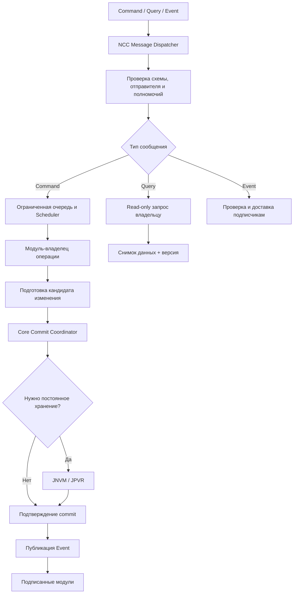

# JARVIS ANS-100 Alpha — архитектура и журнал решений

**Статус документа:** рабочая спецификация и журнал согласованных проектных решений  
**Дата последнего обновления:** 11 ноября 2026 года  
**Репозиторий:** `maksrugu123-sys/jarvis-ans100-alpha` (Private)  
**Основная ветка:** `main`

> Этот документ фиксирует идеи и решения, обсуждённые до начала реализации. Он не означает, что описанные механизмы уже написаны, собраны или проверены. Все показатели производительности и объёмы памяти должны быть измерены экспериментально.

---

## 1. Назначение проекта

**JARVIS ANS-100 Alpha** (Adaptive Neural System) — исследовательский проект компактной адаптивной нейросистемы.

Исходная цель — начать с одного небольшого искусственного нейрона, исследовать его состояние, связи, обучение и потребление памяти, а затем постепенно проверить масштабирование до 10, 100, 1 000 и большего числа нейронов.

Основные намерения:

- локальная работа без обязательного подключения к интернету;
- небольшие и экономно хранящиеся нейроны;
- адаптивное изменение синаптических связей;
- обучение на опыте, обратной связи и обнаруженных закономерностях;
- гибридная память нейронов и всей сети;
- собственная система виртуальной памяти для работы с объёмом данных, превышающим доступную физическую RAM;
- измеряемая, поэтапная разработка без преждевременных обещаний о производительности.

**Начальный бюджет RAM и бюджет проекта пока не определены.** Не считать ранее обсуждавшиеся значения окончательными ограничениями.

## 2. Принципы разработки

1. Сначала исследовать и проектировать, затем программировать.
2. Начинать с одного нейрона и измерений, а не сразу создавать большую сеть.
3. Разделять логическую доступность нейрона и его фактическую вычислительную активность.
4. Не считать накопитель эквивалентом физической RAM: CPU должен получить необходимые данные в RAM, чтобы выполнять вычисления.
5. Не удалять важные воспоминания и обученные связи только из-за длительного отсутствия обращений.
6. Не считать гипотезы о скорости, размере и масштабировании доказанными до тестов.
7. Сохранять решения и открытые вопросы в этом документе по мере развития проекта.

## 3. Искусственный нейрон

### 3.1. Предварительная модель

В качестве кандидата для первого эксперимента рассматривалась модель **Leaky Integrate-and-Fire (LIF)**:

- получает входящие сигналы;
- накапливает мембранный потенциал;
- постепенно уменьшает потенциал за счёт утечки;
- при достижении порога выдаёт импульс;
- после импульса может проходить период восстановления.

Это пока кандидат для сравнения, а не окончательно утверждённая модель.

Планируемые параметры для исследования:

- мембранный потенциал;
- порог активации;
- коэффициент утечки;
- период восстановления;
- счётчик импульсов;
- адаптивный порог.

Нужно сравнить LIF с более простым пороговым нейроном по сложности, скорости, памяти и качеству поведения.

### 3.2. Обучение и изменение связей

Рассматриваемые механизмы:

- **STDP** — изменение силы связи с учётом временного соотношения импульсов;
- **Reward-Modulated STDP** — дополнительная коррекция с учётом сигнала обратной связи;
- укрепление и ослабление связей;
- создание и удаление связей;
- нормализация и ограничения весов для устойчивости;
- разреженные связи: не каждый нейрон обязан быть связан со всеми остальными.

Совместная активация сама по себе не гарантирует полезность связи. Нужны критерии обратной связи, проверки устойчивых закономерностей и защиты от случайного шума.

### 3.3. Predictability Feedback

Обсуждалась идея обратной связи, вдохновлённая экспериментами с нейронными культурами и Pong:

- успешное действие может сопровождаться предсказуемой обратной связью;
- ошибка может сопровождаться менее предсказуемой обратной связью;
- сеть может учиться находить действия и закономерности, которые улучшают результат.

Для искусственной системы это будет собственный вычислительный механизм обратной связи, а не точная копия биологического эксперимента. Нельзя трактовать такой механизм как доказательство сознания или буквального переживания эмоций.

### 3.4. Predictive Surprise — обнаружение неожиданностей

Пользователь согласился включить в концепцию механизм удивления/неожиданности:

1. нейрон формирует прогноз;
2. получает фактический результат;
3. оценивает ошибку прогноза;
4. при существенном расхождении временно повышает внимание к сигналу;
5. проверяет, является ли событие шумом или частью устойчивой новой закономерности;
6. при подтверждении адаптирует соответствующие связи.

Для числового прогноза возможна базовая оценка ошибки:

**E = |фактическое значение − ожидаемое значение|**

Для вероятностных прогнозов потребуется подходящая вероятностная метрика. Повторяющиеся знакомые события могут со временем снижать реакцию (habituation).

Не следует автоматически усиливать все связи после каждого неожиданного события. Единичный шум нужно отличать от устойчивого изменения.

Предлагаемые внутренние показатели: Prediction, Surprise, Familiarity, Attention и Adaptation. Это инженерные переменные, а не утверждение о субъективных переживаниях.

### 3.5. Предварительные компоненты нейрона

В качестве схемы для дальнейшего проектирования обсуждались:

1. входной модуль;
2. синаптический модуль;
3. ядро нейрона;
4. механизм неожиданности;
5. механизм предсказания;
6. обучение и локальная память;
7. выходной модуль.

Окончательный состав, интерфейсы и формат состояния ещё предстоит определить.

### 3.6. Согласованные решения по архитектуре первого нейрона (7 ноября 2026)

Пользователь выбрал вариант C в десяти последовательных архитектурных вопросах. Эти решения фиксируют направление проектирования, но ещё не являются реализованным или экспериментально проверенным кодом.

| № | Область | Согласованное решение |
|---|---|---|
| 1 | Общая архитектура | Собственный гибридный нейрон с отдельными входным, синаптическим, вычислительным, адаптивным, обучающим/памятным и выходным компонентами |
| 2 | Адаптация чувствительности | Полная адаптация с учётом активности, неожиданности, опыта, полезности сигналов и обратной связи |
| 3 | Активация | Динамический порог, учитывающий потенциал, неожиданность, опыт, активность и обратную связь |
| 4 | Выходной сигнал | Адаптивный импульс: сила, длительность и частота зависят от состояния нейрона и ситуации |
| 5 | Усталость и восстановление | Адаптивное утомление при нагрузке и восстановление во время отдыха; необходимы ограничения, чтобы нейрон не истощался полностью |
| 6 | Забывание | Адаптивное забывание с учётом возраста, частоты использования, полезности и важности; защита значимых воспоминаний и обученных связей |
| 7 | Обучение | Гибридное обучение: STDP, Reward-Modulated STDP, ошибка прогноза, обратная связь и адаптация связей |
| 8 | Связи с другими нейронами | Адаптивное создание, укрепление, ослабление и удаление связей с ограничениями для предотвращения хаоса и чрезмерного роста |
| 9 | Обработка входящих сигналов | Адаптивная обработка: приоритет важных и срочных сигналов, очередь для ожидающих сигналов и параллельная обработка независимых операций при наличии ресурсов |
| 10 | Самоконтроль и саморегуляция | Полная адаптивная саморегуляция: мониторинг состояния и ресурсов, обнаружение нестабильности, регулировка нагрузки, контроль памяти и связей, безопасный режим и адаптивная частота проверок |

Все десять предварительных архитектурных решений согласованы. Это не означает, что нейрон готов на 100%: число отражает только количество выбранных направлений, а не процент реализации. Следующие этапы — согласование внутреннего состояния, проверка совместимости компонентов, определение алгоритмов и параметров, а затем реализация и измерение прототипа одного нейрона.

### 3.7. JARVIS Neural Core State — единое внутреннее состояние

**Neural Core State** — согласованный набор текущих параметров, через который компоненты нейрона обмениваются сведениями о его состоянии. Выбрана **C — гибридная структура**:

- компактное основное состояние и параметры, нужные для текущих вычислений, находятся в RAM;
- объёмные данные воспоминаний и подробные записи синаптических связей хранятся в отдельных структурах;
- основное состояние содержит необходимые сводки, идентификаторы/ссылки и метаданные для доступа к этим структурам;
- JNVM/JPVR управляет постоянным хранением и загрузкой нужных данных; наличие логической ссылки не означает, что данные уже находятся в RAM.

Предварительно состояние разделено на семь логических групп:

1. **Физиологическое состояние:** Neural Potential, Activity Level, Fatigue, Recovery.
2. **Когнитивное и предсказательное состояние:** Prediction, Surprise, Attention, Familiarity.
3. **Адаптивное состояние:** Sensitivity, Activation Threshold, Adaptation Rate.
4. **Состояние связей:** Connection Count, сводная Connection Strength, Plasticity, Structural Stability. Подробные записи отдельных связей находятся во внешнем хранилище связей.
5. **Состояние памяти:** показатели кратковременной и долговременной памяти, Memory Importance, Memory Integrity и ссылки на записи. Сами объёмные воспоминания не встраиваются целиком в основной объект.
6. **Самоконтроль:** Stability, Resource Usage, Error State, Recovery Mode.
7. **Временное состояние:** Last Activation, Last Learning, Last Recovery, Update Counter и необходимые временные метки.

Это логические группы для дальнейшего проектирования, а не утверждённый список полей структуры или окончательные типы данных. В частности, ещё предстоит определить единицы измерения, диапазоны, типы чисел и правила синхронизации.

### 3.8. Адаптивное обновление Neural Core State

Выбран вариант **C — адаптивное обновление**:

- после критического события нужные параметры обновляются немедленно;
- после обычного сигнала обновляются прежде всего затронутые параметры, а не всё состояние без необходимости;
- при высокой нагрузке некритические обновления могут объединяться или откладываться;
- во время низкой активности выполняются отложенное обслуживание и плановые проверки;
- при ошибке или подозрении на повреждение запускается внеочередная проверка затронутых данных.

Экономия ресурсов не должна задерживать критическое обновление, обработку срочного сигнала или фиксацию данных, необходимых для безопасного восстановления. Конкретные триггеры, интервалы, приоритеты и пределы объединения обновлений пока не определены.

### 3.9. Адаптивная точность числовых параметров

Выбран вариант **C — адаптивная точность хранения**:

- для критичных параметров применяется представление с точностью, достаточной для устойчивых вычислений;
- для обычных параметров используется стандартная точность;
- для второстепенных или допускающих приближение данных может применяться более компактное представление;
- во время обучения точность может повышаться, если это необходимо для сохранения значимых малых изменений;
- преобразование между форматами должно контролироваться по ошибке округления и влиянию на поведение нейрона.

Окончательная точность runtime-вычислений, пороги переключения точности и допустимая погрешность ещё не выбраны. Для постоянной сериализации полей Neural Core State/Synapse в JPVR_FORMAT_V1 уже зафиксирован F64 (раздел 3.21); это не определяет точность вычислительного ядра. Нельзя автоматически снижать точность защищённых или чувствительных параметров без проверки последствий.

### 3.10. Предварительная схема взаимодействия компонентов

Для уменьшения конфликтов между компонентами предлагается разделить работу на три координируемых контура:

- **Быстрый нейронный цикл:** получение и приоритизация сигнала, прогноз, оценка неожиданности, вычисление активации и формирование выходного сигнала. Обновляются только необходимые для этого цикла параметры.
- **Медленный адаптационный цикл:** изменение чувствительности и порога, усталость и восстановление, обучение, забывание, обслуживание памяти и перестройка связей.
- **Контур саморегуляции:** контролирует стабильность, нагрузку, ошибки, целостность и безопасные границы; выбирает частоту проверок и при необходимости ограничивает работу других контуров.

Это предварительная архитектурная схема. Точный порядок операций, синхронизация и разрешение конфликтов ещё требуют проектирования и тестирования.

Основные риски, которые необходимо проверить экспериментально:

- самоподдерживающееся усиление активности — нужны ограничители и устойчивые правила восстановления;
- обучение на единичном шумовом событии — неожиданность сама по себе не должна немедленно усиливать все связи;
- конфликт обучения и забывания — важные воспоминания и связи должны быть защищены, а изменения согласованы;
- чрезмерные расходы на самоконтроль — мониторинг должен иметь собственные ресурсные пределы;
- длительное ожидание сигналов низкого приоритета — требуется проверить защиту очереди от голодания.

Пока это список рисков и проектных мер, а не доказательство отсутствия проблем.


### 3.11. Дополнительные согласованные решения Neural Core State (7 ноября 2026)

Продолжение десяти решений по внутреннему состоянию. Для всех пунктов выбран вариант C — гибридный или адаптивный подход:

| № | Область | Согласованное решение |
|---|---|---|
| 4 | Восстановление повреждённого состояния | Гибридное восстановление: обнаружить повреждение проверкой целостности; по возможности восстановить только повреждённую часть из журнала и резервных копий; если локальное восстановление невозможно — вернуться к последнему целостному состоянию; перед продолжением проверить нейрон. Контрольная сумма обнаруживает повреждение, но сама его не исправляет. |
| 5 | Проверка согласованности | Адаптивные проверки после критических изменений, подозрительных событий и периодически во время обслуживания; при обнаружении ошибок частота проверок повышается. |
| 6 | История изменений | Гибридная история: актуальное состояние, журнал важных изменений и периодические контрольные снимки; устаревшие записи можно объединять или очищать безопасным способом. |
| 7 | Одновременные изменения | Критические изменения обрабатываются последовательно; независимые операции могут выполняться параллельно; перед сохранением проверяется согласованность; конфликты разрешает контроллер; незавершённые изменения не считаются подтверждённым состоянием. |
| 8 | Приоритеты компонентов | Адаптивные приоритеты: целостность и восстановление становятся высшими при ошибках; далее учитываются важные и срочные сигналы; обучение и обслуживание планируются с учётом нагрузки; низкоприоритетные задачи не должны голодать бесконечно. |
| 9 | Нехватка RAM | Адаптивно определять необходимые данные; критические данные сохранять в RAM; подходящие неактивные данные выгружать в JPVR; при необходимости использовать сжатие; при сохраняющемся дефиците ограничивать новые задачи. RAM освобождать только после подтверждённой записи. |
| 10 | Автономность и перезапуск | При запуске загрузить последнее целостное состояние, проверить согласованность, восстановить подтверждённые изменения из журнала, сначала загрузить необходимые компоненты, остальные — по запросу; при серьёзной ошибке перейти в безопасный режим. |

### 3.12. JARVIS Neural Core State Engine

**Neural Core State Engine** — управляющая подсистема, координирующая жизненный цикл внутреннего состояния и работу специализированных модулей. Выбрана гибридная архитектура: центральный контроллер координирует систему, а специализированные модули отвечают за свои области.

Согласованные решения по Engine (7 ноября 2026):

| № | Область | Согласованное решение |
|---|---|---|
| 1 | Архитектура Engine | C — гибрид: центральный контроллер координирует работу, специализированные модули управляют своими компонентами. |
| 2 | Взаимодействие модулей | C — обмен через центральный контроллер с ограниченными прямыми связями там, где они явно разрешены архитектурой. |
| 3 | Обработка ошибок | C — изолировать сбойный модуль и пытаться восстановить его, не останавливая всю систему без необходимости. |
| 4 | Запуск модулей | C — адаптивно запускать модули по необходимости и приоритету, а не безусловно активировать всё сразу. |
| 5 | Контроль ресурсов | C — адаптивно управлять лимитами и бюджетами RAM, CPU и накопителя. |
| 6 | Обновление Engine | C — адаптивно обновлять компоненты по необходимости, предварительно проверяя совместимость. |
| 7 | Защита Engine | C — адаптивная защита с усилением проверок при подозрительных событиях. |
| 8 | Масштабирование | C — адаптивно добавлять или активировать модули с учётом доступных ресурсов и текущей нагрузки. |
| 9 | Журналирование | C — адаптивный журнал: важные события записывать подробно, обычные — кратко. |

Решение №10 по автономности Engine — **C, согласовано**: Engine самостоятельно управляет обычными задачами, а критические решения остаются под контролем центральной системы. Граница полномочий, перечень критических операций, правила эскалации и безопасное поведение при недоступности центрального контроллера ещё должны быть формализованы и протестированы.

Эти решения описывают проектируемое поведение. Они не означают, что Engine уже реализован, что модули действительно изолируются или восстанавливаются, либо что система проверена под нагрузкой. Перед реализацией потребуется определить интерфейсы модулей, модель ошибок, права контроллера, тайм-ауты, правила отката и тесты отказоустойчивости.


### 3.13. JARVIS Neural Core Controller — предварительная архитектура

**Статус:** архитектурное предложение, выбранное главным архитекторским решением 7 ноября 2026 года. Это спецификация для дальнейшего обсуждения и прототипирования, а не реализованный компонент.

#### 3.13.1. Назначение и границы

**Neural Core Controller (NCC)** — главный координатор внутри Neural Core State Engine. Он принимает команды и события, проверяет полномочия, распределяет задачи между специализированными модулями, контролирует ресурсы и подтверждает изменения общего состояния.

NCC не должен самостоятельно выполнять работу всех модулей:
- не рассчитывает синаптические веса вместо Learning Manager;
- не реализует алгоритм нейрона вместо Neural Computation;
- не управляет физическими страницами JPVR вместо JNVM/JPVR;
- не отменяет проверки целостности ради скорости;
- не получает права на критические операции только потому, что является главным координатором Engine.

Нужно различать NCC и центральную систему JARVIS, упомянутую в решении об автономности Engine. NCC действует в пределах делегированных полномочий. Центральная система задаёт политику и подтверждает операции, для которых требуется более высокий уровень разрешения. Точный интерфейс между ними остаётся открытым.

#### 3.13.2. Выбранная базовая архитектура

Для первой реализации выбирается **модульный монолит с циклом обработки событий и единственным координатором подтверждения изменений общего состояния (single-writer commit)**.

Причины выбора:
- на первом этапе исследуется один нейрон, поэтому микросервисы и распределённые процессы добавили бы ненужную сложность;
- модули можно разрабатывать и тестировать раздельно, сохраняя единый процесс и чёткие интерфейсы;
- один координатор подтверждения упрощает обнаружение конфликтов и контроль согласованности;
- независимые вычисления можно будет распараллелить позже, не разрешая нескольким задачам одновременно бесконтрольно менять общее состояние.

Термин «детерминированный цикл» здесь означает контролируемый порядок принятия и подтверждения событий. Он сам по себе не гарантирует полностью детерминированные результаты всех вычислений: это зависит также от алгоритмов, потоков, числовых операций и оборудования.

#### 3.13.3. Компоненты NCC

| Компонент | Обязанность |
|---|---|
| Command Validator | Проверка формата, обязательных полей, версии и допустимости команды |
| Permission & Safety Gate | Проверка полномочий, класса риска и ограничений операции |
| Bounded Priority Queue | Очередь ограниченного размера с приоритетами и обратным давлением при перегрузке |
| Core Dispatcher | Выбор следующего допустимого задания и передача его нужному модулю |
| Module Registry | Реестр модулей, интерфейсов, версий и текущих состояний |
| Lifecycle Manager | Контролируемый запуск, остановка, изоляция и перезапуск модулей |
| Resource Manager | Учёт и жёсткое ограничение бюджетов RAM, CPU, очередей и операций хранения |
| Recovery Manager | Координация восстановления и проверок перед возвращением модуля в работу |
| Journal & Telemetry | Запись важных переходов, ошибок, результатов и измерений производительности |

Специализированные модули — обработка сигналов, вычисление нейрона, обучение, управление Neural Core State и адаптер JNVM/JPVR — предоставляют NCC типизированные интерфейсы. В первой версии все команды, запросы и события проходят через внутренний диспетчер NCC; прямые вызовы между модулями и общий изменяемый доступ к их внутренним данным запрещены. Возможность узких прямых read-only интерфейсов можно рассматривать только позднее, если измерения покажут необходимость и зависимость будет явно описана.

#### 3.13.4. Путь обработки команды

1. NCC принимает команду или внутреннее событие и присваивает ему идентификатор.
2. Command Validator проверяет формат, версию схемы и обязательные данные.
3. Permission & Safety Gate определяет, разрешена ли операция текущему уровню Engine.
4. Допустимая задача помещается в ограниченную очередь. При заполнении очереди применяется backpressure: новые обычные задачи задерживаются или отклоняются с явным результатом, а не накапливаются бесконечно.
5. Core Dispatcher выбирает задачу по политике приоритетов и доступности ресурсов.
6. Задача передаётся специализированному модулю с ограниченным контекстом и сроком выполнения.
7. Результат проверяется; изменения общего состояния готовятся как отдельная транзакция.
8. Единственный координатор подтверждения проверяет конфликты и согласованность, затем разрешает зафиксировать изменение.
9. Если операция требует постоянного хранения, она считается сохранённой только после подтверждения соответствующего слоя JPVR. RAM нельзя освобождать до такого подтверждения.
10. NCC фиксирует итог: выполнено, отклонено, ожидает разрешения или завершилось ошибкой.

Повторная доставка события не должна приводить к повторному применению уже подтверждённого изменения. Для этого потребуются идентификаторы операций и правила идемпотентности.

#### 3.13.5. Очередь и приоритеты

Выбирается фиксированная иерархия классов безопасности с ограниченной адаптацией порядка внутри классов:

| Класс | Назначение |
|---|---|
| P0 | Предотвращение повреждения данных, проверка целостности и критическое восстановление |
| P1 | Разрешённые критические изменения состояния |
| P2 | Важные и срочные нейронные сигналы |
| P3 | Обучение и обычное изменение связей |
| P4 | Фоновая оптимизация и обслуживание |

Внутри класса допускаются сроки выполнения, доступность ресурсов и механизм Aging — повышение приоритета слишком долго ожидающей задачи. Aging не может позволить обычной задаче обойти обязательную операцию безопасности или восстановления.

Такой вариант выбран намеренно вместо полностью самоизменяющейся системы приоритетов: порядок защиты данных должен оставаться предсказуемым. Адаптация используется там, где она не нарушает эту гарантию.

Размер очередей, квоты на каждый класс, сроки и политика переполнения пока не определены и должны быть измерены на прототипе.

#### 3.13.6. Полномочия и автономность

NCC и Engine могут без отдельного запроса выполнять только заранее разрешённые обратимые операции в пределах ресурсных лимитов, например:
- планировать и запускать штатные задачи;
- обрабатывать очередь сигналов;
- выполнять обычное обслуживание;
- изолировать неисправный некритический модуль;
- перезапускать модуль после проверки его состояния;
- сохранять данные штатным способом.

Операции, для которых требуется разрешение центральной системы JARVIS:
- удаление защищённых воспоминаний или критически важных обученных данных;
- необратимое изменение общей структуры памяти;
- изменение глобальных правил безопасности и полномочий;
- превышение утверждённых ресурсных лимитов;
- восстановление, которое требует выбора между конфликтующими версиями критических данных.

Правило по умолчанию — **запрет при отсутствии разрешения**. Если центральная система недоступна, NCC продолжает только заранее разрешённые безопасные задачи, не выполняет ожидающие критические операции и сообщает о необходимости эскалации. Конкретная матрица полномочий должна быть утверждена отдельно.

#### 3.13.7. Состояния контроллера

Используется конечный автомат:

| Состояние | Значение |
|---|---|
| BOOTING | Загрузка реестра модулей, проверка конфигурации и последнего целостного состояния |
| READY | Штатная работа в рамках разрешённых задач |
| DEGRADED | Ограниченная работа: один или несколько модулей недоступны либо ресурсы ограничены |
| RECOVERING | Изолированное восстановление модуля или состояния с последующей проверкой |
| SAFE_STOP | Запрет новых изменяющих операций, когда безопасность или целостность подтвердить нельзя |

Переход в READY разрешён только после успешных стартовых проверок. После RECOVERING модуль возвращается в работу лишь после теста интерфейса и проверки целостности. При неустранимом повреждении критических данных, нарушении границ полномочий или невозможности безопасно продолжить работу выбирается SAFE_STOP. Выход из SAFE_STOP требует отдельной доверенной процедуры восстановления; автоматический бесконечный перезапуск запрещён.

#### 3.13.8. Ошибки и отказоустойчивость

Для задач и модулей предусматриваются:
- ограниченные тайм-ауты и число повторов;
- изоляция сбойного модуля;
- контроль повторной доставки и идемпотентности;
- явные состояния задания: queued, running, prepared, committed, failed или rejected;
- запрет считать подготовленное, но не подтверждённое изменение завершённым;
- журналирование причин отказа и восстановления;
- ограничение каскадных перезапусков и повторных попыток.

Ошибка обычного модуля не должна автоматически останавливать весь Engine. Но при сомнении в целостности общего состояния система должна предпочесть безопасную остановку продолжению работы с потенциально повреждёнными данными.

#### 3.13.9. Масштабирование

Первая версия работает в одном процессе. Изменения общего состояния подтверждаются последовательно. Независимые вычисления могут выполняться параллельно только если они не меняют общее состояние напрямую и возвращают результат через интерфейс NCC.

Переход к пулу рабочих потоков, процессам или распределённым компонентам допускается только после измерений. До такого перехода нужно доказать, что параллелизм действительно улучшает задержку или пропускную способность и не нарушает согласованность.

#### 3.13.10. Проверки для будущего прототипа

Минимальный набор тестов NCC:
1. Некорректная или неизвестная команда отклоняется до выполнения.
2. Запрещённая операция не проходит Permission & Safety Gate.
3. Переполнение очереди не приводит к неограниченному росту RAM.
4. Долгождущие задачи не остаются без обслуживания, но не обходят P0/P1.
5. Дублированное событие не применяет подтверждённое изменение повторно.
6. Два конфликтующих изменения общего состояния не фиксируются одновременно.
7. Сбой одного обычного модуля не повреждает состояние остальных.
8. NCC не освобождает данные из RAM до подтверждения сохранения JPVR.
9. При недоступности центральной системы критическая операция остаётся заблокированной.
10. При повреждении критического состояния NCC переходит в SAFE_STOP, а не продолжает работу на непроверенных данных.

**Итог выбора:** модульный монолит, ограниченная очередь, фиксированные классы безопасности, единственный координатор подтверждения общего состояния и строгая проверка полномочий. Адаптивность применяется к расписанию и ресурсам только внутри этих защитных границ. Это базовая архитектура для первого прототипа, а не утверждение о готовой реализации.


### 3.14. Протокол взаимодействия модулей Neural Core Engine

**Статус:** базовая модель взаимодействия выбрана 7 ноября 2026 года. Она относится к проектированию; интерфейсы и реализация ещё не созданы.

#### 3.14.1. Основной принцип

Для первой версии выбирается внутренний протокол **Command–Query–Event (CQE)**:

- **Command** — просьба выполнить действие, которое может изменить состояние.
- **Query** — запрос данных без изменения состояния.
- **Event** — сообщение о факте, который уже произошёл, например о подтверждённом изменении состояния или отказе модуля.

Все три типа проходят через **NCC Message Dispatcher** внутри одного процесса. Отдельный сетевой сервер, внешний брокер сообщений и межпроцессное взаимодействие на первом этапе не нужны.

Причины выбора:
- единая точка проверки полномочий, формата, приоритета и лимитов;
- отсутствие неконтролируемых прямых зависимостей между модулями;
- возможность тестировать каждый модуль отдельно через его контракт;
- меньше накладных расходов и меньше инфраструктуры для эксперимента с одним нейроном;
- возможность позднее заменить внутренний транспорт, не меняя смысл команд, запросов и событий.

Общая схема прохождения сообщений:



Схема не означает, что каждый Command обязательно записывается на накопитель: JPVR участвует только тогда, когда операция требует постоянного сохранения.

#### 3.14.2. Три типа сообщений

| Тип | Для чего используется | Правило |
|---|---|---|
| Command | Запустить вычисление, изменить состояние, сохранить данные, восстановить модуль | Всегда проверяет полномочия; имеет идентификатор операции и определённый результат |
| Query | Получить состояние нейрона, статус модуля, сведения о ресурсах или версии данных | Не меняет состояние; возвращает ограниченный read-only результат или снимок |
| Event | Сообщить, что сигнал принят, состояние подтверждено, модуль отказал или восстановлен | Описывает уже случившийся факт; не является скрытой командой на изменение |

Успешное принятие команды в очередь **не означает**, что действие завершено. Ответы должны различать как минимум:
- `ACCEPTED` — команда проверена и принята в обработку;
- `COMPLETED` — действие выполнено и, если требовалось, изменение подтверждено;
- `REJECTED` — команда запрещена или некорректна;
- `DEFERRED` — выполнение отложено из-за ресурсов, зависимости или необходимости разрешения;
- `FAILED` — выполнение началось, но завершилось ошибкой.

Повторный запрос статуса должен позволять выяснить итог команды по её идентификатору, не запуская её заново.

#### 3.14.3. Конверт сообщения

Все сообщения используют общую оболочку. Полезная нагрузка зависит от типа сообщения и его схемы.

| Поле | Назначение |
|---|---|
| message_id | Уникальный идентификатор сообщения |
| correlation_id | Идентификатор исходной операции для связывания запроса и ответа |
| causation_id | Идентификатор сообщения, которое вызвало текущее |
| schema_version | Версия контракта и формата данных |
| source | Идентификатор отправляющего модуля |
| target | Получатель или разрешённая способность/операция |
| message_type | COMMAND, QUERY или EVENT |
| priority | Класс приоритета в рамках политики NCC |
| deadline | Срок, после которого результат уже не нужен или должен быть пересмотрен |
| idempotency_key | Ключ для безопасной обработки повторов команды |
| expected_state_version | Ожидаемая версия состояния, если операция зависит от конкретной версии |
| payload | Типизированные данные сообщения с ограничением размера |

Не каждое поле обязательно для каждого сообщения. Например, Query обычно не требует idempotency_key, а Event не обязан содержать expected_state_version. Временные метки, счётчики и идентификаторы не должны заменять проверку фактической версии состояния.

Сообщения должны иметь лимит размера. Большие воспоминания, модели или блоки памяти не копируются в очередь целиком: передаётся проверяемая ссылка/дескриптор на данные в управляемом хранилище, а владелец данных проверяет право доступа и доступность объекта.

#### 3.14.4. Владение данными и запрет общего изменяемого доступа

Для каждого домена состояния назначается один модуль-владелец. Только он может менять принадлежащие ему данные через утверждённый путь фиксации.

Примеры границ владения:
- Neural State Manager — актуальное состояние нейрона и его версия;
- Learning Manager — состояние процесса обучения и предложенные изменения связей;
- Signal Processing — очередь и метаданные необработанных входящих сигналов;
- Module Lifecycle Manager — состояния и жизненный цикл модулей;
- JNVM/JPVR Adapter — запросы к слою постоянного хранения и результаты операций хранения.

Это предварительное распределение обязанностей: точные поля и границы доменов должны быть согласованы до реализации.

Запрещается:
- напрямую изменять внутренние структуры другого модуля;
- хранить несогласованные копии одного и того же изменяемого значения в нескольких модулях;
- передавать наружу изменяемые указатели или ссылки на внутреннюю память владельца;
- считать локальную копию данных актуальной без проверки её версии.

Query возвращает read-only снимок или ограниченный результат с номером версии. Изменение выполняется только через Command к владельцу данных.

#### 3.14.5. Последовательность изменения состояния

В первой версии выбирается **один владелец данных на одну транзакцию изменения**. Междоменные атомарные транзакции пока не вводятся: они усложнили бы восстановление до того, как доказана необходимость.

Последовательность:
1. NCC проверяет схему, полномочия, лимиты и idempotency_key.
2. NCC маршрутизирует Command модулю-владельцу.
3. Владелец проверяет expected_state_version и готовит кандидат изменения, не выдавая его за подтверждённое состояние.
4. Core Commit Coordinator проверяет право операции, конфликт версии и ограничения целостности.
5. Если изменение требует постоянного хранения, запись/журналирование проходит через JNVM/JPVR; до подтверждения хранения RAM не освобождается.
6. После успешной проверки владелец подтверждает новую версию состояния через единственный путь commit.
7. Только после подтверждения публикуется соответствующий Event и возвращается результат COMPLETED.

Если проверка или запись не прошла до commit, кандидат изменения отбрасывается, а прежнее подтверждённое состояние сохраняется. Если ошибка произошла в процессе восстановления после прерванного commit, NCC сверяется с журналом и последним целостным состоянием; он не должен угадывать, завершилась ли операция.

Операция, которая затрагивает несколько доменов, в первой версии выполняется как явно описанная последовательность отдельных команд с контрольными точками. Она не должна называться атомарной транзакцией. Поддержку много-доменных транзакций можно добавить только после отдельного проектирования журнала, порядка фиксации и аварийного отката.

#### 3.14.6. Очереди, порядок и перегрузка

NCC использует ограниченные внутренние очереди. Порядок обработки:
- приоритет сначала определяется классами P0–P4 из раздела 3.13.5;
- внутри одного класса действует FIFO;
- Aging может повысить ожидающую задачу внутри разрешённых границ;
- для модулей применяются квоты, чтобы один источник не занял всю очередь;
- зарезервированная ёмкость для критических задач не может использоваться обычными фоновыми задачами.

При достижении порога перегрузки NCC:
1. прекращает принимать необязательные фоновые задачи;
2. возвращает явный DEFERRED или REJECTED/RESOURCE_EXHAUSTED для новых команд;
3. просит источники снизить темп подачи сигналов;
4. сохраняет возможность безопасной обработки P0/P1 в рамках зарезервированных лимитов.

Очередь никогда не растёт без ограничения. Если безопасно принять критическое сообщение уже невозможно, NCC блокирует новые изменяющие операции и переходит в DEGRADED или SAFE_STOP в зависимости от риска. Критические события нельзя молча удалять ради освобождения места.

#### 3.14.7. Повторы, порядок доставки и подтверждения

Протокол **не обещает exactly-once delivery**. После тайм-аута или восстановления одно сообщение может быть доставлено повторно. Поэтому:
- каждая изменяющая команда имеет operation_id/idempotency_key;
- владелец хранит результат уже обработанной операции в пределах определённой политики хранения;
- повтор с тем же ключом возвращает прежний результат, а не применяет изменение повторно;
- конфликт expected_state_version возвращается как VERSION_CONFLICT и требует перечитать состояние;
- событие об успешном изменении публикуется только после commit;
- Event содержит event_id и, если относится к состоянию, state_version; получатель игнорирует устаревшие версии и не предполагает глобальный порядок между независимыми темами;
- доставка Event может повторяться; подписчики обрабатывают повторы идемпотентно;
- важные события, нужные для восстановления после перезапуска, записываются в журнал/outbox вместе с записью о commit или в рамках согласованной последовательности восстановления;
- временные телеметрические события могут быть потеряны при аварийном завершении, если они не влияют на состояние.

Тайм-аут означает, что отправитель не получил результат вовремя, но не доказывает, что операция не была выполнена. Сначала нужно проверить статус по operation_id. Повторять команду с новым ключом вслепую запрещено.

#### 3.14.8. Ошибки и коды результата

Для контрактов вводятся ограниченные машинно-читаемые коды:
- INVALID_MESSAGE — некорректный формат или поля;
- UNSUPPORTED_SCHEMA — несовместимая версия контракта;
- UNAUTHORIZED — нет требуемых полномочий;
- MODULE_UNAVAILABLE — получатель не готов принимать работу;
- VERSION_CONFLICT — изменилось состояние, на версии которого основывалась команда;
- DEADLINE_EXCEEDED — истёк срок выполнения;
- LATE_SIGNAL — временная метка сигнала старше уже подтверждённого модельного времени;
- RESOURCE_EXHAUSTED — достигнут безопасный лимит очереди или ресурсов;
- CANCELLED — задача отменена до commit;
- INTEGRITY_FAILURE — проверка целостности не пройдена;
- INTERNAL_FAILURE — непредвиденная внутренняя ошибка.

Ошибки должны содержать безопасное описание и correlation_id, но не раскрывать секреты, внутренние адреса памяти, приватные данные или чувствительное содержимое воспоминаний в обычном журнале.

#### 3.14.9. Реестр модулей и зависимости

Перед получением задач модуль регистрируется в Module Registry и сообщает:
- уникальный module_id;
- версию реализации и поддерживаемые версии схем;
- список принимаемых Commands и Queries;
- список публикуемых Events и список Event-тем, на которые модуль подписан;
- зависимости от других модулей;
- допустимый бюджет ресурсов;
- текущий статус жизненного цикла.

NCC принимает сообщения только от зарегистрированных модулей и только к объявленным операциям. Неизвестная команда или неподдерживаемая версия схемы отклоняется.

Граф обязательных зависимостей при запуске должен быть ациклическим. NCC проверяет порядок старта. Если для работы модуля недоступна обязательная зависимость, модуль не переходит в READY.

#### 3.14.10. Защита от взаимных блокировок

Модуль не должен синхронно ждать завершения цепочки, которая прямо или косвенно требует ответа от него самого. В первой версии:
- модули отправляют Command/Query через NCC и получают результат по correlation_id;
- длительные задачи возвращают ACCEPTED, а затем отдельный итог;
- ожидание ограничивается deadline и отменой;
- NCC выявляет циклические зависимости модулей на стадии регистрации;
- никакой модуль не удерживает блокировку своего состояния, ожидая выполнения чужой команды.

Это предотвращает типичные циклы вида A ждёт B, B ждёт A. Для изменения общего состояния всё равно применяется отдельная проверка версии и последовательная фиксация.

#### 3.14.11. Журналирование и наблюдаемость

Для диагностики записываются:
- message_id, correlation_id и operation_id;
- отправитель, получатель и тип операции;
- класс приоритета и время ожидания;
- версии контракта и состояния;
- итоговый код результата;
- длительность выполнения и причина отказа;
- факт commit и подтверждения постоянного хранения, если они требовались.

По умолчанию журнал содержит метаданные, а не полную полезную нагрузку. Содержимое воспоминаний и другие потенциально чувствительные данные не копируются в телеметрию без отдельной необходимости и политики защиты.

#### 3.14.12. Масштабирование транспорта

Первая реализация использует типизированные интерфейсы, внутренние ограниченные очереди и диспетчер событий в одном процессе.

Не используются на старте:
- сетевые RPC;
- внешний брокер сообщений;
- отдельные процессы для каждого модуля;
- распределённая фиксация транзакций;
- произвольный прямой обмен изменяемыми объектами.

При необходимости будущего разделения на процессы сохраняются типы сообщений и контракты; меняется только транспорт. Такое расширение допускается после измерений, а не заранее.

#### 3.14.13. Проверки для будущей реализации

1. Command с неизвестным типом, неверной схемой или незарегистрированным получателем отклоняется.
2. Query не изменяет данные и возвращает версию read-only снимка.
3. Модуль не может изменить данные другого владельца напрямую.
4. Дублированная команда с прежним idempotency_key не применяет изменение повторно.
5. Команда с устаревшим expected_state_version получает VERSION_CONFLICT.
6. Событие об успешном изменении не публикуется до подтверждённого commit.
7. Тайм-аут не приводит к слепому повторному выполнению операции.
8. Переполнение очереди не вызывает неограниченный рост RAM и не уничтожает критические задачи молча.
9. Циклическая зависимость модулей выявляется до перехода в READY.
10. Модуль не блокирует собственные ресурсы, ожидая чужую команду.
11. После сбоя результат операции можно восстановить по operation_id и журналу.
12. Повреждение или несовместимость контракта приводит к явной ошибке, а не к частичной интерпретации сообщения.

**Итог выбора:** CQE-протокол внутри одного процесса, единственный диспетчер NCC, типизированные контракты, один владелец на домен данных, ограниченные очереди, идентификаторы операций и commit до публикации события. Это намеренно более простая модель, чем распределённая шина сообщений, и она соответствует текущему масштабу исследования.


### 3.15. Нормативный профиль CQE v1: контракты, лимиты, полномочия и восстановление

**Статус:** базовый профиль для первого прототипа выбран 7 ноября 2026 года. Он уточняет разделы 3.13–3.14 и не означает, что NCC, CQE, журнал JPVR или центральная система полномочий уже реализованы. Все численные лимиты ниже — стартовые конфигурационные значения для эксперимента с одним нейроном, а не измеренные оптимумы для конкретного устройства.

#### 3.15.1. Версия и общие правила контракта

Для первого прототипа фиксируется **CQE protocol version 1**. Версия протокола описывает общие правила конверта и доставки; отдельная пара «schema_id + schema_version» описывает конкретную полезную нагрузку команды, запроса, ответа или события.

Обязательные правила:

1. NCC принимает только зарегистрированные типы сообщений и объявленные операции.
2. Отправитель идентифицируется по записи Module Registry, а не по произвольной строке, присланной внутри payload.
3. Приоритет назначается NCC по реестру операций. Поле priority от отправителя — только подсказка и не может повысить полномочия или обойти P0–P4.
4. Неизвестные обязательные поля, несовместимая версия схемы, повторяющиеся поля, выход за размерный лимит или неверный тип данных приводят к явному отказу. Неизвестные необязательные поля можно игнорировать только если это прямо разрешено конкретной версией схемы.
5. Идентификаторы и версии сравниваются как значения, а не как текстовые строки.
6. Время ожидания внутри процесса измеряется монотонными часами. Календарные отметки могут использоваться для журнала, но не для измерения дедлайна.
7. Ни один модуль не получает общий изменяемый доступ к памяти другого модуля.

#### 3.15.2. Контракт конверта сообщения

Каждое CQE-сообщение использует следующий логический конверт:

| Поле | Обязательность | Правило |
|---|---|---|
| protocol_version | Обязательно | Версия CQE; для первой реализации — 1 |
| message_id | Обязательно | Уникальный 128-битный идентификатор конкретного сообщения/доставки |
| event_id | Для EVENT | Стабильный идентификатор логического события, сохраняющийся при повторной доставке |
| commit_id | Для Event о подтверждённом изменении | Идентификатор commit, который породил событие |
| message_type | Обязательно | COMMAND, QUERY или EVENT |
| schema_id | Обязательно | Стабильное имя конкретной схемы |
| schema_version | Обязательно | Положительное целое число версии схемы |
| source_module_id | Обязательно | Идентификатор зарегистрированного отправителя |
| target_module_id / operation_id | По типу | Получатель или зарегистрированная операция/тема |
| correlation_id | Условно | Связывает ответ и дочерние сообщения с исходным запросом |
| causation_id | Условно | Ссылается на message_id сообщения-причины |
| operation_id | Для изменяющей Command | Стабильный идентификатор логической операции |
| idempotency_key | Для изменяющей Command | Ключ повторной безопасной доставки; повтор с тем же ключом не создаёт новое изменение |
| expected_state_version | Когда требуется | Версия состояния, на которой основано предложение изменения |
| deadline_budget_ms | Для выполняемых задач | Остаточный бюджет времени; NCC преобразует его в локальный монотонный дедлайн |
| requested_priority | Необязательно | Только подсказка; окончательный класс P0–P4 определяет NCC |
| capability_id | Для защищённых операций | Ссылка на выданное разрешение; наличие поля само по себе не доказывает полномочия |
| payload | По схеме | Типизированная полезная нагрузка или проверяемый дескриптор данных |

Для QUERY correlation_id обязателен, operation_id и idempotency_key не используются. Для EVENT обязателен event_id; если событие относится к изменённому состоянию, оно содержит commit_id и state_version. Событие без привязки к состоянию может не иметь state_version.

Данные большой величины не помещаются непосредственно в конверт. Используется ограниченный descriptor, содержащий object_id, область/тип данных, ожидаемый размер, версию и контрольную сумму или иной механизм проверки целостности. Владелец хранилища повторно проверяет разрешение на доступ и фактический объект при чтении. Обычные указатели на память и незащищённые пути файлов в CQE не передаются.

**Начальные ограничения v1:**

| Ограничение | Стартовое значение |
|---|---:|
| Полный размер одного конверта с inline payload | 8 KiB |
| Inline payload | 4 KiB |
| Descriptor ссылки на внешние данные | 1 KiB |
| Количество ссылок на внешние данные в одном сообщении | 16 |
| Размер результата QUERY с inline данными | 16 KiB |
| Необработанные принятые сообщения во всех очередях NCC | 256 |
| Одновременно активные изменяющие транзакции общего состояния | 1 |
| Одновременно исполняемые задачи в базовом профиле | 1 |

Если результат или вход больше допустимого размера, модуль должен вернуть ссылку на данные или разделить работу на ограниченные части. Молчаливое усечение payload запрещено. Параллельное исполнение вычислений не включается в стартовый профиль: его можно добавить после базовых измерений, сохранив единственный координатор commit.

#### 3.15.3. Начальная конфигурация ограниченных очередей

Общая ёмкость очередей NCC в первом профиле — **256 сообщений**. Классы имеют отдельные жёсткие квоты, которые нельзя занимать фоновыми задачами:

| Класс | Назначение | Максимум сообщений |
|---|---|---:|
| P0 | Целостность, аварийное восстановление, безопасная остановка | 16 |
| P1 | Разрешённые критические изменения состояния | 16 |
| P2 | Важные и срочные входящие сигналы | 64 |
| P3 | Обучение и обычные изменения связей | 96 |
| P4 | Обслуживание и фоновая оптимизация | 64 |
| **Всего** |  | **256** |

Дополнительные правила:

- одна очередь не может превысить свою квоту или общую ёмкость;
- стартовый предел для одного источника — 32 принятых сообщения одновременно; для P0/P1 NCC может использовать отдельную системную квоту, но не разрешает обычному модулю занять её;
- FIFO применяется внутри одного класса; Aging может менять порядок только в разрешённых границах и не переносит задачу через классы безопасности;
- Query учитывается в общей ёмкости, чтобы поток запросов также не мог бесконтрольно расходовать RAM;
- после ответа ACCEPTED сообщение принадлежит NCC и остаётся учитываемым до терминального результата; отправитель не должен создавать копию операции с новым idempotency_key;
- REJECTED/RESOURCE_EXHAUSTED означает, что NCC не принял сообщение: источник сохраняет его или снижает скорость отправки;
- DEFERRED означает, что операция не получила место/ресурс и не была обещана к выполнению; для повторной подачи сохраняется исходный operation_id и idempotency_key;
- уже принятые сообщения не удаляются молча ради освобождения слотов;
- телеметрию допустимо объединять или пропускать только если она явно помечена как необязательная и не влияет на состояние;
- при заполнении P0 очередь не вытесняет критические сообщения: новые изменяющие операции блокируются, NCC переходит как минимум в DEGRADED, а при невозможности сохранить целостность — в SAFE_STOP;
- если P1 заполнен, новые P1 операции получают явный DEFERRED/RESOURCE_EXHAUSTED; они не могут занять слоты P0;
- превышение квот P2–P4 приводит к backpressure, DEFERRED или REJECTED в зависимости от того, было ли сообщение уже принято.

Отдельный durable outbox также ограничен: стартовый предел — 256 ожидающих событий или 1 MiB метаданных/inline payload, в зависимости от того, что наступит раньше. В нём резервируются 16 записей для событий P0/P1. Если outbox достиг лимита, операция, требующая обязательной публикации durable Event, не может пройти commit до освобождения ёмкости. Критическое событие не удаляется для освобождения места. Для временной телеметрии без влияния на состояние допускается отдельный ограниченный best-effort канал.

Эти лимиты — защита от неограниченного роста памяти, а не обещание заданной пропускной способности. После измерений одного нейрона значения должны быть пересмотрены.

#### 3.15.4. Дедлайны, отмена и повторы

Все дедлайны рассчитываются от момента приёма сообщения по монотонным часам. Начальные значения для прототипа:

| Вид операции | Бюджет по умолчанию |
|---|---:|
| QUERY | 1 000 ms |
| Короткая локальная Command | 5 000 ms |
| Операция чтения/записи JPVR | 30 000 ms |
| Восстановление/проверка целостности | 60 000 ms |

Операция может иметь собственный бюджет только в пределах верхнего лимита, разрешённого NCC. Увеличить лимит или продолжить критическую операцию после истечения срока может только заранее разрешённая политика/полномочие. Значения не являются измеренными SLA и подлежат настройке по результатам тестов на целевом устройстве.

Правила отмены и тайм-аута:

1. До стадии PREPARED/COMMIT задача может быть отменена; её кандидат изменения отбрасывается и не становится состоянием нейрона.
2. После начала COMMIT отмена не означает откат. NCC обязан выяснить по журналу, был ли commit подтверждён.
3. Тайм-аут после отправки запроса не доказывает, что операция не была выполнена. Сначала запрашивается статус по operation_id.
4. Если commit нельзя однозначно подтвердить или опровергнуть, результат помечается COMMIT_UNKNOWN; запрещено повторять изменение с новым ключом.
5. Автоматические повторы Command на уровне диспетчера по умолчанию выключены. Ограниченные повторы отдельных идемпотентных I/O операций могут выполняться внутри владельца хранилища, но не должны обходить operation_id и лимит дедлайна.
6. Повторная подача той же логической команды использует прежний idempotency_key и возвращает сохранённый результат/текущее состояние операции.
7. После подтверждённого commit задача не отменяется; дальнейшее ожидание относится к доставке события, а не к выполнению изменения.

Статусы операции разделяются на состояние выполнения и состояние доставки события. Принятая команда может пройти QUEUED → RUNNING → PREPARED → COMMITTED → COMPLETED. Ответ ACCEPTED — отдельное подтверждение приёма в ограниченную очередь, а не конечный результат. После ACCEPTED операция остаётся под ответственностью NCC до терминального результата. Внутреннее ожидание зависимости/ресурса отражается состоянием очереди и не превращается в повторный DEFERRED. DEFERRED используется до ACCEPTED, когда NCC не взял операцию на исполнение; источник сохраняет её и повторяет с прежним idempotency_key. Допустимые терминальные/особые статусы: REJECTED, FAILED, CANCELLED и COMMIT_UNKNOWN. COMPLETED означает, что состояние подтверждено согласно требуемому уровню сохранения; это не означает, что каждый подписчик уже подтвердил обработку связанного Event.

#### 3.15.5. Матрица полномочий и capabilities

**Permission & Safety Gate** использует deny-by-default. Права назначаются конкретному зарегистрированному модулю, операции, области данных и лимиту ресурсов. Приоритет P0 не является разрешением: даже критическая команда проходит проверку полномочий.

| Операция | Кто может запросить | Условия |
|---|---|---|
| Приём входящего сигнала | Signal Processing / зарегистрированный входной адаптер | Только объявленный формат сигнала, P2 и лимиты очереди |
| Вычисление нейрона | Neural Computation через NCC | Вычисляет кандидат результата; не выполняет commit напрямую |
| Предложение изменения связей | Learning Manager | P3 по умолчанию; проверка версии, ограничений веса и защищённых связей |
| Изменение принадлежащего домена состояния | Модуль-владелец домена | Только через подготовку кандидата и Core Commit Coordinator |
| Сохранение/чтение JPVR | JNVM/JPVR Adapter | Только разрешённый контейнер, область, объект и I/O бюджет |
| Запуск/остановка/изоляция модуля | Lifecycle Manager через NCC | Только allowlist; запрещено отключать NCC или последний обязательный механизм безопасности без специального разрешения |
| Восстановление последней проверенной версии | Recovery Manager | Только при успешной проверке целостности и отсутствии неразрешённого конфликта версий |
| Очистка обычных временных данных | Владелец данных / штатный менеджер хранения | Только если данные объявлены удаляемыми и не защищены |
| Удаление защищённых воспоминаний/обученных данных | Центральная система JARVIS | Явное разрешение на конкретный объект/область и журналируемая причина |
| Выбор между конфликтующими валидными версиями критических данных | Центральная система JARVIS | Явное решение; Recovery Manager не выбирает произвольно |
| Изменение глобальной политики безопасности/полномочий | Центральная система JARVIS | Версионированное изменение с аудитом |
| Повышение глобальных лимитов RAM/CPU/storage | Центральная система JARVIS | NCC не может повысить собственный бюджет |
| Необратимая перестройка общей структуры памяти/контейнера | Центральная система JARVIS | Явное разрешение и проверяемая процедура восстановления |

Разрешение представляется capability с полями:

- capability_id;
- subject_module_id;
- разрешённые имена операций/типы команд (не уникальные идентификаторы отдельных запусков);
- область действия (нейрон, домен, объект или диапазон объектов);
- максимальный разрешённый приоритет;
- ресурсные пределы;
- policy_version/authority_epoch;
- срок действия или условие отзыва.

NCC проверяет capability при приёме команды и повторно перед commit для операций, меняющих состояние. Модуль не может самостоятельно выпустить capability, повысить свой приоритет, расширить scope или изменить ресурсный предел. Capability должен быть связан с идентичностью отправителя из Module Registry, а не только с присланным идентификатором.

Если центральная система недоступна, разрешены только заранее делегированные обратимые операции. Критические, необратимые или не покрытые действующей capability операции получают DEFERRED/UNAUTHORIZED и не выполняются. Для первой реализации формат реального межсистемного канала выдачи capabilities остаётся отдельным интерфейсом; здесь определены правила проверки, а не транспорт или реализация центральной системы.

#### 3.15.6. Commit и публикация Event: durable outbox

Для изменения, которое должно пережить перезапуск, выбирается схема **commit record + outbox в одной логической транзакции JPVR**. Это устраняет окно, в котором состояние уже сохранено, а намерение опубликовать Event потеряно.

Логическая запись commit содержит:

- commit_id и operation_id;
- владельца домена;
- expected_state_version и новую state_version;
- ссылки/описание подтверждаемых изменений состояния;
- event_id и компактные данные каждого обязательного Event, который должен быть опубликован после commit;
- контроль длины и целостности записи;
- признак завершённого commit, распознаваемый при восстановлении.

Порядок:

1. Владелец проверяет expected_state_version и готовит кандидат изменения.
2. До записи новых страниц владелец резервирует нужное место в ограниченном outbox; если места нет, commit откладывается без изменения подтверждённого состояния.
3. Новые страницы/объекты состояния записываются в JPVR и проходят проверку целостности.
4. JPVR формирует commit record, включающий изменение версии и записи outbox для обязательных событий.
5. Commit считается durable только после того, как слой хранения подтвердил завершённую запись и требуемую операцию flush/sync.
6. После подтверждения commit новая версия становится видимой в RAM.
7. NCC доставляет Event подписчикам из outbox.
8. Подписчик возвращает подтверждение после того, как сохранил результат обработки события в собственном состоянии или durable inbox.
9. Outbox и записи дедупликации очищаются/компактизируются только после подтверждения всех обязательных подписчиков и фиксации безопасной контрольной точки.

Для первой версии используется один владелец данных на транзакцию; много-доменные атомарные транзакции не вводятся. Если операция меняет несколько доменов, это последовательность отдельных commit с явно описанными промежуточными состояниями.

**Важное различие:** commit состояния и доставка события — разные этапы. После подтверждённого commit изменение не откатывается только потому, что один подписчик временно недоступен. Event остаётся в outbox и повторяется по политике доставки.

#### 3.15.7. Восстановление после сбоя между commit и Event

| Момент сбоя | Действие при восстановлении |
|---|---|
| До полной записи commit record | Неподтверждённый кандидат не применяется; неполный хвост журнала игнорируется после проверки framing/checksum |
| После записи страниц, но до commit record | Старое состояние остаётся подтверждённым; новые страницы считаются неподтверждёнными и могут быть очищены позднее |
| После durable commit, но до обновления RAM | Журнал повторно проигрывается; подтверждённая версия состояния восстанавливается |
| После durable commit, но до публикации Event | Outbox обнаруживает ожидающее событие и публикует его после восстановления |
| После публикации Event, но до подтверждения подписчика | Event может быть доставлен повторно; подписчик распознаёт event_id и не применяет эффект второй раз |
| После подтверждения подписчика, но до компактизации outbox | Повторная доставка безопасна благодаря durable inbox/курсорной записи подписчика; затем outbox можно компактизировать |
| Повреждение commit record или невозможность определить целостный префикс | Новые изменяющие операции блокируются; Recovery Manager проверяет checkpoint/журнал, при неустранимой неопределённости используется SAFE_STOP |

Файл/журнал должен использовать записи с длиной, версией формата и контрольной суммой; незавершённая или повреждённая последняя запись не считается commit. Нельзя полагаться на предположение, что произвольная запись файла атомарна при потере питания.

**Гарантия доставки:** для durable outbox используется at-least-once delivery, а не exactly-once. Повтор возможен, если получатель обработал событие, но система завершилась до сохранения подтверждения. Поэтому подписчик хранит event_id или непрерывный cursor вместе с результатом обработки в одной логической транзакции своего домена. Глобального порядка между независимыми темами нет; порядок по одному агрегату/домену определяется state_version.

Для volatile-изменения, которое по определению не требуется сохранять после перезапуска, допускается только in-memory outbox. Такое событие не является гарантированным после аварийного завершения и не может использоваться как доказательство долговременной фиксации состояния.

Надёжность flush/sync, framing и восстановления зависит от конкретной файловой системы, Android API и накопителя. Её необходимо подтвердить отдельным экспериментом с принудительным завершением процесса и проверкой состояния; архитектурное описание само по себе такой гарантии не доказывает.

#### 3.15.8. Начальные проверки CQE v1

К уже перечисленным проверкам раздела 3.14.13 добавляются:

1. Конверт выше 8 KiB, inline payload выше 4 KiB или QUERY-result выше 16 KiB отклоняется до обработки.
2. Отправитель не может назначить себе P0/P1 или повысить приоритет через поле сообщения.
3. Очередь каждого класса и общий лимит 256 не превышаются даже при параллельном поступлении.
4. Один источник не может занять более 32 обычных слотов; системные резервы остаются доступными только разрешённым компонентам.
5. Команда с отозванной/истёкшей capability не проходит повторную проверку перед commit.
6. Истечение дедлайна до commit приводит к отмене кандидата; истечение после commit не отменяет подтверждённое изменение.
7. Неопределённый результат после прерывания commit переводится в COMMIT_UNKNOWN и сверяется с журналом, а не повторяется с новым ключом.
8. Durable commit и обязательный outbox восстанавливаются вместе после сбоя в любой точке между записью, commit и публикацией Event.
9. Повторная доставка одного event_id не применяет эффект подписчика повторно.
10. Outbox не очищается до подтверждения обязательных подписчиков и безопасной контрольной точки.
11. При заполнении outbox критический Event не теряется; новые commit, которым требуется outbox-слот, получают backpressure.
12. Если центральная система полномочий недоступна, неразрешённые критические операции остаются заблокированными.

**Результат архитектурного выбора:** CQE v1 получил конкретный стартовый контракт, размерные ограничения, исходные квоты очередей, временные бюджеты, модель capabilities и сценарии восстановления commit-to-Event. Это закрывает проектную неопределённость на уровне первого прототипа; окончательные численные настройки, совместимость с реальным Android-хранилищем и все свойства восстановления ещё должны быть проверены экспериментально.


#### 3.15.9. Исполняемая эталонная реализация CQE v1

**Статус:** частичная reference implementation создана и проверена. Это не production NCC и не окончательная реализация протокола для JARVIS.

Пакет `tools/cqe_reference/` содержит самостоятельную реализацию выбранной части CQE v1 на Python Standard Library. Python здесь временно используется как язык исполняемой спецификации, поскольку production-язык JARVIS ещё не выбран. Публичный API этого пакета не считается production API и может меняться до утверждения runtime-контрактов.

Реализованные и проверенные в reference slice возможности:
- типизированные COMMAND/QUERY/EVENT envelope и проверка UUID/schema version;
- реестр модулей и маршрутизация по зарегистрированным схемам/операциям;
- deny-by-default capability для Command с проверкой subject, operation/schema, priority, policy version и expiry, а также повторной проверкой перед commit; отдельные ограничения по domain/object scope и resource budgets в reference пока не реализованы;
- определение приоритета политикой NCC, а не доверие к запрошенному приоритету отправителя;
- ограниченные очереди P0–P4, квоты классов, per-source limit, FIFO внутри класса и age-based promotion ожидающих сообщений (один уровень за 5 секунд);
- проверки размера конверта, inline payload, descriptor, query result и deadline;
- operation_id/idempotency_key, lookup статуса и проверка expected_state_version;
- последовательный volatile commit coordinator с single-writer version check;
- формирование Event только после успешного commit receipt, bounded subscriber dedup history (последние 4 096 ключей) и ограниченная volatile retry queue; старое событие после вытеснения из окна может быть обработано повторно;
- повторная проверка deadline после работы обработчика, до commit.

**Историческая проверка:** 26 специализированных unit-тестов CQE reference прошли на Python 3.13.5 командой:

```sh
python3 -m unittest tools.cqe_reference.test_cqe -v
```

Это исторический результат только для `tools.cqe_reference.test_cqe`; полный набор тестов репозитория и Oracle в том запуске не выполнялся. В текущем файле 31 тестовый метод: после исторического запуска добавлены проверка age-based priority, а также четыре новых теста для bounded event inbox, idempotency/result backpressure, некорректных event descriptors и лимита количества событий. Эти пять новых/изменённых проверок после добавления **не запускались**; текущий PASS для них не заявляется.

**Строгие ограничения reference slice:**
- `InMemoryCommitCoordinator` хранит состояние только в RAM процесса и выдаёт `durable=false`;
- Command с `requires_durable=True` отклоняется до мутации состояния, потому что JPVR adapter отсутствует;
- Event outbox и subscriber inbox — только in-memory; они теряются при завершении процесса. Inbox хранит последние 4 096 пар subscriber/event_id; после вытеснения старый event_id может быть обработан повторно;
- commit record и outbox пока не записываются одной атомарной durable-транзакцией;
- crash recovery, flush/sync, JPVR_FORMAT_V1 reader/writer, durable idempotency retention, реальная многопоточность и полный lifecycle/resource/recovery NCC не реализованы. In-memory idempotency/result ledger удерживает до 4 096 принятых команд и затем возвращает DEFERRED/RESOURCE_EXHAUSTED; записи намеренно не вытесняются до появления durable ledger, чтобы не допустить повторного выполнения команды;
- Age-based promotion реализован в reference-диспетчере: ожидающее сообщение повышается на один эффективный уровень за каждые 5 секунд; тест добавлен, но после добавления не запускался. Это свойство reference slice, не production NCC, и оно требует повторной проверки вместе с остальными CQE тестами.
- Отдельные capability-ограничения по диапазонам доменов/объектов и ресурсным квотам из разделов 3.13.6 и 3.15.5 не представлены в текущей структуре `Capability` и не проверяются; существующая проверка operation/schema не заменяет эти ограничения. До production NCC необходимо определить и протестировать явный scope/resource contract.

Поэтому текущий код позволяет проверять контрактные правила и порядок взаимодействия, но **не подтверждает durable commit, восстановление после сбоя, production-безопасность или готовность полноценного JARVIS**. Отсутствие JPVR не скрывается эмуляцией: persistent Command возвращает `MODULE_UNAVAILABLE` до изменения состояния.

Следующая техническая граница:
1. сохранить reference contract как тестовый oracle для будущей runtime-реализации;
2. выбрать production-язык и минимальную исполняемую платформу JARVIS;
3. реализовать JPVR durable commit + commit/outbox в одной транзакции и recovery;
4. подключить production NCC к реальному commit adapter и подтвердить fault-injection сценарии из разделов 3.15.7–3.15.8.

Разделение reference implementation и production runtime обязательно сохраняется до выполнения этих шагов.

---

### 3.16. Выбор вычислительной модели первого нейрона: Adaptive LIF-DT

**Статус:** для первого прототипа выбрана модель Adaptive Leaky Integrate-and-Fire с динамическим порогом (Adaptive LIF-DT). Это компактная вычислительная модель, а не утверждение о точном воспроизведении биологического нейрона. Численные параметры и поведение на целевом устройстве ещё не измерены.

#### 3.16.1. Сравнение кандидатов

| Модель | Что делает | Преимущество | Оценка для JARVIS |
|---|---|---|---|
| Простой пороговый нейрон | Считает взвешенную сумму текущего входа и сравнивает её с порогом | Минимум состояния и вычислений | Не хранит временную динамику между сигналами; недостаточен как единственная модель |
| Integrate-and-Fire без утечки | Добавляет входные воздействия к потенциалу; при пороге выдаёт импульс и сбрасывается | Очень простой событийный механизм | Влияние старых сигналов может накапливаться слишком долго |
| Классический LIF | Накапливает вход, постепенно уменьшает потенциал, выдаёт импульс при пороге и сбрасывается | Простая временная динамика с небольшим количеством параметров | Подходит как база, но имеет фиксированный порог и не отражает выбранную адаптацию |
| **Adaptive LIF-DT** | LIF плюс состояние адаптации, которое временно повышает порог после импульсов | Сохраняет компактность LIF и учитывает недавнюю активность | **Выбран для первого прототипа:** соответствует динамическому порогу, усталости и восстановлению |
| Adaptive Exponential IF / Izhikevich | Добавляет более сложную нелинейную динамику и дополнительные состояния | Может воспроизводить больше типов спайковой активности | Для первого нейрона преждевременно усложняет модель; рассматривать при доказанной необходимости |

Простой пороговый нейрон остаётся контрольной базовой моделью для сравнения памяти, задержки и поведения. Классический LIF остаётся контрольной версией без адаптации порога. Основная проектируемая модель — Adaptive LIF-DT.

#### 3.16.2. Принцип модели

Нейрон хранит мембранный потенциал u и отдельное состояние адаптации/утомления a.

Между входящими событиями потенциал постепенно возвращается к потенциалу покоя, а адаптация постепенно уменьшается. При новом сигнале потенциал изменяется с учётом веса соответствующей синаптической связи. После выходного импульса состояние адаптации возрастает, поэтому следующий импульс требует более сильного или более продолжительного входа.

Таким образом, короткая динамическая память задаётся потенциалом u, а более медленная память недавней активности — состоянием a. Долговременные воспоминания и обученные связи не хранятся в этих двух переменных: они остаются в Neural Core State, Learning Manager и гибридной памяти JNVM/JPVR.

#### 3.16.3. Состояние и нормализация

| Переменная | Смысл | Ограничение |
|---|---|---|
| u | Мембранный потенциал | Ограниченный числовой диапазон |
| u_rest | Потенциал покоя | Нормализованная опорная величина |
| u_reset | Потенциал после импульса | Начально равен u_rest |
| theta_0 | Базовый порог | Выше потенциала покоя |
| a | Адаптация/утомление | От 0 до a_max |
| tau_m | Временной масштаб утечки потенциала | Строго положительный |
| tau_a | Временной масштаб восстановления адаптации | Строго положительный |
| k_a | Влияние адаптации на порог | Неотрицательный ограниченный коэффициент |
| T_ref | Минимальный период запрета нового выходного импульса | Неотрицательный временной интервал |
| Attention | Коэффициент текущего внимания из контура предсказания | От 0 до 1 |
| last_update_time | Момент последнего обновления динамики | Монотонное модельное время |
| refractory_until | Момент окончания рефрактерного периода | Монотонное модельное время |

Для первой математической проверки используется безразмерная нормализация: u_rest = 0, u_reset = 0, theta_0 = 1. Это удобная шкала для эксперимента, а не физические вольты и не окончательные значения. Пределы потенциала, коэффициенты, временные масштабы и числовая точность остаются параметрами исследования.

Эффективный синаптический вес в уравнениях имеет знак: положительный соответствует возбуждающему воздействию, отрицательный — тормозящему. В записи Synapse v1 знак хранится отдельно как неизменяемая полярность, а величина веса — как неотрицательное weight_magnitude; эффективный вес вычисляется как polarity_sign × weight_magnitude. Обычная пластичность не может менять полярность. Числовые пределы задаются параметрическим набором синапса. Входная сила проверяется и нормализуется до попадания в ядро нейрона.

#### 3.16.4. Математическое обновление между событиями

Первая версия использует **событийное обновление с аналитическим затуханием**, а не обязательный глобальный такт для каждого нейрона. При поступлении сигнала или запросе снимка состояния вычисляется интервал Delta t с момента последнего обновления.

Потенциал между событиями:

\[
u(t+\Delta t)=u_{\mathrm{rest}}+
\left(u(t)-u_{\mathrm{rest}}\right)e^{-\Delta t/\tau_m}
\]

Состояние адаптации:

\[
a(t+\Delta t)=a(t)e^{-\Delta t/\tau_a}
\]

Это позволяет не опрашивать неактивный нейрон каждую миллисекунду только ради уменьшения потенциала: затухание вычисляется при следующем событии или чтении состояния. Реализация обязана использовать монотонное время и не допускать отрицательного Delta t.

Для первой версии входные синаптические воздействия моделируются как ограниченные импульсные приращения потенциала. Отдельная динамика экспоненциального синаптического тока не включается в базовую модель: она добавила бы дополнительное состояние и стоимость обновления. Если эксперименты покажут, что форма и длительность постсинаптического тока важны, этот вариант можно исследовать отдельно.

#### 3.16.5. Обработка входного сигнала и активация

Для каждого сигнала применяется следующий порядок:

1. **Проверка и упорядочивание.** Signal Processing проверяет формат, диапазон, источник и временную последовательность. Сигналы поступают в неубывающем порядке модельного времени. Опоздавший сигнал получает явный результат LATE_SIGNAL или обрабатывается до передачи ядру; он не вставляется задним числом в уже подтверждённую историю.
2. **Обновление динамики.** Neural Computation вычисляет Delta t и обновляет u и a по формулам затухания.
3. **Получение синаптического воздействия.** Для сигнала используется актуальный вес синапса из версии, предоставленной его владельцем. Большие структуры не копируются в очередь CQE.
4. **Регулировка чувствительности.** Применяется ограниченный коэффициент внимания:

   \[
   g(A)=\operatorname{clip}\left(g_0(1+k_g A),g_{\min},g_{\max}\right)
   \]

   Внимание не может сделать усиление бесконечным или обойти ограничения безопасности.
5. **Интеграция.** Для одного сигнала:

   \[
   u \leftarrow \operatorname{clip}\left(u+g(A)w_i x_i,u_{\min},u_{\max}\right)
   \]

   Здесь w_i — подписанный вес синапса, а x_i — нормализованная сила входного сигнала. Сигналы с одинаковой временной меткой могут быть сгруппированы и просуммированы до проверки порога.
6. **Динамический порог.** Рассчитывается:

   \[
   \theta_{\mathrm{eff}}=
   \operatorname{clip}\left(\theta_0+k_a a,\theta_{\min},\theta_{\max}\right)
   \]

   Сюрприз не вызывает импульс напрямую и не обнуляет порог. Он может повлиять на ограниченное внимание после проверки предсказания.
7. **Рефрактерное состояние.** Пока model_time меньше refractory_until, новый выходной импульс запрещён. Входные воздействия при этом не исчезают: они продолжают менять ограниченный потенциал. Neural Scheduler планирует событие окончания рефрактерного периода, после которого порог проверяется снова.
8. **Выходной импульс.** Если рефрактерный период завершён и u не меньше theta_eff, нейрон генерирует один выходной импульс, сохраняет время события, сбрасывает u в u_reset, увеличивает a на величину адаптации после импульса и задаёт следующий refractory_until.
9. **Подтверждение состояния.** Изменённое состояние становится видимым только после штатного пути Neural Core State / Core Commit Coordinator. Событие neuron.spike.generated публикуется после подтверждения соответствующего изменения по правилам CQE.

Если несколько сигналов пришли с одной модельной временной меткой, они обрабатываются как один временной пакет с детерминированным порядком суммирования. Для пластичности равновременные pre/post-события не получают искусственного временного приоритета: следы читаются из снимка до пакета и обновляются после расчёта всего пакета (подробно — раздел 3.18.6).

#### 3.16.6. Усталость, восстановление и частота импульсов

После каждого выходного импульса адаптация увеличивается:

\[
a \leftarrow \min(a_{\max},a+\Delta a_{\mathrm{spike}})
\]

Затем она постепенно уменьшается по формуле из 3.16.4. Эффективный порог растёт вместе с a, поэтому при длительной непрерывной стимуляции нейрон может выдавать импульсы реже. Во время отдыха адаптация снижается, и чувствительность постепенно восстанавливается.

Обязательные ограничения:

- a не выходит за [0, a_max];
- порог не превышает theta_max;
- потенциал ограничен численно безопасным диапазоном;
- T_ref задаёт верхний предел частоты импульсов;
- восстановление не удаляет воспоминания, обученные связи или важные данные.

Частота выхода не задаётся отдельным генератором импульсов: она является результатом временного распределения входов, потенциала, адаптивного порога и рефрактерного периода. Это исключает второй независимый механизм, который мог бы противоречить вычислению нейрона.

#### 3.16.7. Предсказание, неожиданность и обучение

Predictive Surprise остаётся отдельным логическим контуром, а не заменой мембранного вычисления.

- Prediction Manager предоставляет прогноз для ожидаемого сигнала или результата.
- После получения фактического события оценивается ошибка прогноза и обновляются Surprise/Familiarity.
- Контур проверки отличает единичный шум от повторяющейся закономерности.
- Временное Attention может повысить чувствительность в пределах g_min и g_max.
- Изменение Attention после обработки текущего сигнала применяется к следующим сигналам, чтобы не менять задним числом уже рассчитанный результат.
- Неожиданность сама по себе не усиливает все синапсы и не гарантирует выходной импульс.

Learning Manager получает временные метки входных и выходных импульсов и предлагает обновления по STDP. Reward-Modulated STDP дополнительно использует отдельный сигнал полезности/обратной связи. Вес не изменяется посреди текущего вычисления: предложение обучения проходит проверку версии, ограничений веса и commit через NCC; подтверждённое изменение применяется к последующим сигналам.

Точные формулы STDP/R-STDP, окно временной зависимости, коэффициенты обучения, нормализация и правила структурной пластичности остаются отдельным открытым этапом. Это предотвращает смешивание вычисления текущего импульса и изменения правил, по которым рассчитываются будущие импульсы.

#### 3.16.8. Адаптивный выходной импульс

Внутреннее событие выхода содержит как минимум идентификатор нейрона, порядковый номер импульса, модельную временную метку, версию состояния и базовую силу.

Согласованная ранее адаптивность выхода уточняется так:

- **частота** определяется интервалами между импульсами, адаптивным порогом и T_ref, а не независимым таймером генерации;
- **сила** может ограниченно зависеть от превышения порога и Attention;
- **длительность** может ограниченно зависеть от состояния внимания и выходной политики.

Здесь overshoot определяется до сброса потенциала: overshoot = max(0, u_before_reset − theta_eff). Это только превышение порога в текущем вычислении, а не дополнительный сигнал неожиданности.

Концептуально:

\[
s_{\mathrm{out}}=\operatorname{clip}(s_0+k_o\,\mathrm{overshoot}+k_s A,s_{\min},s_{\max})
\]

\[
d_{\mathrm{out}}=\operatorname{clip}(d_0+k_d A,d_{\min},d_{\max})
\]

На первом контрольном прогоне следует сначала использовать базовые фиксированные силу и длительность, чтобы отдельно проверить динамику ALIF-DT. Затем адаптивная форма выходного импульса включается как отдельный этап и сравнивается по влиянию на сеть. Это не отменяет выбранную адаптивную архитектуру, а позволяет измерить её части без смешивания причин ошибок.

#### 3.16.9. Границы модели и условия пересмотра

Adaptive LIF-DT не моделирует точную форму потенциала действия, ионные каналы, дендритную геометрию, все типы возбуждения, вспышечные режимы и постингибиторный отскок. Это компактная точечная модель для проверки обучения, временной интеграции, адаптации и хранения состояния.

Переходить к AdEx, Izhikevich или другой более сложной модели следует только если конкретный эксперимент покажет, что важное целевое поведение невозможно получить с ALIF-DT при приемлемой сложности. Более сложная модель не считается автоматически лучше для JARVIS.

#### 3.16.10. Проверки для первого нейрона

Минимальный набор проверок модели:

1. Без входных сигналов потенциал экспоненциально возвращается к u_rest.
2. Два подпороговых сигнала в допустимом временном интервале могут суммироваться и вызвать один импульс.
3. Слишком разнесённые сигналы не сохраняют бесконечное влияние: ранний вклад затухает.
4. Отрицательный вес уменьшает потенциал и может подавлять активацию.
5. После импульса a возрастает, а эффективный порог становится выше.
6. Во время отдыха a постепенно уменьшается и порог возвращается к базовому.
7. Ни при каком входе потенциал, адаптация и выходная сила не выходят за заданные границы.
8. Во время рефрактерного периода второй импульс не возникает; входящие сигналы не теряются и проверяются после его окончания.
9. Равновременные входы дают одинаковый результат независимо от порядка их доставки внутри пакета.
10. Одинаковая последовательность входов, времени и параметров при фиксированной числовой реализации даёт одинаковый результат.
11. Surprise без подтверждения закономерности не создаёт принудительный импульс и не изменяет все веса.
12. Обновление веса от Learning Manager влияет только на последующие вычисления после подтверждения новой версии.
13. Событие выходного импульса не публикуется до подтверждения изменения состояния.
14. Сохранение и восстановление через JPVR сохраняет потенциал, адаптацию, время последнего обновления, рефрактерное состояние, счётчик импульсов и версию состояния.

**Результат выбора:** Adaptive LIF-DT становится основной вычислительной моделью первого нейрона JARVIS ANS-100 Alpha. Простой пороговый нейрон и классический LIF сохраняются как контрольные варианты. Эта спецификация не является реализацией и не доказывает точность, скорость или биологическое сходство.

#### 3.16.11. Источники для выбора модели

1. Dan Goodman, *Abstract neuron models* — учебное изложение перехода от порогового Integrate-and-Fire к LIF, временной утечки, синаптической динамики и адаптивного порога: https://neuro4ml.github.io/abstract-models/
2. *Spike frequency adaptation: bridging neuronal models and neuromorphic applications* — обзор вариантов адаптации частоты импульсов и динамического порога: https://pmc.ncbi.nlm.nih.gov/articles/PMC11053160/
3. *Advancing spatio-temporal processing through adaptation in spiking neural networks* — исследование адаптивных LIF-моделей и роли дополнительной переменной адаптации: https://www.nature.com/articles/s41467-025-60878-z


### 3.17. Каноническая структура Neural Core State для первого прототипа

**Статус:** выбрана логическая структура NeuronStateRecord и правила её версионирования. Физическая сериализация, TLV-кодирование и persisted F64 для JPVR_FORMAT_V1 специфицированы в разделе 3.21; runtime-точность и экспериментальные диапазоны вычислений остаются открытыми. Реализация и проверки отсутствуют.

#### 3.17.1. Принцип разделения данных

Neural Core State не должен становиться одним огромным объектом, в котором вперемешку хранятся вычисления, все воспоминания, список связей, журналы и кэш.

Для первого прототипа данные разделяются на три категории:

1. **Авторитетное состояние нейрона.** Минимальные данные, без которых нельзя корректно продолжить вычисление: динамика Adaptive LIF-DT, текущая версия, модель и версия набора параметров, жизненный цикл и ссылки на связанные данные.
2. **Отдельные авторитетные объекты.** Синапсы хранятся отдельными записями; объёмная локальная память — отдельными объектами JPVR. Они имеют собственные версии и проверки целостности.
3. **Производные и временные данные.** Эффективный порог, промежуточные суммы, overshoot, усиление текущего события, кэшированные значения и диагностические счётчики вычисляются по запросу либо хранятся как восстанавливаемый кэш. Они не заменяют авторитетное состояние.

Такое разделение снижает размер горячего состояния в RAM и позволяет выгружать холодные данные без потери идентичности нейрона.

#### 3.17.2. Логическая запись NeuronStateRecord

Запись первого прототипа имеет следующие группы полей:

| Группа | Поле | Назначение |
|---|---|---|
| Идентичность | object_type | Фиксированное значение NEURON_STATE для проверки типа объекта |
| Идентичность | neuron_id | Неизменяемый уникальный идентификатор нейрона |
| Схема | schema_version | Версия структуры сериализуемой записи |
| Модель | model_id, model_version | Идентификатор Adaptive LIF-DT и версия семантики вычислений |
| Параметры | parameter_set_id, parameter_set_version | Ссылка на неизменяемый набор числовых параметров, применяемый к состоянию |
| Состояние | state_version | Монотонная версия записи; увеличивается при каждом подтверждённом изменении |
| Жизненный цикл | lifecycle_status | CREATED, ACTIVE, PAUSED, DEGRADED, RECOVERING, SAFE_DISABLED или TOMBSTONED |
| Динамика | u | Текущий мембранный потенциал на момент last_update_model_time |
| Динамика | a | Текущая переменная адаптации/утомления |
| Динамика | last_update_model_time_ns | Время, до которого динамика u и a уже рассчитана |
| Динамика | refractory_until_model_time_ns | Модельное время окончания рефрактерного периода |
| Выход | last_spike_model_time_ns | Время последнего подтверждённого импульса; может отсутствовать до первого импульса |
| Выход | spike_sequence | Монотонный номер последнего подтверждённого выходного импульса; начальное значение — 0 |
| Память | local_memory_root_ref | Необязательная ссылка на корень локальной памяти в JPVR |
| Индексы | topology_index_generation | Версия поколения производных индексов входящих/исходящих синапсов, если она требуется снимку |

Все поля обязательны только там, где это логически требуется. Например, last_spike_model_time_ns может быть пустым до первого импульса, а ссылка на локальную память может отсутствовать у только что созданного нейрона.

В первом прототипе u и a инициализируются нулём в выбранной безразмерной шкале; spike_sequence начинается с нуля. Остальные начальные значения берутся из проверенного parameter_set, а не дублируются в каждой записи нейрона. Постоянное представление этих числовых полей — F64; допустимые диапазоны и окончательная точность runtime остаются открытыми до параметрической проверки Adaptive LIF-DT.

#### 3.17.3. Разные версии отвечают за разные вещи

Четыре версии нельзя объединять в одно поле:

- **schema_version** меняется, если меняется формат/состав сериализуемой записи или правила её чтения;
- **model_version** меняется, если меняется смысл модели или порядок вычислений, даже если набор полей остался прежним;
- **parameter_set_version** определяет конкретные значения коэффициентов, пределов и временных масштабов;
- **state_version** увеличивается при каждом подтверждённом изменении конкретного объекта.

Изменение веса синапса не должно автоматически менять state_version нейрона, потому что синапс является отдельным объектом. Аналогично обновление параметров модели не переписывает историю состояния задним числом: новая версия параметров применяется через контролируемую процедуру совместимости.

Объект с неизвестной или неподдерживаемой schema_version не интерпретируется «примерно» и не загружается как исправный. Он помещается в карантин/режим восстановления; при невозможности безопасного чтения соответствующий компонент остаётся в SAFE_DISABLED или SAFE_STOP согласно политике NCC.

#### 3.17.4. Время и восстановление после перезапуска

Абсолютное значение системного monotonic clock нельзя переносить между запусками процесса: после перезапуска его начало может измениться. Поэтому вводится **логическое модельное время** model_time_ns.

Правила первого прототипа:

1. Внутри одного запуска Signal Processing преобразует монотонные отметки времени в неубывающую шкалу model_time_ns.
2. В NeuronStateRecord сохраняется последнее подтверждённое логическое модельное время, а не сырая отметка системных часов.
3. При новом запуске создаётся новый runtime_epoch_id; шкала модельного времени продолжается от последнего подтверждённого значения.
4. Для первого прототипа время простоя процесса считается паузой модели: автоматически не начисляется затухание за часы или дни, когда JARVIS не работал. Рефрактерный период и динамика продолжаются с сохранённого логического момента.
5. Входящее событие текущего запуска должно иметь совпадающий runtime_epoch_id. Событие из старой эпохи не сравнивается напрямую с новой шкалой: оно отклоняется как устаревшее либо проводится через отдельную явно разрешённую процедуру replay.
6. Источники внешнего времени не могут напрямую задавать внутреннее монотонное время нейрона; преобразование выполняет доверенный адаптер Signal Processing.

Общую шкалу model_time_ns ведёт один Runtime Clock внутри Neural Scheduler, а не отдельные часы каждого нейрона. Подтверждённая верхняя отметка общего времени сохраняется в метаданных commit журнала JPVR. При восстановлении значение берётся из последней целостной подтверждённой записи/контрольной точки и последующих подтверждённых commit; время не может уменьшаться. runtime_epoch_id создаётся для каждого запуска и передаётся в событиях, но не является идентификатором нейрона и не требует переписывать все записи NeuralState. Поле last_update_model_time_ns каждой записи показывает, до какого момента именно этот нейрон уже рассчитан.

Такой режим выбран ради воспроизводимости и однозначного восстановления. Непрерывное течение модельного времени во время выключения можно добавить позже отдельным режимом, но тогда потребуется безопасная политика расчёта прошедшего времени и влияния недостоверных часов.

#### 3.17.5. Согласованный путь изменения записи

Neural State Manager является владельцем NeuronStateRecord. Другие модули не меняют его поля напрямую.

Каждое изменение проходит следующий путь:

1. Получить снимок записи и текущий state_version.
2. Подготовить отдельный кандидат состояния, не показывая его как подтверждённый.
3. Проверить диапазоны u/a, временную последовательность, модель, parameter set, lifecycle и ожидаемую версию.
4. Передать кандидат единственному Core Commit Coordinator.
5. Записать требуемый журнал/commit/outbox через установленный путь JPVR.
6. Только после успешного подтверждения увеличить state_version и опубликовать соответствующее событие CQE.
7. При конфликте версии перечитать состояние и пересчитать операцию; при ошибке сохранения оставить прежнее подтверждённое состояние.

Выходной импульс получает следующий spike_sequence только в рамках подтверждаемого изменения. neuron.spike.generated содержит neuron_id, spike_sequence, model_time_ns, runtime_epoch_id, state_version и идентификатор commit/причины. Повторная доставка такого события не должна создавать второй импульс.

#### 3.17.6. Временные входные данные и Attention

Текущий вход, промежуточная сумма и временный коэффициент усиления не становятся постоянными полями нейрона.

Чтобы повторная обработка события была проверяемой, входной пакет должен содержать или ссылаться на:
- идентификатор события и источник;
- runtime_epoch_id и model_time_ns;
- идентификатор и версию использованного синапса;
- нормализованную входную силу;
- значение Attention, применённое именно к этому пакету, вместе с версией источника прогноза и сроком актуальности, если Attention использовалось.

Attention после обработки события влияет на последующие события; уже обработанный пакет не пересчитывается задним числом с новым Attention. Производные значения theta_eff, g(A) и overshoot можно кэшировать, но при восстановлении они вычисляются заново из подтверждённых параметров и состояния.

#### 3.17.7. Границы памяти и топологии

Список всех связей не копируется внутрь каждой записи нейрона. Канонические записи связей принадлежат Synapse Registry; индексы входящих и исходящих связей строятся по ним и могут быть восстановлены.

local_memory_root_ref указывает на отдельный объект или дерево объектов JPVR. Большие воспоминания, история сигналов, журнал обучения и массивы связей не помещаются в NeuronStateRecord и не передаются целиком через очередь CQE.

Производный индекс не считается единственным источником истины. Если индекс повреждён или его поколение не совпадает с записью, его можно перестроить по проверенным записям Synapse. Нельзя продолжать вычисление по частично восстановленному или противоречивому индексу.

#### 3.17.8. Инварианты и отказоустойчивость

Перед commit и после загрузки проверяются как минимум:

- neuron_id и тип объекта соответствуют друг другу;
- все версии схемы, модели и параметров поддерживаются;
- u и a конечны и находятся в разрешённых диапазонах;
- last_update_model_time_ns не уходит назад;
- refractory_until_model_time_ns не нарушает временную модель;
- spike_sequence не уменьшается;
- все ссылки указывают на объекты ожидаемого типа и версии;
- checksum и framing сохранённого объекта корректны;
- восстановленная запись совместима с последним подтверждённым commit.

Контрольная сумма обнаруживает повреждение, но не исправляет его. При неполной записи используется журнал и последняя целостная контрольная точка. Неизвестная версия, нарушенная ссылка или неоднозначная история не маскируются значениями по умолчанию.

#### 3.17.9. Что не входит в авторитетное состояние

Следующие значения не дублируются как обязательная истина:
- текущий эффективный порог theta_eff;
- временный коэффициент усиления g(A);
- сумма ещё не подтверждённых входов;
- overshoot до сброса;
- отображаемые/диагностические счётчики активности;
- кэшированные копии синаптических весов;
- перестраиваемые индексы топологии.

Их можно кэшировать для скорости, но они должны иметь версию/срок актуальности и восстанавливаться из авторитетных данных.

### 3.18. Контракт Synapse v1 — отдельная направленная связь

**Статус:** выбрана логическая модель отдельного объекта Synapse. Математические правила возбуждающей пластичности специфицированы в разделе 3.19, persisted TLV/F64-представление — в разделе 3.21; калибровка коэффициентов, runtime-точность, iSTDP и реализация остаются открытыми.

#### 3.18.1. Основное решение

Синапс — самостоятельная **направленная связь от источника к целевому нейрону**. Он не является симметричной парой и не хранит копию веса внутри обоих нейронов.

Авторитетная запись SynapseRecord принадлежит Synapse Manager/Synapse Registry. Нейрон хранит только идентификатор и версии своих индексов топологии; актуальный вес читается из записи синапса и проверяется по её state_version.

Для первого эксперимента источник может быть:
- другим NEURON, когда появятся несколько полноценных нейронов;
- зарегистрированным INPUT_PORT, чтобы подавать тестовые сигналы на единственный целевой нейрон без создания целой сети вспомогательных нейронов.

Целью всегда является существующий NEURON. INPUT_PORT — адаптер входа и не считается полноценным нейроном.

#### 3.18.2. Логическая запись SynapseRecord

| Группа | Поле | Назначение |
|---|---|---|
| Идентичность | object_type | Фиксированное значение SYNAPSE |
| Идентичность | synapse_id | Неизменяемый уникальный идентификатор связи |
| Схема | schema_version | Версия формата записи синапса |
| Версия | state_version | Версия конкретной записи синапса, увеличивается при каждом commit |
| Направление | source_endpoint_type | NEURON или зарегистрированный INPUT_PORT |
| Направление | source_endpoint_id | Идентификатор источника |
| Направление | target_neuron_id | Идентификатор целевого нейрона |
| Знак | polarity | Неизменяемое EXCITATORY или INHIBITORY |
| Сила | weight_magnitude | Неотрицательная величина веса в допустимом диапазоне |
| Пластичность | plasticity_rule_id, plasticity_rule_version | NONE, EXCITATORY_PAIR_EXP_STDP_V1 или EXCITATORY_PAIR_EXP_R_STDP_V1; версия семантики правила |
| Параметры | parameter_set_id, parameter_set_version | Неизменяемые параметры ограничений и обучения |
| Состояние | lifecycle_status | ACTIVE, DISABLED, RETIRING или TOMBSTONED |
| STDP | pre_trace, post_trace | Ограниченные следы активности для выбранного trace-based правила; отсутствуют, если правило их не использует |
| STDP | trace_last_update_model_time_ns | Модельное время последнего обновления trace |
| R-STDP | eligibility_trace | След пригодности для reward-modulated обновления; присутствует только для R-STDP |
| R-STDP | eligibility_last_update_model_time_ns | Время последнего обновления eligibility |
| R-STDP | eligibility_started_model_time_ns | Модельное время начала текущего learning context; используется для max_eligibility_age и сохраняется до закрытия/истечения контекста |
| R-STDP | eligibility_context_id | Идентификатор единственного активного learning context, для которого накоплен eligibility; пусто, если след неактивен |
| R-STDP | last_applied_feedback_id | Идентификатор последней подтверждённой обратной связи, применённой к этой записи |
| Дедупликация | last_applied_learning_sequence | Последний подтверждённый порядковый номер операции обучения для этой связи |
| Время | created_model_time_ns, updated_model_time_ns | Логическое время создания и последнего изменения |

Эффективный подписанный вес для формулы нейрона рассчитывается как:

w_i = polarity_sign × weight_magnitude

где polarity_sign равен +1 для EXCITATORY и −1 для INHIBITORY. Таким образом, существующее уравнение интеграции с подписанным w_i сохраняется, но физическое хранение не позволяет обычному обучению незаметно превратить тормозящую связь в возбуждающую.

#### 3.18.3. Неизменяемость направления и знака

- Синапс всегда направлен от source_endpoint_id к target_neuron_id.
- source_endpoint_id и target_neuron_id после создания не изменяются. Для другой пары создаётся новый synapse_id.
- polarity задаётся при создании и не меняется обычным STDP/R-STDP.
- Обучение меняет только weight_magnitude в пределах ограничений параметрического набора.
- Если связь должна изменить знак, это не обновление веса, а отдельная структурная операция: старая связь выводится из эксплуатации, а новая создаётся с новым идентификатором и явным разрешением.
- Значение weight_magnitude = 0 означает молчащую, но существующую связь; удаление выполняется отдельным контролируемым действием.

Это отделяет обучение силы существующей связи от перестройки топологии и предотвращает случайную смену типа сигнала из-за численной ошибки.

#### 3.18.4. Правила создания и уникальности

Для первого прототипа:
- целевой нейрон обязан существовать и пройти проверку целостности;
- источник-нейрон, если он выбран, обязан существовать; входной порт должен быть зарегистрирован и разрешён;
- самосвязи NEURON → тот же NEURON по умолчанию запрещены до отдельного разрешения;
- две активные связи с одинаковой парой source/target и одинаковым каналом не создаются; повторная команда возвращает существующий объект либо конфликт идентичности;
- удаление не выполняется простым исчезновением записи: используется RETIRING, а после проверки ссылок и журналов — tombstone/безопасная компактизация.

Возможность нескольких параллельных каналов между одной парой узлов можно добавить через channel_id, если эксперимент покажет необходимость. Для первого прототипа это не требуется.

#### 3.18.5. Пластичность и локальное состояние обучения

Для первого прототипа допускаются следующие точные идентификаторы правил:
- NONE — вес фиксирован; используется для контрольного прохода вычисления нейрона.
- EXCITATORY_PAIR_EXP_STDP_V1 — экспоненциальное парное STDP для возбуждающего синапса.
- EXCITATORY_PAIR_EXP_R_STDP_V1 — то же локальное временное правило, но его результат накапливается в eligibility_trace и применяется только после допустимой reward-обратной связи.

Оба обучаемых правила v1 разрешены только для polarity = EXCITATORY. Для INHIBITORY в первом прототипе используется NONE. Отдельное iSTDP или другое правило адаптации тормозящих синапсов требует самостоятельной спецификации и параметров; оно не выводится автоматически из возбуждающего правила.

Для trace-based STDP pre_trace и post_trace принадлежат самой записи синапса. Это немного увеличивает размер активного синапса, но даёт локальную историю конкретной связи, исключает необходимость хранить копии одного и того же следа в разных нейронах и упрощает независимое восстановление и проверку.

Концептуальный порядок обновления:
1. Проверить порядок и идентификатор входного/выходного spike event.
2. Аналитически уменьшить trace и eligibility с учётом прошедшего модельного времени и параметров связи.
3. Рассчитать кандидат изменения веса по текущим следам и выбранному правилу.
4. Для R-STDP обновлять вес только при наличии допустимого reward/feedback; без него eligibility затухает и не должна бесконечно накапливаться.
5. Ограничить новое значение диапазоном параметров, проверить конечность и версию записи.
6. Подтвердить новую версию через Synapse Manager и Core Commit Coordinator.
7. Применять подтверждённый вес только к последующим входным пакетам.

Выбранные формулы и порядок обновления STDP/R-STDP описаны в разделе 3.19; точные коэффициенты, временные константы, пределы trace/eligibility и экспериментальная калибровка остаются открытыми. Нельзя считать произвольное совместное срабатывание доказательством полезности связи.

#### 3.18.6. Одновременные события и причинный порядок

События с одинаковым model_time_ns образуют пакет. Для вычисления нейрона пакет суммируется по утверждённому правилу из раздела 3.16.

Для пластичности равная временная метка **не означает**, что одно событие причинно произошло раньше другого. Поэтому при обработке одновременных pre- и post-событий:
- все вклады рассчитываются по снимку следов до текущего пакета;
- равновременные события не создают искусственную временную пару только из-за алфавитного или случайного порядка доставки;
- после расчёта вклада следы обновляются согласованно для всего пакета;
- порядок суммирования внутри пакета фиксируется детерминированно для воспроизводимости.

Событие из старой runtime_epoch_id не смешивается с новой временной шкалой без явного replay.

#### 3.18.7. Идемпотентность и порядок обновления

Каждое изменение веса имеет стабильный operation_id, causation_event_id и порядковый номер обучения для конкретного synapse_id.

Synapse Manager:
- обрабатывает операции одной связи последовательно;
- проверяет expected_state_version;
- не применяет повторно уже подтверждённую операцию;
- при конфликте версии перечитывает запись и пересчитывает допустимое изменение;
- сохраняет состояние очереди/журнала так, чтобы после восстановления можно было продолжить незавершённую работу;
- не объявляет изменение успешным до commit.

Изменение нескольких синапсов после одного spike event не является общей атомарной транзакцией. Это набор независимых идемпотентных обновлений, каждое со своей версией. Learning Manager отслеживает выполнение всего набора и может продолжить его после перезапуска. Это соответствует выбранной в CQE v1 модели одной транзакции одного владельца данных и не создаёт ложного обещания глобального exactly-once.

#### 3.18.8. Индексы и хранение топологии

Каноническая истина — отдельные SynapseRecord. Для быстрого доступа строятся производные индексы:
- source_endpoint_id → outgoing synapse_id[];
- target_neuron_id → incoming synapse_id[];
- при необходимости — индекс по lifecycle_status и классу пластичности.

Индексы можно перестроить из проверенных записей. Они имеют index_generation и не могут считаться актуальными при несовпадении поколения с состоянием топологии.

Сами веса и trace не копируются в индекс как авторитетная запись. Индекс может содержать небольшое кэшированное представление, но оно должно ссылаться на synapse_id и state_version.

#### 3.18.9. Проверки и критерии целостности

Перед созданием, загрузкой или commit проверяются:
- тип и уникальность synapse_id;
- существование и допустимость источника/цели;
- направление source → target;
- фиксированная полярность;
- конечность и допустимый диапазон weight_magnitude;
- совместимость plasticity_rule_version и parameter set;
- конечность, ограниченность и временная согласованность trace/eligibility;
- корректный порядок last_applied_learning_sequence;
- отсутствие повторной активной связи с запрещённой комбинацией концов/канала;
- checksum, версия схемы и ссылки на объекты.

Некорректная связь помещается в карантин и не участвует в вычислении. Неизвестная версия формата не преобразуется молча.

#### 3.18.10. Границы первого эксперимента

В JPVR-001 достаточно создать одну запись NeuronStateRecord и несколько SynapseRecord, направленных на этот нейрон от тестовых INPUT_PORT. Сначала выполнить контрольный проход с plasticity_rule_id = NONE; затем включить STDP и отдельно R-STDP только после фиксации их математических правил. Такой порядок позволит отличить ошибку вычисления Adaptive LIF-DT от ошибки обучения.

Для каждого запуска сохраняются версия параметров и последовательность входных событий. Повторный прогон на одинаковых входах должен быть сопоставим по выходам и обновлениям с учётом зафиксированной числовой реализации.


### 3.19. Математическая спецификация STDP и Reward-Modulated STDP v1

**Статус:** для первого прототипа выбраны две событийные trace-based формулы обучения. Они задают однозначную математическую основу, но коэффициенты, временные окна, точность и устойчивость ещё должны быть откалиброваны экспериментально.

#### 3.19.1. Выбор правил и границы применимости

В первой реализации используются три режима:

| Идентификатор | Применение | Момент изменения веса |
|---|---|---|
| NONE | Возбуждающий или тормозящий синапс | Вес не меняется |
| EXCITATORY_PAIR_EXP_STDP_V1 | Только возбуждающий синапс | При подтверждённом пакете pre/post-событий |
| EXCITATORY_PAIR_EXP_R_STDP_V1 | Только возбуждающий синапс | При подтверждённом сигнале reward, после накопления eligibility |

Для v1 выбирается **парное экспоненциальное STDP с двумя затухающими следами**. Оно компактно: вместо неограниченной истории временных меток синапс хранит только два trace и время их последнего обновления.

Это модельный выбор для первого эксперимента, а не универсальное утверждение о биологических синапсах. Реальные правила пластичности различаются между типами связей и зависят не только от времени импульсов, но также от частоты, деполяризации, кооперативной активности и контекста. Поэтому возбуждающее правило нельзя автоматически переносить на тормозящие синапсы. [1][2]

#### 3.19.2. Временные следы pre/post

Для одной записи Synapse хранятся:
- x_pre — затухающий след пресинаптических импульсов;
- x_post — затухающий след постсинаптических импульсов;
- trace_last_update_model_time_ns — время последнего обновления обоих следов.

Между событиями следы уменьшаются аналитически. Если с момента предыдущего обновления прошло Delta t:

\[
x_{\mathrm{pre}}^- =
x_{\mathrm{pre}}\,e^{-\Delta t/\tau_{\mathrm{pre}}}
\]

\[
x_{\mathrm{post}}^- =
x_{\mathrm{post}}\,e^{-\Delta t/\tau_{\mathrm{post}}}
\]

Здесь tau_pre и tau_post — положительные временные константы. Верхний индекс минус обозначает значение **до** добавления текущих событий.

После обработки пакета с n_pre входными и n_post выходными импульсами:

\[
x_{\mathrm{pre}}' =
\operatorname{clip}(x_{\mathrm{pre}}^-+n_{\mathrm{pre}},0,x_{\mathrm{pre,max}})
\]

\[
x_{\mathrm{post}}' =
\operatorname{clip}(x_{\mathrm{post}}^-+n_{\mathrm{post}},0,x_{\mathrm{post,max}})
\]

Все величины неотрицательны и ограничены. Полная история импульсов не сохраняется; для диагностики может сохраняться ограниченный журнал событий по отдельной политике.

#### 3.19.3. Нормализованный сигнал парной пластичности

Для синапса определяется диапазон силы:

\[
W_{\mathrm{span}}=w_{\max}-w_{\min}, \qquad
z=\frac{w-w_{\min}}{W_{\mathrm{span}}}
\]

Требования: w_max > w_min, а z находится в [0,1] после проверки и ограничения текущего веса.

Для одного временного пакета локальный сигнал пластичности:

\[
q =
n_{\mathrm{post}}\eta_+x_{\mathrm{pre}}^-(1-z)
-
n_{\mathrm{pre}}\eta_-x_{\mathrm{post}}^-z
\]

где:
- первое слагаемое — потенциация: прежний pre след усиливает связь при более позднем post;
- второе слагаемое — депрессия: прежний post след ослабляет связь при более позднем pre;
- eta_plus и eta_minus — неотрицательные коэффициенты обучения;
- множители (1-z) и z реализуют мягкие границы: потенциация ослабевает около w_max, депрессия — около w_min.

Сигнал одного пакета ограничивается:

\[
q_{\mathrm{bounded}}=
\operatorname{clip}(q,-q_{\mathrm{batch,max}},q_{\mathrm{batch,max}})
\]

Значения параметров не назначаются заранее. Ограничение пакета необходимо даже при мягких границах: большая пачка событий не должна вызывать неограниченный скачок веса.

#### 3.19.4. Прямое STDP

Для EXCITATORY_PAIR_EXP_STDP_V1 изменение веса рассчитывается так:

\[
\Delta w_{\mathrm{STDP}}=
\operatorname{clip}
\left(
W_{\mathrm{span}}q_{\mathrm{bounded}},
-\Delta w_{\mathrm{batch,max}},
+\Delta w_{\mathrm{batch,max}}
\right)
\]

\[
w'=\operatorname{clip}
(w+\Delta w_{\mathrm{STDP}},w_{\min},w_{\max})
\]

Положительный результат увеличивает величину возбуждающей связи, отрицательный — уменьшает. Полярность не меняется. Если вес достиг границы, изменение в запрещённую сторону блокируется; значение всё равно проходит финальную жёсткую проверку диапазона.

Это правило является парной аппроксимацией: сложные взаимодействия трёх и более импульсов могут требовать triplet- или других моделей. В первом прототипе их сознательно не добавляем, чтобы отдельно проверить базовую пару и цену хранения trace. [3]

#### 3.19.5. Reward-Modulated STDP: eligibility trace

В режиме EXCITATORY_PAIR_EXP_R_STDP_V1 локальный сигнал q не меняет вес сразу. Он накапливается в eligibility trace e, который хранит временную пригодность синапса для последующей обратной связи:

\[
e^- =
e\,e^{-\Delta t/\tau_e}
\]

\[
e'=
\operatorname{clip}
(e^-+q_{\mathrm{bounded}},-e_{\max},+e_{\max})
\]

tau_e — положительная временная константа сохранения пригодности; e_max — конечная граница. Если обратная связь долго не приходит, след постепенно затухает. Одно лишь наличие eligibility не изменяет вес.

Такое разделение реализует трёхфакторный принцип: пресинаптическая активность, постсинаптическая активность и отдельный модулирующий сигнал. Eligibility trace связывает локальное совпадение импульсов с потенциально более поздним reward. [2]

#### 3.19.6. Контракт reward-сигнала и baseline

Reward не генерируется самим STDP и не равен Surprise или Attention. Это отдельная оценка результата от зарегистрированного Feedback Evaluator/Critic.

Для первого прототипа RewardEnvelope содержит:
- feedback_id — уникальный идентификатор результата;
- reward_task_id — задачу, для которой ведётся ожидаемый уровень награды;
- feedback_sequence — возрастающий номер обратной связи внутри reward_task_id;
- learning_context_id — конкретный эпизод/контекст, к которому относится eligibility;
- runtime_epoch_id и model_time_ns;
- reward_value в диапазоне [0,1];
- baseline_version — версия снимка ожидаемой награды, использованного при расчёте M;
- critic_id и версию политики оценки.

Reward Baseline Manager хранит ожидаемую награду b отдельно от записей синапсов и отдельно для каждого reward_task_id. Она ограничена [0,1] и обновляется только после проверки обратной связи.

Модулирующий сигнал вычисляется с использованием **старой подтверждённой версии baseline**:

\[
M=\operatorname{clip}(r-b,-1,+1)
\]

где r — reward_value. Если фактическая оценка выше ожидания, M положителен; если ниже — отрицателен; если совпадает — равен нулю. Baseline нельзя менять до вычисления M для текущего feedback_id.

После обработки текущего события baseline обновляется ограниченным экспоненциальным средним:

\[
b'=\operatorname{clip}
\left(b+\beta_b(r-b),0,1\right)
\]

beta_b — отдельный коэффициент адаптации baseline. Его точное значение остаётся параметром эксперимента. Начальный baseline задаётся явной конфигурацией, а не случайным первым reward.

Reward Baseline Manager владеет отдельной RewardBaselineRecord с полями reward_task_id, schema_version, baseline_version, expected_reward, last_committed_feedback_sequence и last_committed_feedback_id. Обратная связь для одной reward_task_id обрабатывается последовательно по feedback_sequence. Повтор той же пары feedback_sequence/feedback_id возвращает ранее зафиксированный результат; та же sequence с другим feedback_id — конфликт; пропуск sequence — DEFERRED до восстановления порядка. Это не позволяет менять baseline в случайном порядке.

Reward принимается только от зарегистрированного источника, для разрешённой задачи, с корректной временной эпохой и допустимым диапазоном. Неизвестный, повторный, просроченный или не соответствующий learning_context_id reward не изменяет вес.

#### 3.19.7. Применение reward и завершение контекста

После получения допустимого reward:

1. Проверяются feedback_id, feedback_sequence, источник, временная эпоха, задача и learning_context_id.
2. Reward Baseline Manager резервирует последовательную обработку для reward_task_id, проверяет следующую feedback_sequence и возвращает неизменяемый снимок b/baseline_version.
3. Вычисляется M по этому снимку и создаётся долговечная RewardProcessingRecord с исходным RewardEnvelope, снимком baseline, M и статусом RECEIVED/VALIDATED.
4. Для каждой подходящей записи Synapse проверяется совпадение eligibility_context_id с learning_context_id и срок пригодности trace.
5. Рассчитывается предварительное изменение:

\[
\Delta w_{\mathrm{raw}}=
\eta_R M e W_{\mathrm{span}}
\]

6. Для дополнительной мягкой границы выбирается коэффициент по направлению изменения:

\[
f(w,\Delta w_{\mathrm{raw}})=
\begin{cases}
1-z, & \Delta w_{\mathrm{raw}}\geq 0\\
z, & \Delta w_{\mathrm{raw}}<0
\end{cases}
\]

\[
\Delta w_R=
\operatorname{clip}
\left(
\Delta w_{\mathrm{raw}}f,
-\Delta w_{\mathrm{reward,max}},
+\Delta w_{\mathrm{reward,max}}
\right)
\]

\[
w'=\operatorname{clip}(w+\Delta w_R,w_{\min},w_{\max})
\]

7. Вес, версия состояния, last_applied_feedback_id и потребление eligibility фиксируются в записи синапса через Synapse Manager и Core Commit Coordinator. Для каждой связи используется стабильный operation_id, связанный с feedback_id и synapse_id.
8. RewardProcessingRecord отмечает результат каждой связи. Явные безопасные результаты без изменения веса: NO_ELIGIBILITY, EXPIRED и DISABLED_NO_OP. Конфликт версии или временная недоступность переводят запись в RETRY_REQUIRED/DEFERRED; повреждение или нарушение целостности переводит операцию в FAILED и блокирует обновление baseline. Незавершённые записи остаются для восстановления.
9. Когда все запланированные связи получили APPLIED или один из разрешённых безопасных NO-OP результатов, Reward Baseline Manager обновляет RewardBaselineRecord с проверкой ожидаемой baseline_version и feedback_sequence. После commit baseline обработка помечается COMPLETED и публикуется итог.
10. Повторная доставка того же feedback_id не должна повторно менять вес, потреблять eligibility или обновлять baseline.

Положительный M усиливает положительный eligibility и ослабляет отрицательный; отрицательный M меняет направление коррекции. Нулевой M не меняет вес. При отсутствии активного или ещё не истёкшего eligibility baseline может обновляться для будущих эпизодов, но вес синапса не меняется.

Для первого прототипа один синапс хранит не более одного активного learning_context_id. Новый контекст не может бесшумно перезаписать незавершённый eligibility: сначала текущий контекст должен получить reward, быть явно закрыт без обучения или истечь по ограниченному сроку. Параллельные независимые задачи и несколько eligibility на одном синапсе откладываются до следующей версии.

После подтверждённого применения reward eligibility обнуляется, eligibility_started_model_time_ns и context id очищаются в той же транзакции синапса. Для R-STDP одновременно очищаются pre_trace/post_trace: новая обучающая серия не должна образовывать пары с импульсами предыдущего уже завершённого контекста. При истечении max_eligibility_age контекст и оба pair trace также очищаются; следующий context_id начинает новую серию с нулевыми pair traces. Это правило относится к R-STDP episode boundaries, не к непрерывному excitatory STDP.
 
Возраст eligibility измеряется как current_model_time_ns − eligibility_started_model_time_ns, а не от eligibility_last_update_model_time_ns: частые затухания/обновления не продлевают жизнь контекста бесконечно. На точной границе max_eligibility_age контекст ещё допустим; истечение наступает при превышении лимита. При expired reward вес не меняется, результат связи — EXPIRED, а baseline задачи может обновиться после выполнения остальных условий обработки reward.
 
При аварии до commit остаются прежние вес, trace и контекст; восстановление продолжает обработку по feedback_id и RewardProcessingRecord. Если часть синапсов уже подтверждена, их operation_id и last_applied_feedback_id позволяют пропустить повторное применение и продолжить только незавершённые записи.

Обновление разных синапсов после одного reward не объявляется общей атомарной транзакцией: каждая запись подтверждается отдельно и идемпотентно, как определено в CQE v1. RewardProcessingRecord сохраняет этап RECEIVED, VALIDATED, APPLYING, WEIGHTS_COMMITTED, BASELINE_COMMITTED, COMPLETED либо DEFERRED/FAILED и результаты отдельных связей. Baseline не обновляется, пока все запланированные изменения не получили APPLIED или явный безопасный NO-OP. При RETRY_REQUIRED или FAILED baseline остаётся прежним, а контекст обработки не объявляется завершённым.

#### 3.19.8. Тормозящие связи и отдельная iSTDP

В первом прототипе INHIBITORY-синапсы используют NONE: их вес фиксирован, пока система проверяет корректность возбуждающей модели.

Это намеренное ограничение. Для тормозящих связей описаны различные и контекстно-зависимые правила; их временные окна и функциональные последствия не сводятся к простому копированию возбуждающего STDP. Поэтому позже потребуется самостоятельная модель iSTDP или другого механизма тормозящей пластичности, с отдельными идентификаторами правил, диапазонами и критериями устойчивости. [4][5]

Пока iSTDP не определена:
- обычные STDP/R-STDP правила отклоняются для INHIBITORY;
- reward не меняет тормозящий вес;
- polarity остаётся неизменной;
- аварийное или структурное изменение тормозящей связи требует отдельной разрешённой команды.

#### 3.19.9. Ограничители, стабильность и защита

Все обновления проходят несколько независимых ограничителей:

- жёсткий диапазон weight_magnitude: [w_min, w_max];
- мягкая зависимость LTP/LTD от близости к границам;
- ограничение размера одного пакета событий;
- ограничение максимального изменения веса за один reward;
- конечные пределы x_pre, x_post и eligibility;
- ограничение срока жизни eligibility и запрет смешивать разные learning_context_id;
- ограничение reward_value и baseline диапазоном [0,1];
- проверка конечности всех чисел и отказ от NaN/Infinity;
- rate limit на количество подтверждаемых обучающих изменений за интервал;
- pause/disable learning при повреждении данных, конфликте версии, выходе за бюджет или нестабильной активности.

Жёсткие пределы и мягкие границы уменьшают риск неконтролируемого изменения веса, но сами по себе **не доказывают устойчивость всей сети**. Стабильность зависит также от статистики входов, коэффициентов, частоты импульсов, количества синапсов, модели нейрона и взаимодействия возбуждения с торможением. Необходимы эксперименты с длинными последовательностями и несколькими входами. [3]

Периодическая нормализация суммы весов или глобальное масштабирование всех связей не включаются в минимальное правило v1. Их можно рассматривать позже как отдельный homeostatic controller, только если измерения покажут дрейф общей активности. Автоматически нормализовать веса после каждого события нельзя: это способно менять не участвовавшие в обучении связи и скрывать причину нестабильности.

#### 3.19.10. Порядок обработки событий и транзакций

Для каждого synapse_id операции сериализуются через Synapse Manager:

1. Проверить тип и уникальность события, runtime_epoch_id, model_time_ns, source/target и lifecycle.
2. Проверить, что версия правила и parameter set совпадают с активным контекстом обучения.
3. Аналитически затухать x_pre, x_post и eligibility до времени события.
4. Рассчитать q по следам **до** добавления равновременных событий.
5. Для STDP — подготовить изменение веса; для R-STDP — обновить eligibility без изменения веса.
6. Добавить количества pre/post-импульсов в traces, применить пределы.
7. Подготовить candidate SynapseRecord и проверить expected_state_version.
8. Подтвердить запись и событие через CQE/JPVR.
9. Использовать новую версию веса только для последующих входных пакетов.

Все pre/post события с одной временной меткой рассматриваются единым пакетом: следы читаются до пакета, q рассчитывается без искусственного порядка между одновременными импульсами, затем следы увеличиваются. Повторное событие с тем же идентификатором не добавляет trace и не меняет вес повторно. В R-STDP начало, потребление или истечение episode context также очищает pre/post traces; eligibility age отсчитывается от сохранённого eligibility_started_model_time_ns.

Если feedback event обработан частично из-за сбоя, восстановление использует feedback_id, baseline_version, журнал обработки и состояние каждой SynapseRecord. Для уже подтверждённого синапса обновление не повторяется; для незавершённого — продолжается с прежнего подтверждённого состояния. Неизвестный результат commit не интерпретируется как отказ или успех без проверки журнала.

#### 3.19.11. Неизменяемость параметров и открытая калибровка

Для каждого plasticity_rule_version используется неизменяемый parameter_set_version. В него входят как минимум:
- tau_pre, tau_post и tau_e;
- eta_plus и eta_minus;
- eta_R и beta_b;
- x_pre_max, x_post_max, e_max;
- q_batch_max, delta_w_batch_max и delta_w_reward_max;
- w_min и w_max;
- max_eligibility_age;
- learning_rate_limit и пороги остановки обучения.

Точные значения, единицы времени и числовая точность не назначаются до тестов. При изменении правила или набора параметров активный eligibility нельзя интерпретировать по новой формуле: сначала текущий контекст закрывается/сохраняется по старым версиям, после чего начинается новая версия обучения.

#### 3.19.12. Проверки для будущей реализации

1. Pre, затем post в пределах временного окна увеличивает величину возбуждающего веса по ожидаемому знаку.
2. Post, затем pre в пределах окна уменьшает его.
3. Большая задержка ослабляет вклад из-за экспоненциального затухания следа.
4. Равновременные pre/post при нулевых старых traces не образуют искусственную пару.
5. Повторный event_id не добавляет второй trace и не повторяет обновление.
6. Все traces аналитически затухают и не выходят за заданные пределы.
7. STDP не переводит вес за [w_min,w_max], в том числе при большом пакете событий.
8. Срабатывание только одного из двух входных событий даёт корректный односторонний вклад согласно старому trace.
9. При R-STDP локальный q меняет eligibility, но не вес до reward.
10. Положительная reward prediction error усиливает положительный eligibility; отрицательная меняет направление коррекции; нулевая не меняет вес.
11. Reward с baseline, равным фактической оценке, даёт M = 0.
12. Задержка reward уменьшает вклад по tau_e; просроченный eligibility не применяется.
13. Дубликат feedback_id не применяет вес и baseline повторно; неправильный learning_context_id отклоняется.
14. Повтор feedback_sequence с тем же feedback_id возвращает прежний результат; другая запись с той же sequence даёт конфликт; более поздняя sequence не обгоняет незавершённую.
15. Сбой после commit части SynapseRecord возобновляет только незавершённые связи; baseline обновляется один раз после завершения группы.
16. INHIBITORY-синапс не принимает возбуждающее STDP/R-STDP правило и остаётся неизменным.
17. Нельзя менять parameter_set_version посреди незавершённого eligibility без контролируемого закрытия контекста.
18. При сбое до commit сохраняется прежнее состояние; при сбое после commit повтор не дублирует результат.
19. При длительной высокой частоте входов веса и следы остаются ограниченными, а обучающий контур может перейти в PAUSED/DEGRADED.
20. Тест с несколькими возбуждающими и фиксированными тормозящими входами не должен приводить к неограниченному росту частоты импульсов.

Успешное прохождение этих тестов будет необходимым, но не достаточным свидетельством устойчивого обучения. Нужно будет измерить качество, скорость, чувствительность к параметрам, забывание и перенос результатов между разными входными последовательностями.

#### 3.19.13. Источники и ограничения модели

1. Daniel E. Feldman, *The spike-timing dependence of plasticity*, Neuron, 2012 — порядок и временной интервал pre/post важны, но timing является одним из нескольких факторов пластичности: https://pubmed.ncbi.nlm.nih.gov/22920249/
2. Nicolas Frémaux and Wulfram Gerstner, *Neuromodulated Spike-Timing-Dependent Plasticity, and Theory of Three-Factor Learning Rules*, Frontiers in Neural Circuits, 2015 — eligibility trace, reward modulation, baseline и трёхфакторные правила: https://www.frontiersin.org/journals/neural-circuits/articles/10.3389/fncir.2015.00085/full
3. Baktash Babadi and L. F. Abbott, *Stability and Competition in Multi-spike Models of Spike-Timing Dependent Plasticity*, PLOS Computational Biology, 2016 — парные и многособытийные правила могут вести себя по-разному; стабильность и конкуренцию необходимо анализировать отдельно: https://pmc.ncbi.nlm.nih.gov/articles/PMC4777380/
4. *Inhibitory Plasticity: Balance, Control, and Codependence*, Annual Review of Neuroscience, 2017 — тормозящая пластичность является важной частью контроля сети и отличается по механизмам: https://doi.org/10.1146/annurev-neuro-072116-031005
5. *Regulation of circuit organization and function through inhibitory synaptic plasticity*, Trends in Neurosciences, 2023 — варианты iSTDP и другие механизмы тормозящей пластичности: https://doi.org/10.1016/j.tins.2022.10.006

---


### 3.20. Стартовый числовой профиль первого нейрона

**Статус:** определён единый стартовый профиль JARVIS_SINGLE_NEURON_STARTER_V1 для контролируемых экспериментов. Это начальные инженерные значения для проверки математики, а не окончательные биологические константы, не результаты калибровки и не гарантированные оптимальные параметры.

#### 3.20.1. Единицы и общие соглашения

1. Внутренняя временная шкала — целое model_time_ns; единица хранения — наносекунда.
2. Для читаемости параметров используется модельная миллисекунда: 1 model-ms = 1 000 000 ns.
3. Один и тот же параметр времени нельзя одновременно передавать в миллисекундах и наносекундах без явного преобразования.
4. Потенциал, веса, входы, Attention и Reward используют нормализованные безразмерные величины. Они не обозначают физические вольты, амперы или концентрацию нейромедиатора.
5. При расчётах запрещены NaN, +Infinity и −Infinity. Любое такое значение отклоняет кандидат изменения и переводит соответствующий обучающий контур в безопасное состояние.
6. Значения параметров загружаются из неизменяемого parameter_set_id / parameter_set_version. Нельзя менять параметры посреди незавершённого события или learning context.
7. Для одинаковых временных меток события обрабатываются единым пакетом; порядок суммирования фиксируется по стабильному идентификатору источника/синапса.

#### 3.20.2. Начальный профиль Adaptive LIF-DT

| Параметр | Стартовое значение | Допустимая область для первых sweep-тестов | Назначение |
|---|---:|---:|---|
| u_rest | 0.0 | фиксировано для v1 | Безразмерный потенциал покоя |
| u_reset | 0.0 | фиксировано для v1 | Потенциал после импульса |
| u_min / u_max | −2.0 / +2.0 | сначала фиксировано | Жёсткие пределы потенциала |
| theta_0 | 1.0 | фиксировано для базового набора | Начальный порог |
| theta_min / theta_max | 1.0 / 1.5 | theta_max проверить в диапазоне 1.25–2.0 | Ограничения динамического порога |
| tau_m | 20 ms | 10 / 20 / 40 ms | Временная константа утечки |
| a при создании | 0.0 | фиксировано | Начальное состояние адаптации |
| a_max | 1.0 | 0.5 / 1.0 / 1.5 | Максимальная адаптация |
| delta_a_spike | 0.2 | 0.1 / 0.2 / 0.3 | Приращение адаптации после импульса |
| tau_a | 100 ms | 50 / 100 / 200 ms | Время восстановления адаптации |
| k_a | 0.5 | 0.25 / 0.5 / 0.75 | Вклад адаптации в порог |
| T_ref | 2 ms | 1 / 2 / 4 ms | Минимальный рефрактерный интервал |
| Attention A | 0.0 при отсутствии сигнала | [0, 1] | Нормализованное внимание |
| g_0 / k_g | 1.0 / 0.5 | сначала фиксировано | Базовое и адаптивное усиление |
| g_min / g_max | 1.0 / 1.5 | сначала фиксировано | Границы усиления |

Для базового профиля эффективный порог изменяется от 1.0 до 1.5 по мере роста a. При отсутствии Attention усиление равно 1.0; при Attention = 1.0 оно не превышает 1.5. Рефрактерный интервал задаёт теоретическую верхнюю границу частоты выхода 500 импульсов в секунду при T_ref = 2 ms; реальные ограничения вычислений и входного потока могут сделать частоту значительно ниже.

Параметры tau_m = 20 ms и T_ref = 2 ms выбраны как удобные стартовые значения в диапазоне опубликованных LIF-модельных параметров, а не как универсальная характеристика всех нейронов. Примеры вычислительных моделей используют, среди прочего, tau_m = 10–20 ms и refractory interval 2 ms [1]. Для моделей адаптации встречается временной масштаб около 100 ms [2], но выбранная в JARVIS переменная a является упрощённой безразмерной динамикой порога, поэтому это только отправная точка для sweep-тестов.

#### 3.20.3. Начальный профиль синапса и STDP

| Параметр | Стартовое значение | Sweep-диапазон | Назначение |
|---|---:|---:|---|
| w_min / w_max | 0.0 / 1.0 | фиксировано для первого профиля | Пределы величины веса |
| initial weight | 0.5 | 0.25 / 0.5 / 0.75 | Начальный вес для контрольных опытов |
| input x_i | [0, 1] | фиксировано | Нормализованная сила входа |
| tau_pre | 20 ms | 10 / 20 / 30 ms | Затухание следа до потенциации |
| tau_post | 40 ms | 20 / 40 / 60 ms | Затухание следа до депрессии |
| eta_plus / eta_minus | 0.005 / 0.005 | 0.0025 / 0.005 / 0.01 для каждого | Базовые коэффициенты парной пластичности |
| x_pre_max / x_post_max | 8 / 8 | сначала фиксировано | Максимальный уровень следов |
| q_batch_max | 0.05 | 0.025 / 0.05 / 0.1 | Ограничение локального вклада пакета |
| delta_w_batch_max | 0.01 × W_span | 0.005 / 0.01 / 0.02 × W_span | Максимальное изменение STDP за пакет |

В базовом профиле eta_plus и eta_minus равны, чтобы первый опыт проверял прежде всего временной порядок и различия tau_pre/tau_post. Асимметрия коэффициентов рассматривается только в отдельном sweep, чтобы не смешивать два фактора.

Начальные tau_pre = 20 ms и tau_post = 40 ms являются округлённой инженерной парой для проверки: в классических измерениях Bi–Poo приводились приблизительно 17 ± 9 ms для потенциации и 34 ± 13 ms для депрессии; при этом другие модели используют и одинаковые временные константы около 20 ms [3][4]. Это показывает вариативность STDP, а не доказывает, что выбранное соотношение обязательно лучше для JARVIS.

#### 3.20.4. Начальный профиль Reward-Modulated STDP

| Параметр | Стартовое значение | Sweep-диапазон | Назначение |
|---|---:|---:|---|
| tau_e | 1000 ms | 500 / 1000 / 2000 ms | Время затухания eligibility |
| e_max | 1.0 | 0.5 / 1.0 / 2.0 | Ограничение eligibility |
| max_eligibility_age | 5000 ms | 3 / 5 / 7 × tau_e | Предельный возраст контекста |
| eta_R | 0.01 | 0.005 / 0.01 / 0.02 | Коэффициент reward-модуляции |
| delta_w_reward_max | 0.01 × W_span | 0.005 / 0.01 / 0.02 × W_span | Максимальное изменение за одну reward-операцию |
| initial reward baseline b_0 | 0.5 | 0.25 / 0.5 / 0.75 | Явный стартовый baseline тестовой задачи |
| beta_b | 0.01 | 0.005 / 0.01 / 0.02 | Скорость обновления baseline |

Значение tau_e = 1000 ms (1 s) выбрано как исходный масштаб для проверки задержанной обратной связи: опубликованные реализации R-STDP используют eligibility trace с характерным временем порядка 1 s [5]. Оно не является обязательным временем памяти для любого задания. Если целевая задача имеет иную задержку reward, tau_e должен быть исследован отдельно.

При max_eligibility_age = 5 × tau_e след, затухающий только экспоненциально, сохраняет примерно 0.67% исходной величины. После этого срока он удаляется по явно определённой политике истечения, а не применяется к слишком поздней награде.

Начальный baseline b_0 = 0.5 используется только для искусственной тестовой задачи с Reward в диапазоне [0,1]. В реальном контуре baseline должен быть настроен или обучен для конкретного reward_task_id; общий baseline на все задачи запрещён.

#### 3.20.5. Начальная точность числовых вычислений

До выбора окончательной точности runtime-вычислений и экспериментальной реализации вводится эталонный числовой профиль:

- reference/oracle вычисления для математических контрольных последовательностей выполняются в float64;
- float32 рассматривается как кандидат рабочего формата для потенциала, весов и trace;
- временные метки и счётчики остаются целочисленными;
- накопление нескольких синаптических вкладов сначала проверяется с float64-аккумулятором, даже если сохранённое состояние использует float32;
- float16 и автоматическое понижение точности для весов/eligibility в первом прототипе запрещены;
- окончательный выбор float32 или float64 делается после сравнения с oracle на длинных последовательностях и измерения производительности целевой платформы.

Предварительный критерий численной проверки: для нормализованных переменных u, a и weight фиксируется максимальная абсолютная и относительная ошибка относительно float64 oracle; целевой ориентир — абсолютная ошибка не более 1e-5 на контрольных коротких последовательностях. Spike/no-spike и последовательный номер импульса на граничных тестах должны совпадать. Этот порог — кандидат для проверки, а не уже подтверждённый результат. Если float32 его не выдерживает, точность повышается; нельзя скрывать расхождение дополнительным округлением.

#### 3.20.6. План калибровки без комбинаторного взрыва

Не следует запускать полный перебор декартова произведения всех параметров: даже небольшой набор диапазонов даст огромное число комбинаций и затруднит объяснение результата.

Порядок калибровки:

1. **Базовая динамика без обучения.** Зафиксировать вес, Attention = 0, reward выключен; проверять только tau_m, theta и refractory.
2. **Адаптация.** Менять по одному tau_a, delta_a_spike и k_a, измерять частоту импульсов до/после нагрузки и время восстановления.
3. **STDP.** Использовать одиночные pre/post пары с задержками −100, −60, −40, −20, −10, 0, +10, +20, +40, +60 и +100 ms; для каждого порядка строить кривую Δw.
4. **Насыщение и устойчивость.** Повторять пары, серии и bursts; измерять скорость приближения к границам веса и долю отсечённых обновлений.
5. **R-STDP.** Фиксировать один learning_context_id; подавать reward без задержки, через 250 ms, 1000 ms и 5000 ms; сравнивать положительный, нулевой и отрицательный M.
6. **Baseline.** Проверять reward ниже, равный и выше baseline; повторные feedback_id и последовательности должны быть идемпотентны.
7. **Точность.** Сравнить float32-кандидат с float64 oracle на одинаковом детерминированном потоке событий.
8. **Совместные входы.** Только после изолированных проверок STDP и LIF соединить несколько возбуждающих и фиксированных тормозящих входов.
9. **Чувствительность.** Сначала однофакторные sweep-тесты, затем ограниченные парные комбинации параметров, которые показали наибольшее влияние.
10. **Зафиксировать профиль.** Выбранные значения записываются в новый неизменяемый parameter_set_version; старые результаты остаются привязаны к исходной версии.

#### 3.20.7. Критерии принятия числового профиля

Параметрический набор можно считать пригодным для первого прототипа только после того, как:

- все переменные остаются конечными и в разрешённых границах;
- отсутствие входа приводит к ожидаемому затуханию потенциала и адаптации;
- рефрактерное состояние не допускает импульс раньше заданного срока;
- LTP/LTD меняют знак в соответствии с временным порядком;
- далеко разнесённые события дают затухающий вклад;
- повторное событие и повторный reward не меняют вес второй раз;
- eligibility истекает и не связывает разные learning_context_id;
- длительные серии не вызывают неконтролируемого роста/падения веса или переполнения trace;
- float32-кандидат не нарушает критерии совпадения контрольных спайков и численной ошибки, либо выбирается более точное представление;
- повторный запуск с теми же parameter_set, runtime inputs и правилами порядка даёт сопоставимый результат.

До получения этих результатов профиль называется STARTER, а не DEFAULT_PRODUCTION или CALIBRATED.

#### 3.20.8. Источники для стартовых временных масштабов

1. Nordlie, Tetzlaff, Einevoll, *Rate Dynamics of Leaky Integrate-and-Fire Neurons with Strong Synapses*, Frontiers in Computational Neuroscience, 2010 — пример LIF-профиля с tau_m = 10/20 ms и refractory interval = 2 ms: https://www.frontiersin.org/journals/computational-neuroscience/articles/10.3389/fncom.2010.00149/full
2. *Linear Versus Nonlinear Signal Transmission in Neuron Models With Adaptation Currents or Dynamic Thresholds*, Journal of Neurophysiology, 2010 — пример модельной tau_A = 100 ms: https://journals.physiology.org/doi/full/10.1152/jn.00240.2010
3. Bi and Poo (1998), STDP timing window; обзор и диапазоны временных констант приведены в Feldman, *The spike timing dependence of plasticity*, Neuron, 2012: https://pmc.ncbi.nlm.nih.gov/articles/PMC3431193/
4. *Stable Hebbian Learning from Spike Timing-Dependent Plasticity* — сравнение асимметричных tau+ / tau− с симметричной моделью 20 ms: https://pmc.ncbi.nlm.nih.gov/articles/PMC6773092/
5. Frémaux and Gerstner, *Neuromodulated Spike-Timing-Dependent Plasticity, and Theory of Three-Factor Learning Rules*, Frontiers in Neural Circuits, 2016 — eligibility trace и reward-baseline framework: https://pmc.ncbi.nlm.nih.gov/articles/PMC4717313/
6. *Bio-plausible digital implementation of a reward modulated STDP synapse*, Neural Computing and Applications, 2022 — пример eligibility trace с tau_c порядка 1 s: https://link.springer.com/article/10.1007/s00521-022-07220-6


### 3.21. JPVR Binary Storage Format v1

**Статус:** нормативная архитектурная спецификация формата контейнера **JPVR_FORMAT_V1** зафиксирована 7 ноября 2026 года. Она определяет байтовое представление, страницы, размещение записей, индексы, commit, durable outbox, восстановление и миграции. Это спецификация, а не реализованный Storage Engine: совместимость файловой системы, корректность flush/sync и восстановление после реального сбоя ещё предстоит проверить на целевом Android-устройстве.

#### 3.21.1. Область действия и разделение версий

JPVR_FORMAT_V1 задаёт физическое представление контейнера и способ безопасного подтверждения транзакций. Он не меняет смысл логических полей NeuronStateRecord, SynapseRecord, CQE Envelope или RewardProcessingRecord.

Раздельно версионируются:

- **container_format_version** — физическая структура контейнера и правила чтения его страниц;
- **record schema_id + schema_version** — структура конкретной логической записи;
- **model_version** — семантика вычислительной модели;
- **parameter_set_id + parameter_set_version** — неизменяемый набор числовых параметров;
- **state_version / record_version** — версия конкретного авторитетного объекта;
- **commit_generation** — возрастающее поколение подтверждённых транзакций контейнера.

Изменение формата страницы не должно автоматически менять модель нейрона. Изменение параметров модели не должно незаметно менять байтовую схему записи. Изменение SynapseRecord не должно требовать переопределять формат всех страниц.

Первый контейнер использует major = 1, minor = 0. Несовместимое изменение геометрии или правил интерпретации требует нового major либо отдельной миграции контейнера. Совместимые расширения могут использовать minor только при соблюдении правил необязательных полей и резервов, описанных ниже.

#### 3.21.2. Каноническое кодирование значений

Для JPVR_FORMAT_V1 фиксируются следующие правила:

1. Все целочисленные поля с размером больше одного байта кодируются little-endian.
2. Идентификаторы объектов кодируются как непрозрачные 128-битные значения (16 байт). Способ генерации идентификаторов остаётся ответственностью соответствующего владельца домена; формат хранения не выводит идентичность из адреса страницы.
3. Временные метки модели и счётчики сохраняются целыми числами. model_time_ns кодируется как беззнаковое 64-битное значение и не смешивается с календарным временем или монотонными часами другого runtime_epoch_id.
4. Авторитетные числовые поля Neural Core State и SynapseRecord в персистентной записи v1 кодируются в IEEE-754 binary64 (F64). Это решение относится только к сериализованному состоянию. Оно не выбирает окончательную точность runtime-вычислений: float32 всё ещё может быть кандидатом после сравнения с float64 oracle из раздела 3.20.
5. NaN, +Infinity и −Infinity запрещены. Значение должно пройти проверку конечности и доменного диапазона до сериализации и после чтения. Для канонического представления нулей −0.0 нормализуется в +0.0.
6. Логические полезные нагрузки кодируются детерминированными TLV-полями. Заголовок каждого поля: field_id (u16), wire_type (u8), flags (u8), value_length (u32), затем ровно value_length байт значения и нулевое выравнивание до 8 байт.
7. Поля внутри записи располагаются по возрастанию field_id. Дубликаты field_id запрещены. Неизвестное поле можно пропустить только при наличии флага OPTIONAL. Неизвестное обязательное поле, wire_type или обязательная возможность приводит к отказу чтения этой записи.
8. Зарезервированные биты, байты выравнивания и неиспользуемые области должны быть нулевыми. Ненулевой резерв в v1 считается повреждением или несовместимым расширением.
9. Строки кодируются UTF-8. Идентификаторы схем, перечисления и системные имена используют зарегистрированные значения, а не произвольную локализованную строку.
10. Базовые wire_type v1: U8, U16, U32, U64, I64, BOOL, F32, F64, ID128, BYTES и UTF8. Для каждого wire_type фиксируется одна длина/семантика; BOOL допускает только 0 или 1. F32/F64 используют IEEE-754 и проверку конечности.
11. Сериализатор обязан проверять длину до выделения памяти. Нельзя сначала выделять буфер по недоверенному length, а затем проверять лимит.

Бинарная схема не полагается на нативную раскладку C/C++/Java/Kotlin-структуры, padding компилятора или порядок байтов процессора.

#### 3.21.3. Геометрия файла-контейнера и superblock

В v1 выбран один основной файл-контейнер приложения: jpvr.container. Индексы, журнал, checkpoint и outbox физически хранятся в нём как типизированные страницы; отдельный обычный файл на каждый нейрон не создаётся.

Геометрия:

| Область | Смещение | Размер | Назначение |
|---|---:|---:|---|
| Superblock A | 0 | 4 096 байт | Первая копия корневых метаданных |
| Superblock B | 4 096 | 4 096 байт | Вторая копия для безопасного переключения |
| Страница 2 и далее | 8 192 | По 4 096 байт | Append-only страницы данных и метаданных |

Размер логической страницы v1 фиксирован: **4 KiB (4 096 байт)**. Размер страницы является частью формата и не меняется внутри одного контейнера. Операция чтения/записи может объединять несколько соседних страниц: 4, 16, 64 или 256 KiB остаются кандидатами для измерения пакетного I/O и read-ahead, а не разными page_size одного файла. Переход на иную базовую геометрию потребует нового формата или явной миграции.

Каждый superblock занимает ровно 4 096 байт. Его начальные 128 байт имеют поля:

| Смещение | Тип | Поле |
|---:|---|---|
| 0 | 8 bytes | Magic JARVISJP |
| 8 | u16 | format_major = 1 |
| 10 | u16 | format_minor = 0 |
| 12 | u16 | header_bytes = 128 |
| 14 | u16 | flags; неизвестные обязательные флаги запрещены |
| 16 | u32 | endian marker 0x01020304 |
| 20 | u32 | page_size = 4096 |
| 24 | 16 bytes | container_uuid |
| 40 | u64 | superblock_generation |
| 48 | u64 | active_commit_page_no |
| 56 | u64 | checkpoint_page_no; 0 означает отсутствие |
| 64 | u64 | durable_tail_page_no |
| 72 | 16 bytes | active_commit_id |
| 88 | u32 | slot_id: 0 для A, 1 для B |
| 92 | u32 | superblock_crc32c |
| 96–4095 | bytes | Нулевой резерв |

CRC32C superblock рассчитывается по всем 4 096 байтам с полем superblock_crc32c, временно заполненным нулём. Проверяются magic, версии, endian marker, размер страницы, slot_id, нулевой резерв, CRC и согласованность ссылок. Страница 0 и страница 1 никогда не используются как обычные страницы данных.

Для только что созданного пустого контейнера обе копии superblock имеют один container_uuid, generation = 0, нулевые active_commit_page_no/active_commit_id, checkpoint_page_no = 0 и durable_tail_page_no = 1; первый настоящий commit получает generation = 1. При равном поколении genesis-копий выбор слота детерминирован, а первая транзакция обновляет A.

superblock_generation должен совпадать с поколением указанного commit. durable_tail_page_no задаёт последний номер страницы, который принадлежит подтверждённому префиксу контейнера; данные после него не становятся видимыми только потому, что физически присутствуют в файле.

При commit обновляется только неактивный/старший по возрасту слот superblock. Предыдущий действительный superblock остаётся нетронутым до следующего commit. Запись superblock не считается атомарной: её корректность определяется полной проверкой CRC и ссылок, а не предположением об атомарной записи 4 KiB.

#### 3.21.4. Универсальный заголовок страницы

Все обычные страницы имеют размер 4 096 байт, из них 64 байта занимает заголовок, а 4 032 байта — payload-область. Структура 64-байтового заголовка:

| Смещение | Тип | Поле |
|---:|---|---|
| 0 | 4 bytes | Magic JPGP |
| 4 | u16 | page_format_major |
| 6 | u16 | page_format_minor |
| 8 | u16 | page_type |
| 10 | u16 | flags |
| 12 | u16 | header_bytes = 64 |
| 14 | u16 | reserved = 0 |
| 16 | u64 | page_no |
| 24 | u64 | commit_generation |
| 32 | 16 bytes | transaction_id |
| 48 | u32 | payload_length, диапазон 0–4032 |
| 52 | u32 | payload_crc32c |
| 56 | u32 | header_crc32c |
| 60 | u32 | reserved = 0 |

payload_crc32c вычисляется по всей 4 032-байтовой payload-области, включая нулевой padding. header_crc32c вычисляется по всем 64 байтам заголовка с собственным полем header_crc32c, временно установленным в ноль. Любые неиспользованные байты payload должны быть нулевыми. Проверка page_no должна совпадать с физическим номером страницы в файле.

page_type v1:

| Значение | Тип | Назначение |
|---:|---|---|
| 1 | DATA | Упакованные небольшие авторитетные записи |
| 2 | BLOB | Фрагменты одной большой логической записи |
| 3 | INDEX | Узлы copy-on-write B+ tree |
| 4 | MANIFEST | Корни индексов и согласованный снимок метаданных |
| 5 | JOURNAL | Operation ID, статусы операций и история commit |
| 6 | OUTBOX | Долговечные Event и подтверждения доставки |
| 7 | COMMIT | Дескриптор завершённой транзакции |
| 8 | CHECKPOINT | Проверенная контрольная точка |

PageRef состоит из page_no (u64) и ожидаемого commit_generation (u64). Ссылка проверяется по фактическому заголовку страницы; одного совпадения номера недостаточно. Физические страницы v1 не переиспользуются для нового содержимого на месте: новые версии записываются в конец контейнера. В одном контейнере допускается только один writer; JPVR Adapter удерживает эксклюзивную process/file lock на время записи. Если блокировку получить нельзя, второй writer не открывает контейнер на изменение. Читатели используют только snapshot корней, выбранный из проверенного superblock.

#### 3.21.5. Записи, TLV и большие объекты

Небольшие записи размещаются в DATA-страницах подряд. Каждая запись имеет 56-байтовый заголовок:

| Смещение | Тип | Поле |
|---:|---|---|
| 0 | 4 bytes | Magic JREC |
| 4 | u16 | record_type |
| 6 | u16 | flags |
| 8 | u32 | schema_id |
| 12 | u16 | schema_version |
| 14 | u16 | header_bytes = 56 |
| 16 | 16 bytes | object_id |
| 32 | u64 | record_version |
| 40 | u32 | payload_length |
| 44 | u32 | payload_crc32c |
| 48 | u32 | header_crc32c |
| 52 | u32 | reserved = 0 |

header_crc32c записи вычисляется по 56 байтам заголовка с нулевым собственным полем. payload_crc32c — по точной полезной нагрузке записи. Следующая запись начинается с ближайшей границы 8 байт; промежуток заполнен нулями. Если запись не помещается в оставшуюся часть страницы, она начинается на следующей DATA-странице. Запись не пересекает границу DATA-страницы.

Максимальная payload небольшого JREC равна 3 976 байтам (4 032 − 56). Большая запись хранится в BLOB-страницах. Каждая BLOB-страница содержит 64-байтовый fragment header и до 3 968 байт фрагмента:

| Смещение в payload | Тип | Поле |
|---:|---|---|
| 0 | 4 bytes | Magic JBLB |
| 4 | u16 | record_type |
| 6 | u16 | flags |
| 8 | u32 | schema_id |
| 12 | u16 | schema_version |
| 14 | u16 | header_bytes = 64 |
| 16 | 16 bytes | object_id |
| 32 | u64 | record_version |
| 40 | u32 | fragment_index, с нуля |
| 44 | u32 | fragment_count |
| 48 | u64 | total_payload_length |
| 56 | u32 | fragment_payload_length |
| 60 | u32 | full_payload_crc32c |

Фрагменты одного BLOB записываются непрерывной последовательностью страниц в рамках одной транзакции. Индекс хранит PageRef первой страницы и число страниц; чтение проверяет последовательность page_no, одинаковые object_id/type/schema/record_version/total length/full checksum, ожидаемый fragment_index, длину каждого фрагмента, CRC каждой страницы и итоговый CRC собранной записи. Фрагмент не может выходить за пределы одной страницы.

Начальный ограничитель JPVR_FORMAT_V1: максимальная логическая запись — **16 MiB**, максимальное число страниц одного BLOB — **8 192**. Превышение лимита отклоняется до выделения большого буфера. Объёмные локальные воспоминания рекомендуется делить на самостоятельные логические объекты, а не складывать в один неограниченный record.

Для NeuronStateRecord, SynapseRecord и других записей сохраняется отдельный schema_id и schema_version. Численные поля сериализуются как F64 согласно 3.21.2; модельная семантика и parameter_set не встраиваются в физический заголовок страницы.

#### 3.21.6. Индексы и manifest

Индекс — производная структура для поиска и не является вторым авторитетным хранилищем значений. Для v1 используется copy-on-write B+ tree: изменение создаёт новые листовые/внутренние страницы по изменившемуся пути, а старые страницы остаются доступными предыдущим commit.

Минимальные индексы:

1. Primary Object Index: (record_type, object_id) → RecordLocation.
2. Neuron Index: neuron_id → NeuronStateRecord location + state_version.
3. Synapse Index: synapse_id → SynapseRecord location + state_version.
4. Outgoing Adjacency Index: (source_endpoint_type, source_endpoint_id) → synapse_id entries.
5. Incoming Adjacency Index: target_neuron_id → synapse_id entries.
6. Operation/Deduplication Index: operation_id / idempotency_key → committed result.
7. Outbox Index: event_id → delivery state and durable record location.

RecordLocation содержит тип записи, PageRef, offset для DATA-записи либо first_page_no/page_count для BLOB, payload length, schema_id/schema_version, record_version и ожидаемый CRC32C. Индекс не дублирует вес синапса, потенциал или иной авторитетный параметр.

MANIFEST-страница фиксирует поколение и корневые PageRef всех обязательных индексов, checkpoint, журнал/outbox high-water marks и идентификатор контейнера. COMMIT-ссылка на manifest представляет согласованный набор корней. Все корни в одном commit должны относиться к одному поколению либо к явно совместимому неизменяемому предыдущему поколению.

Если индекс повреждён, он не используется как достоверный. При наличии целостных авторитетных DATA/BLOB-записей разрешено перестроить производный индекс сканированием подтверждённого префикса. Если невозможно доказать полноту/целостность исходных записей, система не должна выдавать частичный индекс за полный.

#### 3.21.6.1. INDEX node payload v1 — reference codec

Для первого read-only слоя INDEX payload фиксируется компактный формат узла `JIDX`. Он занимает обычную INDEX-страницу и не меняет 64-байтовый внешний page envelope.

**Заголовок payload — 44 байта, little-endian:**

| Смещение | Тип | Поле |
|---:|---|---|
| 0 | 4 bytes | magic = `JIDX` |
| 4 | u16 | node_format_version = 1 |
| 6 | u8 | node_kind: 0 LEAF, 1 INTERNAL |
| 7 | u8 | level: 0 для LEAF, больше 0 для INTERNAL |
| 8 | u16 | entry_count |
| 10 | u16 | reserved = 0 |
| 12 | 16 bytes | tree_id |
| 28 | u64 | first_child_page_no (0 для LEAF) |
| 36 | u64 | first_child_commit_generation (0 для LEAF) |

LEAF entry: `u16 key_length`, `u16 value_length`, key bytes, value bytes, затем нулевое дополнение до 8-байтовой длины entry. Ключ непустой, максимум 1 024 байта; value максимум 2 048 байт. Ключи строго возрастают.

INTERNAL entry: `u16 separator_length`, 6 нулевых reserved bytes, `u64 child_page_no`, `u64 child_commit_generation`, separator bytes, затем нулевое дополнение до 8-байтовой длины entry. Первый child хранится в заголовке. Separator — минимальный ключ соответствующего правого child; поиск направляет равный separator в правое поддерево. Разделители строго возрастают.

В v1 максимальная высота дерева ограничена 64 уровнями. Все PageRef проверяются по page number и expected generation; read-only lookup дополнительно проверяет тип INDEX, tree_id, durable prefix, отсутствие циклов и согласованность уровня дочернего узла с уровнем родителя. Неизвестные версии/типы, ненулевые reserved/padding, некорректные длины и переполнение страницы отклоняются.

**Реализовано:** `tools/jpvr_reference/index.py` кодирует/декодирует LEAF и INTERNAL nodes, INDEX page envelope и read-only snapshot lookup; отдельный `tools/jpvr_reference/cow.py` выполняет full-tree validation и in-memory COW upsert с path-copy и split. COW слой описан в разделе 3.21.22. Оба модуля работают с переданным in-memory page catalog: физическая запись и durability ими не обеспечиваются.

#### 3.21.7. Журнал, commit и связь с CQE durable outbox

JPVR сохраняет append-only историю транзакций. JOURNAL хранит operation_id, idempotency_key, владельца домена, ожидаемую и новую версии, состояние обработки и ссылки на commit/result. COMMIT фиксирует границу подтверждённого изменения. OUTBOX хранит Event, обязательные метаданные доставки, event_id, commit_id, sequence/cursor и подтверждения подписчиков.

Состояние, необходимые страницы индексов и обязательные outbox-записи входят в один логический commit. Схема сохраняет ранее установленный CQE-контракт: событие не публикуется до durable commit; доставка остаётся at-least-once, а подписчик дедуплицирует event_id.

Порядок одной транзакции:

1. NCC проверяет capability, лимиты, operation_id/idempotency_key, expected_state_version и доступность места.
2. JPVR резервирует место для обязательного outbox до принятия необратимого изменения.
3. В конец контейнера добавляются новые DATA/BLOB-страницы и новые copy-on-write INDEX/MANIFEST/OUTBOX/JOURNAL-страницы. Старые подтверждённые страницы не изменяются.
4. Записывается COMMIT-страница с transaction_id, новым commit_generation, commit_id, operation_id, ссылкой на предыдущий commit, новыми корнями manifest/outbox/index и durable_tail_page_no.
5. Выполняется требуемый flush/sync всего добавленного префикса вместе с COMMIT-страницей. Ошибка синхронизации означает, что durable commit не подтверждён.
6. В ранее неактивный слот superblock записываются новое поколение, ссылка на COMMIT, checkpoint и durable_tail_page_no; затем superblock отдельно синхронизируется.
7. Только после успешного завершения второго этапа sync JPVR возвращает DURABLE_COMMITTED. NCC может сделать новую версию видимой в RAM и начать публикацию обязательных Event из outbox.
8. Если ответ потерян после commit, операция восстанавливается по прежнему operation_id/idempotency_key; повтор не создаёт второе изменение.

Разделение двух sync-границ принципиально: сначала становятся долговечными страницы и COMMIT, затем публикуется новый корень через другой superblock. Если процесс завершился после первого sync, но до второго, добавленный хвост является orphan/unpublished и старый superblock остаётся авторитетным. Если запись нового superblock оборвалась, его CRC/ссылки не проходят проверку и используется предыдущая копия.

Никакая стадия не полагается на атомарность произвольной записи страницы или на то, что запись файла обязательно дойдёт до накопителя без flush/sync. Ошибка I/O, ошибка force/sync, исчерпание места или невозможность подтвердить новое поколение не должны превращаться в положительный ответ commit.

#### 3.21.8. Восстановление и выбор подтверждённого состояния

При старте Recovery Engine:

1. Читает оба superblock и независимо проверяет magic, версию, endian marker, page_size, slot_id, резерв, CRC и физические границы файла.
2. Сортирует действительные копии по superblock_generation от новой к старой.
3. Для каждой копии проверяет указанный COMMIT, его commit_id/generation, manifest и обязательные корневые страницы. Первая полностью согласованная копия выбирается текущей.
4. Проверяет ссылки на страницы по page_no и generation. Неподдерживаемые версии, некорректные размеры, выход за границы файла, неверные CRC или несовпадающие идентификаторы блокируют загрузку соответствующего объекта.
5. Загружает обязательные записи по индексу с проверкой schema_version и CRC. Дальнейшие страницы проверяются перед использованием; полное сканирование контейнера является отдельной диагностической/проверочной операцией.
6. Сверяет JOURNAL, operation_id и OUTBOX. Event, чей commit подтверждён, но который ещё не доставлен, остаётся в outbox и может быть отправлен повторно.
7. Сохраняет прежний durable_tail_page_no как границу подтверждённого префикса. Байты и страницы после неё не проигрываются автоматически и не становятся подтверждённым состоянием только из-за наличия корректной CRC.
8. Если новая superblock-копия некорректна, использует предыдущую действительную. Если обе копии недействительны, выполняется поиск только заранее определённой проверенной backup-копии; при отсутствии подтверждённого источника система переходит в SAFE_STOP.

Правила отказа:

- Незавершённая транзакция не применяется.
- Неизвестная обязательная схема не загружается как приблизительно совместимая.
- Повреждённая запись помещается в quarantine и не участвует в вычислениях.
- Если повреждена запись, критически необходимая для продолжения состояния нейрона или топологии, соответствующий компонент не активируется; при невозможности безопасной изоляции используется SAFE_STOP.
- CRC32C обнаруживает многие случайные ошибки, но не исправляет данные и не обеспечивает защиту от преднамеренной подмены. Для восстановления нужна проверенная копия/предыдущий commit/достаточный журнал.
- Нельзя автоматически продвигать orphan COMMIT из хвоста в активный только по результатам сканирования: решение о публикации состояния уже должно было быть выражено подтверждённым superblock.

Checkpoint фиксирует полный согласованный набор корней и границы журнала, необходимые для последующего восстановления/компактизации. Точный интервал checkpoint и политика очистки истории выбираются после измерений; они не меняют commit-протокол.

#### 3.21.9. Durability API и ограничения платформы

JPVR отделяет логическую процедуру commit от платформенного Storage Durability Adapter. Для Android/Java возможными примитивами являются FileChannel.force(true) и FileDescriptor.sync() после предварительного flush буферов приложения. Документация Android описывает force/sync как способы протолкнуть изменения файла к устройству, но фактическая гарантия зависит от локального хранилища, ОС, реализации файловой системы и корректности нижележащего storage stack.

Поэтому:

- сначала сбрасываются все прикладные буферы в файловый канал/дескриптор;
- критические страницы и COMMIT синхронизируются до записи нового superblock;
- новый superblock синхронизируется отдельным вызовом;
- ошибка или неопределённый результат sync означает COMMIT_UNKNOWN/DEGRADED, а не успешный commit;
- для создания нового контейнера и замены имени файла требуется также надёжно закрепить изменения каталога, если платформа предоставляет такой механизм;
- если durability операции каталога не подтверждается на целевой платформе, JPVR не удаляет старую копию/backup и не обещает полную crash-safe замену файла;
- memory-mapped writes не используются в базовом пути v1 до отдельной проверки их flush-семантики;
- гарантия должна быть проверена fault-injection-тестами на конкретной файловой системе и накопителе.

На Android наличие метода force/sync само по себе ещё не является результатом испытания на конкретном телефоне. Системы хранения и драйверы могут иметь собственные ограничения; формат не должен обещать больше, чем подтверждает тестовая среда.

#### 3.21.10. Компактизация и безопасное освобождение места

v1 использует append-only размещение: подтверждённые страницы не перезаписываются ради обновления объекта. Это упрощает сохранение предыдущих версий и восстановление, но увеличивает файл при обновлениях.

Физическое место освобождается отдельной компактизацией. Компактор переносит в новое поколение:

- последнюю подтверждённую версию каждого живого авторитетного объекта;
- необходимые tombstone и сведения, запрещающие повторное создание уже удалённых ID;
- незавершённые/неподтверждённые delivery-записи outbox и нужные deduplication markers;
- активные learning_context/eligibility и незавершённые RewardProcessingRecord;
- последнюю проверенную checkpoint и commit metadata, необходимую для восстановления;
- записи схем/миграций, которые ещё требуются для чтения оставшихся объектов.

Компактизация не должна удалять подтверждённый operation_id/event_id раньше, чем истёк согласованный срок идемпотентности и доказано, что повторная доставка больше не может вызвать повторный эффект.

Предлагаемый файловый протокол использует jpvr.container.new и проверяемую резервную копию jpvr.container.bak. Новая копия полностью записывается, синхронизируется, повторно открывается и проверяется до переключения. Переключение имён выполняется только в том же каталоге/файловой системе и только если адаптер подтвердил требуемую атомарность rename/replace и синхронизацию каталога. Иначе старая копия сохраняется; компактизация может закончиться без освобождения старого места, но не имеет права удалять единственный проверенный контейнер.

После переключения новая копия повторно открывается и проверяется. Backup удаляется только после подтверждения нового основного контейнера и закрепления изменения каталога. При нехватке места компактизация не начинает разрушительную очистку: возвращает RESOURCE_EXHAUSTED/DEFERRED и сохраняет старое подтверждённое состояние.

Точные триггеры компактизации, размер свободного резерва и максимальный размер файла остаются настройками после измерения; в этом документе они не выдаются за выбранные аппаратные значения.

#### 3.21.11. Миграции и совместимость

Миграция контейнера и миграция отдельной записи — разные операции.

- Container major version определяет возможность прочитать физические superblock/page структуры.
- schema_version определяет форму payload конкретного record.
- model_version и parameter_set_version проверяются владельцем нейронной/синаптической модели отдельно от физического декодирования.
- Миграция записи выполняется зарегистрированной детерминированной функцией schema_old → schema_new с явной проверкой диапазонов и обязательных полей.
- Миграция контейнера выполняется copy-on-write в новую копию: исходный проверенный контейнер не переписывается на месте.
- После миграции новая копия полностью проверяется; старую нельзя удалять до успешного открытия/проверки новой и подтверждения переключения.
- Неизвестный major, обязательный TLV, wire_type или codec приводит к отказу/SAFE_STOP для соответствующего объекта, а не к угадыванию структуры.
- Неизвестные optional TLV можно пропустить по длине только при поддержке этой семантики текущей схемой.
- В JPVR_FORMAT_V1 обязательное сжатие или шифрование не вводится. Они требуют отдельной версии/профиля codec, измерений и политики управления ключами. CRC32C не является криптографической аутентификацией.

#### 3.21.12. Начальный профиль и неизменяемые ограничения v1

| Параметр | Значение v1 | Примечание |
|---|---:|---|
| Container format | JPVR_FORMAT_V1, major 1/minor 0 | Не означает реализацию |
| Superblock copies | 2 × 4 KiB | Чередуемые A/B |
| Logical page size | 4 KiB | Фиксировано внутри контейнера |
| Generic page header | 64 bytes | Проверка header и payload отдельно |
| Page payload | 4 032 bytes | CRC включает zero padding |
| Small record header | 56 bytes | Запись не пересекает DATA-страницу |
| Maximum small-record payload | 3 976 bytes | До выравнивания |
| BLOB fragment header | 64 bytes | До 3 968 bytes данных на страницу |
| Maximum logical record | 16 MiB | Начальный защитный лимит |
| Maximum pages per BLOB | 8 192 | Жёсткий предел v1 |
| Object ID | 128 bits | Непрозрачный ID |
| Integer byte order | Little-endian | Для всех числовых полей |
| Persisted floating values | IEEE-754 F64 | Runtime precision остаётся отдельным решением |
| Page/record checksum | CRC32C | Не защита от умышленной подмены |
| Page update policy | Append-only + copy-on-write indexes | Без перезаписи подтверждённых страниц |
| Transaction publisher | Dual superblock + COMMIT | Отдельные sync-границы |
| Small-page batching candidates | 4/16/64/256 KiB | Проверяются измерением, не меняют page_size |

Стартовые лимиты размера записи и BLOB — защитная конфигурация формата, а не результат измерения телефона. Уменьшать или увеличивать лимиты можно конфигурацией только в разрешённых пределах; расширение физической схемы, которое меняет layout, требует новой версии.

#### 3.21.13. План проверки формата до статуса Verified

Будущий JPVR Storage Engine должен иметь отдельные детерминированные проверки как минимум для следующих случаев:

1. Создание пустого контейнера с двумя валидными superblock и правильной геометрией.
2. Round-trip NeuronStateRecord и SynapseRecord с проверкой каждого поля, state_version, schema_version и числовых значений.
3. TLV с необязательным неизвестным полем принимается только при установленном OPTIONAL; обязательное неизвестное поле отклоняется.
4. Отклонение NaN, Infinity, отрицательной/переполненной длины, дублированного field_id и ненулевого reserved/padding.
5. Запись нескольких небольших объектов в одну DATA-страницу и чтение по разным индексным ключам.
6. BLOB размером меньше, равным и больше границы страницы; проверка первого/последнего фрагмента, порядка и максимального размера.
7. Повреждение каждого типа CRC отдельно: superblock, page header, page payload, record header, record payload.
8. Повреждение только нового superblock: восстановление предыдущей действительной копии.
9. Сбой до первого sync: кандидат не виден.
10. Сбой после sync страниц/COMMIT, но до публикации superblock: предыдущий commit остаётся активным, хвост не проигрывается.
11. Частичная запись нового superblock: выбор предыдущей действительной копии.
12. Потеря ответа после успешного commit: запрос статуса по старому operation_id/idempotency_key не применяет изменение повторно.
13. Commit состояния и outbox в одной логической транзакции; Event не публикуется до DURABLE_COMMITTED.
14. Доставка Event, сбой до ack, повторная доставка и дедупликация по event_id.
15. Повреждение производного индекса и безопасное перестроение из проверенных авторитетных записей.
16. Проверка всех границ контейнера: EOF, durable_tail_page_no, page_no, generation и ссылок на страницы.
17. Принудительное завершение во время каждого этапа компактизации и выбор проверенной основной/backup-копии.
18. Неизвестный major/schema_version и неудачная миграция без изменения исходного контейнера.
19. Исчерпание места до/во время транзакции: отсутствие ложного commit и сохранение старой версии.
20. Повторное открытие контейнера после каждого fault-injection-сценария и сравнение логического состояния с ожидаемым.

До прохождения этих проверок формат имеет статус **Specified**, но не Verified. Критические проверки crash-consistency должны включать fault injection/принудительное завершение, а не только обычный round-trip.

#### 3.21.14. Технические источники и границы заимствования

1. SQLite, Atomic Commit in SQLite — объясняет, почему порядок записи и flush/sync существенны, и какие предположения о накопителе/файловой системе влияют на атомарность: https://www.sqlite.org/atomiccommit.html
2. SQLite, Write-Ahead Logging — описывает преимущества и ограничения WAL, последовательную запись и взаимодействие читателей/писателей: https://sqlite.org/wal.html
3. IETF RFC 3720, §12.1 — задаёт CRC32C и прямо характеризует его как средство обнаружения ошибок, а не криптографическую защиту: https://www.rfc-editor.org/rfc/rfc3720
4. Android API, FileChannel.force(boolean) — описывает синхронизацию обновлений файла и оговаривает зависимость гарантий от локального хранилища/ОС: https://developer.android.com/reference/java/nio/channels/FileChannel
5. Android API, FileDescriptor.sync() — описывает синхронизацию буферов дескриптора и необходимость предварительно сбросить прикладные буферы: https://developer.android.com/reference/java/io/FileDescriptor

Источники используются как подтверждение принципов долговечной записи, CRC32C и платформенных границ flush/sync; JPVR не копирует внутренний формат SQLite и не заявляет его уровень проверенной надёжности без собственных испытаний.

#### 3.21.15. Начальный бинарный codec reference slice

**Статус:** исходный код реализован. 23 теста `test_codec.py` вошли в совокупный 141-test набор JPVR, который пользователь сообщил как прошедший в Android Termux; независимый повторный запуск здесь не выполнялся. Это нижний binary-codec слой, а не Storage Engine.

Пакет `tools/jpvr_reference/` содержит:
- стандартно-совместимую реализацию CRC32C Castagnoli с контрольным вектором;
- encode/decode 4-KiB Superblock A/B с проверкой magic, версии, header size, endian marker, page size, slot id, CRC32C, нулевого резерва и согласованности genesis/active-commit ссылок;
- encode/decode 4-KiB обычной страницы с 64-byte header и 4 032-byte payload area; проверяются page type, version, flags, reserved, page_no, generation, transaction id, длина, CRC32C заголовка/всей payload area, нулевой padding и соответствие ожидаемой физической позиции.

`tools/jpvr_reference/test_codec.py` содержит 23 детерминированных тестовых метода для CRC контрольного вектора, round-trip genesis/committed superblock, обеих slot-копий, page round-trip (empty/small/full payload), границ, corruption CRC, reserved/flags, padding и physical page number. Эти 23 теста входят в user-reported PASS набор из 141 JPVR tests; этот результат не подтверждает файловую durability или recovery.

**Границы реализации:** файловый контейнер и file/process lock, автоматическое построение DATA RecordLocation/index entries, сборка одной транзакции из отдельных COW/manifest/JOURNAL/OUTBOX/COMMIT кодеков, CHECKPOINT, durable flush/sync, reopen/recovery, compaction и fault injection ещё не реализованы. Для OUTBOX существует отдельный immutable event codec/sequence validator, но он не обеспечивает публикацию или подтверждения доставки. Этот пакет нельзя использовать как доказательство durability или безопасного хранения данных.

Этот page-envelope slice является нижним уровнем; JREC/TLV и BLOB codecs описаны в разделах 3.21.16–3.21.17. Интеграция с CQE запрещена до появления и проверки transaction/recovery path.

#### 3.21.16. JREC small-record и TLV codec reference slice

**Статус:** исходный код реализован. 23 теста `test_records.py` вошли в совокупный 141-test набор JPVR, который пользователь сообщил как прошедший в Android Termux. Пакет `tools/jpvr_reference/records.py` добавляет small-record framing и generic deterministic TLV encoding/decoding поверх бинарных примитивов 3.21.15.

**JREC header v1 (56 bytes):**
- offset 0: `JREC` magic (4 bytes);
- 4: record_type (u16), 6: flags (u16; пока только 0);
- 8: schema_id (u32), 12: schema_version (u16), 14: header_bytes=56 (u16);
- 16: object_id (16 bytes), 32: record_version (u64);
- 40: payload_length (u32), 44: payload_crc32c (u32), 48: header_crc32c (u32), 52: reserved=0 (u32).

Payload CRC покрывает точные байты payload; header CRC покрывает 56-byte header с собственным CRC-полем, временно равным нулю. Следующая запись выравнивается на 8 bytes нулевым padding. Small record не пересекает DATA page; максимум payload — 3 976 bytes.

**Начальная таблица wire_type (u8):**

| Код | Тип | Кодирование |
|---:|---|---|
| 1 | U8 | little-endian, 1 byte |
| 2 | U16 | little-endian, 2 bytes |
| 3 | U32 | little-endian, 4 bytes |
| 4 | U64 | little-endian, 8 bytes |
| 5 | I64 | little-endian signed, 8 bytes |
| 6 | BOOL | один byte, только 0 или 1 |
| 7 | F32 | IEEE-754 little-endian, finite |
| 8 | F64 | IEEE-754 little-endian, finite |
| 9 | ID128 | 16 opaque bytes |
| 10 | BYTES | непрозрачные байты |
| 11 | UTF8 | строгий UTF-8 |

Для TLV v1 выбран `OPTIONAL=0x01`; остальные flag bits запрещены. `field_id=0` зарезервирован. Поля сериализуются по возрастанию field_id без дублей; каждый header (u16 field_id, u8 wire_type, u8 flags, u32 value_length) + value выравнивается нулевыми байтами до 8. Неизвестное поле разрешено пропустить только при OPTIONAL и известном wire_type; неизвестный wire_type всегда отклоняется. При передаче schema map decoder также проверяет обязательность и ожидаемый wire_type. NaN/Infinity запрещены; encoder нормализует −0.0 в +0.0, decoder отклоняет ненормализованный −0.0. Максимальный логический TLV payload — 16 MiB.

`tools/jpvr_reference/test_records.py` содержит 23 тестовых метода для всех 11 wire types, сортировки/дублей, unknown optional/mandatory, type mismatch, malformed values, UTF-8, alignment, JREC round-trip, несколько записей на странице, CRC, reserved/flags и границ размера. 23 теста `test_records.py` входят в базовые 109 тестов ранних JPVR codecs; все 109 были частью совокупного 141-test набора, который пользователь сообщил как PASS.

**Границы:** BLOB fragmentation реализован отдельным reference slice в 3.21.17; его 15 тестов вошли в user-reported PASS набор из 141 JPVR tests. Record registry/schema migration, автоматический DATA page indexing/RecordLocation builder, file/container I/O, durable sync, recovery и compaction не реализованы. Отдельные MANIFEST/JOURNAL/COMMIT codecs теперь существуют, но ещё не собраны в транзакционный writer; OUTBOX и CHECKPOINT codecs отсутствуют. Числовые коды wire_type и OPTIONAL bit — зафиксированный начальный выбор этого reference slice; изменение после появления persisted files потребует явной schema/format compatibility policy.

#### 3.21.17. BLOB fragment codec reference slice

**Статус:** исходный код реализован; 15 тестов `test_blob.py` вошли в совокупный 141-test набор, user-reported PASS в Termux. `tools/jpvr_reference/blob.py` кодирует большую логическую запись в последовательность полных PageType.BLOB страниц и выполняет обратную проверку/сборку.

64-byte JBLB fragment header внутри 4 032-byte page payload:
- offset 0: `JBLB` magic (4 bytes);
- 4: record_type (u16), 6: flags=0 (u16);
- 8: schema_id (u32), 12: schema_version (u16), 14: header_bytes=64 (u16);
- 16: object_id (16 bytes), 32: record_version (u64);
- 40: fragment_index (u32), 44: fragment_count (u32);
- 48: total_payload_length (u64), 56: fragment_payload_length (u32), 60: full_payload_crc32c (u32).

Одна BLOB page содержит до 3 968 bytes fragment data после заголовка. Внешний page envelope проверяет CRC32C всех 4 032 bytes payload area, включая JBLB header и zero padding; full_payload_crc32c проверяется после сборки всей логической записи. Decoder требует последовательные page_no, одинаковые transaction_id/commit_generation и record metadata, точный fragment_index/count/length, нулевой padding, полный размер и full-record CRC. Максимум logical record — 16 MiB; максимум страниц BLOB — 8 192.

`tools/jpvr_reference/test_blob.py` содержит 15 тестов для round-trip, fragment boundary, малого/слишком большого payload, порядка страниц/индексов, expected page number, outer CRC, full-record CRC после повторного outer checksum, padding, transaction/generation/metadata consistency и page type. Эти 15 BLOB tests входят в базовые 109 ранних JPVR tests; все 109 были включены в совокупный user-reported PASS набор из 141.

**Границы:** BLOB codec не резервирует file offsets/pages, не создаёт DATA/INDEX/MANIFEST страницы, не управляет транзакциями, не выполняет file I/O, flush/sync, durable commit, recovery, outbox или compaction. Он проверяет только in-memory последовательность уже предоставленных полных страниц.

#### 3.21.18. DATA page record packing reference slice

**Статус:** исходный код реализован; 14 тестов `test_data.py` вошли в совокупный 141-test набор, user-reported PASS в Termux. `tools/jpvr_reference/data.py` добавляет ограниченный one-page packer/parser для JREC records.

- `encode_data_page(records, page_no, commit_generation, transaction_id)` принимает только canonical padded JREC byte strings, проверяет каждый через `decode_record`, укладывает их последовательно в 4 032-byte payload и отклоняет переполнение до outer page encoding.
- `decode_data_page(page)` проверяет PageType.DATA, полный размер payload area, внешний page CRC и последовательно декодирует JREC до полностью нулевого остатка. Ненулевой мусор после последней записи не игнорируется.
- Пустая DATA page допустима; записи сохраняют порядок и не пересекают границу страницы.

`tools/jpvr_reference/test_data.py` содержит 14 тестов для single/multiple/empty pages, ordering, capacity, canonical record framing, malformed records, wrong page type/size/physical page number, outer CRC, inner record CRC и nonzero trailing bytes. 14 DATA tests входят в базовые 109 тестов шести ранних JPVR modules; пользователь сообщил PASS для расширенного набора из 141 теста, включая INDEX и COW.

**Границы:** packer работает только с одной страницей за вызов. Он не выполняет file I/O и не резервирует page numbers; чистый append planner для диапазонов описан в 3.21.19. Object indexes, manifest, transaction journal, commit/outbox, durability, recovery и compaction отсутствуют.

#### 3.21.19. In-memory append planner reference slice

**Статус:** исходный код реализован; 15 тестов `test_layout.py` входят в базовые 109 JPVR tests, которые пользователь включил в совокупный 141-test PASS набор. `tools/jpvr_reference/layout.py` содержит pure planner, который не открывает и не изменяет файлы.

`plan_append(current_superblock, page_count, active_commit_id)`:
- начинает диапазон со следующего номера после `durable_tail_page_no`;
- проверяет u64 overflow и положительный bounded page_count;
- считает последнюю страницу COMMIT page и новую durable tail;
- увеличивает generation на 1 и выбирает противоположный superblock slot A/B;
- сохраняет checkpoint по умолчанию или проверяет новый checkpoint внутри planned durable prefix;
- возвращает immutable AppendPlan с expected base generation/tail/slot, page range и новой Superblock copy.
  
`validate_append_plan` повторно проверяет типы/диапазон и отклоняет stale plan или изменённые поля до будущей записи. Планирование не резервирует физические offsets, не гарантирует отсутствие гонок между процессами и не выполняет write ordering/flush/sync; это должно обеспечить будущий locked writer по протоколу 3.21.10.

`tools/jpvr_reference/test_layout.py` содержит 15 тестов для genesis/next-generation planning, alternating slots, checkpoint, overflow, invalid identifiers, stale/tampered plans и строгих numeric types. Эти 15 layout tests завершают базовые 109 тестов шести ранних JPVR modules; пользователь сообщил PASS для совокупного набора из 141 tests, включающего также INDEX и COW.

**Границы:** append planner не является allocator или transaction manager. Он не записывает страницы, не формирует COMMIT record, не проверяет содержимое новых страниц, не обновляет superblock на диске и не выполняет crash recovery.

#### 3.21.20. MANIFEST payload/page codec и root validation

**Статус:** исходный код реализован; 19 тестов `test_manifest.py` входят в базовые 109 JPVR tests, user-reported PASS в составе совокупных 141 tests. `tools/jpvr_reference/manifest.py` реализует начальный TLV payload schema, MANIFEST page envelope и проверку корневых ссылок.

**Manifest TLV field IDs:**
- 1: container_uuid (ID128);
- 2: generation (U64);
- 3–9: семь обязательных index roots (BYTES[16], PageRef = little-endian page_no u64 + expected_commit_generation u64): primary_object, neuron, synapse, outgoing_adjacency, incoming_adjacency, operation_deduplication, outbox;
- 10: checkpoint_page_no (U64);
- 11: journal_high_water_page_no (U64);
- 12: outbox_high_water_page_no (U64).

Все 12 известных полей обязательны и не могут быть помечены OPTIONAL. Неизвестные optional поля пропускаются общим TLV decoder; неизвестные mandatory поля и неверный wire_type отклоняются. В этом initial profile journal/outbox high-water marks трактуются как номера последних соответствующих страниц.

`encode_manifest_page/decode_manifest_page` помещают TLV payload в PageType.MANIFEST; generation payload обязана совпадать с generation внешней страницы. `validate_manifest` сверяет container UUID и generation с Superblock, проверяет все семь INDEX roots по PageRef/page header/expected generation, а checkpoint/JOURNAL/OUTBOX references — по page type и durable_tail. Неизменяемые root pages предыдущего поколения разрешены, если их generation совпадает с PageRef и не превышает manifest generation.

`tools/jpvr_reference/test_manifest.py` содержит 19 тестов для TLV round-trip, unknown optional/mandatory, required fields, MANIFEST page envelope, root generation/type/bounds, container identity и отсутствующих страниц. Они входят в базовые 109 тестов шести ранних JPVR modules; пользователь позднее сообщил PASS для совокупного набора из 141 теста, включавшего эти модули, INDEX и COW.

**Границы:** это проверка структуры manifest и root page references в памяти. INDEX codec/lookup и COW planner существуют отдельно, однако построение manifest из полного transaction candidate, проверка полноты индексов сканированием авторитетных DATA/BLOB-записей, file I/O и recovery не реализованы.

#### 3.21.21. COMMIT descriptor JCOM v1 — reference codec

Для однозначной сериализации COMMIT в reference profile выбран фиксированный payload JCOM v1 размером 112 байт. Это уточнение ранее описанного логического набора полей, а не доказательство готовности storage engine.

| Смещение | Размер | Поле |
|---:|---:|---|
| 0 | 4 bytes | magic = `JCOM` |
| 4 | u16 | version = 1 |
| 6 | u16 | header_bytes = 112 |
| 8 | u64 | generation |
| 16 | 16 bytes | transaction_id |
| 32 | 16 bytes | commit_id |
| 48 | 16 bytes | operation_id |
| 64 | u64 | previous_commit_page_no (0 только для generation 1) |
| 72 | u64 | previous_commit_generation (0 только для generation 1) |
| 80 | u64 | manifest_page_no |
| 88 | u64 | manifest_generation (равен generation) |
| 96 | u64 | durable_tail_page_no (равен page_no самого COMMIT) |
| 104 | u64 | reserved = 0 |

Внешний PageType.COMMIT header повторяет transaction_id и generation; decoder требует их точного совпадения. MANIFEST и предыдущий COMMIT должны физически предшествовать текущей COMMIT page. Для generation 1 previous reference отсутствует; для более поздних поколений указывается ровно generation − 1. commit_id, operation_id и transaction_id в этой reference-схеме ненулевые.

**Реализация:** `tools/jpvr_reference/commit.py` содержит payload/page encode/decode и `validate_commit_snapshot`. Последняя функция сверяет COMMIT с MANIFEST, проверяет предыдущую commit-ссылку и, если одновременно предоставлены Superblock и page catalog, вызывает существующую проверку корней/служебных страниц manifest. 20 тестов находятся в `test_commit.py`; они написаны, но пока **AUTHORED, NOT RUN**.

**Границы:** это только codec и in-memory cross-check по переданным байтам. JOURNAL/OUTBOX codec теперь существуют как отдельные reference slices; сборка полной последовательности DATA/BLOB/INDEX/MANIFEST/JOURNAL/OUTBOX/COMMIT, эксклюзивная reservation, файловая запись, два flush/sync, публикация superblock, crash recovery и orphan-page handling не реализованы. Валидный COMMIT descriptor не означает DURABLE_COMMITTED.

#### 3.21.22. Full-tree validation и COW B+ tree upsert planner

`tools/jpvr_reference/cow.py` реализует две операции поверх immutable JIDX nodes:

- `validate_index_tree` обходит все достижимые nodes и сверяет PageRef, page generation, durable prefix, tree_id, уровни потомков, отсутствие циклов и повторного использования child page, точное равенство separator минимальному ключу правого поддерева и отсутствие пересекающихся диапазонов ключей.
- `cow_upsert_index` вставляет один новый ключ или заменяет значение существующего через path-copy. Неизменённые поддеревья переиспользуют старые PageRef; переполненные LEAF/INTERNAL nodes делятся, а split root создаёт новый уровень. Новые INDEX page numbers планируются последовательно после переданного durable tail.

`CowIndexPlan` содержит staged page bytes и новый root, но не резервирует место в контейнере, не пишет диск и не подтверждает новый durable prefix. Delete/merge, bulk update, redistribution и compaction отсутствуют. Полная проверка дерева имеет O(number of reachable INDEX pages) стоимость. Точный контракт: `docs/JPVR_COW_WRITER_V1.md`.

**Тесты:** 16 COW tests вошли в совокупный 141-test набор, который пользователь сообщил как прошедший в Android Termux. Это user-reported verification; независимый повторный запуск здесь не выполнялся.

#### 3.21.23. JOURNAL operation-state JNRL v1 — reference codec

`tools/jpvr_reference/journal.py` кодирует одну immutable operation-state revision в одной PageType.JOURNAL page. Восьмибайтовый префикс JNRL содержит magic/version/header size; далее идут упорядоченные TLV fields:

| Field ID | Wire type | Назначение |
|---:|---|---|
| 1 | ID128 | operation_id |
| 2 | ID128 | idempotency_key |
| 3 | ID128 | owner_module_id из Module Registry |
| 4 | U8 | lifecycle status |
| 5 | U64 | expected_state_version (optional) |
| 6 | U64 | new_state_version (optional) |
| 7 | ID128 | commit_id (optional) |
| 8 | BYTES[16] | commit PageRef, paired with field 7 |
| 9 | BYTES[16] | previous JOURNAL entry PageRef (optional) |
| 10 | ID128 | result_object_id (optional) |

Статусы v1: QUEUED=1, RUNNING=2, PREPARED=3, COMMITTED=4, COMPLETED=5, DEFERRED=6, REJECTED=7, FAILED=8, CANCELLED=9, COMMIT_UNKNOWN=10. ACCEPTED остаётся queue acknowledgement, а не persistent operation state. После QUEUED (уже принятой операции) возврат в DEFERRED запрещён; COMMIT_UNKNOWN → FAILED требует внешней проверки отсутствия commit и явного `confirmed_no_commit=True`. Каждая следующая revision должна указывать на предыдущую страницу той же операции; identities и expected version неизменны, назначенный new version и commit identity нельзя переписывать. `validate_journal_transition` проверяет порядок страниц/поколений, транзакционные ID и разрешённые переходы состояний.

COMMITTED/COMPLETED требуют commit_id + commit_ref. Одинаковое поколение означает, что JOURNAL page предшествует будущей COMMIT page в том же append prefix; ссылка на COMMIT предыдущего поколения должна вести назад. COMMIT_UNKNOWN — специальное неопределённое состояние, а не разрешение повторно выполнить side effect.

**Тесты и границы:** пользователь сообщил, что исправленный десятимодульный JPVR suite прошёл **196/196 PASS** на Android Termux за 2.204 s. Затем добавлен OUTBOX JOUT v1 codec/sequence validator с 36 тестами, AUTHORED, NOT RUN на момент разработки; package-export regression и две cross-generation COMMIT identity проверки доводят OUTBOX до 39 тестов. Текущий JPVR source set содержит 235 test methods в одиннадцати модулях; полный 235-test запуск ещё не выполнялся. JOURNAL codec не ведёт глобальный idempotency index, не доказывает уникальность operation_id, не сканирует полный журнал, не разрешает result_object_id в RecordLocation и не реализует retention/recovery. OUTBOX не имеет global event/idempotency index, publisher worker, subscriber ACK/cursors, retry/retention или recovery. Transaction sequence assembly, page reservation, file I/O, flush/sync и superblock publication также не реализованы. Полный JOURNAL контракт: `docs/JPVR_JOURNAL_V1.md`; OUTBOX: `docs/JPVR_OUTBOX_V1.md`.

### 3.22. JARVIS Numerical Oracle v0.1 — эталонная числовая реализация

**Статус:** отдельный research/reference tool реализован в `tools/numerical_oracle/`. В полном запуске пользователя на Android Termux 7 ноября 2026 года прошли все 64 теста репозитория, включая 29 тестов Numerical Oracle; версия Python в этом запуске не записана. Ранее отдельно запускались 26 тестов CQE reference на Python 3.13.5. Результаты подтверждают только проверенные assertions эталонных инструментов, а не будущий JARVIS runtime, качество решения прикладной задачи, float32 или производительность. STARTER остаётся некалиброванным.

#### 3.22.1. Назначение и границы

Numerical Oracle предоставляет детерминированную float64-точку сравнения для уравнений первого нейрона из разделов 3.16, 3.19 и STARTER-профиля 3.20. Он создан отдельно от runtime, потому что язык и стек будущей рабочей реализации JARVIS ещё не выбраны.

Python выбран только как язык независимого исследовательского эталона: стандартная библиотека, доступность на обычной среде и отсутствие внешних зависимостей. Это **не** решение писать JARVIS на Python и не требование к будущей реализации. Модуль не выполняет файловое хранение, сетевое взаимодействие, многопоточность, планирование событий, транзакции или JPVR.

#### 3.22.2. Эталон Adaptive LIF-DT

Реализованы:

- неизменяемые структуры NeuronParams, NeuronState и InputSignal;
- проверка конечности чисел, диапазонов и монотонного unsigned 64-bit model_time_ns;
- аналитическое затухание u и a по точным экспоненциальным формулам раздела 3.16;
- вычисление ограниченного динамического порога и Attention gain;
- суммирование входов одного временного пакета в порядке стабильного source_id с math.fsum;
- интеграция входа, ограничение потенциала и генерация не более одного spike на один переданный пакет;
- сохранение входных воздействий во время рефрактерного периода и проверка порога после его завершения;
- явный отказ от опоздавших событий и NaN/Infinity.

Все сигналы с одной model_time_ns должны быть сгруппированы вызывающей стороной в один пакет до вызова process_neuron_batch. Для точной проверки выхода в момент окончания refractory scheduler должен передать пустой пакет/событие на refractory_until_model_time_ns; поздний вызов не должен выдавать импульс задним числом.

#### 3.22.3. Эталон STDP и R-STDP

Для возбуждающего парного STDP реализованы два экспоненциальных trace, расчёт q по значениям trace до равновременного пакета, ограничение q, ограничение delta weight и жёсткие границы веса.

Для R-STDP реализованы:

- экспоненциальное затухание eligibility;
- один активный learning_context_id на синапс;
- сохранение eligibility_started_model_time_ns и ограничение возраста от начала контекста;
- отказ от тихой замены незавершённого контекста;
- сброс pair traces при начале, потреблении или истечении R-STDP контекста, чтобы пары импульсов не пересекали границы эпизодов;
- reward prediction error M = clip(reward − baseline, −1, +1);
- ограничение изменения веса, мягкие границы и обновление baseline.

Поле eligibility_started_model_time_ns уже входит в логический SynapseRecord v1 (раздел 3.18.2). При реализации сериализации/JPVR оно должно быть сохранено без потери семантики и проверяться при восстановлении; повторно добавлять его как новое поле не требуется.

Математическая функция не реализует durable feedback deduplication: feedback_id, feedback_sequence, CQE idempotency, RewardProcessingRecord, commit и outbox остаются обязанностью будущих модулей NCC/JPVR.

#### 3.22.4. Сравнение float32-кандидата с float64 reference

В Python float используется как float64 reference. Добавлены:

- float32_roundtrip — явное округление значения до IEEE-754 binary32;
- compare_numeric_vectors — отчёт max absolute error, max relative error и индексов несовпадений;
- начальное комбинированное условие допуска: abs(error) ≤ abs_tol + rel_tol × abs(reference).

Начальные значения tolerance 1e-5 являются исследовательским критерием из раздела 3.20, а не доказанным результатом. Само округление отдельных сохранённых значений до float32 не является полноценной симуляцией float32 runtime: будущую реализацию нужно сравнивать на целых детерминированных последовательностях. Spike/no-spike, spike_sequence и временные метки сравниваются отдельно и должны совпадать точно; небольшая ошибка около порога способна изменить дискретный выход.

#### 3.22.5. Контрольные тесты

Файл тестов: `tools/numerical_oracle/test_jarvis_oracle.py`.

Исходный набор из 26 тестов группировался по задачам; к нему добавлены ещё 3 теста:

1. LIF: аналитическое затухание, порог и Attention, пакетная генерация импульса, независимость от порядка входов, рефрактерное накопление и проверка на границе, late event, нечисловые/выходящие за диапазон входы.
2. STDP: LTP, LTD, равновременные события без искусственной пары, ограничения следов/весов и late event.
3. R-STDP: накопление eligibility без раннего изменения веса, положительный и нулевой reward, baseline, несовпадающий контекст, запрет переписывания контекста, точная граница/истечение возраста и отказ повторного открытия истёкшего контекста.
4. Numeric comparison: float32 round-trip, допуск и обнаружение значения за пределами допуска.
5. Long sequences: 2 500 шагов Adaptive LIF-DT с проверкой детерминизма/границ и 5 000 последовательных STDP-обновлений с проверкой весов/следов.
6. Calibration sweep: детерминированность отчёта и покрытие сетки из 81 LIF-DT, 12 STDP и 6 R-STDP случаев, включая границу eligibility.

Команда запуска из корня репозитория:

```sh
python3 -m unittest discover -s tools -t . -v
```

Это обычный unit-test запуск стандартной библиотеки, а не build/package/Gradle/CI команда. Исторически исходные 26 тестов прошли отдельно; после добавления трёх проверок пользователь повторно запустил полный набор на Android Termux. Подтверждённый результат: 64 passed, 0 failures, 0 errors за 1.649 секунды, включая все 29 тестов Numerical Oracle. Версия Python не записана. Это не проверка production runtime; сборки и GitHub Actions не запускались.

#### 3.22.6. Что Oracle пока не доказывает и не реализует

- Он не является рабочим JARVIS runtime и не хранит состояние в JPVR.
- Он не измеряет RAM, задержки, производительность или износ накопителя.
- Он не доказывает биологическую точность, полезность обучения или стабильность сети.
- Он не реализует inhibitory plasticity/iSTDP; тормозящие связи первого прототипа остаются NONE.
- Он не является полной float32-реализацией: пока есть только инструменты сравнения кандидата с float64 reference.
- Генератор sweep-наборов существует, но наличие инструмента не означает, что эксперименты уже выполнены, результаты проанализированы или STARTER_PROFILE откалиброван.
- Он не заменяет CQE, дедупликацию событий/reward, журнал, outbox, восстановление или авторизацию.

#### 3.22.7. Следующие задачи

1. Получить и разобрать фактические значения и traces из `calibration_round2.json`; проверить согласованность всех 23 сценариев с ожидаемыми свойствами и зафиксировать наблюдения, не выводя пользу из одного только числа spikes.
2. На основе конкретной цели первого прототипа сформулировать task-level validation: ожидаемые выходы, критерии успеха, допустимые ошибки, стоимость false positive/false negative и независимые held-out сценарии.
3. Проверить STARTER на длинных контролируемых последовательностях и только после определения задачи оценивать, какие параметры действительно требуют отдельной калибровки.
4. Сохранить версии Oracle, сценариев, среды и параметров для каждого эксперимента; исходный STARTER не перезаписывать.
5. Сравнить float32-кандидат с float64 Oracle на одинаковых полных последовательностях после появления runtime-кандидата; отдельно проверять численную погрешность и точное совпадение spike/no-spike/spike_sequence.
6. Только после task-level проверки и воспроизводимых результатов рассматривать новый неизменяемый `parameter_set_version`. До этого STARTER не называется CALIBRATED.


#### 3.22.8. Exploratory Calibration Sweep v0.1

**Статус:** генератор `tools/numerical_oracle/calibration_sweeps.py` был выполнен пользователем в Round 1; 99 сценариев (81 LIF-DT, 12 STDP, 6 R-STDP) были сгенерированы и рассмотрены. Он остаётся инструментом анализа чувствительности, а не калибратором-оптимизатором и не выбирает лучший набор параметров автоматически. STARTER по этим данным не менялся и CALIBRATED не стал.

Команда запуска из корня репозитория:

~~~sh
python3 -m tools.numerical_oracle.calibration_sweeps
~~~

Команда печатает воспроизводимый JSON в stdout и не меняет STARTER-профиль и не создаёт файлов. Зафиксированная ограниченная сетка:

- **81 LIF-DT комбинация:** tau_m = 10/20/40 ms; tau_a = 50/100/200 ms; theta_0 = 1.0/1.1/1.2; refractory = 1/2/4 ms.
- **12 STDP комбинаций:** pre→post и post→pre при интервалах 1/5/10/20/40/80 ms.
- **6 R-STDP комбинаций:** задержки reward после второго парного события подобраны так, чтобы проверить возраст eligibility ровно 5 000 ms от начала контекста и превышение до 5 001 ms.

Результаты служат анализом чувствительности, а не критерием полезности/качества обучения. Нельзя выбирать production-параметры только по количеству spikes или величине delta weight. Для утверждения калиброванного профиля необходимы заранее определённые критерии, просмотр результатов, воспроизводимая среда и сохранение parameter_set_version. До этого JARVIS_SINGLE_NEURON_STARTER_V1 остаётся исходным стартовым профилем.


---

### 3.23. JARVIS Reasoning Engine v0.1 — ограниченный контур рассуждения

**Статус:** архитектура v0.1 специфицирована на концептуальном уровне; исходный код, исполняемые контракты и экспериментальная проверка отсутствуют. Это отдельный когнитивный слой более высокого уровня, а не функция одного искусственного нейрона.

#### 3.23.1. Назначение и границы

Reasoning Engine (RE) должен преобразовывать поставленную задачу в проверяемую последовательность рассуждений и действий: понять цель, разбить её на подзадачи, собрать подходящие сведения, сформировать альтернативные гипотезы, сравнить их с доказательствами и ограничениями, построить план, проверить результат и при необходимости пересмотреть план.

RE не должен изображать человеческое сознание или субъективное мышление. В этой архитектуре «рассуждение» означает наблюдаемую вычислительную процедуру, качество которой можно проверять по корректности выводов, доказательствам, ограничениям, результатам действий и расходу ресурсов.

RE не равен нейрону и не должен ждать появления большой нейросети, чтобы его можно было исследовать. Первый вариант может использовать детерминированные алгоритмы, явные правила, поиск по ограниченному пространству вариантов и структурированные данные. В дальнейшем Prediction Manager, ассоциативная память и обучаемые компоненты могут предлагать гипотезы и оценки, но не отменяют проверку доказательств и полномочий.

Не входит в v0.1: безграничное саморазмышление, неограниченная генерация гипотез, самостоятельное изменение собственного кода или политик безопасности, а также гарантия истинности вывода только на основании внутреннего score.

#### 3.23.2. Контракт запроса и результата

Входной ReasoningRequest концептуально содержит:

- request_id и idempotency_key — стабильные идентификаторы запроса и повторной попытки;
- цель или задачу в текстовом/структурированном виде;
- ограничения, критерии успеха и ожидаемый формат результата;
- ссылки на доступный контекст и источники, а не бесконтрольные копии всей памяти;
- разрешённые capabilities и уровень допустимых действий;
- бюджет времени, вычислений, памяти и максимальный размер результата.

ReasoningSession хранит session_id, state_version, model/policy version, текущую фазу, краткий контекст задачи, ссылки на подзадачи и состояние плана. Изменения authoritative state проходят через соответствующие контролируемые интерфейсы; RE не меняет общий state напрямую.

Результат RE должен включать вывод или предлагаемый план, использованные EvidenceRef, явно отмеченные допущения, неразрешённые противоречия, итог проверки и причины остановки. Внутренний support_score/уверенность — эвристическая оценка ранжирования, а не вероятность истинности, пока отдельная калибровка не докажет обратное. При недостатке данных система должна уметь ответить «не установлено» и перечислить, чего не хватает.

#### 3.23.3. Основной цикл рассуждения

1. **Interpret:** проверить запрос, определить цель, ограничения, формат результата и недостающие обязательные сведения.
2. **Decompose:** разделить сложную цель на ограниченный граф подзадач с зависимостями, входами, критериями завершения и локальными бюджетами. Не создавать бесконечные или циклические цепочки.
3. **Retrieve:** получить относящиеся к задаче сведения из локальной, ассоциативной и общей памяти, а при наличии отдельного разрешённого источника — из внешних источников. Сохранять ссылки, версии, временной контекст и происхождение данных.
4. **Generate hypotheses:** сформировать ограниченное число альтернативных объяснений или вариантов решения. Для каждой гипотезы хранить, какие наблюдения её поддерживают, какие опровергают и какие данные ещё нужны.
5. **Evaluate:** сравнить гипотезы по покрытию доказательствами, противоречиям, выполнимости, стоимости, риску и ожидаемой ценности дополнительной информации. До калибровки не выдавать эвристические баллы за объективные вероятности.
6. **Plan:** построить конечный план-граф. Каждый PlanStep имеет входы, предусловия, ожидаемый результат, критерий проверки, допустимую capability, оценку риска и безопасный вариант отказа/отката, если он существует.
7. **Authorize:** до исполнения проверить полномочия, ограничения, побочные эффекты и необходимость подтверждения пользователя. Планирование само по себе не даёт права выполнить действие.
8. **Execute and observe:** выполнять только разрешённые шаги через соответствующий CQE/NCC или внешний адаптер с явными capabilities, idempotency key и лимитами повторов. Получать фактическое наблюдение, а не считать отправку команды доказательством успеха.
9. **Verify and revise:** сравнить наблюдение с ожидаемым результатом, проверить критерии успеха и выявить ошибки. При неудаче допускается ограниченное число пересмотров гипотез/плана; затем задача завершается с честным статусом, а не бесконечно повторяется.
10. **Record feedback:** сохранить существенный результат, ошибку прогноза и происхождение обратной связи. Изменения памяти и обучаемых параметров передаются соответствующим менеджерам и проходят обычные проверки версий/commit; RE не переписывает веса или правила безопасности напрямую.

#### 3.23.4. Логические компоненты

| Компонент | Ответственность |
|---|---|
| Task Interpreter & Decomposer | Разбор цели, ограничений и построение графа подзадач |
| Context & Memory Retriever | Поиск релевантных воспоминаний, знаний и контекста с provenance/version refs |
| Hypothesis Generator | Создание ограниченного набора альтернатив |
| Evidence Evaluator | Сопоставление утверждений с подтверждающими и опровергающими данными |
| Contradiction Detector | Поиск несовместимых утверждений с учётом сущности, времени, области действия и источника |
| Planner | Построение конечного плана и критериев каждого шага |
| Safety & Capability Adapter | Проверка полномочий и маршрутизация разрешённых команд |
| Outcome Verifier | Проверка реального результата, обнаружение ошибки и решение о пересмотре |
| Session & Reasoning Journal | Версионирование сессии, воспроизводимость и сохранение существенных переходов |

Это логические границы ответственности, а не обязательное разбиение на отдельные процессы или микросервисы. Для ранней версии они могут быть модулями одного приложения.

#### 3.23.5. Интеграция с существующей архитектурой

- **Prediction Manager** может предоставлять прогнозы последствий и обнаруженные закономерности. Прогноз является гипотезой, а не фактом.
- **Hybrid Memory** предоставляет локальные и общие воспоминания. RE сохраняет ссылки на первичные записи и не копирует всю память в каждую сессию.
- **Feedback Evaluator / Learning Manager** получают проверенные исходы и reward-сигналы. Они не должны обновлять связи только потому, что гипотеза была сгенерирована или выбрана.
- **NCC и CQE** остаются обязательным контролируемым путём для изменений общего состояния JARVIS: валидация, capability gate, ограниченная очередь, версии, идемпотентность, commit и durable publication сохраняются.
- **Permission & Safety Gate** нельзя обойти через формулировку задачи, гипотезу или план. RE не может самостоятельно выдавать себе новые capabilities.
- **JNVM/JPVR** могут хранить устойчивые снимки сессий и журнал важных переходов. Временные кандидаты и крупные контексты не должны без разбора записываться в постоянное хранилище; запись и освобождение RAM подчиняются правилам JPVR durability.

Reasoning Engine не получает привилегированного доступа к файловой системе, сети, устройству или аккаунтам. Все такие возможности представлены явно разрешёнными адаптерами и capabilities.

#### 3.23.6. Противоречия, неопределённость и достоверность

- Утверждения сравниваются только после выравнивания сущности, единиц измерения, времени и области применимости. Различие значений в разных условиях не обязательно является логическим противоречием.
- При конфликте источников RE сохраняет обе версии, их происхождение и временной контекст; он не удаляет неудобное свидетельство и не выбирает вариант только по уверенной формулировке.
- Отсутствие найденного опровержения не считается подтверждением.
- Устаревшие воспоминания маркируются временем и версией; при необходимости RE ищет более свежую проверку.
- Если доказательства недостаточны, вывод ограничивается установленными фактами и явно помеченными гипотезами.
- Внешние сведения должны сохранять источник и дату получения; без доступного источника система не должна выдумывать цитаты или подтверждения.

#### 3.23.7. Ограничения ресурсов и завершение

Каждая сессия обязана иметь конечные бюджеты: число подзадач, гипотез, глубину/число шагов плана, объём контекста, количество пересмотров, время и расход вычислительных ресурсов. Конкретные численные лимиты остаются открытыми до измерений на целевой платформе.

Сессия завершается при достижении критерия успеха, доказанной невозможности, запрете полномочий, исчерпании бюджета или невозможности безопасно продолжать. При исчерпании бюджета RE возвращает частичный результат, известные ограничения и причину остановки. Тайм-аут или сбой не должны превращаться в бесконечный цикл самоповторов.

Критические действия получают приоритет над исследованием гипотез. При повреждении контекста, конфликте версий или недоступности центрального контроллера разрешены только заранее определённые безопасные операции; иначе сессия приостанавливается.

#### 3.23.8. Безопасное исполнение плана

- Read-only операции допускаются только в пределах выданных разрешений и области доступа.
- Обратимые операции дополнительно проверяются по риску, предусловиям и возможности отката.
- Необратимые, внешние или имеющие значимые побочные эффекты действия требуют отдельного явного разрешения пользователя/центральной политики, если соответствующая capability не была заранее и узко делегирована.
- RE не может изменять собственные полномочия, отключать проверки, обходить лимиты или объявлять собственный план безопасным без независимого Safety Gate.
- Повтор команды использует прежний idempotency key; неизвестный статус commit обрабатывается по правилам CQE, а не как разрешение выполнить действие заново.

#### 3.23.9. План проверок Reasoning Engine v0.1

До признания реализации работоспособной необходимы как минимум следующие тесты:

1. Простая задача решается без ненужной декомпозиции.
2. Сложная задача делится на подзадачи с корректными зависимостями.
3. Для неоднозначного запроса формируются альтернативы и явно указываются допущения.
4. Противоречивые источники сохраняются и корректно обозначаются.
5. Устаревшая запись не выдаётся за актуальный факт без проверки времени.
6. Недостаток доказательств приводит к маркировке неопределённости, а не к вымышленному ответу.
7. Циклический план и повторяющаяся неудачная операция обнаруживаются и завершаются в пределах бюджета.
8. Исчерпание времени/памяти возвращает контролируемый частичный результат.
9. Запрещённая capability блокирует действие независимо от выбранной гипотезы.
10. Необратимое действие без необходимого разрешения не исполняется.
11. Ошибка выполнения приводит к проверке наблюдения и ограниченному пересмотру плана.
12. Повторный запрос с тем же idempotency key не вызывает дублирующий side effect.
13. Восстановление сессии после сбоя не повторяет уже подтверждённое действие.
14. Повтор воспроизводимого сценария сохраняет порядок и объяснимость ключевых решений.
15. Все бюджеты соблюдаются на длинной задаче; рост памяти/очередей остаётся ограниченным.

Эти проверки пока являются планом. Исполняемого Reasoning Engine и результатов этих тестов в репозитории нет.

#### 3.23.10. Связь с первым прототипом и открытые вопросы

Reasoning Engine не входит в критерии JPVR-001 и не должен задерживать первый эксперимент одного Adaptive LIF-DT нейрона с несколькими синапсами. Один нейрон сам по себе не доказывает наличие рассуждения. RE будет отдельным последующим этапом, который можно тестировать изолированно, а затем интегрировать с нейронным ядром и памятью.

Открытыми остаются: окончательные API и форматы записей; конкретный алгоритм поиска/ранжирования гипотез; калибровка confidence/support scores; лимиты и планировщик вычислений; политика доступа к внешним источникам; выбор локальных или внешних языковых моделей (если они вообще понадобятся); мультимодальный ввод; политика хранения reasoning journal; sandbox для инструментов; набор эталонных задач и метрики качества.

Архитектурное направление v0.1 — **гибридное и ограниченное**: явные правила, проверяемые доказательства и детерминированные safety-проверки сочетаются с адаптивной генерацией гипотез, прогнозами и обучением на подтверждённых результатах. Конкретные реализации и весовые коэффициенты выбираются только после тестов.

### 3.24. Сравнение нейроморфных эталонных архитектур: Intel Loihi и SpiNNaker

#### 3.24.1. Назначение исследования

Loihi и SpiNNaker изучаются как существующие инженерные реализации спайковых нейронных сетей (SNN), а не как готовые архитектуры, которые нужно целиком копировать в JARVIS. Цель сравнения — найти проверенные принципы организации событий, связей, обучения, локальности памяти, планирования и отказоустойчивости.

Важно различать:
- **SNN-модель** — вычислительная модель искусственных нейронов, которые изменяют внутреннее состояние и передают импульсы (spikes) по направленным связям;
- **нейроморфная платформа** — конкретная аппаратно-программная система для выполнения или моделирования таких сетей;
- **интеллектуальная система общего назначения** — более широкая система, которой дополнительно нужны память, представление знаний, планирование, оценка доказательств, взаимодействие и безопасное исполнение.

Сам факт использования искусственных нейронов не доказывает наличие общего интеллекта, языкового понимания, сознания или способности к человеческому рассуждению.

#### 3.24.2. Intel Loihi / Loihi 2

Loihi — специализированный цифровой многоядерный нейроморфный процессор Intel. В исходной публикации описаны иерархическая связность, дендритные компартменты, задержки синапсов и программируемые правила синаптического обучения. Архитектура ориентирована на выполнение SNN с событийной передачей импульсов и локальной обработкой нейронного состояния.

Loihi 2 развивает эту идею: Intel указывает поддержку более гибко программируемых моделей нейронов, обобщённых spike-сообщений и расширяемых нейроморфных алгоритмов. Вместе с ним представлен Lava — открытый программный framework для разработки нейро-вдохновлённых приложений, в том числе с возможностью работать с разными аппаратными платформами.

Основные инженерные особенности:
- асинхронная обработка событий вместо обязательного полного пересчёта всей сети на каждом шаге;
- ориентация на разреженную активность и уменьшение лишних перемещений данных;
- близость вычислительных блоков и локальной памяти;
- программируемая динамика нейронов и правила изменения синапсов;
- аппаратно поддерживаемая передача spike-событий между блоками.

Ограничение интерпретации: заявления о максимальной вместимости процессора или ускорении относятся к конкретной архитектуре, конфигурации и задачам. Их нельзя напрямую переносить на обычный CPU, смартфон или программную реализацию JARVIS.

#### 3.24.3. SpiNNaker / SpiNNaker2

SpiNNaker — другая архитектурная стратегия. Вместо реализации всей нейронной логики в специализированных нейроморфных схемах система использует большое число обычных маломощных ARM-ядер, исполняющих программные модели нейронов и синапсов.

Сеть соединения SpiNNaker оптимизирована для большого количества небольших сообщений. Spike обычно представляется компактным пакетом, а аппаратный multicast-маршрутизатор позволяет доставлять событие нескольким адресатам. Это соответствует характеру SNN, где один нейрон может передавать импульс по множеству исходящих связей.

Университет Манчестера описывает SpiNNaker 1Million как платформу с более чем миллионом ARM-ядер для моделирования больших SNN в биологическом реальном времени. Это число относится к вычислительным ядрам платформы, а не к количеству физических биологических нейронов. SpiNNaker2 использует более новые многоядерные чипы; публикация 2024 года описывает для одного чипа 152 processing elements, локальную SRAM и специализированную маршрутизацию spike-пакетов.

Основные инженерные особенности:
- распределение вычислений между многими относительно независимыми ядрами;
- событийная доставка малых сообщений с fan-out/multicast;
- явное планирование размещения нейронов, синапсов и сообщений на вычислительных ресурсах;
- сочетание небольшой локальной памяти с общей/внешней памятью;
- программная гибкость моделей, поскольку нейронные вычисления исполняются на процессорных ядрах;
- необходимость проектировать обнаружение отказов и восстановление для большой системы.

SpiNNaker — прежде всего платформа моделирования и выполнения SNN, а не массив биологических нейронов и не готовый диалоговый ИИ.

#### 3.24.4. Сравнение подходов

| Аспект | Intel Loihi / Loihi 2 | SpiNNaker / SpiNNaker2 |
|---|---|---|
| Основная идея | Специализированные нейроморфные вычислительные блоки | Большое количество программируемых ARM-ядер |
| Выполнение | Аппаратно поддерживаемая асинхронная событийная обработка | Программное исполнение моделей на многих ядрах |
| Передача импульсов | Нейроморфные event/spike-сообщения | Компактные пакеты и multicast-маршрутизация |
| Обучение | Программируемые локальные правила пластичности; возможности зависят от поколения | Правила пластичности реализуются программно и зависят от модели/ПО |
| Память | Локальная память тесно связана с нейроморфными ядрами | Локальная память ядер плюс общая/внешняя память |
| Главный урок | Сокращать ненужную активность и перемещение данных | Планировать маршруты, размещение и нагрузку при большом fan-out |
| Главный компромисс | Специализированное оборудование и его ограничения | Сложность распределённого планирования и коммуникаций |

Эти платформы не являются прямым сравнением «кто умнее»: они отличаются целями, аппаратурой, задачами и режимами оценки.

#### 3.24.5. Принципы, полезные для JARVIS

Следующие идеи согласуются с уже принятой архитектурой. Они фиксируются как подтверждающие инженерные ориентиры, а не как новые обязательные подсистемы.

1. **Событийная обработка.** Обновлять состояние нейрона при поступлении относящегося к нему события и при необходимых контрольных операциях, не заставляя всю сеть постоянно пересчитываться без причины. Это поддерживает выбранную event-driven модель Adaptive LIF-DT (раздел 3.16).
2. **Разреженные связи.** Хранить и обрабатывать только существующие направленные синапсы, а не создавать плотную матрицу связей без необходимости. Это уже заложено в Synapse v1.
3. **Компактные сообщения.** Передавать через очереди идентификаторы, временные метки, версии и ссылки на данные, а не копировать крупные состояния во все сообщения. Это согласуется с CQE v1.
4. **Явная маршрутизация и fan-out.** При появлении нескольких нейронов заранее определить, как одно событие доставляется всем разрешённым адресатам, как устраняются дубликаты и как ограничивается очередь. Multicast можно рассматривать как принцип маршрутизации; специализированный аппаратный маршрутизатор для программного прототипа не требуется.
5. **Локальность данных.** По возможности размещать часто совместно используемые состояния и связи рядом в памяти/контейнере, уменьшая случайные чтения. Это исследовательское направление для JPVR и Neural Locality Manager, которое должно подтверждаться измерениями.
6. **Разделение модели и платформы.** Описание динамики нейрона, синапса и правила обучения должно быть отделено от конкретного CPU, языка или будущего ускорителя. Версии модели и параметров уже предусмотрены в Neural Core State.
7. **Ограниченное планирование ресурсов.** Учитывать число активных событий, исходящих связей, стоимость обработки и доступную память. Это согласуется с NCC, bounded queues, backpressure и Resource Manager.
8. **Изоляция и восстановление.** Ошибка одного модуля или участка сети не должна приводить к неконтролируемому повреждению всего состояния. Это согласуется с lifecycle/recovery-моделью NCC и CQE.

#### 3.24.6. Что не следует переносить напрямую

- Не копировать аппаратное устройство Loihi в программную архитектуру JARVIS: его локальная SRAM, специализированные маршрутизаторы и асинхронные схемы не эквивалентны обычным потокам, RAM и файловому хранилищу.
- Не считать JPVR аналогом локальной SRAM нейроморфного чипа. JPVR — постоянное хранилище с существенно иными задержками и характеристиками записи; активные вычисления всё равно требуют загрузки данных в RAM.
- Не переносить миллионные масштабы SpiNNaker/Hala Point в качестве целевого числа нейронов JARVIS. Масштаб определяется проверками корректности, RAM, пропускной способности событий, задержек и реального устройства.
- Не вводить распределённую многопроцессорную архитектуру только ради сходства со SpiNNaker. Для первого прототипа остаётся выбранный модульный монолит с единым координатором подтверждения общего состояния.
- Не менять Adaptive LIF-DT, STDP/R-STDP или STARTER-профиль только потому, что похожие механизмы существуют в других системах. Изменения требуют воспроизводимых Oracle-сценариев и явных критериев калибровки.
- Не трактовать локальную пластичность, большое количество нейронов или низкое энергопотребление специализированной платформы как доказательство общего интеллекта или языкового рассуждения.

#### 3.24.7. Зафиксированные решения JARVIS

- **R-NEURO-REF-01:** Loihi и SpiNNaker принимаются как сравнительные исследовательские эталоны, но JARVIS не становится производным проектом ни одной из платформ.
- **R-NEURO-REF-02:** До отдельного решения целевая реализация остаётся аппаратно-независимой программной архитектурой. Конкретная платформа и язык реализации ещё не выбраны.
- **R-NEURO-REF-03:** Для первого нейронного прототипа сохраняется Adaptive LIF-DT, выбранные контракты Synapse/STDP/R-STDP и последовательный single-writer commit в NCC. Внешнее сравнение не меняет их числовые параметры.
- **R-NEURO-REF-04:** Принципы событийной маршрутизации, локальности данных и распределения нагрузки можно вводить только по мере появления проверенной необходимости — сначала в виде простых программных решений.
- **R-NEURO-REF-05:** Сравнение с нейроморфными системами не меняет критерии JPVR-001 и не является основанием откладывать проверку Numerical Oracle.

Для будущих измерений, когда появится исполняемая реализация, полезно фиксировать не только число нейронов, но и: обработанные события в секунду; число активированных синапсов; задержку обработки события; RAM на нейрон/синапс; частоту cache miss; объём чтения/записи JPVR; долю времени в планировщике; корректность и воспроизводимость последовательности spike-событий. Энергопотребление можно сравнивать только на реально измеряемом оборудовании и при одинаковой задаче.

#### 3.24.8. Источники

1. M. Davies et al., **“Loihi: A Neuromorphic Manycore Processor with On-Chip Learning,”** IEEE Micro, 2018. [DOI: 10.1109/MM.2018.112130359](https://doi.org/10.1109/MM.2018.112130359).
2. Intel, **“Intel Advances Neuromorphic with Loihi 2, New Lava Software Framework and New Partners,”** 2021. [Intel press release](https://www.intc.com/news-events/press-releases/detail/1502/intel-advances-neuromorphic-with-loihi-2-new-lava-software).
3. Intel Labs, **“Neuromorphic Computing and Engineering.”** [Official research overview](https://www.intel.com/content/www/us/en/research/neuromorphic-computing.html).
4. S. B. Furber et al., **“Overview of the SpiNNaker System Architecture,”** IEEE Transactions on Computers, 2013. [DOI: 10.1109/TC.2012.142](https://doi.org/10.1109/TC.2012.142).
5. S. B. Furber et al., **“The SpiNNaker Project,”** Proceedings of the IEEE, 2014. [DOI: 10.1109/JPROC.2014.2304638](https://doi.org/10.1109/JPROC.2014.2304638).
6. University of Manchester, **“SpiNNaker 1Million.”** [Research platform description](https://research.manchester.ac.uk/en/equipments/spinnaker-1million/).
7. **“Neuromorphic intermediate representation: A unified instruction set for interoperable brain-inspired computing,”** Nature Communications, 2024. [Article](https://www.nature.com/articles/s41467-024-52259-9).

**Статус раздела:** исследовательское сравнение и архитектурные выводы документированы. Аппаратная реализация, производительность JARVIS, энергопотребление и соответствие Loihi/SpiNNaker не проверялись. Этот раздел не является реализацией нейроморфного backend.

---

### 3.25. Методология обучения и калибровки по Google Research Tuning Playbook

#### 3.25.1. Что это за руководство и для чего оно подходит

Google Research **Deep Learning Tuning Playbook** — практическое руководство по систематическому повышению качества deep learning моделей. Его главный предмет — не изобретение новой нейронной архитектуры и не универсальный алгоритм обучения, а организация воспроизводимых экспериментов и настройка гиперпараметров уже работающей обучающей системы.

Авторы ориентируются главным образом на supervised и близкие к ним self-supervised задачи и предполагают, что обучающий pipeline уже существует, метрики выбраны, а обучение и оценка могут запускаться повторяемым способом. Следовательно, это не пошаговая инструкция по созданию спайкового нейрона и не готовая схема обучения JARVIS.

Для JARVIS ценность руководства заключается прежде всего в экспериментальной дисциплине: проверять гипотезы контролируемо, отделять влияние параметров друг от друга, учитывать стоимость экспериментов, сохранять результаты и принимать изменения только на основании воспроизводимых свидетельств.

Источник: Google Research, *Deep Learning Tuning Playbook*, [https://github.com/google-research/tuning_playbook](https://github.com/google-research/tuning_playbook). Репозиторий указывает, что материал не является официально поддерживаемым продуктом Google; рекомендации отражают практический опыт авторов и могут уточняться.

#### 3.25.2. Различие между обучением, калибровкой и подбором гиперпараметров в JARVIS

В JARVIS необходимо разделять три разных процесса:

1. **Синаптическое обучение** — изменение весов и локальных следов по STDP/R-STDP после событий и обратной связи. Это часть выбранной модели пластичности.
2. **Численная калибровка** — проверка и выбор параметров динамики нейрона и пластичности, например tau_m, tau_a, динамического порога, STDP learning rates, временных констант следов и ограничений eligibility. Это не меняет автоматически сам принцип обучения.
3. **Оценка качества поведения** — проверка, решает ли система заранее определённую задачу, сохраняет ли устойчивость и обобщает ли закономерность на неиспользованные сценарии.

Tuning Playbook непосредственно даёт методологию для второго и третьего процессов. Он не предписывает заменить STDP/R-STDP на SGD, Adam или backpropagation. Эти алгоритмы оптимизации относятся к градиентным моделям; переносить их в текущий спайковый прототип без отдельного обоснования нельзя.

#### 3.25.3. Принципы экспериментов, принимаемые для JARVIS

**TUNE-J-01 — Начинать с простой проверяемой конфигурации.**

Сначала использовать минимальную рабочую модель и небольшую область параметров. Не добавлять сложные механизмы, регуляризаторы, оптимизаторы или дополнительные подсистемы только ради потенциального улучшения. Любое усложнение должно иметь проверяемую цель.

**TUNE-J-02 — Один основной исследовательский вопрос на раунд.**

Каждый раунд должен отвечать на конкретный вопрос: например, как изменение tau_m влияет на точность временного ответа при фиксированных остальных условиях. Если одновременно изменить модель, данные, правило пластичности и параметры, определить причину улучшения или ухудшения будет невозможно.

**TUNE-J-03 — Разделять параметры на три экспериментальные категории.**

- *Scientific parameters* — параметры, влияние которых является целью текущего исследования.
- *Nuisance parameters* — параметры, которые могут взаимодействовать с исследуемыми и должны быть настроены или контролируемо учтены для честного сравнения.
- *Fixed parameters* — параметры, которые в текущем раунде намеренно остаются неизменными.

Категории зависят от конкретного вопроса. Например, при изучении tau_m коэффициенты обучения STDP могут быть фиксированными только тогда, когда это явно оговорено; если tau_m и learning rates взаимодействуют, их потребуется отдельно проверить, чтобы не сделать ложный вывод.

**TUNE-J-04 — Исследовать пространство параметров систематически.**

Для небольшого числа параметров и понятных границ допустимы сеточные sweeps. При большем количестве измерений можно применять воспроизводимый quasi-random поиск с фиксированным seed и заранее определёнными диапазонами. Более сложный адаптивный поиск (например, Bayesian optimization) следует вводить только при достаточном числе корректных экспериментов и ясной целевой метрике.

Если лучший кандидат постоянно оказывается на границе диапазона, это признак, что пространство поиска может быть слишком узким; границы нужно пересмотреть отдельным раундом, а не объявлять найденное значение оптимальным.

**TUNE-J-05 — Отличать исследование от выбора лучшего кандидата.**

На ранней стадии эксперименты должны давать понимание чувствительности параметров, их взаимодействий и причин нестабильности. После этого можно сравнивать перспективные кандидаты по заранее заданному критерию. Нельзя принимать единственный случайно удачный запуск как доказательство улучшения.

**TUNE-J-06 — Использовать короткий отбор и более длинную проверку.**

Короткие эксперименты подходят для обнаружения грубых ошибок, оценки диапазонов и первичного отсева. Небольшое количество перспективных конфигураций затем проверяется на более длинных последовательностях и дополнительных сценариях. Ранжирование на коротком горизонте не считается гарантией такого же ранжирования при длительной работе: долгосрочная устойчивость, забывание, накопление следов и дрейф поведения требуют отдельной проверки.

**TUNE-J-07 — Учитывать вариативность.**

Для стохастических процедур сравнивать кандидатов на нескольких независимых seed или повторениях. Сохранять не только лучший результат, но и разброс результатов. Для детерминированного Oracle повторяемость является обязательной контрольной проверкой; если будущая runtime-система станет недетерминированной, статистические повторения будут необходимы. Изменение параметра принимается только тогда, когда улучшение устойчиво и не объясняется случайностью.

**TUNE-J-08 — Оценивать не одну удобную метрику.**

Метрики задаются конкретной задачей заранее. Для первого нейрона в набор могут входить:
- точность и последовательность выходных spike-событий относительно эталонных сценариев;
- ошибка времени импульса и корректность spike/no-spike;
- ограниченность потенциала, порога, весов и следов;
- устойчивость на длинной последовательности и воспроизводимость;
- корректность реакции на reward, expiry eligibility и повторные события;
- потребление RAM, задержки, число обработанных событий и стоимость операций JPVR.

Корректность, устойчивость и ресурсные ограничения являются обязательными условиями, а не метриками, которые можно компенсировать красивым средним баллом. Если используется сводная оценка, её формула и веса должны быть заранее записаны; исходные метрики в любом случае сохраняются отдельно.

**TUNE-J-09 — Не подгонять вывод под validation-набор.**

Нужны фиксированные обучающие/калибровочные сценарии, validation-сценарии для выбора параметров и отдельный отложенный test-набор для итоговой проверки. Сценарии нельзя незаметно перемещать между наборами ради улучшения отчёта. Повторное использование validation для множества раундов может привести к подгонке под эти сценарии, поэтому финальное заключение подтверждается на отложенных сценариях.

**TUNE-J-10 — Сохранять не только последний результат.**

Для каждого эксперимента следует фиксировать параметры, seed, версии кода/Oracle/модели, наборы входных сценариев, команды запуска, метрики, ограничения ресурсов и причину принятия или отклонения. Состояния-кандидаты и лучшие контрольные точки сохраняются отдельно. В JARVIS сохранение полного изменяемого состояния должно происходить только через согласованный commit path NCC/JPVR; нельзя считать checkpoint успешным до подтверждённого durable commit.

**TUNE-J-11 — Диагностировать кривые и причины отказов.**

Нужно сохранять временные ряды метрик и характерные примеры сигналов/ответов. Внезапный рост ошибки, насыщение весов или trace, отсутствие импульсов, чрезмерная частота спайков, рост очереди, нестабильность после длительной последовательности и деградация после восстановления должны рассматриваться как отдельные диагностические симптомы, а не скрываться одной итоговой оценкой.

**TUNE-J-12 — Учитывать реальную стоимость вычислений.**

Скорость обработки, RAM, I/O, объём записей и длительность эксперимента измеряются на конкретной среде. Увеличение числа сценариев, длины последовательности или числа нейронов оправдано лишь тогда, когда оно даёт достаточную дополнительную уверенность. Профилирование требуется до оптимизации узких мест; сама по себе большая конфигурация не означает лучший эксперимент.

#### 3.25.4. Как перенести руководство в текущий план JARVIS

Для текущей стадии применяется следующий порядок:

1. Сначала подтвердить Numerical Oracle: запустить все 29 unit-test определений, разобрать ошибки, подтвердить golden vectors и воспроизводимость. До этого калибровочные выводы преждевременны.
2. Сформулировать цель каждого калибровочного раунда и определить научные, nuisance и фиксированные параметры.
3. Проверить исходный STARTER на фиксированных контролируемых сценариях. Не менять сразу несколько взаимосвязанных групп параметров.
4. Запустить заранее определённые sweeps по небольшим областям параметров и сохранить полный машиночитаемый отчёт, включая границы поиска и seed.
5. Изучить чувствительность, взаимодействия, насыщение ограничений, длительную устойчивость и ресурсные последствия. Если оптимум упирается в границу диапазона, расширить поиск отдельным раундом.
6. Отобрать ограниченное число кандидатов и проверить их на длинных сценариях, отдельных validation-наборах и независимых повторах там, где присутствует случайность.
7. Сравнить float32 runtime-кандидатуру с float64 Oracle только после того, как поведение Oracle и критерии допустимой ошибки подтверждены.
8. Зафиксировать выбранный профиль как новую неизменяемую версию parameter_set_id/version. STARTER не перезаписывать задним числом; сохранять происхождение и результаты калибровки.
9. Обновлять статус параметров только по фактическим результатам: STARTER → TESTED CANDIDATE → CALIBRATED, причём переход в CALIBRATED требует заранее объявленных критериев и полного отчёта.

#### 3.25.5. Текущий sweep-генератор и границы применимости

Существующий `tools/numerical_oracle/calibration_sweeps.py` формирует детерминированный набор из 99 исследовательских сценариев (LIF-DT, STDP и R-STDP). Это **генератор сценариев/отчёта**, а не полноценный обучающий pipeline, не автоматический оптимизатор параметров и не доказательство, что параметры уже откалиброваны. Сгенерированный отчёт ещё требуется получить и проанализировать.

Tuning Playbook не меняет текущую реализацию Oracle и не даёт основания прямо переносить в неё:
- SGD, Adam/NAdam и градиентные learning-rate schedules;
- batch size для градиентных обновлений и связанные с ним правила;
- batch normalization, dropout и типичные техники обучения глубоких feed-forward/transformer-сетей.

Эти методы могут стать релевантны только при появлении отдельного градиентного компонента с соответствующим обучающим pipeline. Событийные пачки сигналов, STDP learning rates, reward modulation и параметры ALIF нельзя автоматически отождествлять с mini-batch training и learning rate обычной градиентной сети.

#### 3.25.6. Решения для проекта

- **TUNE-J-01:** В JARVIS принимается научно-экспериментальная методология Tuning Playbook: контролируемые раунды, изоляция исследовательских вопросов, воспроизводимость, анализ взаимодействий, учёт ресурсов и сохранение конфигураций.
- **TUNE-J-02:** Quasi-random/grid sweeps рассматриваются как инструменты исследования области параметров; адаптивная оптимизация допускается только после появления валидированных данных и корректной целевой функции.
- **TUNE-J-03:** Каждое изменение числового профиля требует сравнения с текущей версией, фиксированных критериев и отложенной проверки. Удачный одиночный запуск не является основанием для принятия.
- **TUNE-J-04:** Текущий STARTER остаётся экспериментальным профилем. Ни этот документ, ни наличие sweep-генератора не означают завершённую калибровку.
- **TUNE-J-05:** Для первого прототипа приоритетны проверяемые свойства одного нейрона и нескольких синапсов; методы масштабного обучения глубоких сетей не вводятся до появления конкретной потребности.

**Статус:** методология экспериментов и адаптация рекомендаций к JARVIS документированы. Нового алгоритма обучения, оптимизатора, training pipeline или автоматического tuner не реализовано. Тесты, sweeps, benchmarks и калибровка в рамках добавления этого раздела не запускались.

#### 3.25.7. Основные темы первоисточника

- Выбор простой исходной архитектуры и конфигурации перед масштабным поиском.
- Последовательная стратегия улучшения и баланс exploration/exploitation.
- Разделение scientific, nuisance и fixed hyperparameters.
- Планирование диапазонов, числа попыток и quasi-random exploration.
- Разные горизонты экспериментов и осторожный перенос результатов коротких запусков.
- Периодическая оценка, анализ кривых, сохранение лучших checkpoints и журналирование экспериментов.

Первоисточник: [Google Research — Deep Learning Tuning Playbook](https://github.com/google-research/tuning_playbook).

---


### 3.26. Calibration Round 1 results and Round 2 behavioral characterization

**Статус на 7 ноября 2026 года:** Round 1 выполнен пользователем в Android Termux; Round 2 generator также запущен, а полный набор из 64 unit-тестов прошёл. Фактические числовые значения и traces 23 сценариев Round 2 ещё ожидают предметного анализа. Параметры `JARVIS_SINGLE_NEURON_STARTER_V1` не изменены и не считаются CALIBRATED.

#### 3.26.1. Подтверждённые результаты Round 1

Пользователь выполнил полный набор unit tests:

~~~sh
python3 -m unittest discover -s tools -t . -v
~~~

Исторический результат Round 1: **55 tests passed, 0 failures, 0 errors** за 3.031 секунды. Состав: 26 CQE reference tests и 29 Numerical Oracle tests. Версия Python для этого запуска не была записана.

Пользователь выполнил генератор первичного sweep:

~~~sh
python3 -m tools.numerical_oracle.calibration_sweeps > sweep.json
~~~

В JSON присутствовали 99 сценариев: 81 LIF-DT, 12 STDP и 6 R-STDP. Распределение spike_count для LIF: 5 сценариев с 1 spike, 34 с 2, 33 с 3 и 9 с 4. Для исследованного фиксированного входа tau_m заметно влиял на траекторию; этот результат не является универсальным рейтингом tau_m.

В 12 STDP-сценариях pre→post давал LTP, post→pre — LTD; величина изменения в целом уменьшалась при увеличении интервала. В 6 R-STDP сценариях eligibility применялся на возрасте ровно 5 000 ms и истекал на 5 001 ms. Полученные значения delta и границы приведены в `docs/CALIBRATION_ROUND2.md`.

Интерпретация ограничена проверенными случаями. Эти результаты подтверждают отдельные математические свойства эталона, но не качество решения задачи, полезность обучения, устойчивость сети или производительность runtime. Малые значения delayed reward delta требуют отдельной task-level оценки.

#### 3.26.2. Calibration Round 2

В `tools/numerical_oracle/` добавлены:
- `calibration_round2.py` — детерминированный генератор 23 сценариев поведения;
- `test_calibration_round2.py` — девять проверок структуры, воспроизводимости, ограничений состояния, временной суммации, burst/sparse различий, восстановления адаптации, Attention, порядка одновременных входов и начальных состояний.

Семь групп: input amplitude (5), temporal spacing (3), temporal patterns (3), adaptation recovery (4), attention gain (3), simultaneous order (2), initial conditions (3). Все группы используют неизменённый STARTER.

Запуск из корня репозитория:

~~~sh
python3 -m tools.numerical_oracle.calibration_round2 > calibration_round2.json
python3 -m unittest discover -s tools -t . -v
~~~

Генератор только печатает JSON и не меняет параметры, не выполняет оптимизацию и не выбирает «лучший» вариант. Redirect в файл выполняется shell-командой пользователя.

#### 3.26.3. Round 2 execution result — 7 November 2026

Пользователь выполнил generator:

~~~sh
python3 -m tools.numerical_oracle.calibration_round2 > calibration_round2.json
~~~

Команда завершилась без сообщения об ошибке; JSON-отчёт создан в локальном каталоге Termux. Сами числовые метрики и traces пока не представлены для анализа, поэтому выводы о фактических величинах 23 сценариев ещё не делаются.

После этого пользователь выполнил полный набор:

~~~sh
python3 -m unittest discover -s tools -t . -v
~~~

Результат: **64 tests passed, 0 failures, 0 errors** за 1.649 секунды. Состав: 26 CQE reference tests, 29 Numerical Oracle tests и 9 Calibration Round 2 tests. Запуск выполнен пользователем на Android Termux; версия Python не зафиксирована.

Это подтверждает прохождение существующих unit-test assertions в данном окружении. Это не заменяет анализ фактических traces, task-level validation, интеграционные/crash tests или runtime benchmarks.

#### 3.26.4. Наблюдаемые результаты Round 2

Пользователь вывел и передал сводку всех 23 сценариев из `calibration_round2.json`. Подробные таблицы и значения сохранены в `docs/CALIBRATION_ROUND2.md`, раздел 6. Ключевые наблюдения:

- одиночные входы 0.1–0.9 дали монотонные subthreshold потенциалы и 0 spikes;
- два импульса 0.6 с интервалом 5 ms дали один spike на 5 ms; интервалы 20 и 80 ms — ни одного;
- burst и sparse имеют по 8 импульсов силы 0.45, но дали соответственно 2 и 0 spikes; sustained содержит 36 импульсов и дал 5 spikes, поэтому он не является сравнением только временной плотности;
- после одинаковой серии из 20 входов адаптация снизилась с 0.863225 до 0.116825 при паузе 0→200 ms, а порог — с 1.431613 до 1.058412;
- Attention 0→1 повысил потенциал 0.5→0.75, но все случаи остались subthreshold;
- перестановка трёх одновременных входов не изменила итог 0.66175;
- начальная адаптация 0.5 подняла порог с 1.0 до 1.25 при том же итоговом потенциале 0.6.

Эти наблюдения поддерживают локальные свойства эталонной модели в выбранных сценариях. Они не доказывают универсальность, полезность spike, качество обучения или task-level competence. В частности, amplitude и attention probes не проверяют переход через порог, а sustained pattern смешивает плотность, число событий и длительность.

#### 3.26.5. Критерии и границы выводов

Round 2 проверяет детерминированность, конечность/ограниченность состояний, монотонность заранее выбранных subthreshold/Attention/recovery-сценариев, различимость временных паттернов и инвариантность порядка одновременных входов. Эти проверки относятся к конкретной сетке сценариев, а не являются универсальными доказательствами поведения модели.

**Калибровочное решение:** STARTER остаётся неизменным. По количеству spikes, величине weight delta или одному sweep нельзя объявлять профиль оптимальным или CALIBRATED. Следующий этап — сформировать отдельную task-level validation suite с заранее определёнными желаемыми выходами, ошибками и held-out сценариями.

Ни сборки, ни APK/AAB, ни CI/GitHub Actions, ни runtime benchmarks в этом этапе не запускались. RAM, CPU, энергия и I/O на устройстве не измерялись.


### 3.27. Task-Level Validation — temporal burst vs sparse detection

**Статус:** benchmark reference-кода выполнен пользователем 7 ноября 2026 года на Android Termux. Результаты записаны в docs/TASK_VALIDATION_TEMPORAL_V1.md. Это reference experiment, не production runtime; STARTER не менялся.

#### 3.27.1. Проверяемая способность

Первая задача — бинарное распознавание временной структуры входа одним Adaptive LIF-DT нейроном:

- **BURST:** три импульса с коротким межимпульсным интервалом;
- **SPARSE:** три импульса с длинным интервалом.

Число импульсов одинаково, а на обучающей выборке сила импульсов одинакова. Поэтому целевой признак — временное расположение событий, а не их количество. Выходная метка определяется заранее фиксированным правилом: один или более выходных spikes означает BURST; отсутствие spikes означает SPARSE.

Это намеренно узкая задача: она проверяет различение двух временных режимов, но не универсальное распознавание последовательностей.

#### 3.27.2. Контрольные условия

Один нейрон и один возбуждающий синапс, начальный вес 0.5, профиль JARVIS_SINGLE_NEURON_STARTER_V1 без изменений.

Сравниваются три условия:

1. **FIXED baseline:** вес не изменяется.
2. **STDP:** вес обновляется по EXCITATORY_PAIR_EXP_STDP_V1 после входных событий; метка класса не передаётся локальному правилу.
3. **R-STDP:** eligibility обновляется по EXCITATORY_PAIR_EXP_R_STDP_V1; после эпизода внешний evaluator выдаёт reward 1.0 за правильную классификацию и 0.0 за ошибочную.

Для всех условий используется одинаковая структура последовательностей. Обучающие интервалы BURST: 4/5/6 ms; SPARSE: 40/50/60 ms. Held-out интервалы не пересекаются с обучающими: BURST 7/8 ms и SPARSE 45/55/65 ms; held-out сила сигнала 0.95. Во всех эпизодах три входных импульса. Порядок фиксирован, генератор случайных чисел не используется.

Во время held-out проверки веса заморожены, plasticity и reward updates отключены. Так тест оценивает перенос уже полученных весов на неиспользованные интервалы и немного меньшую силу входа.

#### 3.27.3. Метрики

Для train и held-out отдельно фиксируются:

- accuracy;
- precision и recall для BURST;
- specificity для SPARSE;
- TP, FP, TN и FN;
- число выходных spikes в каждом held-out эпизоде;
- начальный и итоговый вес синапса.

Главная метрика — held-out accuracy вместе с FP/FN. Одной accuracy недостаточно: ложное распознавание SPARSE как BURST и пропуск BURST должны оставаться видимыми.

#### 3.27.4. Интерпретация и ограничения

- Если FIXED baseline уже распознаёт все held-out примеры, это подтверждает различимость выбранной пары паттернов данным нейроном без обучения, но не доказывает необходимость STDP/R-STDP.
- STDP — локальное правило без метки класса; улучшение нельзя заранее предполагать.
- R-STDP получает скалярную внешнюю награду за правильность классификации. Это контролируемое обучение с учителем через reward, а не самостоятельное понимание цели.
- Если обучение повышает recall BURST, но ухудшает specificity SPARSE, это компромисс, а не однозначное улучшение.
- Результат относится только к одному нейрону, одному синапсу и заданному диапазону интервалов. Следующие тесты должны усложнять вариации, шум и число паттернов только после анализа первого результата.

Reference benchmark находится в tools/task_validation/temporal_patterns.py; тесты — в tools/task_validation/test_temporal_patterns.py. Запуск отчёта из корня репозитория:

~~~sh
python3 -m tools.task_validation.temporal_patterns
~~~

Запуск полного набора unit tests:

~~~sh
python3 -m unittest discover -s tools -t . -v
~~~

Пока пользователь не выполнил команды, benchmark считается добавленным, но не Verified. Результаты, включая baseline, STDP и R-STDP, нельзя считать полученными по одному факту создания скрипта.

#### 3.27.5. Фактические результаты V1 — 7 ноября 2026

Пользователь запустил benchmark и полный набор unit tests на Android Termux. Все три условия получили 100% train accuracy и 100% held-out accuracy (6/6 held-out эпизодов):

| Условие | Held-out accuracy | TP | FP | TN | FN | Итоговый вес |
|---|---:|---:|---:|---:|---:|---:|
| FIXED | 1.000 | 3 | 0 | 3 | 0 | 0.5000000000 |
| STDP | 1.000 | 3 | 0 | 3 | 0 | 0.5204623985 |
| R-STDP | 1.000 | 3 | 0 | 3 | 0 | 0.5000493025 |

Во всех трёх условиях held-out spike counts были [1, 0, 1, 0, 1, 0] для чередующихся BURST/SPARSE эпизодов. Начальный вес во всех условиях — 0.5. FIXED не изменял вес; STDP повысил его примерно на 0.0204624; R-STDP дал итоговое изменение примерно +0.0000493.

**Вывод:** FIXED baseline уже идеально решает эту конкретную разделённую задачу. Поэтому V1 не доказывает преимущество обучения по точности. STDP/R-STDP изменяли внутреннее состояние синапса, но измеримого улучшения классификации не было. Малое итоговое изменение R-STDP само по себе не доказывает неэффективность reward modulation.

Полный набор тестов: **69 passed, 0 failures, 0 errors, 1.833 s** (26 CQE + 29 Numerical Oracle + 9 Round 2 + 5 task-validation). Версия Python не записана. Сборки и CI/Actions не запускались.

Подробный протокол и ограничения: docs/TASK_VALIDATION_TEMPORAL_V1.md.

#### 3.27.6. Temporal Robustness V1 — зафиксированный протокол

**Статус:** benchmark выполнен пользователем 7 ноября 2026 года на Android Termux; фактические результаты записаны ниже и в docs/TASK_VALIDATION_TEMPORAL_V1.md. Это reference experiment, не production runtime; STARTER не менялся.

Проверка должна усложнять простую burst-vs-sparse задачу без изменения STARTER:

- один Adaptive LIF-DT reference neuron и один excitatory synapse, начальный вес 0.5;
- три входных импульса в эпизод, два межимпульсных интервала и отдельная сила каждого импульса;
- 12 train episodes (6 BURST / 6 SPARSE) и 10 независимых held-out episodes (5 / 5);
- диапазоны временных интервалов частично перекрываются: BURST 4–8 ms, SPARSE 7–10 ms;
- обе метки используют одну и ту же полосу силы отдельных входных импульсов: 0.85, 0.90 и 0.95;
- полные входные сигнатуры train и held-out (оба интервала и три силы) не повторяются между выборками;
- все эпизоды заданы явными константами, без случайной генерации; интервалы между стартами эпизодов — 2000 ms;
- состояние нейрона начинает каждый эпизод из покоя, а состояние синапса и выученный вес сохраняются на протяжении train.

Сравниваются FIXED, STDP и R-STDP на одинаковых эпизодах. STDP не получает метку класса; R-STDP получает reward 1.0 за верную классификацию и 0.0 за ошибочную после завершения эпизода. Выходное правило неизменно: один или более output spikes — BURST, отсутствие spikes — SPARSE. На held-out все методы используют только фиксированный inference; пластичность и reward отключены.

Отчёт должен включать confusion metrics, spike pattern каждого эпизода, weight trajectory после каждого train episode и проверку неизменности веса на held-out. Отдельно сравниваются held-out accuracy и число правильных ответов относительно FIXED.

Реализация reference benchmark: tools/task_validation/temporal_robustness.py; тесты: tools/task_validation/test_temporal_robustness.py. Запуск из корня репозитория:

    python3 -m tools.task_validation.temporal_robustness > temporal_robustness_report.json
    python3 -m unittest discover -s tools -t . -v

Поскольку временные диапазоны перекрываются, часть входов может быть неоднозначной по назначенным меткам. Нельзя заранее требовать 100% accuracy. Ошибки baseline, STDP или R-STDP нужно разбирать отдельно; низкая точность может указывать на ограничение one-neuron/one-synapse capacity или выходного правила, а не только на недостаток обучения. STARTER остаётся неизменным.


#### 3.27.7. Фактические результаты Temporal Robustness V1 — 7 ноября 2026

Пользователь выполнил tools/task_validation/temporal_robustness.py и полный набор unit tests в Android Termux.

| Условие | Train accuracy | Held-out accuracy | TP | FP | TN | FN | Вес после обучения |
|---|---:|---:|---:|---:|---:|---:|---:|
| FIXED | 1.000 | 0.800 | 3 | 0 | 5 | 2 | 0.5000000 |
| STDP | 1.000 | 0.900 | 5 | 1 | 4 | 0 | 0.5192031 |
| R-STDP | 1.000 | 0.800 | 3 | 0 | 5 | 2 | 0.5000464 |

Все три условия подтвердили неизменность весов на held-out. STDP дал на один правильный ответ больше, чем FIXED (9/10 против 8/10), устранив два пропуска BURST, но допустив одно ложное срабатывание SPARSE. Поэтому это предварительное преимущество на одном фиксированном наборе, а не доказательство устойчивого обобщения. R-STDP в этом опыте не превзошёл FIXED.

Полный набор: **82 tests passed, 0 failures, 0 errors, 3.228 s** на Android Termux. В этот запуск вошли 26 CQE reference, 29 Numerical Oracle, 9 Calibration Round 2, 5 temporal-pattern, 5 baseline-boundary и 8 temporal-robustness тестов. Python version не записана. Сборки и GitHub Actions не запускались.

#### 3.27.8. Temporal Robustness V2 — протокол расширенной проверки

**Статус:** reference implementation выполнен пользователем 7 ноября 2026 года на Android Termux; полный набор содержал 92 passed. Итоговые метрики записаны в docs/TASK_VALIDATION_TEMPORAL_V2_RESULTS.md. FIXED и обе версии R-STDP получили 0.74375 held-out accuracy; STDP — 0.66250. STARTER не менялся.

V2 расширяет проверку, не меняя STARTER и фиксированное правило классификации:

- четыре детерминированных независимых набора с seed 104729, 130363, 155921 и 181081;
- в каждом наборе 16 BURST и 16 SPARSE train episodes, 20 BURST и 20 SPARSE held-out episodes;
- два межимпульсных интервала в каждом эпизоде; диапазоны BURST 4–8 ms и SPARSE 7–11 ms перекрываются на 7–8 ms;
- для обеих меток используется общая сетка силы импульса 0.80/0.85/0.90/0.95/1.00;
- SHA-256-derived deterministic generator даёт воспроизводимые примеры без runtime randomness; полные входные сигнатуры уникальны и не пересекаются между train/held-out;
- один Adaptive LIF-DT neuron, один excitatory synapse, три pulses per episode, начальный вес 0.5; состояние нейрона сбрасывается к покою на границе эпизода, состояние синапса сохраняется внутри run/condition;
- сравниваются FIXED, STDP, rewarded R-STDP и R-STDP neutral-reward control; последний подаёт reward, равный текущему baseline, то есть потребляет eligibility при нулевой prediction error и изолирует вклад модуляции reward;
- все held-out эпизоды выполняются без STDP, eligibility и reward updates.

Сводка включает pooled confusion metrics, accuracy, balanced accuracy, class F1, macro-F1, среднее и sample standard deviation по четырём runs, траектории весов и per-seed эффект reward. Преимущество rewarded R-STDP оценивается относительно neutral-reward control, а не только по сравнению с FIXED или по величине изменения веса.

Реализация: tools/task_validation/temporal_robustness_v2.py; тесты: tools/task_validation/test_temporal_robustness_v2.py; протокол и команда запуска: docs/TASK_VALIDATION_TEMPORAL_V2.md.

Сборки, CI/GitHub Actions, APK/AAB и измерения ресурсов этим этапом не запускаются. STARTER не изменяется.

#### 3.27.9. Temporal Robustness V3 — deadline-bounded temporal-rate task

**Статус:** выполнен пользователем 7 ноября 2026 года на Android Termux; полный набор — 107 tests passed, 0 failures, 0 errors за 19.730 s. Результаты записаны в docs/TASK_VALIDATION_TEMPORAL_V3_RESULTS.md. Held-out accuracy: FIXED 1.000, STDP 0.9875, R-STDP 1.000, neutral R-STDP 1.000. STARTER не изменялся.

V3 дополняет V2, но не заменяет его. V2 исследует перекрывающиеся временные интервалы; V3 задаёт контролируемую временную задачу с заранее определённым decision deadline 7 ms:

- три импульса в полном эпизоде; FAST gaps — 2/3 ms, SLOW gaps — 4/5 ms;
- matched FAST/SLOW-пары используют одинаковые три значения силы импульсов из общей сетки 0.80/0.85/0.90/0.95/1.00; между парными примерами меняются только временные интервалы;
- решение принимается на отметке 7 ms: входные события позже deadline не предъявляются нейрону для этого решения и не участвуют в обучении этого эпизода;
- FAST-последовательности имеют три события до deadline, SLOW — два; это явно заданный rate/latency task, а не утверждение о распознавании при одинаковом числе событий в окне;
- четыре SHA-256-derived deterministic seed; для каждого 32 train и 40 held-out примеров, train/held-out signatures уникальны и не пересекаются;
- FIXED, STDP, rewarded R-STDP и neutral-reward R-STDP получают одни и те же примеры в одинаковом порядке;
- held-out выполняется inference-only; вес должен оставаться неизменным;
- per-pulse диагностика записывает q_raw/q_bounded, локальные изменения веса, eligibility trace и выходные события; per-episode R-STDP диагностика записывает reward, baseline, modulator, eligibility at reward, status и фактический reward weight delta;
- exhaustive diagnostic-only weight probe проверяет 1,000 допустимых комбинаций входов на каждом из весов 0.45, 0.475, 0.50, 0.525, 0.55, 0.575 и 0.60. Probe не изменяет STARTER и не подбирает рабочие параметры.

Реализация: tools/task_validation/temporal_robustness_v3.py; тесты: tools/task_validation/test_temporal_robustness_v3.py; протокол и команда запуска: docs/TASK_VALIDATION_TEMPORAL_V3.md.

Запуск из корня репозитория:

    python3 -m tools.task_validation.temporal_robustness_v3 > temporal_robustness_v3_report.json
    python3 -m unittest discover -s tools -t . -v

Фактические результаты: FIXED и обе версии R-STDP получили 100% held-out accuracy на всех четырёх seed; STDP получил 98.75% из-за двух false positives. Boundary probe (1,000 patterns/weight) дал 100% при весах 0.50 и 0.525, с ростом false positives при увеличении веса до 0.55–0.60. STDP поднял средний вес примерно до 0.55786 и ухудшил held-out результат. Rewarded R-STDP изменил средний вес примерно на +0.00014353/run, но все 128 reward modulators были положительными, так как все training examples классифицированы правильно; отрицательная reward correction в V3 не проверялась. Важно: FAST предъявляет три импульса до deadline 7 ms, SLOW — два; поэтому V3 проверяет deadline-bounded event-density/latency, а не same-count interval discrimination. Подробности и ограничения — docs/TASK_VALIDATION_TEMPORAL_V3_RESULTS.md. V3 не является production-runtime validation. STARTER, Numerical Oracle, сборки и CI не менялись.

### 3.27.10. R-STDP Feedback and Error Recovery V4 — signed feedback and same-count temporal task

**Статус:** Python reference benchmark, protocol and dedicated unit tests добавлены; пользовательский запуск на Android Termux ожидается. Метрики V4 пока неизвестны. Это не production runtime.

V4 отвечает на незакрытый вопрос V3: может ли R-STDP не только принимать reward, но и получать положительную и отрицательную обратную связь, применять signed eligibility и уменьшать количество ошибок на отложенных примерах.

**Канонический STARTER сохранён:**
- канонический синаптический вес `JARVIS_SINGLE_NEURON_STARTER_V1` остаётся **0.5**;
- отдельный read-only baseline probe оценивает задачу с весом 0.5 без обучения;
- recovery track использует явно обозначенное диагностическое начальное значение **0.70**; это не калибровка и не замена STARTER;
- FIXED, STDP, R-STDP и neutral R-STDP начинают recovery track с одного и того же веса 0.70 и получают одинаковые данные.

**Signed eligibility probe:**
- pre при 0 ms → post при 2 ms формирует положительную eligibility;
- post при 0 ms → pre при 2 ms формирует отрицательную eligibility;
- reward 1.0 при baseline 0.5 даёт положительный modulator;
- reward 0.0 при baseline 0.5 даёт отрицательный modulator;
- neutral reward равен baseline и должен давать нулевое изменение веса.

Проверяются все четыре комбинации знаков. Ожидаемое направление изменения определяется знаком произведения `modulator × eligibility`; отсутствие eligibility не должно менять вес.

**Same-count temporal challenge:**
- оба класса содержат ровно три импульса, и все три предъявляются до общего decision deadline 40 ms;
- FAST gap pairs: (2,2), (2,3), (3,2), (3,3) ms;
- SLOW gap pairs: (18,18), (18,19), (19,18), (19,19) ms;
- matched FAST/SLOW пары имеют идентичные три значения силы импульсов в диапазоне [0.8, 1.0];
- train/held-out signatures уникальны и не пересекаются;
- decision: хотя бы один output spike до deadline → FAST, иначе SLOW.

Диагностический вес 0.70 заранее выбран как high-excitability perturbation: быстрый паттерн обычно вызывает spike на втором импульсе, а часть сильных медленных паттернов — только на третьем. Эти разные временные отношения pre/post должны формировать разные знаки eligibility. Проверяется, уменьшает ли обратная связь завышенный вес и улучшает ли held-out поведение. Сам дизайн не считается результатом: вывод делается только по фактическому JSON.

**Протокол:** четыре deterministic seeds (104729, 130363, 155921, 181081); по 8,000 matched train pairs и 256 held-out pairs на seed. Сравниваются:
1. FIXED — диагностический вес не изменяется;
2. STDP — обычная локальная excitatory pair-STDP без class label/reward;
3. R-STDP — reward 1.0 за правильное и 0.0 за неправильное training decision;
4. R-STDP neutral — тот же eligibility путь, но reward равен текущему baseline, то есть modulator равен нулю.

Baseline reward начинается с 0.5; используется неизменённый R-STDP профиль STARTER. Held-out — inference-only, без plasticity, eligibility и reward updates.

Отчёт фиксирует reward/modulator signs, eligibility signs на момент feedback, направление и величину delta weight, первые ошибки, weight trajectory, train/held-out confusion metrics и сравнения R-STDP с FIXED, neutral R-STDP и STDP по каждому seed.

**Критерий task-level исправления ошибки:** повторяемое улучшение held-out confusion metrics над FIXED и neutral R-STDP с уменьшением ошибочных решений и согласованной диагностикой feedback/eligibility/weight. Одна только смена веса успехом не считается. STDP может оказаться лучше R-STDP; это нужно честно отразить. Ограничения одного нейрона/одного синапса, включая credit assignment, фиксируются как результат, а не обходятся незаявленной настройкой.

Файлы:
- реализация: `tools/task_validation/rstdp_feedback_v4.py`;
- тесты: `tools/task_validation/test_rstdp_feedback_v4.py`;
- протокол: `docs/TASK_VALIDATION_R_STDP_V4.md`.

Запуск из корня репозитория:

    python3 -m tools.task_validation.rstdp_feedback_v4 > rstdp_feedback_v4_report.json
    python3 -m unittest discover -s tools -t . -v

V4 остаётся reference experiment: он не реализует production neuron runtime, не доказывает сознание и не измеряет ресурсы устройства. Сборки и GitHub Actions к эксперименту не относятся.

### 3.27.11. V4.1 — Eligibility–Reward Alignment Audit

**Статус:** V4.1 запущен пользователем на Android Termux: 15 специализированных тестов прошли, двух-seed pilot завершился 8/8 условий. Полный набор тестов после V4.1 пока не запускался. V4 и V4.1 pilot остаются exploratory reference experiments, не production runtime.

V4.1 не меняет протокол V4, сигналы, reward policy, алгоритм `update_rstdp`/`apply_reward`, коэффициенты или канонический STARTER. Он расширяет отчёт, чтобы объяснить, почему V4 получил 1,355 отрицательных reward-driven обновлений и ни одного положительного.

Для каждого training feedback event строится cross-tab по шести измерениям: класс FAST/SLOW, prediction FAST/SLOW, correctness, знак eligibility, знак reward modulator и знак фактического weight delta. Ключ ячейки сохраняет все шесть признаков; сумма ячеек обязана совпадать с числом feedback events. Таблица публикуется отдельно для каждого seed/condition и агрегируется по seed.

Отдельный baseline audit записывает baseline до каждого reward, min/mean/max и проверяет существующее равенство `modulator = clip(reward_value - baseline_before, -1, 1)`. Счётчики сверяют все положительные, отрицательные и нулевые delta, а также согласованность знака delta со знаком произведения `eligibility × modulator`. Нулевой delta при ненулевом произведении отделён от фактического несовпадения знака: ограничение веса может подавить изменение, не меняя математический знак.

**Научная граница:** cross-tab показывает ассоциации между типом эпизода и знаком eligibility, но сам по себе не доказывает причинную пригодность eligibility для credit assignment. Нельзя менять формулу или STARTER только на основании агрегированной корреляции; сначала нужно прочитать конкретные ячейки и проверить механизм на целевом задании.

Файлы:
- `tools/task_validation/rstdp_feedback_v4.py` — V4.1 report diagnostics;
- `tools/task_validation/test_rstdp_feedback_v4.py` — audit reconciliation tests;
- `docs/TASK_VALIDATION_R_STDP_V4_1_AUDIT.md` — protocol and interpretation.

Запуск остаётся тем же:
`python3 -m tools.task_validation.rstdp_feedback_v4 --profile pilot > rstdp_feedback_v4_pilot_report.json`
и
`python3 -m unittest tools.task_validation.test_rstdp_feedback_v4 -v`.

### 3.27.12. V4.2 — Pulse-Level R-STDP Causal-Credit Audit

**Статус:** пользователь выполнил dedicated V4.2 tests (6/6, 0.288 s), smoke (128 episodes) и pilot (2,048 episodes) на Android Termux. Pilot подтвердил 1,355 отрицательных, 0 положительных и 693 нулевых reward-driven updates. 1 ns shadow изменил aggregate eligibility sum, но не per-episode eligibility/weight-update sign counts. Это диагностическое наблюдение, не исправление обучения; learning rules и параметры не менялись.

V4.1 показал 2,048 feedback events: 1,024 correct FAST с negative eligibility / positive modulator / negative delta; 331 incorrect SLOW→FAST с positive eligibility / negative modulator / negative delta; 693 correct SLOW с zero eligibility / zero delta. Арифметика baseline/modulator и знак delta согласовались с существующей формулой. При этом V4.1 не сохранял значения traces и q на каждом из трёх импульсов.

V4.2 закрывает именно этот диагностический пробел:
- для каждого импульса записывает n_pre, n_post, decayed pre_trace/post_trace до update, q_raw, q_bounded, eligibility до decay, после decay и после добавления q, а также traces после события;
- вычисляет вклад каждого q в eligibility на момент feedback (40 ms) и сверяет сумму с фактической eligibility; остаток сохраняется в отчёте;
- группирует pulse-level статистику по label / prediction / correctness и сохраняет ограниченное число полных representative traces;
- независимо реконструирует batch q из старых traces и проверяет совпадение с Numerical Oracle;
- сохраняет фактические cross-tab, eligibility и reward-driven weight delta на feedback.

**Shadow ordering probe:** отдельный shadow synapse получает те же фактические spike events, но presynaptic event ставится в t, а postsynaptic event при spike — в t+1 ns. Он сравнивается с существующим simultaneous batch path при том же весе до эпизода, reward и baseline-before. Shadow не подключён к neuron input, не изменяет реальное состояние, веса, решение или baseline и удаляется после эпизода. 1 ns — искусственное смещение для анализа чувствительности к tie ordering, не биологическое утверждение и не новая нормативная семантика.

Архитектурное правило остаётся прежним: одинаковые timestamps обрабатываются пакетом; старые traces используются для расчёта q, новые traces записываются после batch. Любое изменение порядка событий потребует отдельного заранее определённого task-level теста с held-out контролями. V4.2 сам по себе не является доказательством улучшенного обучения.

Файлы:
- tools/task_validation/rstdp_causal_credit_v42.py;
- tools/task_validation/test_rstdp_causal_credit_v42.py;
- docs/TASK_VALIDATION_R_STDP_V4_2_CREDIT_AUDIT.md.

Команды:
    python3 -m tools.task_validation.rstdp_causal_credit_v42 --profile smoke > rstdp_causal_credit_v42_smoke.json
    python3 -m tools.task_validation.rstdp_causal_credit_v42 --profile pilot > rstdp_causal_credit_v42_pilot.json
    python3 -m unittest tools.task_validation.test_rstdp_causal_credit_v42 -v

Canonical STARTER weight 0.5 remains unchanged; V4 diagnostic start weight remains 0.70. The V4.2 tool is a float64 reference diagnostic, not a production runtime, not a held-out learning benchmark, and does not collect device resource measurements.


### 3.27.13. V4.3 — Decision-Boundary Temporal-Credit Experiment (8 November 2026)

**Статус:** Python reference benchmark, protocol and regression tests are authored; V4.3 has NOT RUN. Предварительный аудит усилил acceptance tests: входной импульс учитывается после успешного возврата process_neuron_batch; общее число обработанных сенсорных импульсов должно равняться трём на каждый обучающий эпизод; post-decision sensory inputs должны быть ненулевыми и совпадать с числом пропущенных plasticity events; matched FAST episode должен сохранять те же output spike times и prediction, что frozen V4.

Гипотеза: первый output spike необратимо фиксирует классификацию FAST. Импульс, вызвавший spike, остаётся eligible; последующие сенсорные входы продолжают поступать в нейрон, но их R-STDP eligibility events пропускаются. Это task-specific credit window, а не общее правило биологического STDP.

Пять условий: FIXED, STDP, frozen V4 R-STDP, decision-latched R-STDP и neutral R-STDP. Все используют одинаковые matched данные, порядок и diagnostic initial weight 0.70. Canonical STARTER 0.5, параметры нейрона/обучения, reward equation, simultaneous-batch ordering и V4 dataset generator не изменены. Held-out остаётся inference-only.

Файлы: `tools/task_validation/rstdp_feedback_v4_3.py`, `tools/task_validation/test_rstdp_feedback_v4_3.py`, `docs/TASK_VALIDATION_R_STDP_V4_3.md` и `docs/TASK_VALIDATION_R_STDP_V4_3_RESULTS.md`.

V4.3 необходимо запускать только после focused tests, затем smoke и pilot. Если тесты не подтверждают non-zero skip при полном sensory-input count, эксперимент считается невалидным. Даже при подтверждённом skip решение принимается по held-out результатам относительно frozen V4, FIXED, neutral R-STDP и STDP на нескольких seed; одного роста числа положительных weight updates недостаточно.

### 3.27.14. V4.3 user-run decision-boundary result (8 November 2026)

**Статус:** пользователь запустил dedicated V4.3 tests: 7/7 PASS за 1.636 s; smoke и pilot завершились. Pilot held-out accuracy: FIXED 81.8359%, STDP 100%, frozen R-STDP V4 83.0078%, Decision-Latched 82.2266%, neutral 81.8359%. Decision-Latched обработал все 6,144 сенсорных входа и пропустил 1,024 post-decision plasticity events, но уступил frozen V4 на 0.78125 процентного пункта. Decision-Latched не становится default; frozen V4 остаётся R-STDP reference. Подробности: `docs/TASK_VALIDATION_R_STDP_V4_3_RESULTS.md`.


### 3.28.2. V5.1 — reference resource-baseline harness (8 November 2026)

Добавлен `tools/compact_core_v5/resource_baseline.py` и dedicated tests. Harness создаёт детерминированные Oracle-shaped объекты и отдельно измеряет deep Python object-graph size, pickle protocol 5 reference bytes, tracemalloc allocations и `/proc/self/status` VmRSS/VmHWM на Linux/Android, если доступны. Дополнительно оценивается сценарий shared parameter bank против отдельных parameter triples; это только иллюстрация, поскольку Oracle передаёт параметры в функции и не встраивает их в State dataclasses.

Профили: smoke 1/10, pilot 1/10/100/1,000, full 1/10/100/1,000/10,000 элементов. Начинать с smoke. Pickle используется только как диагностическая serialization-size метрика, не как формат хранения. Deep object-graph/tracemalloc значения являются runtime measurements и могут меняться между запусками из-за allocator/dict state; их нельзя сравнивать как детерминированные fixture values. Harness не измеряет latency, CPU time, энергию или JPVR и не сравнивает пока packed candidate. На Linux x86_64 / Python 3.13.5 smoke (1/10 элементов) выполнен, dedicated tests: **6/6 PASS**; это не Android measurement. Pilot/full профили и устройство не запускались.

### 3.28. JARVIS Compact Adaptive Neuron Core V5 — proposed architecture (7 November 2026)

**Статус: PROPOSED / NOT IMPLEMENTED / NOT MEASURED.** Полная спецификация: `docs/JARVIS_COMPACT_NEURON_CORE_V5.md`.

Главное решение V5: сначала оптимизировать представление состояния и горячий событийный путь, не меняя уравнения обучения. Oracle остаётся F64 эталоном. STARTER, V4/V4.1/V4.2 и одновременная batch-семантика заморожены.

Предлагается пять связанных механизмов:

1. **Shared Parameter Bank:** неизменяемые параметры и версии хранятся один раз; нейроны и синапсы используют компактный handle на parameter set.
2. **Hot/Cold State Split:** числовое активное состояние отделяется от ID, schema/commit metadata, topology, диагностики и истории. JPVR durability, NCC single-writer и подтверждение commit сохраняются.
3. **Rule-Specific Synapse State:** NONE хранит только вес; STDP — вес, pre/post traces и один timestamp; R-STDP дополнительно eligibility, время начала контекста и U32 context token. Общее время trace/eligibility допустимо только после тестирования инварианта, так как текущие update_rstdp/apply_reward продвигают обе шкалы одним timestamp.
4. **Compact Event Payload:** события ссылаются на числовой synapse handle, timestamp задаётся для пакета, а строки/неизменяемые параметры не копируются в каждый spike. Версия/pinned snapshot веса должна соответствовать порядку обработки.
5. **Derived State:** last_spike может быть выведен из refractory_until − refractory_ns при spike_sequence > 0 и неизменной parameter-set version; эффективный порог и transient sums не являются authoritative state.

Предварительные F64 hot-payload размеры (не полный объект/JPVR record): NeuronState 40 байт; synapse NONE 8 байт; STDP 32 байта; R-STDP 52 байта (до возможного выравнивания до 56). Эти числа — расчёт по типам полей, не измерения RAM. Полный durable record содержит дополнительные метаданные и integrity overhead.

**Не вводить пока:** F32/INT8/INT4, новый learning rule, shared slow-memory path, изменённый event ordering или новый temporal buffer. Сначала F64 packed-state должен пройти round-trip, corruption/version tests, дифференциальную проверку траекторий Oracle и измерение полной памяти на Android Termux.

Отдельная будущая гипотеза — threshold-margin precision escalation: F32 для уверенных решений и F64-пересчёт, если валидированная граница численной ошибки пересекается с порогом. Никакого принятия до доказанной error bound и spike/learning-sign equivalence.

В многонейронном режиме можно отдельно проверить общий низкоразмерный slow-context state вместо повторения длинной временной памяти в каждом нейроне. Работа Nature Machine Intelligence 2026 о dual-memory-pathway SNN — научная мотивация для эксперимента, а не готовое доказательство для JARVIS. Работа ICLR 2026 по checkpointing и lossless spike compression относится к BPTT; текущий JARVIS использует online STDP/R-STDP и не должен переносить этот метод в hot path без появления соответствующего training regime.

**Ближайшие ворота:** V4.3 focused tests, smoke и pilot уже выполнены; Decision-Latched остаётся экспериментальным и не заменяет frozen V4. Для V5.1 сначала выполнить только phone-safe reference baseline на Android (smoke, затем pilot после оценки времени/RAM), не запускать full profile на телефоне без отдельного ресурсного расчёта. Затем реализовать отдельный F64 packed-state candidate без изменения проверенных математических правил и сравнить полную RAM, latency, spike sequence, weights, traces, eligibility и reward updates. Не вводить F32 и более низкую точность до F64 differential equivalence. Для BTCC отдельно подготовить более сложный temporal/noise task с независимым held-out распределением до любых learning-rule изменений. Масштабировать 1 → 10 → 100 → 1,000 → 10,000 только после прохождения предыдущего gate.

### 3.29. SuperNeuron research track — Boundary-Triggered Counterfactual Credit (BTCC)

**Статус:** BTCC 0.2 reference replay oracle IMPLEMENTED; focused unit tests **17/17 PASS** (local Python 3.13.5/Linux x86_64 container). Само правило обучения остаётся PROPOSED / NOT INTEGRATED / NOT TASK-BENCHMARKED. BTCC предлагает ограниченный leave-one-event-out replay только для ошибочных или пограничных эпизодов и формирует diagnostic credit по разнице task loss. Это инженерная комбинация известных направлений — e-prop, expected eligibility, EventProp и adaptive compute — а не заявка на доказанную научную новизну. V4.3 показал, что decision-latched eligibility меняет динамику обучения, но не превосходит frozen V4 по held-out accuracy; поэтому следующий кандидат должен измерять причинную полезность входных событий, а не только менять момент обновления. Полный математический протокол, compute gate, риски, ablations и критерии принятия: `docs/JARVIS_SUPER_NEURON_BTCC_RESEARCH.md`. Канонический STARTER и все контрольные реализации остаются неизменными.


#### 3.29.1. BTCC 0.2 replay oracle

Добавлены `tools/super_neuron_btcc/credit_oracle.py` и dedicated tests. Реализация использует функции существующего Numerical Oracle для точного replay event sequence, выделяет pre-reset/non-refractory margin, вычисляет binary cross-entropy score и bounded leave-one-event-out contribution. Отдельно оценивает локальное направление descent и сравнивает его с central finite-difference dL/dw. Режимы ALWAYS/GATED; по умолчанию не более 8 событий в audited episode.

**Статус:** reference oracle IMPLEMENTED; **17/17 focused tests PASS** на Python 3.13.5/Linux x86_64. Проверки включают явную оценку deadline, сохранённый во время refractory input и empty-episode deadline margin. Формула credit остаётся диагностическим приближением, не правилом обучения. Добавлен отрицательный redundancy-контрпример: два независимых одинаково полезных сигнала могут иметь нулевой leave-one-out delta каждый, хотя общий вес имеет ненулевой gradient. Задачный benchmark, held-out advantage, интеграция в production learning rule и Android measurement НЕ ВЫПОЛНЕНЫ; никакое улучшение обучения не заявляется.


### 3.30. Первый исполняемый Python reference coordinator нейрона

**Статус: IMPLEMENTED как ограниченный in-memory reference orchestration slice; NOT PRODUCTION / NOT JPVR-001 / NOT DEVICE-VERIFIED.** Пакет tools/neuron_runtime координирует один Adaptive LIF-DT output neuron и несколько входящих возбуждающих синапсов. Он вызывает функции Numerical Oracle и не содержит самостоятельной реализации математических уравнений.

#### 3.30.1. API и путь события

- NeuronRuntime создаётся с mapping synapse_id к weight или SynapseState, параметрами Oracle и одним из режимов none, stdp, rstdp.
- SynapticInput передаёт event_id, synapse_id, нормализованную strength и attention.
- Все входы одного model_time_ns передаются одним process_batch; Oracle обновляет нейрон один раз для всего одновременного пакета.
- Для каждой связи считается собственный n_pre по числу входов этой связи. Единый n_post от output spike передаётся всем синапсам, включая те, у которых не было pre-события в этом пакете.
- В режиме none меняется только состояние нейрона. STDP обновляет локальные trace/weight по Oracle. R-STDP накапливает eligibility под одним learning_context_id; изменение веса отложено до apply_reward.
- Модельное время остаётся монотонным; идентификаторы событий уникальны в пределах одного timestamp batch.

#### 3.30.2. Владение состоянием и reward baseline

process_batch сначала рассчитывает candidate states нейрона и всех синапсов. Изменения фиксируются только после успешного завершения всех вычислений batch. Это ограниченная гарантия атомарности in-memory метода; она не заменяет NCC commit, JPVR transaction или crash recovery.

baseline_before поступает в apply_reward из внешнего Reward Baseline Manager. Runtime возвращает baseline_after, но не хранит task baseline. Это сохраняет разделение ответственности раздела 3.19.6: baseline принадлежит reward_task_id, а не отдельному синапсу. Применение reward к нескольким синапсам, durable feedback sequence, duplicate prevention и единый commit веса/eligibility/baseline ещё не интегрированы.

#### 3.30.3. Явные границы текущего среза

- Только один output neuron и возбуждающие веса [0, 1]; inhibitory polarity/iSTDP не реализованы.
- Нет нескольких нейронов, создания/удаления topology, event queue, scheduler, CQE routing или NCC state-commit path.
- Нет сериализации, JPVR reader/writer, JNVM, durable storage, crash recovery или Android UI.
- Это orchestration layer, вызывающий Numerical Oracle, а не независимый числовой runtime-кандидат; тесты не доказывают float32/F64 differential equivalence.
- Нет device RAM/CPU/latency/energy/I/O измерений и не запускались сборки/CI.

#### 3.30.4. Тесты и следующий gate

Добавлен tools/neuron_runtime/test_runtime.py с 15 контрактными тестами. Пользователь выполнил полный запуск `python3 -m unittest discover -s tools -t . -v` в Android Termux 8 ноября 2026 года: **216/216 PASS, 0 failures, 0 errors, 19.280 s**. В этот запуск входили реальные tools.neuron_runtime.test_runtime и Numerical Oracle. Версия Python в переданном выводе не указана.

Следующий gate для нового сетевого слоя: выполнить `python3 -m unittest tools.neuron_runtime.test_network -v`, затем повторить полный suite. Только после проверки — отдельно специфицировать и реализовать сериализацию NeuronStateRecord/SynapseRecord и JPVR-001 close/reopen/recovery path. Масштабирование и изменения STARTER/формул не входят в этот gate.


### 3.31. Ограниченный многонейронный Python event loop V1

**Статус: IMPLEMENTED как одно-процессный in-memory reference coordinator; 14 тестов AUTHORED, NOT RUN против настоящего Numerical Oracle. NOT PRODUCTION / NOT DURABLE / NOT DEVICE-VERIFIED.**

Пакет `tools/neuron_runtime/network.py` композитно использует существующие `NeuronRuntime` объекты. Нейронные и пластические уравнения не дублируются и не меняются.

#### 3.31.1. Топология и владение синапсом

- `NetworkConnection` задаёт направленный маршрут от output spike исходного нейрона к одному входному синапсу целевого нейрона.
- Авторитетный вес хранится только в `NeuronRuntime` целевого нейрона. Connection хранит ID маршрута, задержку, нормализованные strength/attention.
- Одна входящая связь владеет одним target synapse; внешние события не могут одновременно писать в этот же синапс.
- Задержка должна быть положительным целым числом наносекунд модельного времени. Нулевые задержки запрещены, чтобы исключить same-timestamp рекурсивное распространение.

#### 3.31.2. Очередь и обработка

- Внешние входы добавляются через `schedule_input`; очередь упорядочена по timestamp и стабильному event ID.
- Все события одного времени группируются по целевому нейрону и обрабатываются одним `NeuronRuntime.process_batch` на нейрон за timestamp.
- Output spike порождает одно событие на каждый исходящий connection с временем `spike_time + delay_ns`.
- `max_pending_events` ограничивает очередь; `max_events_per_run` ограничивает обработку за один вызов. Полный timestamp batch не делится из-за лимита; оставшиеся события сохраняются pending.
- Перед фиксацией timestamp резервируется worst-case fan-out для всех затронутых нейронов. При backpressure batch откладывается без частичного изменения состояния.
- Кандидаты затронутых NeuronRuntime вычисляются на копиях; состояние нейронов и события очереди фиксируются вместе только после успешного расчёта timestamp. Это только in-memory гарантия одного timestamp, не durable transaction.
- Рекуррентные маршруты разрешены только с положительной задержкой и остаются ограниченными лимитами очереди и запуска.

#### 3.31.3. R-STDP, время и ограничения

`learning_context_id` передаётся в работающие R-STDP узлы; reward можно направить через `NetworkRuntime.apply_reward`. Reward baseline по-прежнему принадлежит внешнему Reward Baseline Manager. Часы модели — u64 nanoseconds; переполнение propagated timestamp отклоняется до commit.

Это одно-поточное Python reference orchestration, не production Neural Core Controller и не CQE scheduler. Не реализованы concurrency, durable queue/idempotency, CQE authorization, NCC durable commit, serialization, JPVR/JNVM, crash recovery, topology learning, inhibitory synapses/iSTDP, Android integration и ресурсные измерения. Cyclic topology сама по себе не подтверждает устойчивость или полезность рекуррентной динамики.

#### 3.31.4. Тесты и следующий gate

`tools/neuron_runtime/test_network.py` содержит 15 контрактных тестов: топология/задержки, проверка endpoints и synapse ownership, дедупликация pending event IDs, пределы очереди и run budget, целостный same-timestamp batch, задержанное распространение через несколько нейронов, fan-out backpressure без partial commit, recurrent budget, timestamp overflow, изоляция входных Runtime, детерминизм порядка входов и инициализация scheduler clock по per-synapse reward/trace timestamps.

Статус нового набора: **AUTHORED, NOT RUN** против настоящего Numerical Oracle. Локально выполнены только:
- `python3 -m py_compile tools/neuron_runtime/network.py tools/neuron_runtime/test_network.py` — **PASS**, синтаксис;
- изолированный авторский harness с API-compatible stand-in для Runtime/Oracle — **PASS, 14/14**; не является интеграционным запуском против настоящего Oracle.

До добавления network.py пользователь выполнил полный Termux suite: **216/216 PASS за 19.280 s**; этот результат проверяет прежний репозиторий и существующий NeuronRuntime, но не новый сетевой модуль. Следующая команда: `python3 -m unittest tools.neuron_runtime.test_network -v`, затем полный discovery suite. STARTER и Oracle formulas не менялись.

## 4. Гибридная память нейросети

Выбран концептуальный вариант **C — Hybrid Memory**:

- **Локальная память нейрона:** его недавний опыт, состояние, прогнозы, ошибки прогнозов и знакомые сигналы.
- **Ассоциативная память связей:** знания и закономерности, выраженные через связи и их веса.
- **Общая память сети:** повторяющиеся закономерности и общие сведения, доступные нужным компонентам сети.

Не нужно копировать всю память между всеми нейронами. Следует избегать ненужного дублирования.

**Согласованное решение — адаптивное забывание:** нейрон оценивает возраст информации, частоту использования, полезность и важность. Важные воспоминания и обученные связи защищаются от удаления только из-за длительного отсутствия обращений. Точные формулы, пороги и правила безопасного удаления остаются предметом проектирования и тестирования.

## 5. JNVM — JARVIS Neural Virtual Memory

**JNVM** — проектируемая собственная система виртуальной памяти JARVIS. Её задача — управлять большим логическим пространством данных нейросети, чем может одновременно находиться в физической RAM.

### 5.1. Выбранная модель

Выбрана **C — Hybrid Virtual Memory**:

- логически память организована как объекты: нейроны, синапсы, воспоминания и другие сущности;
- физически данные размещаются в страницах и блоках;
- необходимые страницы загружаются в RAM по мере потребности;
- кэш удерживает часто используемые страницы;
- изменённые данные сохраняются на накопитель.

### 5.2. Предлагаемые модули JNVM

1. **Virtual Address Space** — единое виртуальное пространство и адресация данных.
2. **Page Manager** — разбиение данных на страницы, учёт их состояния и размещения.
3. **Storage Engine** — чтение и запись страниц.
4. **RAM Cache** — кэш востребованных данных в физической RAM.
5. **Neural Scheduler** — планирование работы с учётом активности и важности нейронов.
6. **Predictive Loader** — предварительная загрузка вероятно нужных страниц.
7. **Recovery Engine** — восстановление согласованного состояния после сбоев.
8. **Neural Memory Controller** — координация подсистем памяти.

Дополнительные возможные компоненты: RAM Manager, Storage Manager, Prediction Manager, Integrity & Recovery и Write Buffer.

### 5.3. Состояния данных

Обсуждались уровни/состояния:

- активные данные в RAM;
- сжатые или менее востребованные данные;
- неактивные данные, постоянно хранящиеся на накопителе;
- временно загруженные данные для обработки.

ZRAM может выступать дополнительной системной оптимизацией, если ОС и устройство её предоставляют. **ZRAM не является обязательной основой JNVM** и обычно находится под управлением операционной системы.

## 6. JPVR — JARVIS Persistent Virtual RAM

**JPVR** — рабочее название подсистемы JNVM, которая организует постоянное хранение данных на накопителе и предоставляет JARVIS управляемый дополнительный уровень виртуальной памяти.

Цель JPVR — позволить JARVIS сохранять состояния большого числа нейронов и загружать необходимые данные по мере работы, даже когда вся сеть не помещается в физическую RAM.

Важно: JPVR не превращает флеш-накопитель в настоящую RAM. Данные для вычислений всё равно загружаются в физическую память. Накопитель медленнее, обладает иной задержкой и пропускной способностью, а флеш-память имеет ограниченный ресурс записи. JPVR — программная система хранения, адресации, кэширования и загрузки, а не физическое расширение RAM.

### 6.1. Размещение контейнера

Выбран вариант **C — Hybrid Storage Allocation**:

- у JPVR будет минимальный резерв;
- контейнер сможет динамически расширяться в пределах заранее разрешённого свободного пространства;
- система должна следить, чтобы не заполнять весь накопитель и не мешать Android и другим приложениям;
- точный размер резерва и максимальный предел пока не выбраны.

Предпочтительная концепция — собственный файл-контейнер в доступном приложению хранилище, а не изменение системных разделов Android и не вмешательство в системный swap.

### 6.2. Три физических уровня

1. **L1 — RAM:** активные состояния и рабочие данные, необходимые для вычислений.
2. **L2 — Cache/буферы:** часто используемые страницы, подготовленные данные и буферы записи.
3. **L3 — Persistent Storage:** постоянное хранение состояний нейронов, связей, воспоминаний, индексов и журнала.

Логическая доступность всех нейронов не означает, что все нейроны одновременно вычисляют. Выгруженный нейрон остаётся частью сети, но для вычисления его нужные данные должны быть загружены.

### 6.3. Адаптивное распределение данных

Выбран адаптивный подход: JARVIS учитывает активность, важность, связи, частоту обращений, размер данных и доступную RAM.

Редко используемые данные можно сжимать, но важные воспоминания и обученные связи нельзя удалять только из-за неактивности.

Предлагаемые категории:

- активные;
- часто используемые;
- редко используемые и сжатые;
- защищённые данные.

Нужны явные правила удаления: только доказуемо ненужные, восстанавливаемые или явно разрешённые к удалению данные; защищённые знания не должны попадать под автоматическую очистку.

## 7. Согласованные решения по JPVR

Следующие варианты выбраны пользователем в ходе обсуждения.

| Область | Выбранное решение |
|---|---|
| Общая модель виртуальной памяти | C — гибрид: объекты + страницы |
| Управление RAM и кэшем | C — адаптивное |
| Выделение места на накопителе | C — резерв + динамическое расширение |
| Управление старыми данными | C — адаптивно, с защитой важных знаний |
| Сохранение изменений | C — немедленно для критического, пакетно для обычного |
| Аварийное восстановление | C — контрольные снимки + журнал + проверка целостности |
| Нагрузка на накопитель | C — адаптивное планирование I/O |
| Очередь сигналов | C — адаптивные приоритеты и сохранение ожидающих сигналов |
| Память каждого нейрона | C — индивидуальное адаптивное выделение |
| Физическая организация хранения | C — логические объекты в общих блоках/страницах |
| Размещение нейронов | C — учитывать связи, активность и локальность обращений |
| Перестройка размещения | C — перестраивать только при ожидаемой чистой выгоде |
| Защита целостности | C — контрольные суммы, копии важных данных, журнал и восстановление |
| Износ накопителя | C — адаптивно распределять и объединять записи |

### 7.1. Адаптивное сохранение

**Adaptive Write Controller (AWC)** должен:

- разделять критические и обычные изменения;
- сначала надёжно фиксировать критические изменения в журнале;
- объединять обычные изменения в пакеты;
- подтверждать запись и целостность до освобождения соответствующей RAM;
- ограничивать лишние мелкие перезаписи.

### 7.2. Восстановление

**Hybrid Recovery System** использует:

- периодические контрольные снимки (checkpoints);
- журнал изменений;
- контрольные суммы и проверку целостности;
- восстановление последнего согласованного состояния;
- отказ от применения незавершённых или частично записанных операций.

Контрольная сумма помогает обнаружить повреждение, но не исправляет его сама. Для восстановления необходима проверенная копия или достаточный журнал.

### 7.3. Адаптивная нагрузка и очередь

**Adaptive I/O Scheduler** регулирует параллельность, очереди и предварительную загрузку в зависимости от задержек накопителя, скорости чтения/записи, доступной RAM и количества ожидающих запросов.

Обсуждались режимы Fast, Balanced и Safe. В Safe Mode система должна снижать необязательную нагрузку, не теряя критические сигналы.

**Adaptive Neural Signal Queue** учитывает приоритет и срочность сигналов, связи между нейронами и доступные ресурсы. Необработанные сигналы должны оставаться в очереди и не исчезать из-за временной нехватки ресурсов.

### 7.4. Адаптивное выделение памяти нейронам

**Adaptive Neural Memory Allocation** выделяет каждому нейрону объём памяти исходя из реальной потребности: состояния, количества связей, обучения, активности, важности и частоты загрузки. Защищённые данные не должны теряться при перераспределении.

### 7.5. Группировка и локальность

Выбрано гибридное хранение: нейрон остаётся отдельным логическим объектом, но физически может находиться в общем блоке с другими объектами.

**Neural Locality Manager** стремится располагать рядом данные нейронов, которые часто взаимодействуют, чтобы потенциально уменьшать число отдельных операций чтения.

**Adaptive Storage Optimizer (ASO)** анализирует, выгодно ли перестроить расположение. Перемещение выполняется только при ожидаемой выгоде, превышающей стоимость перемещения и записи. Переключение индексов должно быть безопасным и проверяемым.

### 7.6. Целостность и износ

**Neural Integrity Manager** должен проверять страницы и блоки, обнаруживать повреждения, запрещать использование повреждённых данных до проверки и восстанавливать их при наличии достаточной копии или журнала.

**Adaptive Wear Management** должен сокращать лишние записи, объединять изменения и распределять записи по доступным логическим областям. Физическое распределение по ячейкам флеш-памяти (wear leveling) в основном контролируется аппаратным контроллером накопителя; приложение не должно утверждать, что полностью управляет физическим износом.

## 8. Организация контейнера JPVR

Физический формат v1 теперь нормативно описан в разделе 3.21:

- один основной файл jpvr.container с двумя чередуемыми superblock;
- append-only DATA/BLOB/JOURNAL/OUTBOX/COMMIT/CHECKPOINT страницы;
- copy-on-write B+ tree индексы и manifest;
- отдельные логические записи нейронов, синапсов и памяти;
- ограниченные RAM-cache и write buffers вне постоянного контейнера;
- безопасная компактизация через новую проверенную копию и backup.

Не следует создавать отдельный обычный файл для каждого нейрона. Физические индексы и страницы не заменяют авторитетные NeuronStateRecord/SynapseRecord, а лишь адресуют их. Контейнерная спецификация не означает, что Storage Engine уже реализован.

## 9. План исследований и экспериментов

### 9.1. Размер логической страницы и пакетный I/O

Для JPVR_FORMAT_V1 зафиксирована логическая страница **4 KiB**. Это стартовое инженерное решение ради небольшой единицы адресации и локальной проверки целостности; оно ещё не подтверждено сравнительным benchmark на целевом накопителе.

Сравнение 4, 16, 64 и 256 KiB сохраняется как план измерения **размера пакетной операции**: несколько соседних 4-KiB страниц могут читаться/записываться одной крупной операцией. Изменение базового page_size внутри существующего контейнера запрещено; другой размер страницы потребует нового major-формата или миграции. Детали зафиксированы в разделе 3.21.

### 9.2. Тест JPVR-001: один нейрон

Предлагаемая последовательность:

1. Создать один нейрон с потенциалом, локальной памятью и несколькими связями.
2. Измерить RAM во время работы.
3. Сохранить его состояние в контейнер JPVR.
4. Проверить целостность сохранённых данных.
5. Освободить рабочую RAM только после подтверждённой записи.
6. Загрузить нейрон обратно.
7. Проверить совпадение состояния и продолжить обработку сигналов.
8. Повторить цикл и проверить аварийное восстановление.

Измерять отдельно:

- размер структуры и сериализованных данных;
- реальное потребление процесса (RSS/PSS и пиковые значения, где доступны);
- время чтения и записи;
- задержку обработки сигнала;
- количество и объём операций записи;
- поведение кэша;
- точность восстановления состояния;
- поведение при нехватке RAM и искусственно медленном хранилище.

Размер C/C++ структуры сам по себе не равен реальному потреблению памяти процесса.

### 9.3. Масштабирование

После одного нейрона планируем последовательные тесты:

**1 → 10 → 100 → 1 000 → 10 000 нейронов.**

Это уровни эксперимента, а не обещание, что все масштабы будут достигнуты с одинаковой скоростью или на любом устройстве.

### 9.4. Сравнение с обычным swap

Нужно отдельно измерить JPVR на целевых сценариях и сравнить с доступными системными механизмами. Нельзя заранее утверждать, что JPVR будет быстрее обычного swap. Собственная система может дать больше контроля над объектами, приоритетами и сохранением, но также добавить накладные расходы.

## 10. Что ещё НЕ решено

Следующие пункты остаются открытыми:

- экспериментальная калибровка STARTER-профиля Adaptive LIF-DT из раздела 3.20: выбрать рабочие значения внутри sweep-диапазонов и подтвердить их на контрольных последовательностях;
- экспериментальная калибровка STARTER-профиля STDP/R-STDP из разделов 3.19–3.20: выбрать рабочие learning rates, trace/eligibility limits, reward baseline, rate limits и критерии качества;
- отдельное правило iSTDP или другой механизм пластичности тормозящих синапсов;
- критерии структурного создания/удаления синапсов и домашеостатического контроля общей активности;
- окончательная метрика удивления и подтверждения новой закономерности;
- точные триггеры, интервалы, приоритеты и правила согласования адаптивных обновлений Neural Core State;
- окончательный runtime numeric format: float32 или float64 после сравнения с float64 oracle, измерения производительности и оценки ошибки; для JPVR persisted representation v1 уже выбран F64, что не предрешает runtime precision;
- конкретные алгоритмы локального восстановления Neural Core State, форматы резервных копий и политика выбора контрольной точки;
- точные формулы и параметры адаптивного забывания, включая безопасные пороги и правила удаления;
- экспериментальный выбор оптимального размера пакетного I/O (4/16/64/256 KiB) при фиксированной логической странице 4 KiB;
- точные пороги checkpoint и компактизации после измерения роста append-only контейнера;
- минимальный резерв и максимальный размер контейнера;
- алгоритмы кэширования, вытеснения и предзагрузки;
- пределы очередей и правила приоритетов сигналов;
- интервалы контрольных снимков и детали журнала JPVR;
- формальная граница полномочий Engine и центральной системы: перечень критических операций, правила эскалации и поведение при недоступности контроллера;
- экспериментальная калибровка стартовых лимитов CQE v1 (размеров сообщений, очередей, outbox, тайм-аутов и квот) на целевых устройствах;
- окончательная политика и реальный интерфейс выдачи/отзыва capabilities центральной системой JARVIS; перечень дополнительных защищённых операций, если они появятся;
- конкретные API, алгоритмы ранжирования гипотез, калибровка оценок уверенности, бюджеты и тестовый набор Reasoning Engine v0.1 (раздел 3.23);
- реализация и проверка framing журнала, commit record + outbox, dual-superblock recovery и компактизации по разделу 3.21; отдельное испытание durability flush/sync и восстановления после принудительного завершения на конкретной файловой системе и накопителе;
- финальная политика компактизации operation_id/event_id и контрольных точек после измерений нагрузки;
- целевые устройства, RAM, скорость накопителя и измеримые критерии успеха.

Раздел 3.20 задаёт воспроизводимый стартовый профиль и диапазоны поиска, но эти значения нельзя объявлять откалиброванными до теста с одним нейроном и измерения целевого устройства.

## 11. Последовательность дальнейшей разработки

1. Сохранить и расширить исполняемую CQE v1 reference contract (раздел 3.15.9) как acceptance oracle; затем выбрать production-язык и интегрировать NCC с JPVR durable commit, атомарным commit/outbox, recovery и durable deduplication.
2. Завершить численную калибровку Adaptive LIF-DT и уже определённых STDP/R-STDP по экспериментальной методологии раздела 3.25: формулировать отдельные вопросы, разделять scientific/nuisance/fixed parameters, проводить воспроизводимые sweeps, анализировать взаимодействия и подтверждать кандидатов на длинных/отложенных сценариях; выбрать диапазоны параметров и числовую точность. iSTDP оставить отдельным исследовательским этапом.
3. Завершить V4.1 Eligibility–Reward Alignment Audit (раздел 3.27.11), сопоставить label/prediction/correctness с eligibility, modulator и weight-delta signs, проверить reward-baseline relation и сверку счётчиков. После чтения отчёта решить, нужен ли полный pre-registered V4 benchmark или отдельный тест credit assignment. STARTER 0.5 и формулу R-STDP не менять без evidence.
4. Сверить будущую runtime-реализацию Adaptive LIF-DT/STDP/R-STDP с уже реализованным float64 Oracle на golden vectors и длинных последовательностях; spike/no-spike, spike_sequence и допустимые числовые ошибки должны проверяться отдельно по разделу 3.22.
5. Реализовать сериализаторы NeuronStateRecord/SynapseRecord и JPVR_FORMAT_V1 reader/writer по разделам 3.17–3.18 и 3.21; пока без масштабирования.
6. Реализовать ограниченный JPVR-001: один нейрон, несколько синапсов, запись, закрытие, повторное открытие и продолжение работы.
7. Проверить crash-consistency, dual-superblock recovery, целостность индексов, durable outbox и компактизацию через fault injection.
8. Измерить RAM, задержки, размер контейнера, пакетный I/O, кэш, write amplification и нагрузку на накопитель; откалибровать стартовые лимиты CQE.
9. Сравнить пакетные операции 4/16/64/256 KiB и политики кэша на целевом устройстве.
10. Только после результатов перейти к 10 и 100 нейронам.
11. После стабилизации базового ядра специфицировать, реализовать и отдельно проверить Reasoning Engine v0.1 как ограниченный слой декомпозиции задач, гипотез, планирования и проверки результата (раздел 3.23).
12. Масштабировать дальше только при подтверждённой устойчивости и приемлемой производительности.

## 12. Текущее состояние проекта

На дату обновления этого документа:

- репозиторий JARVIS ANS-100 Alpha является приватным;
- основная ветка — main;
- проект находится на стадии исследований, архитектуры и первого ограниченного in-memory Python reference coordinator (раздел 3.30); production NCC/runtime и JPVR-001 ещё не реализованы;
- по архитектуре первого нейрона согласованы 10 из 10 предварительных решений; для вычислительного ядра выбрана Adaptive LIF-DT с событийным затуханием и динамическим порогом, описанная в разделе 3.16; это проектное решение, не реализованный и не измеренный код;
- по Neural Core State согласованы все 10 предварительных решений, включая гибридное восстановление, согласованность, историю изменений, параллельные изменения, приоритеты, управление нехваткой RAM и автономный перезапуск;
- по Neural Core State Engine согласованы все 10 из 10 предварительных решений; это не процент готовности реализации;
- для Neural Core Controller выбрана предварительная архитектура модульного монолита с очередью событий и единым координатором подтверждения изменений;
- для взаимодействия модулей выбрана внутренняя схема Command–Query–Event (CQE); нормативный профиль v1 описан в разделе 3.15, а частичная Python reference implementation создана в tools/cqe_reference. Исторически 26 специализированных тестов прошли на Python 3.13.5; текущий файл содержит 31 тестовый метод, включая пять проверок, добавленных после того запуска и пока AUTHORED, NOT RUN. В reference добавлены age-based priority promotion, bounded recent subscriber inbox на 4 096 ключей, строгая проверка committed-event descriptors и предварительные лимиты outbox; это не production NCC: JPVR durable commit, атомарный persistent outbox, crash recovery и полный lifecycle/resource management ещё не реализованы;
- логическая запись Neural Core State, модель времени, версии, инварианты и правила восстановления определены в разделе 3.17;
- отдельный направленный контракт Synapse v1, фиксированная полярность, локальные trace/eligibility и идемпотентность обучения определены в разделе 3.18;
- математические правила EXCITATORY_PAIR_EXP_STDP_V1 и EXCITATORY_PAIR_EXP_R_STDP_V1, reward baseline, ограничения и сценарии проверки описаны в разделе 3.19; численная калибровка и отдельное правило iSTDP ещё открыты;
- стартовый числовой профиль и план sweep-калибровки описаны в разделе 3.20; значения являются экспериментальными кандидатами, а не откалиброванным runtime-профилем;
- бинарный формат контейнера JPVR_FORMAT_V1, включая dual-superblock, 4-KiB страницы, TLV-записи, BLOB, copy-on-write индексы, COMMIT/outbox, recovery и миграции, специфицирован в разделе 3.21; начальные reference layers для CRC32C, superblock/page, JREC/TLV, BLOB, DATA packing и append planning реализованы в tools/jpvr_reference; 109 тестов AUTHORED, NOT RUN; полноценный Storage Engine и crash-тесты отсутствуют;
- для постоянного представления числовых полей v1 выбрано F64; рабочая точность runtime ещё не определена;
- первый Python reference coordinator реализован в tools/neuron_runtime: один Adaptive LIF-DT нейрон с несколькими входящими возбуждающими синапсами; его 15 тестов вошли в пользовательский полный Termux запуск 216/216 PASS от 8 ноября 2026 года (19.280 s). Многонейронный NetworkRuntime V1 с направленными задержанными связями, bounded event queue и in-memory timestamp commit реализован в разделе 3.31; его 14 тестов AUTHORED, NOT RUN против настоящего Oracle. Оба слоя остаются Python reference, не production NCC и не persistence.
- отдельный JARVIS Numerical Oracle v0.1 реализован в tools/numerical_oracle как float64 reference tool; все 29 его unit-тестов прошли в полном запуске 64 тестов на Android Termux 7 ноября 2026 года (версия Python не записана); генератор Round 1 на 99 сценариев и генератор Round 2 на 23 сценария выполнены; числовые значения всех 23 сценариев Round 2 рассмотрены и записаны; STARTER не откалиброван; это не runtime JARVIS;
- архитектура Reasoning Engine v0.1 описана в разделе 3.23 как отдельный ограниченный когнитивный слой; исходный код и исполняемые проверки отсутствуют, и он не входит в критерии JPVR-001;
- сравнительные архитектуры Intel Loihi/Loihi 2 и SpiNNaker/SpiNNaker2 проанализированы в разделе 3.24; выявленные принципы рассматриваются как исследовательские ориентиры, без смены аппаратной платформы, модели первого нейрона или критериев JPVR-001;
- методология систематической калибровки и экспериментального сравнения по Google Research Deep Learning Tuning Playbook адаптирована для JARVIS в разделе 3.25; она не заменяет STDP/R-STDP и не означает наличия полноценного training pipeline или завершённой калибровки;
- описанные в документе подсистемы являются проектными решениями и предложениями;
- production-реализация нейрона и NCC, полноценный JNVM service и production JPVR integration ещё не начаты; tools/neuron_runtime содержит in-memory reference coordinator одного нейрона, bounded multi-neuron event loop и частичный JNVM↔JPVR checkpoint adapter (версионированный DATA/BLOB payload с clock epoch), а tools/jpvr_reference — file-backed Python reference storage, history scanner и non-destructive recovery-copy API; ни один из пакетов не является production runtime;
- специализированные тесты CQE reference (26 методов) ранее прошли на Python 3.13.5; в более свежем полном запуске на Android Termux прошли 64 теста (26 CQE + 29 Numerical Oracle + 9 Round 2), 0 failures и 0 errors за 1.649 секунды; Round 1 sweep на 99 сценариев и Round 2 generator выполнены, но фактические метрики всех 23 сценариев Round 2 проанализированы и записаны в docs/CALIBRATION_ROUND2.md; task-level reference benchmark JARVIS_TEMPORAL_BURST_VS_SPARSE_V1 выполнен 7 ноября 2026 года: FIXED/STDP/R-STDP показали 100% на train и held-out; преимущество обучения не установлено, так как FIXED baseline уже решил выбранную задачу; crash-тесты production JPVR, runtime benchmarks и измерения ресурсов не проводились; сборки и GitHub Actions не запускались.


### 3.35. JNVM↔JPVR one-neuron checkpoint adapter V1

**Статус: IMPLEMENTED как Python reference serialization/typed-input adapter; 17 focused tests AUTHORED, NOT RUN; NOT DEVICE-VERIFIED / NOT PRODUCTION.** Контракт: docs/JNVM_NEURON_RUNTIME_JPVR_ADAPTER_V1.md.

#### 3.35.1. Цель и границы

tools/neuron_runtime/jpvr_adapter.py связывает существующий in-memory NeuronRuntime с typed transaction builder JPVR. Один checkpoint является одной версионированной application record; небольшая запись отправляется как JREC в DATA, большая — как BLOB. Это устраняет необходимость повторной ручной сериализации, но пока не создаёт полного JNVM persistence service.

#### 3.35.2. Содержимое snapshot

Checkpoint включает:
- logical neuron_id и стабильный 128-bit object ID, полученный из SHA-256 с domain separation;
- schema/type/version и явно заданный clock_epoch_id;
- learning_rule и processed_batches;
- все поля NeuronParams, SynapseParams и RewardParams;
- полный NeuronState;
- все SynapseState, отсортированные по synapse ID, включая STDP pre/post traces, R-STDP eligibility, active context и его модельные timestamps.

Payload — canonical UTF-8 JSON: sorted keys, compact separators, strict schema keys, duplicate-key rejection, finite-number validation и предел JPVR logical-record 16 MiB. Outer DATA/JREC или BLOB codec добавляет integrity metadata/CRC.

clock_epoch_id — обязательный ненулевой 128-bit logical clock-domain identifier. Все persisted model times остаются внутри именно этой временной эпохи; нельзя при рестарте незаметно заменить её новым OS monotonic clock origin. Rebase/epoch policy остаётся обязанностью scheduler/caller.

#### 3.35.3. API и порядок интеграции

- make_neuron_runtime_record_input() выбирает DataRecordInput при размере payload до MAX_SMALL_RECORD_PAYLOAD, иначе BlobRecordInput.
- append_neuron_runtime_checkpoint(request, ...) возвращает новый TypedTransactionRequest, не меняя входной объект, и запрещает два checkpoint одного neuron object в одной транзакции.
- decode_neuron_runtime_record() проверяет JPVR record type/schema/object identity и связывает object ID с neuron ID до восстановления runtime.
- NeuronRuntime предоставляет read-only properties для immutable parameter dataclasses; constructor принимает валидируемый processed_batches, чтобы продолжить счётчик после restore. Счётчик ограничен u64.

Адаптер не вызывает JPVRStorage.commit() и не меняет COW индексы автоматически. Caller должен собрать и проверить TypedTransactionBuildPlan, а durable publication делает JPVRStorage.commit(plan).

#### 3.35.4. Что пока не сохраняется

Не входят в snapshot: NetworkRuntime topology/pending event queue, external Reward Baseline Manager state, CQE inbox/outbox/subscriber cursors, task sessions и side effects. Отдельно не реализованы индексный locator для последнего snapshot, automatic record-version allocator и storage-level load/save orchestration. Поэтому наличие record codec не означает, что runtime уже самостоятельно восстанавливается из JPVR файла.

#### 3.35.5. Проверки и статус

tools/neuron_runtime/test_jpvr_adapter.py содержит 16 focused methods: full state/config round-trip, R-STDP context preservation, canonical deterministic bytes, DATA/BLOB branch selection, strict IDs/clock epochs/versions/schema/JSON validation, object-ID binding, typed-builder DATA/BLOB integration, duplicate checkpoint prevention and bounded counter restore. Эти тесты AUTHORED, NOT RUN. No Python import/syntax/runtime checks, performance tests, filesystem/device I/O, Android builds, CI, GitHub Actions or APK/AAB were run.


### 12.1. Оценка готовности к JPVR-001 интегрированному прототипу

**Оценка на 7 ноября 2026 года: примерно 78% архитектурной подготовки.**

Это экспертная ориентировочная оценка объёма проектирования именно для первого ограниченного прототипа одного нейрона с несколькими синапсами после определения его контрактов, математических правил обучения и стартового числового профиля. Она не включает готовность всего JARVIS и Reasoning Engine v0.1; это не измеренная метрика, процент написанного кода или вероятность успешной реализации. Процент не следует использовать как показатель качества или производительности.

#### Что уже спроектировано

- общая концепция JARVIS ANS-100 Alpha и поэтапный подход к масштабированию;
- гибридная память, JNVM и JPVR на уровне архитектурных компонентов;
- 10 предварительных решений по архитектуре первого нейрона;
- 10 предварительных решений по Neural Core State;
- 10 предварительных решений по Neural Core State Engine;
- архитектура Neural Core Controller;
- протокол взаимодействия модулей CQE v1, включая начальные квоты, полномочия, идемпотентность и durable outbox;
- вычислительная модель первого нейрона Adaptive LIF-DT, её основные уравнения, порядок обработки сигнала, ограничения и перечень будущих проверок;
- логические контракты NeuronStateRecord и SynapseRecord v1, включая версии, временную модель, знаки весов, локальное состояние пластичности, индексы и восстановление (разделы 3.17–3.18);
- математические правила парного возбуждающего STDP и R-STDP, reward baseline, ограничения и набор будущих проверок (раздел 3.19);
- единый стартовый числовой профиль Adaptive LIF-DT/STDP/R-STDP, sweep-диапазоны и политика точности вычислений (раздел 3.20); профиль пока не откалиброван;
- физический бинарный формат JPVR_FORMAT_V1: кодирование, страницы, JREC/TLV, BLOB, индексы, транзакции и durable outbox (раздел 3.21); Python reference реализации включают COW-integrated typed builder, file-backed dual-Superblock storage, historical scanner и non-destructive recovery-copy publication (разделы 3.32–3.34); 362 JPVR test methods across seventeen modules are AUTHORED, NOT RUN in the current combined baseline; Android filesystem behavior and hardware crash consistency remain unverified;
- JARVIS Numerical Oracle v0.1 — отдельный float64 reference module, контрольные тесты, длинные последовательности и генераторы exploratory sweeps/behavioral characterization (раздел 3.22); все 29 Oracle-тестов прошли в составе полного запуска из 64 тестов; это проверка reference tool, а не production/runtime или task-level калибровка;
- CQE v1 executable contract reference (раздел 3.15.9) — отдельный Python package tools/cqe_reference с маршрутизацией, авторизацией, bounded queues, age-based promotion, idempotency/version checks и volatile commit/event flow; 26 тестов имеют исторический PASS на Python 3.13.5, текущий файл содержит 31 метод, из которых пять добавлены после того запуска и AUTHORED, NOT RUN; persistence/recovery и production runtime отсутствуют;
- концептуальная архитектура Reasoning Engine v0.1: декомпозиция задач, гипотезы, оценка доказательств, планирование, Safety Gate и проверка результата (раздел 3.23); это последующий слой, не часть первого нейронного прототипа.

#### Что необходимо завершить до JPVR-001 интегрированного прототипа

Ориентировочно остаётся **4–6 крупных архитектурных этапов**. Это оценка объёма оставшейся проектной работы, а не обязательное количество отдельных документов или пользовательских решений. Связанные этапы следует объединять, если это не снижает ясность спецификации.

1. Откалибровать STARTER-профиль Adaptive LIF-DT/STDP/R-STDP с использованием Oracle и выбрать подтверждённую версию параметров.
2. Проверить устойчивость и качество обучения на длинных контролируемых последовательностях, включая точность будущей float32 runtime-кандидатуры относительно float64 oracle.
3. Завершить исполняемые интерфейсы нейрона, синапсов, Learning Manager, Prediction Manager, Feedback Evaluator, NCC и JPVR Adapter; single-neuron serialization/indexed save-load и bounded NetworkRuntime topology/pending-event/network-clock checkpoint реализованы как Python reference APIs в разделах 3.35–3.37. Scheduler-owned clock-epoch continuity/rebase policy, atomic combined NetworkRuntime+RewardBaseline checkpoint/feedback transaction и production NCC остаются открытыми; отдельный RewardBaselineManager и его dedicated-container checkpoint реализованы в разделе 3.38.
4. Зафиксировать минимальную архитектуру первого исполняемого прототипа, конфигурацию, границы модулей и диагностические показатели.
5. Подготовить проверяемый план JPVR-001 и критерии приёмки: корректность сигналов, обучение, сохранение/загрузка, восстановление, RAM, задержка и объём операций записи.

Первый in-memory Python reference coordinator уже добавлен в разделе 3.30. Перечисленные пункты остаются воротами до JPVR-001 интегрированного прототипа: reference coordinator сам по себе не подтверждает сериализацию, durable commit, восстановление или работу целевого устройства. Это не означает готовность полноценного JARVIS.

#### Минимальный объём первого прототипа

Первый прототип намеренно ограничивается следующими возможностями:

1. Один нейрон на основе Adaptive LIF-DT.
2. Несколько возбуждающих и тормозящих синапсов.
3. Приём, проверка и обработка временных входных сигналов.
4. Интеграция потенциала, утечка, динамический порог и рефрактерный период.
5. Генерация и журналирование выходных импульсов.
6. Минимальная проверка обучения/обновления синаптических весов через контролируемый путь NCC.
7. Сериализация состояния и сохранение в JPVR.
8. Загрузка, проверка целостности и продолжение работы после восстановления.
9. Измерение фактического потребления RAM, задержек, размера данных и операций записи.

Масштабирование до 10, 100 и более нейронов не входит в критерии готовности самого первого прототипа. Оно начинается только после успешных проверок одного нейрона.

#### Что означает переход к реализации

«Готовность к реализации JPVR-001» означает, что спецификация достаточно полна для интегрированного эксперимента. Ограниченный in-memory coordinator из раздела 3.30 уже существует, но не означает, что production-код, JPVR persistence, recovery или выбранные алгоритмы подтверждены; производительность целевого устройства неизвестна.

До отдельного разрешения пользователя сборки не запускаются. Архитектурная готовность, написание исходного кода, статические проверки, запуск тестов и сборка приложения — разные статусы и должны учитываться раздельно.


**Ближайший шаг реализации — пользователь сообщает PASS предыдущего полного JPVR набора; после добавления четырёх genesis-validator tests требуется выполнить python3 -m unittest tools.jpvr_reference.test_outbox -v, затем полный одиннадцатимодульный JPVR suite. При PASS следующий инженерный этап — спроектировать read-side scanner, закреплённый за committed MANIFEST OUTBOX root/high-water mark и проверяющий полный COMMIT chain, active Superblock и глобальную уникальность. Только после этого переходить к transaction assembly и fault-injection recovery. File I/O и durability barriers не начинать без завершённого transaction/recovery design. Не менять canonical STARTER или формулы обучения; не масштабировать до прохождения нейронных и JPVR gates. Reasoning Engine v0.1 остаётся отдельным последующим блоком.


### 12.2. Calibration Round 2 — историческая запись запуска 7 ноября 2026

На этапе завершения Calibration Round 2 пользователь запустил генератор и полный набор unit tests на Android Termux:

- Генератор создал локальный файл `calibration_round2.json`; его 23 сценария были впоследствии просмотрены и описаны в `docs/CALIBRATION_ROUND2.md`.
- На тот момент полный набор содержал **64 passed, 0 failures, 0 errors**, 1.649 секунды: 26 CQE reference + 29 Numerical Oracle + 9 Calibration Round 2.
- Python version не записана.
- Это проверка reference-инструментов, а не production runtime.
- Параметры `JARVIS_SINGLE_NEURON_STARTER_V1` не менялись и не считаются CALIBRATED.
- Сборки, CI/GitHub Actions, APK/AAB и измерения ресурсов не запускались.

Это историческая запись запуска Round 2, а не последняя проверка всего репозитория. Более поздние task-level validation V1, V2 и V3 описаны в разделе 12.3 и соответствующих отчётах. На момент этой исторической записи STARTER не менялся; последующие эксперименты также сохранили его неизменным.


### 12.3. Последнее пользовательское task-level validation — 8 ноября 2026

- V1 temporal robustness выполнен в Android Termux: 82 unit tests passed, 0 failures, 0 errors за 3.228 s.
- V1 held-out accuracy: FIXED 0.80, STDP 0.90, R-STDP 0.80; на выборке из 10 примеров STDP дал 9 правильных ответов против 8 у FIXED, но сделал один false positive. Это предварительный результат одного детерминированного набора.
- V2 выполнен пользователем на Android Termux: 92 unit tests passed; held-out accuracy FIXED 0.74375, STDP 0.66250, rewarded R-STDP 0.74375, neutral R-STDP 0.74375. Rewarded/neutral R-STDP predictions совпали по всем четырём seed; детали — docs/TASK_VALIDATION_TEMPORAL_V2_RESULTS.md.
- V3 temporal-rate benchmark выполнен пользователем на Android Termux: 107 tests passed, 0 failures; held-out accuracy FIXED 1.000, STDP 0.9875, R-STDP 1.000, neutral R-STDP 1.000. Reward modulation была только положительной (128/128 train rewards), поэтому отрицательная reward correction остаётся непроверенной. V3 cue — число импульсов до deadline (FAST=3, SLOW=2), не same-count interval discrimination. Подробности: docs/TASK_VALIDATION_TEMPORAL_V3_RESULTS.md.
- V4 R-STDP feedback/error-recovery pilot выполнен пользователем на Android Termux: 12/12 специализированных тестов прошли за 2.962 s; два seed, 512 training pairs и 128 held-out pairs на seed. Held-out accuracy: FIXED 81.8359%, STDP 100%, R-STDP 83.0078%, neutral R-STDP 81.8359%. R-STDP получил 1,717 положительных и 331 отрицательный reward modulator; eligibility: 1,024 отрицательных, 331 положительный, 693 нулевых. Все 1,355 ненулевых reward-driven weight updates были отрицательными: правильные FAST эпизоды и ошибочные SLOW false positives оба депрессировали один и тот же вес. R-STDP превзошёл FIXED на 1.171875 п.п. (6 из 512 примеров), но STDP дал 0 ошибок; результат pilot предварительный и не доказывает надёжное error recovery. Полный pre-registered профиль (4 seed, 8,000/256 matched pairs) ещё не запускался. Детали: docs/TASK_VALIDATION_R_STDP_V4_PILOT_RESULTS.md.
- V4.1 alignment audit выполнен пользователем на Android Termux: 15/15 специализированных тестов прошли за 4.061 s; V4.1 pilot завершился 8/8 условий (два seed × четыре condition). Cross-tab: 1,024 correct FAST с negative eligibility / positive modulator / negative delta; 331 incorrect SLOW→FAST с positive eligibility / negative modulator / negative delta; 693 correct SLOW с zero eligibility. Итого 2,048 feedback events и 0 positive / 1,355 negative / 693 zero reward-driven updates. Baseline-before mean/min/max: 0.8045988381060147 / 0.495 / 0.891672785088837; neutral control сохранил baseline 0.5 и не изменил weight. Вывод: reward-baseline sign accounting согласован, но task-level R-STDP не показал двунаправленной коррекции. Полный набор тестов репозитория после V4.1 не запускался.
- STARTER не менялся; сборки, CI/GitHub Actions, APK/AAB и измерения RAM/CPU/энергии/I/O не запускались.


## JPVR COW upsert planner reference slice — 9 November 2026

The immutable JIDX layer now has a pure in-memory one-key copy-on-write upsert planner and a full reachable-tree validator. It copies the modified root-to-leaf path, reuses unaffected subtrees, handles leaf/internal splits and creates a higher root when needed. The validator checks exact right-subtree separator minima and non-overlapping child ranges. This remains a planning/reference layer: no file I/O, page reservation lock, journal/commit, superblock update, durability barrier or recovery is implemented. Full contract and run commands: [JPVR_COW_WRITER_V1.md](JPVR_COW_WRITER_V1.md). The previous 125 JPVR tests were user-reported PASS; 16 new COW tests are AUTHORED, NOT RUN.


#### 3.21.24. OUTBOX immutable event JOUT v1 — reference codec

**Статус:** реализованы Python reference codec для одной immutable OUTBOX event page, genesis validator, adjacent sequence validator и проверка привязки события к фактической source COMMIT page. Публичные типы/API экспортированы из tools.jpvr_reference. Контракт: [JPVR_OUTBOX_V1.md](JPVR_OUTBOX_V1.md). Модуль содержит 50 тестов: 46 входят в ранее подтверждённый пользователем набор, а четыре новых genesis-validator tests — **AUTHORED, NOT RUN**.

JOUT v1 хранит ненулевые event_id, idempotency_key, operation_id и commit_id; event_type (UTF-8, максимум 128 байт); непрозрачный event_payload (максимум 3 500 байт); глобальный sequence; source commit PageRef; необязательную ссылку на предыдущую OUTBOX event. Sequence начинается с 1. Первая запись обязана иметь sequence=1 и не может содержать previous_event_ref — это проверяет validate_outbox_genesis. Страница обязана иметь ненулевой transaction_id, ссылаться на COMMIT того же поколения, физически следующую за событием. Соседний sequence validator проверяет точную ссылку на предыдущее событие, непрерывность sequence, отсутствие непосредственного повтора event/idempotency identity, согласованность transaction_id/source COMMIT в пределах поколения и смену commit_id при переходе на новое поколение.

validate_outbox_genesis проверяет корректность genesis descriptor. Полный read-side snapshot scanner теперь описан в разделе 3.21.25: он закрепляет чтение за активным Superblock/COMMIT, проверяет полный COMMIT chain, MANIFEST high-water, каждую durable OUTBOX page, source COMMIT binding и глобальные event/idempotency duplicates. Scanner требует полный in-memory page catalog; он не выполняет file I/O/flush и не traverses B+ tree для подтверждения membership каждого event в OUTBOX index root. Кодек не публикует Event, не ведёт subscriber ACK/cursor, retry/retention или publisher worker. Доставка остаётся at-least-once; exactly-once не заявляется.

**Проверка:** пользователь сообщил, что предыдущий одиннадцатимодульный JPVR набор прошёл (242 methods на тот момент; точная команда/count/duration не указаны). После этого добавлены четыре genesis-validator tests и 16 scanner tests. Текущий source set содержит 262 метода в 12 модулях; эти 20 новых тестов — **AUTHORED, NOT RUN**. Сборки/CI не запускались.


#### 3.21.25. JPVR committed OUTBOX history scanner — read-only reference

**Реализация:** `tools/jpvr_reference/outbox_scan.py` добавляет `scan_committed_outbox(superblock, page_catalog)` и immutable `OutboxScanResult`. API экспортирован из `tools.jpvr_reference`. Нормативный reference contract: [JPVR_OUTBOX_SCAN_V1.md](JPVR_OUTBOX_SCAN_V1.md).

Scanner требует уже выбранный/декодированный Superblock и полный contiguous in-memory page catalog от page 2 до active durable tail. Он проверяет CRC/структуру всех страниц, active COMMIT↔MANIFEST snapshot через `validate_commit_snapshot`, весь COMMIT chain до generation 1, соответствие исторических COMMIT и MANIFEST page refs/transaction IDs, отсутствие пропущенных durable COMMIT pages, OUTBOX high-water page, обратные predecessor links до genesis, каждый source COMMIT, соответствие source commit активной COMMIT chain, durable-tail inclusion, последовательность событий и глобальную уникальность event_id/idempotency_key. При high-water=0 durable OUTBOX pages быть не должно.

**Результат:** возвращает COMMIT и OUTBOX chains в ascending order. Любая неполнота каталога, повреждённая страница, пропуск поколения, разрыв последовательности, дублирующийся ID или ссылка вне активной цепочки приводит к `JPVRFormatError`.

**Ограничения:** scanner не читает физические Superblock slots и не выбирает лучший slot; caller обязан decode intended slot с expected_slot_id. Он не читает файл и не доказывает fsync/flush durability. OUTBOX index root проверяется как INDEX page через active MANIFEST, но B+ tree не traversed для подтверждения membership каждого event. Исторические MANIFEST descriptors сверяются с COMMIT, но исторические index roots не replay-ятся как отдельные snapshots. Это read-side reference algorithm, не production storage engine/recovery/publisher.

**Тесты:** `tools/jpvr_reference/test_outbox_scan.py` содержит 16 методов. Текущий JPVR source set — **262 методов в 12 модулях**. Пользователь сообщил PASS предыдущего 242-method набора; четыре genesis-validator tests и 16 scanner tests добавлены после него и **AUTHORED, NOT RUN**. Запускать `python3 -m unittest tools.jpvr_reference.test_outbox_scan -v`, затем полный набор из README. Build/CI/GitHub Actions не запускались.


**Regression repair 2026-11-10:** пользовательский запуск общего набора выявил неправильный доступ к полям DecodedOutboxPage в глобальной проверке event_id/idempotency_key и отсутствие ранней проверки типа страницы MANIFEST high-water. Исправлено чтение через вложенный event, добавлен явный отказ для high-water, указывающего не на OUTBOX. Fixture проверки оборванной predecessor-связи исправлен так, чтобы source COMMIT был валиден и тест доходил до проверки полноты цепочки. В CQE priority-aging тесте срок команды увеличен до 10 секунд: прежний default deadline 5 секунд истекал ровно в момент первого aging interval, поэтому тест проверял истечение deadline вместо приоритета. Первый пользовательский прогон: 497 тестов, 7 errors и 3 failures. После изменений тесты ещё должны быть повторно запущены; PASS не заявляется.


**Follow-up regression correction 2026-11-10:** the prior CQE deadline-cap adjustment was accidentally applied to the neighboring priority-drain test rather than the starvation-aging test. The actual starvation test now registers a 10-second command cap and asserts COMPLETED after the one-interval wait; production scheduler aging semantics remain unchanged. JPVR scanner now checks the active MANIFEST OUTBOX high-water page type before generic snapshot validation, preserving a specific diagnostic. These corrections follow a second user-run report of 497 tests with two failures. Rerun is pending.


### 3.21.26. JPVR transaction assembly planner — in-memory reference

Added `tools/jpvr_reference/transaction.py` with `assemble_transaction`, immutable `TransactionAssemblyPlan`, and `validate_transaction_assembly_plan`. The planner consumes already encoded pages in append order, requires exactly one final staged MANIFEST and a final COMMIT, checks contiguous physical page numbers, generation and transaction identity, constructs the inactive-Superblock candidate via the existing append planner, and validates COMMIT↔MANIFEST↔previous-COMMIT plus all seven INDEX roots and high-water references against the combined page catalog. The caller's catalog is never mutated. API is exported from `tools.jpvr_reference`.

The planner does not generate DATA/BLOB/COW/JOURNAL/OUTBOX pages, reorder pages, write a container, lock/reserve physical pages, flush/sync, publish either physical Superblock slot, or recover after a crash. It is a deterministic in-memory assembly/validation layer, not a durable transaction writer. Contract and commands: [JPVR_TRANSACTION_ASSEMBLY_V1.md](JPVR_TRANSACTION_ASSEMBLY_V1.md).

`tools/jpvr_reference/test_transaction.py` adds 16 focused test methods for genesis and second-generation plans, page order and gaps, missing/duplicate MANIFEST, generation/transaction identity, predecessor COMMIT requirements, invalid catalog/root references, plan tampering, and failure immutability. These tests are **AUTHORED, NOT RUN** in this change. No build, CI, GitHub Actions, physical file I/O, or durability check was run.


### 3.21.27. JPVR typed transaction builder — in-memory construction layer

Добавлен `tools/jpvr_reference/typed_transaction.py`. `build_typed_transaction` принимает типизированные small records (JREC), большие BLOB records, immutable INDEX nodes, JOURNAL revisions и OUTBOX events, а затем создаёт один детерминированный page sequence и передаёт его в `assemble_transaction`.

Канонический append order: DATA → BLOB → INDEX → JOURNAL → OUTBOX → MANIFEST → COMMIT. DATA записи упаковываются greedy-пакетами без разрыва одного JREC между страницами. Каждый BLOB record получает непрерывный fragment run. INDEX node страницы кодируются в порядке, заданном caller; `root_name` связывает выбранную страницу с одним из семи MANIFEST roots. На новых поколениях неизменённые roots и JOURNAL/OUTBOX high-water marks наследуются из активного MANIFEST; genesis обязан задать все семь roots.

До кодирования JOURNAL/OUTBOX вычисляется конечный физический номер COMMIT. JOURNAL entries с текущим commit_id получают точный PageRef этого COMMIT; последовательные записи одного operation_id автоматически связываются predecessor refs и проверяются `validate_journal_transition`. OUTBOX events обязаны иметь текущий commit_id, получают точный COMMIT PageRef, автоматически продолжают committed high-water sequence и проходят genesis/sequence/source-COMMIT validation. Повтор event_id/idempotency_key внутри новой транзакции запрещён; глобальную уникальность всей истории по-прежнему проверяет committed-history scanner на полном catalog.

API и контракт: [JPVR_TYPED_TRANSACTION_BUILDER_V1.md](JPVR_TYPED_TRANSACTION_BUILDER_V1.md). Экспортированы `DataRecordInput`, `BlobRecordInput`, `IndexPageInput`, `JournalEntryInput`, `TypedTransactionRequest`, `TypedTransactionBuildPlan`, `build_typed_transaction` и `validate_typed_transaction_plan`. Добавлено 19 focused tests; они **AUTHORED, NOT RUN** в этом этапе. Пользователь сообщил, что старые full-suite ошибки устранены, но это не является проверкой новых тестов.

Границы: builder не строит B+ tree из key/value наборов и не запускает COW upsert автоматически; INDEX nodes и внутренние child PageRefs подготавливает caller. MANIFEST validator проверяет объявленные root pages, но не обходит все ключи деревьев. Код остаётся чистым in-memory planner: нет физического page reservation/locking, file I/O, flush/fsync, dual-Superblock publication/arbitration, crash recovery или OUTBOX delivery. Успешное построение плана не означает durable commit или production readiness.


### 3.21.28. JPVR COW-integrated index mutation pipeline — in-memory reference

`TypedTransactionRequest.index_mutations` accepts `IndexMutationInput(root_name, tree_id, key, value)`. `cow_apply_index_mutations` validates the current tree, sorts and rejects duplicate keys, performs one recursive rewrite for the batch, copies each affected path once, preserves untouched subtree PageRefs, and splits overflowing leaves/internal nodes. All new INDEX pages use the transaction's generation and contiguous append range. The typed builder emits them in the INDEX section and replaces only affected MANIFEST roots. Mutations to multiple roots are emitted in canonical `INDEX_ROOT_NAMES` order; mutations for one root must agree on `tree_id`.

The source snapshot remains immutable. A request can update multiple keys in one tree; duplicate keys within a root batch, a mismatched tree ID, missing roots, malformed keys/values, and page/generation errors fail closed. The mutation root must belong to an earlier generation; callers cannot create a root and mutate that same new-generation root in one transaction. The public result exposes the per-root `CowIndexPlan` and includes generated pages in `index_page_numbers`.

**Verification status:** five direct batch-COW regression methods and six typed-builder integration methods were added. They are **AUTHORED, NOT RUN** in this implementation turn. No Python tests, imports, syntax checks, Gradle/Android builds, CI, GitHub Actions, APK/AAB, file I/O, flush/fsync or crash-recovery tests were run. Focused Termux commands are listed in README and the builder contract.

**Limits:** this is still a pure in-memory planner. It does not reserve or lock physical page ranges, persist pages, atomically publish dual Superblock slots, arbitrate torn writes, recover after interruption, or prove storage durability. Only trees modified by this mutation path receive full B+ tree traversal validation; untouched roots retain the existing snapshot validator's root-reference checks.


### 3.32. JPVR Real Storage Engine V1 — file-backed reference

**Статус: IMPLEMENTED как file-backed Python reference; AUTHORED, NOT RUN tests; NOT DEVICE-VERIFIED / NOT PRODUCTION.** Контракт: [JPVR_STORAGE_ENGINE_V1.md](JPVR_STORAGE_ENGINE_V1.md).

#### 3.32.1. Физическая разметка

- Superblock slot 0: bytes `[0, 4096)`.
- Superblock slot 1: bytes `[4096, 8192)`.
- Physical page N: offset `N * 4096`; первая data page имеет номер 2 и offset 8192.
- Файл создаётся с двумя одинаковыми genesis Superblock (кроме `slot_id`); существующий путь никогда не перезаписывается.

#### 3.32.2. Открытие и выбор durable snapshot

`JPVRStorage.open(path)` читает оба физических слота с проверкой CRC, версии и соответствия slot_id. Для каждого кандидата проверяется, что COMMIT, MANIFEST и все прямые MANIFEST references находятся внутри файла и durable prefix; проверяется текущий COMMIT и непосредственный predecessor COMMIT. Выбирается кандидат с наибольшим валидным generation. Если равные поколения описывают разные состояния, открытие завершается отказом. Повреждённый/неполный новый слот не заслоняет предыдущую корректную версию.

После выбора active Superblock файл усекается до `(durable_tail_page_no + 1) * 4096`, удаляя orphan pages/частичный хвост от транзакции, которая не опубликовала новый Superblock. `verify_index_trees=True` дополнительно обходит все семь текущих B+ trees; обычный open проверяет прямые root/high-water references без полного обхода каждого дерева.

#### 3.32.3. Протокол публикации транзакции

`JPVRStorage.commit(TransactionAssemblyPlan | TypedTransactionBuildPlan)` выполняет действия под эксклюзивным `fcntl.flock` и внутрипроцессным `RLock`:

1. заново выбирает active Superblock и проверяет, что план не stale;
2. читает нужные старые MANIFEST references и повторно валидирует TransactionAssemblyPlan;
3. для typed COW plan проверяет соответствие старого/нового root, точные bytes новых INDEX pages, старые statistics и полный modified tree;
4. пишет contiguous append pages в физическом порядке, включая final COMMIT;
5. вызывает `fsync` для всех страниц;
6. записывает только неактивный Superblock slot и снова вызывает `fsync`;
7. перечитывает слоты и подтверждает, что новый Superblock стал выбранным active snapshot.

Старый Superblock slot не перезаписывается во время append. Если исключение происходит после начала публикации нового слота, метод выдаёт `JPVRCommitUncertainError` с commit_id/generation. Клиент обязан переоткрыть контейнер и проверить active commit identity; повторять side effect вслепую нельзя.

`load_page_catalog(max_pages=4096)` даёт bounded materialization для существующего typed builder. Ограничение относится к числу страниц/encoded bytes и не включает overhead Python dict/bytes objects; пользователь может увеличить cap только после оценки RAM.

#### 3.32.4. Тесты и границы

Добавлены `tools/jpvr_reference/storage.py`, `tools/jpvr_reference/test_storage.py` с 19 focused tests и public exports `JPVRStorage` / `JPVRCommitUncertainError`. Сценарии включают создание обоих слотов, create без overwrite, truncation, genesis/second-generation commit, stale plan, orphan tail, corrupt Superblock/COMMIT/root fallback, conflicting slots, bounded catalog load, typed COW integration и injected partial Superblock publication.

**Проверки этого этапа:** Python tests, import/syntax checks, fault-injection execution и Android Termux measurement **NOT RUN** по согласованному режиму работы. Все 19 новых storage tests — **AUTHORED, NOT RUN**; суммарный JPVR source set теперь содержит 327 методов в 15 модулях. Gradle/Android builds, CI, GitHub Actions и APK/AAB не запускались.

**Явные ограничения:** обычный open не сканирует всю физическую историю и не доказывает целостность всех неактивных/неиспользуемых страниц; он проверяет текущий snapshot и immediate previous COMMIT. Полный обход B+ trees опционален. Нет полной истории/индексации recovery, compaction, free-page reuse, allocator reclamation, file-format upgrades, CQE OUTBOX worker/ACK, JNVM integration, multi-process transaction coordinator, или гарантии аппаратного поведения флеш-контроллера/накопителя при внезапном питании. `fsync` — требуемый системный barrier, но не доказательство того, что конкретное устройство правдиво выполняет flush.


### 3.33. JPVR Historical Recovery Scanner V1 — read-only history audit

**Статус: IMPLEMENTED как streaming/lazy Python reference scanner; 22 tests AUTHORED, NOT RUN; NOT DEVICE-VERIFIED / NOT PRODUCTION.** Контракт: docs/JPVR_HISTORICAL_RECOVERY_V1.md.

#### 3.33.1. Назначение и API

JPVRStorage.scan_history(verify_index_trees=None) выбирает активный Superblock под shared file lock и передаёт сканеру lazy _DiskPageCatalog. Публичный pure reference API — scan_jpvr_history(superblock, page_catalog, verify_index_trees=False). Сканер не вызывает load_page_catalog(), не удерживает все encoded page bytes и не изменяет файл.

#### 3.33.2. Проверки исторической цепочки

1. Последовательно читает страницы 2..durable_tail, проверяет page number, header/payload CRC и сохраняет только compact page-header metadata.
2. Находит COMMIT страницы в физическом порядке и восстанавливает generation ranges от genesis до активного COMMIT.
3. Для каждой транзакции требует contiguous диапазон, один generation/transaction_id на все страницы, отсутствие промежуточного COMMIT и ровно один MANIFEST в последней staged позиции непосредственно перед COMMIT.
4. Проверяет уникальность commit_id/transaction_id, последовательность generation и точную ссылку на физический предыдущий COMMIT.
5. Для каждого поколения декодирует исторический MANIFEST и запускает validate_commit_snapshot с Superblock соответствующей исторической версии и ограниченным page catalog до её durable tail. Проверяются UUID, все семь INDEX root PageRefs, checkpoint/JOURNAL/OUTBOX high-water types, поколения и COMMIT identity.
6. В конце проверяет, что последний исторический COMMIT совпадает с активным Superblock по generation, commit page/id, checkpoint, durable tail и ожидаемому alternating slot.
7. Повторно использует OUTBOX chain validator для проверки event predecessor links, source COMMIT membership, sequence и global ID/idempotency uniqueness.

#### 3.33.3. Отчёт и граница восстановления

JPVRHistoryScanResult.snapshots содержит только полностью проверенные исторические поколения. verified_generation и verified_durable_tail_page_no указывают самую дальнюю безопасную append boundary. При повреждении страницы или historical MANIFEST scan сохраняет более ранние snapshots и возвращает first JPVRRecoveryIssue(code, message, page_no, generation). OUTBOX ошибка отдельно отмечает outbox_history_complete=False, не удаляя информацию о проверенной commit history.

JPVRStorage.scan_history() дополнительно сообщает orphan_tail_bytes для байтов после активного durable prefix. Orphan tail не считается committed state; scanner не обрезает его. Открытие с recover_tail=True в отдельной операции может удалить tail, но scanner никогда сам не делает такой mutation. Отчёт о последней verified boundary — recovery candidate/диагностика, а не автоматическое восстановление Superblock или запись старого состояния обратно.

#### 3.33.4. Полная проверка INDEX

По умолчанию проверяются корневые PageRef каждого исторического MANIFEST через validate_commit_snapshot. При verify_index_trees=True каждый из семи B+ trees каждого поколения полностью обходится через validate_index_tree; это может быть O(sum of reachable index pages across all snapshots) и потому выключено по умолчанию. В отчёт включаются IndexTreeStats каждого проверенного дерева.

#### 3.33.5. Тесты и ограничения

Добавлены tools/jpvr_reference/recovery.py, tools/jpvr_reference/test_recovery.py (22 test methods), JPVRStorage.scan_history и public exports JPVRHistoryScanResult, JPVRHistoricalSnapshot, JPVRRecoveryIssue, scan_jpvr_history. Регрессии охватывают empty/genesis, 1/3 generation, broken/missing page, failed read, historical invalid root, wrong generation/transaction IDs, manifest order, duplicate identities, generation gap, active Superblock/checkpoint mismatch, uncommitted/orphan tail, optional index-tree scan, OUTBOX history and file-backed lazy scan.

**Проверки этого этапа:** source readback и static API/doc cross-reference only. Python tests, imports/syntax checks, fault injection and device measurement NOT RUN. 22 новых теста AUTHORED, NOT RUN; JPVR total = 349 methods across sixteen modules. Build/CI/GitHub Actions/APK/AAB не запускались.

**Ограничения:** scanner сохраняет O(page count) компактных headers и O(generation count) snapshot records; raw encoded pages читаются лениво. Он не сохраняет/перезаписывает старый Superblock, не делает rollback, truncate, compaction или free-page reuse; full tree scan опционален. Flush/power-loss свойства конкретной Android flash storage не подтверждены. При ошибке ниже verified prefix автоматическое решение о rollback остаётся за отдельной recovery/repair операцией с явным контролем.

### 3.34. JPVR Recovery Copy V1 — non-destructive publication of a verified prefix

**Статус: IMPLEMENTED как Python POSIX reference API; 12 recovery-copy tests и 1 regression scanner test AUTHORED, NOT RUN; NOT DEVICE-VERIFIED / NOT PRODUCTION.** Контракт: docs/JPVR_RECOVERY_REPAIR_V1.md.

#### 3.34.1. Цель и явное подтверждение точки восстановления

JPVRStorage.recover_copy(destination, expected_commit_id=..., verify_index_trees=None) публикует отдельную копию контейнера по последнему полностью проверенному COMMIT-префиксу. expected_commit_id обязателен (ровно 16 bytes) и должен совпадать с commit_id последнего проверенного снимка. Операция выполняет собственный повторный scan под shared file lock; ранее полученный report не используется как доверенная инструкция записи и не может стать stale-планом.

#### 3.34.2. Проверки и порядок записи

1. Под shared lock заново выбирается активный Superblock, физическая история перечитывается через lazy catalog и строится recovery report.
2. Последний verified snapshot выбирается только после проверки всех исторических COMMIT/MANIFEST и OUTBOX цепочки именно этого snapshot. Если позднее поколение повреждено, scanner всё равно проверяет OUTBOX до предыдущей полной границы; невалидная/неполная OUTBOX цепочка блокирует копирование.
3. Для recovery snapshot восстанавливаются два alternating Superblock slots: текущий verified generation G и его непосредственный predecessor G−1 (для G=1 — genesis). Оба физические slot_id и parity сохраняются. Для genesis slots создаются две корректные genesis copies.
4. В том же каталоге создаётся временный файл. Копируются только physical pages 2..verified_durable_tail_page_no; исходные байты Superblock не копируются.
5. Page bytes синхронизируются и читаются обратно; затем записываются оба Superblock, синхронизируются и декодируются повторно. Лишь после readback временный файл публикуется атомарным hard link, который отказывает при уже существующем destination. Родительский каталог синхронизируется.
6. Исходный descriptor удерживается под shared lock до завершения публикации. Источник не усекается, не переписывается и не меняет Superblock slots. Orphan tail и неподтверждённые поколения остаются в оригинале и отсутствуют в копии.

#### 3.34.3. Ошибки и ограничения

JPVRRecoveryCopyUncertainError означает, что hard link уже опубликован, но последующая финализация/каталоговый fsync не подтверждены; destination нужно проверить до повторной попытки. Ошибка до публикации оставляет исходник нетронутым и удаляет временный файл по возможности. Existing path никогда не заменяется. Публикация требует same-directory hard-link support; неподдерживаемая файловая система отклонит операцию безопаснее, чем fallback к overwrite-capable rename.

Это recovery-copy, не in-place repair. Нет автоматического rollback исходника, физического truncate, изменения исходных Superblock, semantic reconstruction JNVM/neuron objects, compaction или reclaim. Python reference filesystem protocol не подтверждён на Android flash/SD/FUSE и не доказывает сохранность при аппаратном сбое питания.

#### 3.34.4. Тесты и статус

tools/jpvr_reference/test_recovery.py добавляет проверку, что OUTBOX префикса остаётся independently verified при повреждении следующего поколения. tools/jpvr_reference/test_recovery_copy.py добавляет 12 сценариев: восстановление прошлого verified generation без изменения исходных байтов; корректность двух Superblock slots; копирование полного активного поколения; исключение orphan-tail bytes; отказ перезаписать существующий destination; exact expected commit identity; запрет copy при OUTBOX failure; запрет destination=source; cleanup при отказе no-replace hard link; отказ при обоих повреждённых Superblock slots; malformed commit identity.

**Проверки этого этапа:** GitHub readback/static review only. 13 новых test methods AUTHORED, NOT RUN. JPVR source set = 362 test methods across seventeen modules. Python runtime tests, imports/syntax, fault-injection execution, Android/Termux I/O and filesystem/hard-link behavior NOT RUN. No Gradle/Android build, CI, GitHub Actions, APK/AAB.


### 3.36. JNVM↔JPVR Indexed One-Neuron Checkpoint Store V1

**Статус: IMPLEMENTED как bounded Python reference API; 15 store tests и одна дополнительная delayed-R-STDP adapter regression AUTHORED, NOT RUN; NOT DEVICE-VERIFIED / NOT PRODUCTION.** Контракт: `docs/JNVM_NEURON_CHECKPOINT_STORE_V1.md`.

#### 3.36.1. Цель и границы

Связать существующий one-neuron JNVM record codec с физическим JPVR storage и COW neuron INDEX. Теперь checkpoint можно сохранить по logical neuron ID, а после повторного открытия контейнера загрузить его по актуальной индексной ссылке без ручного управления page numbers или record_version.

#### 3.36.2. Locator и атомарное сохранение

- Ключ neuron INDEX — тот же стабильный 16-byte object_id, который создаёт `neuron_runtime_object_id()`.
- Значение INDEX — фиксированный 100-byte little-endian `JNLR` V1 locator с storage kind (DATA/BLOB), record/schema identity, object_id, record_version, contiguous page range, record generation, exact COMMIT page/id и transaction_id.
- На genesis-контейнере первый save создаёт семь пустых MANIFEST INDEX roots в отдельном schema-initialization COMMIT. Сам neuron checkpoint не смешивается с инициализацией схемы.
- Основная операция планирует JREC/DATA или BLOB, затем COW-upsert neuron locator. Два planning pass вычисляют окончательный COMMIT page number, оставаясь на locator фиксированного размера. Checkpoint record и его locator публикуются одним `JPVRStorage.commit()`.
- record_version увеличивается от сохранённого locator; optional `expected_record_version` реализует compare-and-swap проверку. Stale concurrent plan отвергается storage commit validator.

#### 3.36.3. Загрузка и целостность

`JPVRStorage.load_snapshot(max_pages=4096)` под одним shared lock возвращает согласованные active Superblock + page catalog. Store находит neuron root в активной MANIFEST, делает B+ tree lookup по object_id, декодирует locator и проходит predecessor chain до source COMMIT. Проверяются COMMIT page/generation/id/transaction ID, принадлежность source COMMIT активной истории, durable page bounds, DATA/BLOB envelope metadata, JREC/BLOB object/schema/version, CRC и inner runtime snapshot identity. Только затем восстанавливается NeuronRuntime. Неизвестный/повреждённый locator не исправляется автоматически.

#### 3.36.4. Независимые временные метки нейрона и синапсов

Удалено ошибочное cross-check правило, запрещавшее synapse STDP/R-STDP trace timestamp быть позже `NeuronState.last_update_model_time_ns`. Delayed reward может обновить синаптическую eligibility/trace в более поздний момент, не вынуждая делать фиктивный membrane integration step. Модельные метки остаются в одном caller-supplied clock_epoch_id, а Oracle продолжает проверять monotonicity каждой synapse отдельно. Автоматическая смена/привязка clock epoch по-прежнему не реализована.

NetworkRuntime initializes its scheduler clock as the maximum of membrane time and all per-synapse trace/eligibility update times, so a restored delayed reward cannot be followed by an earlier network event. A dedicated network-clock regression is included.

#### 3.36.5. Проверки и ограничения

Добавлены `tools/neuron_runtime/jpvr_store.py`, `tools/neuron_runtime/test_jpvr_store.py` (17 методов), `JPVRStorage.load_snapshot()`, exports и документация. Проверяются locator wire contract, genesis indexes, DATA/BLOB save/load, reopen, record-version update, expected-version conflict, object isolation, delayed reward restore, corrupted page, page-catalog memory bound и validation до первого write. В adapter tests добавлен delayed-R-STDP clock regression.

**Проверки этого этапа:** GitHub readback/static source and documentation cross-reference only. 17 store methods, 17 adapter methods and 15 network-runtime methods are **AUTHORED, NOT RUN**. No Python tests, imports/syntax execution, filesystem fault injection, Android/Termux I/O, resource benchmarks, builds, CI, GitHub Actions, APK/AAB were run.

**Ограничения:** catalog materialization is bounded to 4096 pages by default; this is not a streaming or large-container JNVM service. Only one NeuronRuntime is persisted per call. NetworkRuntime connections, pending event queue and network clock, external reward baseline, CQE state, sessions and side effects are not included. Save on genesis publishes empty index schema first, then checkpoint+locator transaction. Hardware crash consistency and Android flash/FUSE behavior remain unverified.


### 3.37. JNVM↔JPVR Multi-Neuron Network Checkpoint V1

**Статус: IMPLEMENTED как bounded Python reference codec/store и typed CHECKPOINT support; 11 codec tests и 14 store tests AUTHORED, NOT RUN; NOT DEVICE-VERIFIED / NOT PRODUCTION.** Контракт: docs/JNVM_NETWORK_CHECKPOINT_STORE_V1.md.

#### 3.37.1. Цель и границы

Предыдущие разделы 3.35–3.36 сохраняли отдельный NeuronRuntime, но не весь объект NetworkRuntime. После рестарта терялись topology, pending event queue, scheduler clock и его limits. Новый этап добавляет один атомарный снимок всей ограниченной сети, не меняя уравнения Adaptive LIF-DT/STDP/R-STDP.

#### 3.37.2. Содержимое и канонизация

encode_network_runtime_snapshot() сериализует:
- network_id и domain-separated 128-bit object ID;
- единый ненулевой caller-supplied clock_epoch_id;
- каждый NeuronRuntime как вложенный версионированный neuron snapshot;
- все directed NetworkConnection (connection ID, endpoints, target synapse, delay, strength, attention);
- точный pending event queue с event IDs, timestamp, target и signal values;
- max_pending_events, max_events_per_run, current_time_ns и has_processed.

Neurons, connections и events сериализуются в каноническом порядке. Decoder отклоняет duplicate JSON keys, unknown fields/version, non-canonical hex, duplicate IDs, invalid nested schemas/clock epochs, invalid routes, invalid event ownership, events earlier than the scheduler clock and queue overflow. Rehydration creates a new NetworkRuntime; callers' objects are not mutated.

#### 3.37.3. JPVR commit protocol

JPVRNetworkCheckpointStore поддерживает один активный network checkpoint на один JPVR container. Он пишет JNNW V1 record в contiguous BLOB range и маленький JNCP V1 descriptor в PageType.CHECKPOINT. Typed transaction builder публикует эту страницу как Manifest.checkpoint_page_no и включает BLOB+CHECKPOINT+MANIFEST+COMMIT в одну транзакцию. On genesis, seven empty INDEX roots are initialized first in a separate schema COMMIT, matching the existing one-neuron store.

Descriptor фиксирует stable object ID, record_version, BLOB first page/count, generation, payload length and CRC32C. Load verifies:
- active MANIFEST/Superblock checkpoint pointer and CHECKPOINT page type;
- exact source generation by traversing COMMIT predecessor history;
- source COMMIT transaction identity and its own MANIFEST pointer to this CHECKPOINT page;
- contiguous BLOB bounds, generation/transaction identity, record/schema/object/version metadata and CRC;
- network ID, nested neuron snapshots and clock epoch before queue reconstruction.

Record versions increment monotonically; optional expected_record_version provides compare-and-swap protection. A regular later neuron checkpoint transaction inherits the network checkpoint pointer unchanged. Old BLOB/CHECKPOINT pages remain immutable history; no page reclamation is introduced.

#### 3.37.4. Safety and non-goals

This is not a per-network INDEX, not a concurrent network scheduler, and not a crash-atomic commit for each in-memory timestamp batch. A JPVR save is one explicit snapshot boundary; callers remain responsible for pausing mutation while exporting and for handling uncertain commit outcomes by inspecting active_commit_id before retry. Only one network ID is stored as the active pointer per container. The store materializes a bounded page catalog (default 4096 pages), with BLOB limit enforced by JPVR. The explicit clock epoch must be resumed by the caller; the adapter does not silently replace model time with a new OS monotonic epoch.

Not persisted: external R-STDP reward-baseline state, CQE inbox/outbox delivery state, session/plan state, side effects, deduplication of already-consumed external event IDs, and cross-process scheduler ownership. No Android filesystem measurements, power-loss certification, resource benchmarks or production NCC guarantees are established.

#### 3.37.5. Проверки и статус

Добавлены network_adapter.py, network_store.py, test_network_adapter.py (11 методов), test_network_store.py (14 методов), NetworkRuntime export/restore checkpoint APIs and typed CheckpointPageInput. Tests cover canonical round-trip, pending delayed route continuation, topology/order, scheduler limits/clock, strict schema/epoch/ID validation, descriptor round-trip/rejection, genesis initialization, reopen, CAS, source-commit ancestry, coexistence with one-neuron checkpoints, BLOB corruption and invalid runtime preflight.

**Проверки этого этапа:** GitHub source readback/static cross-reference only. 11 adapter and 14 storage tests are **AUTHORED, NOT RUN**; existing 15 network scheduler tests remain AUTHORED, NOT RUN. No Python tests/import/syntax commands, fault-injection execution, Android/Termux I/O, performance/resource benchmarks, builds, CI, GitHub Actions, APK or AAB were run.


### 3.38. R-STDP Reward Baseline Manager and JPVR Checkpoint V1

**Статус: IMPLEMENTED как bounded Python reference manager, canonical snapshot codec и dedicated-container JPVR checkpoint store; 26 manager/codec tests и 15 store tests AUTHORED, NOT RUN; NOT DEVICE-VERIFIED / NOT PRODUCTION.** Контракт: `docs/JNVM_REWARD_BASELINE_CHECKPOINT_STORE_V1.md`.

#### 3.38.1. Владение baseline и feedback ordering

`RewardBaselineManager` владеет отдельным ожидаемым reward для каждого `reward_task_id`. Начальное значение явно задаётся конфигурацией (default 0.5 в reference API); `beta_b` передаётся отдельно, STARTER/Oracle параметры не изменяются.

`prepare_feedback(task, feedback_id, sequence, reward, model_time, clock_epoch_id=...)` проверяет:
- ненулевой 128-bit clock epoch, точно совпадающий с epoch менеджера;
- непустые стабильные task/feedback IDs, reward в [0,1], sequence как положительный u64;
- монотонность model_time отдельно для каждой reward_task_id;
- строго следующую feedback sequence. Пропуск возвращает `RewardBaselineDeferred`, конфликтующий или устаревший replay — `RewardBaselineConflict`;
- единственный pending proposal на задачу. Точная повторная доставка pending feedback возвращает ту же reservation.

Proposal привязан к `manager_id` и `clock_epoch_id`; `feedback_id` нельзя повторно использовать под другим sequence внутри сохранённой истории. Proposal привязан к `manager_id` и `clock_epoch_id`; `feedback_id` нельзя повторно использовать под другим sequence внутри сохранённой истории. Proposal фиксирует старый `baseline_before`, вычисленные `M=clip(r-b,-1,+1)` и `baseline_after=clip(b+beta_b(r-b),0,1)`. Подготовка не меняет committed baseline. `commit_feedback()` продвигает baseline/version только после явно переданного терминального результата: APPLIED, APPLIED_NO_CHANGE, NO_ELIGIBILITY, EXPIRED или DISABLED_NO_OP. RETRY_REQUIRED/FAILED и прочие неуспешные статусы не продвигают baseline; pending proposal остаётся для восстановления.

Committed receipt history ограничена (default 16 на задачу). Повтор идентичного feedback внутри окна возвращает исходный receipt; та же sequence с другим ID/содержимым конфликтует. Более старый replay за пределами retention безопасно отвергается, а не исполняется снова. Каталог задач также bounded (default 1024). Один pending feedback на задачу и один writer — текущий reference contract; параллельная конкурентная обработка не реализована.

#### 3.38.2. JRBM snapshot и JPVR persistence

- Record type 0x0103, schema ID 0x4A52424D (JRBM), schema version 1.
- Object ID — первые 16 байт SHA-256 от domain-separated `JARVIS:JNVM:REWARD-BASELINE:V1\\0` и strict UTF-8 manager_id.
- Payload — canonical UTF-8 JSON: exact field sets, deterministic task order, duplicate-key/non-finite JSON rejection, bounded task/history arrays. Persisted fields include epoch, manager policy, each baseline/version, last committed sequence/ID/time, bounded receipts and pending proposal.
- One JRCP V1 fixed-size CHECKPOINT descriptor points to the contiguous BLOB range and binds record version, schema/object identity, source generation, payload length and CRC32C.
- Save publishes BLOB + CHECKPOINT + MANIFEST + COMMIT in one `JPVRStorage.commit()`; load verifies active Superblock/MANIFEST pointer, exact historical source COMMIT ancestry, transaction/generation/container identity, BLOB metadata/range and payload CRC before strict manager restoration.
- Optional `expected_record_version` is a compare-and-swap guard. Genesis initializes required empty INDEX roots in a separate schema COMMIT, matching existing stores.

**Отдельный контейнер обязателен для V1.** JPVR MANIFEST currently exposes one `checkpoint_page_no`; the active NetworkRuntime checkpoint already owns that pointer. Saving reward state into the same container would replace the network pointer. A future composite Runtime checkpoint must introduce an explicit versioned descriptor for both objects and atomically publish both references; this stage does not alter JNCP V1 or silently share the pointer.

#### 3.38.3. Часы, recovery и ограничения

Caller supplies the same explicit 16-byte clock_epoch_id for manager and related model state. The manager enforces per-task nondecreasing model time within that epoch; it does not infer a new epoch after process restart or rebase timestamps. Pending feedback is included in snapshots so a retry can resume after restore, but this checkpoint alone cannot establish whether external synapse work already committed.

The manager is not wired into `NeuronRuntime.apply_reward()` or `NetworkRuntime` as an atomic feedback operation. The caller must persist the pending reservation before external side effects and call `commit_feedback()` only after all relevant synapses have reached terminal success or an approved no-op. The separate manager and network stores cannot yet guarantee crash-atomic agreement between weights/eligibility and baseline. There is no durable RewardProcessingRecord, cross-domain outbox, critic/source authorization registry, concurrent lock protocol, or exact-once guarantee. These belong to the next composite Runtime/CQE integration.

#### 3.38.4. Проверки и статус

Added `reward_baseline.py`, `reward_baseline_adapter.py`, `reward_baseline_store.py`, `test_reward_baseline.py` (26 methods), `test_reward_baseline_store.py` (15 methods), public exports and `docs/JNVM_REWARD_BASELINE_CHECKPOINT_STORE_V1.md`. Tests cover old-baseline modulation, ordered sequences, duplicate/pending retry, conflicts/gaps, epoch/time bounds, task/history bounds, terminal status gate, strict restore/codec, pending restart, descriptor, JPVR genesis/reopen, CAS, pointer isolation, ancestry, BLOB CRC and catalog bound.

**Проверки этого этапа:** GitHub source readback and static cross-reference review only. All 41 new tests are **AUTHORED, NOT RUN**. No Python tests, import/syntax execution, storage fault injection, Android/Termux I/O, resource benchmark, build, CI, GitHub Actions, APK or AAB were run.

**Следующий этап:** build a versioned composite Runtime checkpoint/feedback transaction that publishes NetworkRuntime plus RewardBaseline state without competing MANIFEST pointers and makes synapse results, consumed eligibility and baseline advancement recoverable as one coherent operation. Then add CQE durable inbox/outbox/session state.


### 3.39. Composite JARVIS Runtime checkpoint V1

**Status:** implemented as a bounded Python reference store; twelve focused tests are AUTHORED, NOT RUN. It is not device-verified or production NCC.

Standalone NetworkRuntime (JNNW/JNCP) and RewardBaselineManager (JRBM/JRCP) stores each used the single MANIFEST `checkpoint_page_no`; separately saving both into one container would replace one pointer. `JPVRRuntimeCheckpointStore` now uses a JRCM V1 composite descriptor embedding fixed-size JNCP and JRCP component descriptors. It appends both component records as DATA or BLOB, then one CHECKPOINT descriptor. The typed transaction builder publishes both records, descriptor, MANIFEST and COMMIT as one JPVR generation.

Both records are validated before planning and share one transaction ID, generation and explicit non-zero 128-bit clock epoch. Each descriptor stores object ID, record version, exact DATA/BLOB locator, payload length and CRC32C; one runtime CAS version protects the pair. Load verifies active Superblock/MANIFEST, exact source COMMIT ancestry, both component page types/record identities/schema/object/version, transaction/generation, CRC and equal clock epochs before returning either restored object. A runtime container refuses to replace a standalone JNCP/JRCP checkpoint.

Both adapters select DATA for payloads up to 3976 bytes and BLOB for larger payloads. JNCP/JRCP descriptor flag 0 retains V1 BLOB behavior; flag 1 identifies one DATA page. Locator field names remain unchanged for API compatibility.

**Not included:** atomic feedback processing over synapse weight/eligibility updates plus baseline advancement and durable publication; CQE inbox/outbox/session persistence; scheduler-owned clock epoch rebasing; concurrent writers; Android I/O measurements; fault-injection proof; production NCC. Pending proposals survive checkpoints, but JRCM cannot infer whether an operation was partially applied in RAM before a crash. The manager must not advance baseline until related synapse operations are terminal success or approved no-op.

Focused tests: `tools.neuron_runtime.test_runtime_store` plus network/reward checkpoint adapter and store tests. All tests in this stage are AUTHORED, NOT RUN.


### 3.40. Atomic R-STDP feedback transaction V1

**Status:** implemented as a bounded Python reference coordinator; ten focused tests are AUTHORED, NOT RUN. Not production NCC, CQE-integrated or Android-device-verified.

`process_reward_feedback()` joins the existing R-STDP Oracle, `RewardBaselineManager` and JRCM composite JPVR store. It creates detached candidate copies of the network and manager, prepares one ordered task feedback, validates a unique target-synapse set, and applies the same reward/time/baseline to every selected R-STDP synapse. Each Oracle result must agree with the prepared manager's baseline-after/modulator, and each target must reach an accepted terminal status. A failure on any target discards all candidate state.

After all targets succeed or return an approved terminal no-op, the manager commits its receipt on the candidate copy and `JPVRRuntimeCheckpointStore.save()` publishes candidate network weights/eligibility and manager baseline/receipt under one JRCM descriptor and one JPVR COMMIT. The required `expected_runtime_version` CAS rejects stale callers. On an exact retained duplicate, the coordinator verifies the active durable receipt/runtime version and returns the active checkpoint without reapplying rewards.

**Input immutability:** the function never mutates supplied NetworkRuntime or RewardBaselineManager objects. On success the caller replaces both with the returned instances. Failed validation, target errors and stale CAS preserve original objects. Uncertain storage commit outcomes require reopen/load and retry of the same feedback identity.

**Limits:** all selected synapses must have the same configured `RewardParams.beta_b` as the manager. The caller must drain queued events through the reward timestamp first; a pending event at or before feedback time blocks the batch. Feedback identity includes task, feedback ID/sequence, reward and model time in the existing manager history; target-set/context digest is not yet persisted, so callers must keep those fields immutable for a feedback ID. A duplicate replay must also present the current durable runtime version; stale duplicates are rejected. Manager replay history remains bounded. This is single-writer reference code; no concurrent process/NCC guarantees. External side effects, CQE inbox/outbox, authorization, session state, exactly-once delivery and device measurements remain out of scope.

Focused tests: `tools.neuron_runtime.test_feedback_transaction` (10 methods), **AUTHORED, NOT RUN**.


### 3.41. Durable CQE R-STDP Reward Feedback Inbox V1

**Статус:** IMPLEMENTED как bounded Python reference adapter поверх JRCM; 12 focused tests AUTHORED, NOT RUN; NOT PRODUCTION NCC / NOT DEVICE-VERIFIED. Контракт: docs/JNVM_CQE_REWARD_FEEDBACK_INBOX_V1.md.

Обычный CQE dispatcher остаётся volatile. Новый process_cqe_reward_feedback() принимает только CQE v1 EVENT schema jarvis.reward.feedback version 1 и ведёт durable inbox только для R-STDP reward feedback. Это adapter-level schema contract; внешнему router требуется отдельная регистрация и authorization до вызова функции, а данный adapter не меняет общий CQE schema registry. Универсальная CQE очередь, произвольные COMMAND/QUERY/EVENT, subscriber inbox/outbox и sessions сюда не входят.

#### 3.41.1. Envelope и trust boundary

Входное сообщение содержит reward task/feedback ID, положительную последовательность, reward [0,1], model_time, активный caller-owned clock epoch, optional learning context и 1..128 уникальных целевых пар (neuron_id, synapse_id). Message ID и event ID проверяются как canonical UUID. Target list канонически сортируется; digest = SHA-256 канонического {learning_context_id, targets}.

Полный CQE envelope сериализуется в canonical JSON вместе с policy_version и authorization_receipt_id. Источник, message/event identity, schema, correlation/causation, idempotency, capability/deadline и commit/state provenance сохраняются для последующего аудита.

**Авторизация выполняется выше по потоку.** Adapter не проверяет подпись/личность источника, не выдаёт и не проверяет capability и не применяет policy. Caller обязан вызвать его только после успешной проверки источника внешним security/policy layer; адаптер не подключён к такому gate. UUID authorization receipt — ссылка на внешний результат проверки, а не криптографическое доказательство.

#### 3.41.2. Durable inbox и восстановление

1. Adapter проверяет envelope, reward payload, clock epoch, target set и provenance, затем создаёт RewardBaselineManager pending proposal с envelope JSON и context digest.
2. Все targets проходят deterministic preflight на detached NetworkRuntime copy: проверяются neuron/synapse, R-STDP mode, beta agreement, model-time/context и совпадение Oracle baseline_after/modulator с proposal. Ошибка preflight не создаёт durable inbox и не изменяет caller state.
3. JRCM JPVRRuntimeCheckpointStore.save() публикует pending proposal до применения reward к authoritative runtime. Это durable inbox-accept boundary; network snapshot публикуется в той же транзакции.
4. Существующая all-or-nothing process_reward_feedback() применяет reward к detached network candidate. После завершения baseline/receipt и новые weight/eligibility сохраняются вторым JRCM COMMIT.
5. При остановке между inbox и completion caller открывает контейнер, загружает JRCM network+manager и повторяет тот же envelope с последним runtime_version. Совпадающий pending proposal возобновляется без дополнительной inbox записи. Если completion COMMIT уже состоялся, receipt replay возвращает active runtime без повторного reward update.

Новый EVENT обычно создаёт два runtime version: pending acceptance и terminal completion. Recovery уже сохранённого pending требует только completion commit. Завершённый exact duplicate не создаёт запись. CQEFeedbackResult.inbox_runtime_version равен новой версии inbox или None, если pending уже существовал либо запрос — завершённый duplicate.

#### 3.41.3. Сохранение и JRBM совместимость

RewardBaselineProposal и RewardBaselineReceipt получили optional cqe_envelope_json и feedback_context_digest. JRBM schema ID/version остаётся V1; decoder принимает прежний набор полей и расширенный набор, восстанавливая старые snapshots с None metadata. Новые exports содержат оба поля. Restore повторно проверяет canonical JSON, duplicate keys, schema, UUID, target order, digest и совпадение payload с owning proposal/receipt.

Metadata хранится внутри baseline-компонента JRCM; второй MANIFEST checkpoint pointer, отдельный out-of-sync file или новая страница JPVR не добавляются. Это сохраняет atomic publication NetworkRuntime + baseline + CQE receipt.

#### 3.41.4. Ограничения и проверки

Один pending proposal на reward_task_id, bounded task catalog/history и runtime-version CAS остаются действующими. UUID dedupe ограничен retention history; нет unbounded global dedupe, concurrent multi-process writer, общего CQE durable inbox/outbox, session/plan persistence, external side effects или exactly-once guarantee. Uncertain commit требует reopen/load и reconciliation. Android I/O, power-loss safety, production NCC и ресурсные показатели не измерялись.

Добавлены tools/neuron_runtime/cqe_feedback.py и test_cqe_feedback.py (12 тестов), а reward_baseline.py расширен совместимыми optional metadata-полями; feedback_transaction.py передаёт metadata в proposal. GitHub readback/static review only; 12 tests AUTHORED, NOT RUN. Python tests, imports/syntax, fault injection, Android/Termux I/O, benchmarks, builds, CI and GitHub Actions не запускались.


### 3.42. Task & Session Lifecycle V1

**Статус:** IMPLEMENTED как bounded single-writer Python reference manager и canonical snapshot codec; 15 focused tests AUTHORED, NOT RUN. Не JPVR-persistent, не scheduler, не Reasoning Engine и не production NCC. Контракт: docs/JARVIS_TASK_SESSION_LIFECYCLE_V1.md.

#### 3.42.1. Назначение и границы

TaskSessionManager создаёт первый исполняемый lifecycle registry для будущего JARVIS task loop. Он владеет стабильными task/session IDs, состояниями, revision/CAS, bounded каталогами задач/сессий/событий, idempotent task creation и детерминированной историей переходов.

Менеджер не интерпретирует естественный язык, не декомпозирует задачи, не строит/исполняет планы, не авторизует capabilities, не вызывает внешние инструменты и не выполняет side effects. Вызовы исполнения должны проходить через будущий Permission & Safety Gate и CQE/NCC.

#### 3.42.2. Session lifecycle

Session status: OPEN, PAUSED, CLOSED. Создание задач разрешено только в OPEN. PAUSED блокирует создание и перевод queued/waiting task в RUNNING. CLOSED допускается только когда все задачи сессии terminal; CLOSED нельзя повторно открыть. Каждая смена состояния требует точного expected_revision.

#### 3.42.3. Task lifecycle

Task status: QUEUED, RUNNING, WAITING, COMPLETED, FAILED, CANCELLED.

- QUEUED -> RUNNING | CANCELLED
- RUNNING -> WAITING | COMPLETED | FAILED | CANCELLED
- WAITING -> RUNNING | FAILED | CANCELLED

Terminal states immutable. Каждая смена статуса требует точного expected_revision. Повторное создание с тем же idempotency_key и идентичным task/session/title/input refs возвращает существующую задачу; конфликтующее повторное использование отклоняется. Deduplication ограничена временем жизни bounded task catalog и не является глобальной.

#### 3.42.4. Boundedness, журнал и snapshot

Defaults: 128 sessions, 1,024 tasks, 4,096 lifecycle events, 32 input refs/task, 4 KiB metadata/result JSON/object, 4 MiB encoded snapshot. Лимиты конфигурируются в hard maxima. Logical order вместо wall-clock timestamp избегает ложной сопоставимости времени между процессами.

Каждый успешный create/transition добавляет упорядоченное событие. При заполнении event log операция отклоняется до изменения состояния; терминальные записи не вытесняются автоматически. Snapshot schema jarvis.task-session V1 использует canonical UTF-8 JSON; restore отвергает duplicate keys, non-finite JSON, неизвестную схему/поля, повторяющиеся identities, отсутствующие session refs, некорректные revisions/terminal data и превышение лимитов.

**Историческая граница milestone 3.42:** на момент создания lifecycle codec ещё не имел durable JPVR store. Последующая реализация JPVR Task/Session Checkpoint V1 и текущие ограничения описаны в разделе 3.43; не использовать это историческое описание как актуальный статус persistence.

#### 3.42.5. Проверки и следующий шаг

Добавлены task_session.py и test_task_session.py (15 тестов) для lifecycle transitions, terminal immutability, CAS, idempotency, paused/closed rules, capacity atomicity, canonical round-trip, duplicate JSON key/schema/size rejection и invalid metadata. GitHub readback/static review only; tests AUTHORED, NOT RUN. Python execution/import/syntax checks, JPVR integration, device I/O, benchmarks, builds, CI and GitHub Actions не запускались.

**Исторический следующий этап:** JPVR Task/Session checkpoint adapter/store; он реализован в разделе 3.43. Текущий следующий этап — authorization snapshot/version contract и первый ограниченный JARVIS task loop.


### 3.43. Durable Task & Session JPVR Checkpoint V1

**Статус:** реализован hardened versioned Python reference adapter/store; 14 focused tests AUTHORED, NOT RUN. Контракт: `docs/JARVIS_TASK_SESSION_JPVR_STORE_V1.md`.

TaskSessionManager теперь можно сохранять как canonical V1 snapshot в JPVR и восстанавливать после закрытия/повторного открытия файла. Record type `0x0104`, schema tag JTSL V1; manager identity — domain-separated SHA-256 ID. Payload использует DATA для малого snapshot и BLOB для большого. Fixed-size JTSC descriptor связывает object ID, record version, DATA/BLOB page range, generation, payload length и CRC32C.

Save публикует logical record и CHECKPOINT descriptor одним typed JPVR COMMIT. Load проверяет Superblock/MANIFEST pointer agreement, source COMMIT ancestry, transaction/generation, DATA/BLOB metadata, CRC и strict TaskSessionManager snapshot restore. `expected_record_version` — CAS guard; stale writers rejected. Reopen/load восстанавливает последнюю committed копию сессий, задач, revisions и lifecycle journal.

**Отдельный контейнер обязателен.** JPVR MANIFEST имеет один активный CHECKPOINT pointer. Нельзя сохранять TaskSession checkpoint в том же контейнере, что JNCP/JNNW/JRCP/JRCM stores: это заменит pointer. Для общей runtime persistence потребуется новый composite descriptor с атомарной публикацией всех компонентов.

**Ограничения:** это single-writer reference store, не multi-process lock protocol. Он не сохраняет внешние side effects, scheduler leases, authorization grants, CQE inbox/outbox или in-flight tool execution; значит, восстановление registry не означает exactly-once execution. Нет Android/Termux I/O или power-loss fault-injection подтверждения.

Добавлены `task_session_adapter.py`, `task_session_store.py`, `test_task_session_store.py` (14 методов после последующего hardening review), public exports и отдельный контракт. GitHub readback/static review only; все 14 тестов AUTHORED, NOT RUN. Python tests/imports/syntax, fault injection, Android I/O, benchmarks, builds, CI and GitHub Actions не запускались.

**Следующий этап:** authorization snapshot/version binding and a constrained task-loop coordinator. Before any real tool side effect, the loop must revalidate authorization and durable task revision; external execution must be represented as a recoverable intent/result protocol rather than inferred from task status.
